# 约翰霍普金斯大学《数据科学R语言基础｜Data Science： Foundations using R》中英字幕（deepseek - P128：28_降维第2部分.zh_en - GPT中英字幕课程资源 - BV1tsFQemEts

So if you we break down the components of the singular value decomposition。

 we can take look at the u's， kind the u and the V matrix of the left singular values and the right singular values。

 so you if you look at the original data matrix here on the left， so that's the image plot here。

 that we saw before。

And then on in the middle plot here， I plot the left。The left the first， sorry。

 the first left singular vector。 and it kind of roughly shows basically the mean of all the of that kind of data set。

 So if you look if you plot you plot it across the rows。

 you can see that the first little singular vector is。

It kind of has a negative value for rows kind of 40 through。About 18 or so or 17。

 And that has a positive value for the remaining rows。

 So that shows the clear separation in the means of the two sets of of rows， right。

 And if you look at the the the right， the first right singular vector。

 you can see that this also shows the change in the mean between the。

The first five columns and the second five columns。

 And so the nice thing about the singular value decomposition here is that it immediately it immediately picked up on the shift in the means。

 both in the row from the row dimension and the column dimension。

 without you having to tell it anything。 It was totally unsupervised。

 and it just kind of picked it up automatically。 So remember， we made a plot that was very。

 very similar to this before， But that was when we knew that there was this kind of pattern in the data set。

 So here， the singular value decomposition picked up the pattern right away。 and。

 and in the first kind of singular left and right singular vectors。😊。

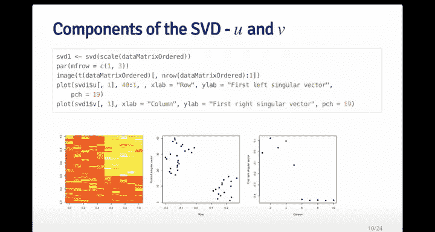

Another kind of a component of the singular value composition is known as the variance explained。

 and this comes from the singular values that are in the D matrix。

 remember the D matrix is really a diagonal matrix so it only has elements that are on the diagonal of that matrix。

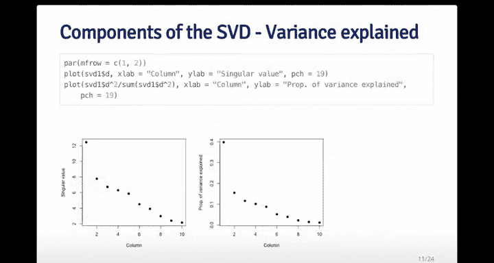

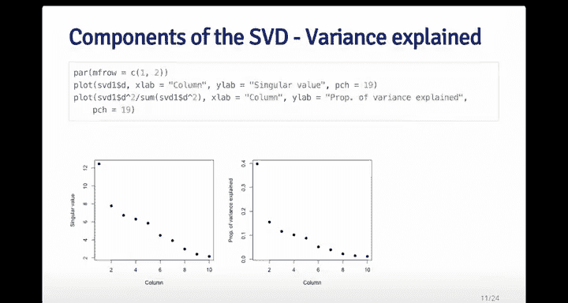

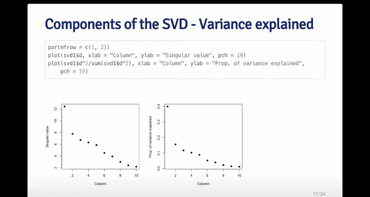

And you can think of each singular value as representing the percent of the total variation in your dataset set that's explained by that particular component。

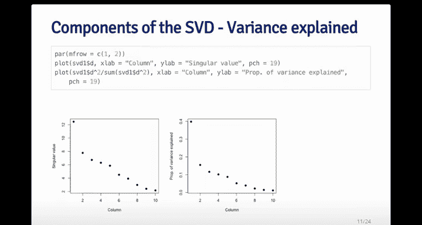

And so and the components are typically ordered so that the first one explains the most variation as possible and the second one explains the second most。

 etc ce， and so you can plot the kind of proportion of variants explained as we have in this plot below。

And so here on the left hand side， I've just plotted the raw singular values and you can see that they kind of decrease in value as you go across the columns。

 but of course， the raw singular value doesn't really have much meaning because it's on an interpretable scale。

 So if I divide by the total sum of all the singular values。

 then on the righthand side I I can interpret it as the proportion of variance explained。

 And you can see that it's exactly the same plot， but the y axis has changed and so you can see that the first singular value if you recall it captures kind of the shift in the mean in between the rows and the columns that captures about 40% of the variation in your data So almost half of the variation of the data is explained by a single kind of singular value or you can think of it as a single dimension。

And then the remaining variation of the data is explained by the other components。

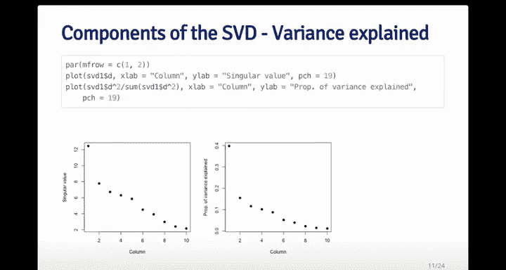

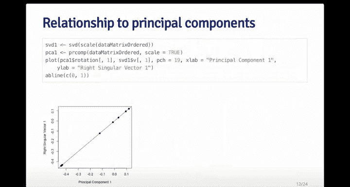

So just to show that the relationship between the singular value de compositionposition and the principal components is close。

 I hear I've plotted， I've calculated the SVD and the PCA of the same data matrix and I plotted the principal components on the x axis and sorry the principal component。

 first principal component on the x axis and the first right singular value vector on the Y axis and you can see that they fall exactly in the line that exactly the same things。

 so the SVD in the principal components and principal components analysis is essentially the same thing and so if you're in a cocktail party and you hear two people talking about the SVD and PCA you can rest assured that they're basically doing the same thing。

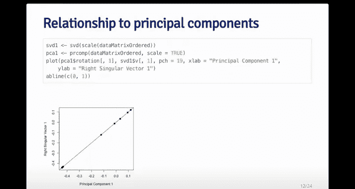

So we look we take a closer look at the variance explained here， I've got a very simple example。

 which is just basically a kind of a matrix that has either zeros or ones。

 And so the idea is that there's basically there's only one pattern in this matrix right。

 And so the first five columns are zeros and the second five columns are ones。 That's it。

 Nothing special。

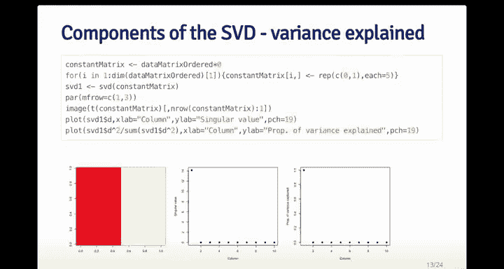

And so if I plot the data you can see that on the lefthand side。

 the left plot the first five are red and kind of the second five are yellowish white。

 So now if I take the Svd of this kind of relatively boring matrix。

 you can see that I can plot the singular values and you can see that there's one singular value is very high and the rest are all kind of zero basically and what you'll see is that the first singular value explains 100% of the variation in the data So how can that be well if you think about this data set。

 even though there is kind of40 rows and 10 columns， there's really only one dimension to this data。

 which is that if you're in the first five columns your mean you're equal to0 and if you're in the second five columns are' equal to1 So even though you have lots of so-called observations。

 there's really only a small fraction of information that's actually useful in this matrix and so that's captured by the SVD by the fact that you can explain 100% of the variation with a singular a single component。

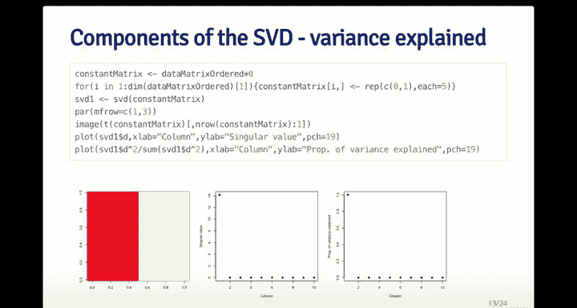

So let's add a second pattern to the dataset set so we can add a pattern that's of thats kind of goes across the rows and it also goes across the columns。

 And so one the first pattern is basically going be kind of a block pattern that we solve before。

 So the first and half the dataset is going to have one mean and half the data that' going to have another mean and the second column。

 the second pattern basically going to alternate between the columns。

 So you can see what that looks like over here。 So on the left hand side， that's the data。

 And you can see that there's there's one pattern and that's kind of like that's kind of a block pattern。

 So the left five columns are low and the right five columns are higher。

 and then you see that within that kind of nested within that is a kind of pattern that's kind of every other column And so every other column is one is higher than the other。

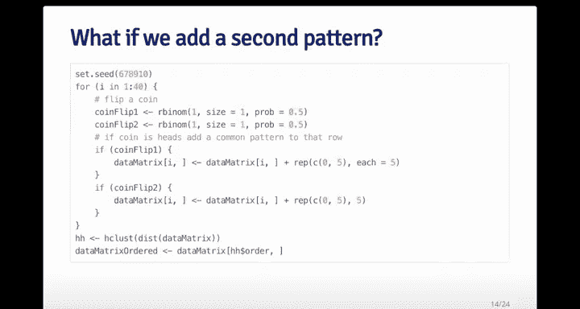

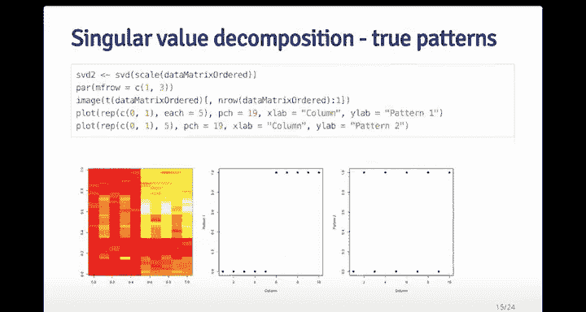

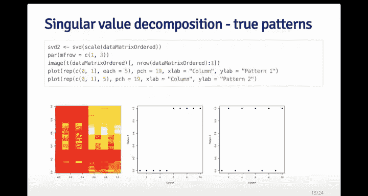

And so if we plot the kind of what the truth is， right we can see that in the middle plot here。

 the first five columns have a lower mean and the second five columns have a higher mean。

And that's the first pattern。 And the second pattern shows that the first column has kind of has a mean of0。

 the second column is a mean of1。 the third column has a mean of zero in the fourth column etc。

 So so there's two patterns here。 one is this shift pattern。

 And the second is this kind of alternating pattern。 So that's the truth。 So but of course。

 we rarely know the truth。 And so we need to learn the truth from the data。

 So if you the idea is that you were presented with the data that we've shown here on the left。

 can you come up with an algorithm that can pick up on the two separate patterns that are buried within the data。

 And so that's kind of what the SVD is for。

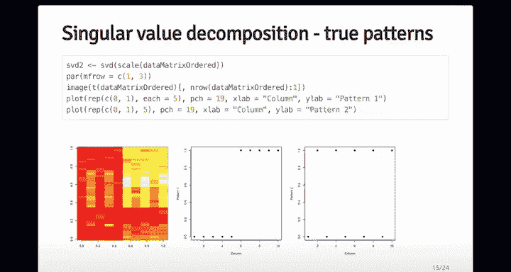

So if we run the SVD on this new matrix with the two patterns。

 I've got the data here on the left and in the middle panel here。

 I've got the first right singular vector and you can see it roughly picks up the block pattern right so the first kind of five are somewhat lower and the second five are somewhat higher so it's not as pretty as the truth was but it's somewhat discernible that there are two different kind of means here。

嗯。The second sorry， the second right singular vector is on the right hand panel here。

 And you can see that it's a little bit hard to see。

 but it does try to pick up the alternating mean pattern， right。

 It's not as obvious as it was when we were plotting the truth， of course。

 but you can see that every other point is either higher or lower。 Now， of course。

 since we know what the truth is， it's a little bit easier to kind of talk about this。

 but but in general you can see that the two patterns are roughly confounded to each other because a little bit hard to separate the two patterns apart。

 So even though they're clearly we know that the truth is two separate patterns。

 the first and the second right singular vectors are also known as the principal components they kind of mix the two patterns together。

 So each of them has a block pattern and each of them has a kind of alternating pattern。

 And so unfortunately just。

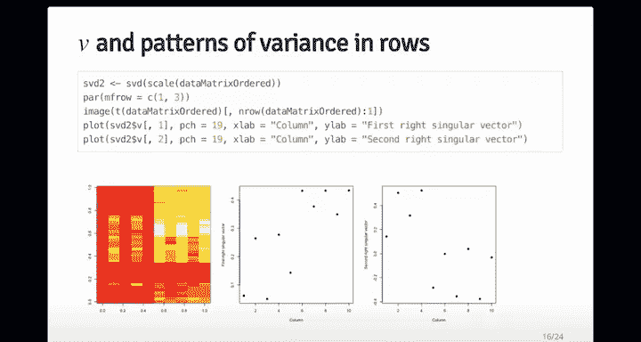

Just like with most real data， the truth is a little bit hard to discern than if you've known it in advance。

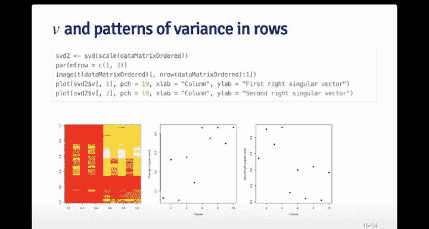

Now if you look at the variance explained in this problem， you can see that on the right hand panel。

 which is the percent of the variance explained that the first component explains over 50% of the variation。

 the total variation in the data and that's basically because the shift pattern with the first five columns。

 the second five columns is so strong it represents a large amount of variation in the data and so you capture that shift pattern。

 you kind of capture a lot of that variation， you can see the second component only captures about 18 or so percent of the variation and it kind of trails off from there。

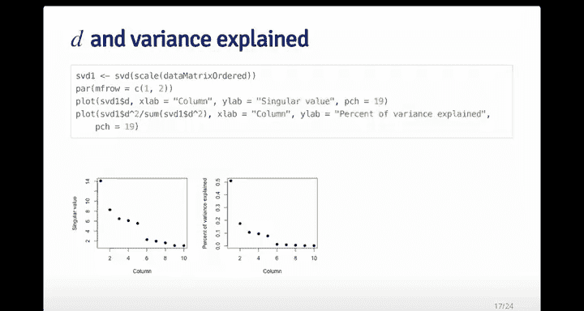

And so that kind of tells you roughly how many components are in this data set。

 but that alternating pattern， which of which is kind of every year of a column is a little bit harder to pick up as you can see。

