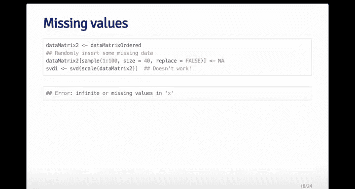
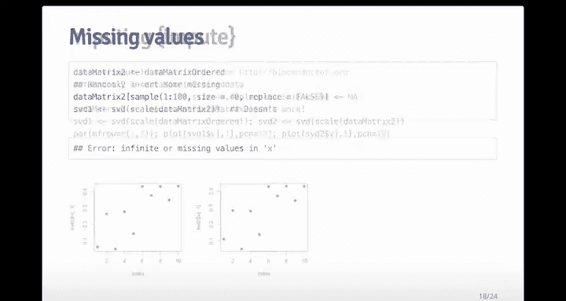
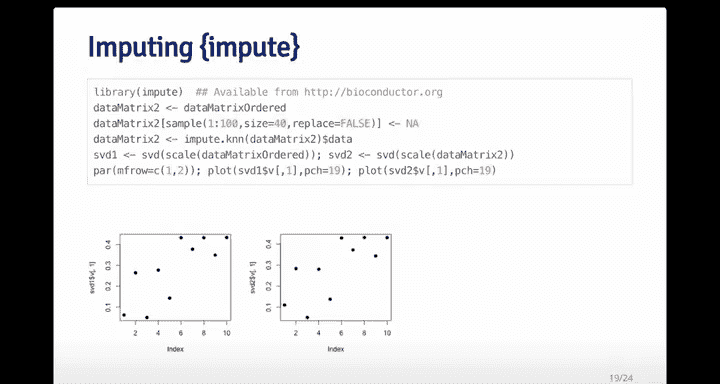
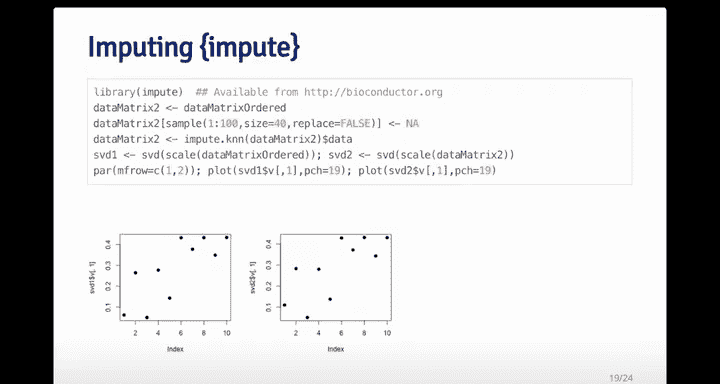
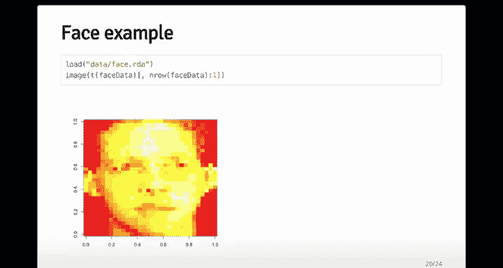
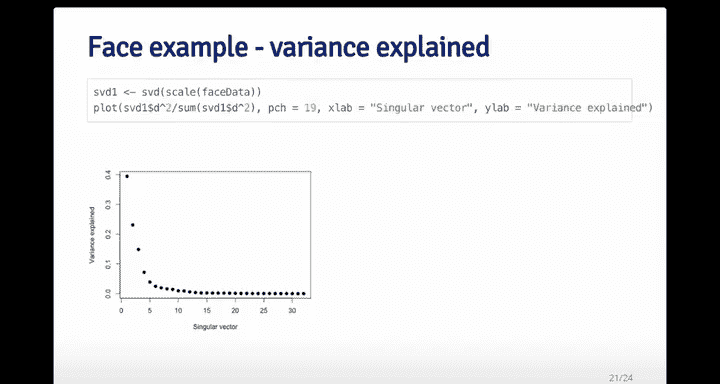
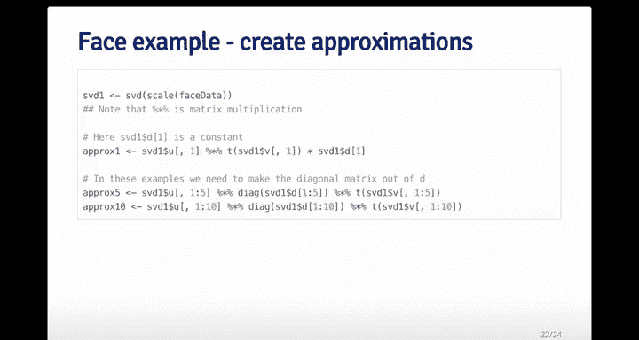
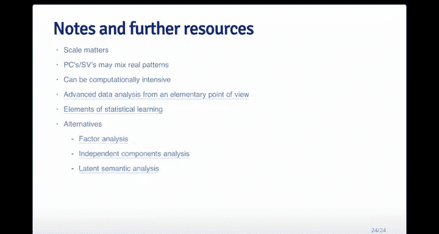
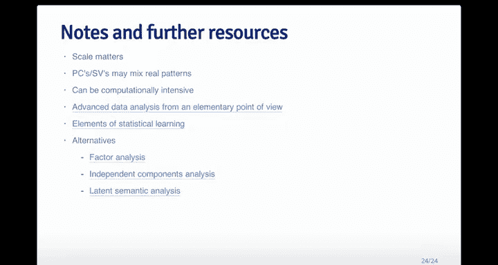
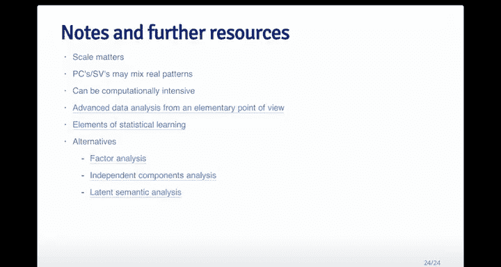

# 约翰霍普金斯大学《数据科学R语言基础｜Data Science： Foundations using R》中英字幕（deepseek - P129：29_降维第3部分.zh_en - GPT中英字幕课程资源 - BV1tsFQemEts

So one issue with either the SVD or principal components analysis is always missing values。

 so real data will typically have missing values and the problem is that if you try to run the SVD on a data that doesn't have or that has some missing values here that Ive created here。

 you can see that you get an error you just can't run it on a data that has missing values。

 so you need to do something about the missing values before you run an SVD or a PCA。

So one possibility and there are many others though。

 is to use the impute package which is available from the bioconductor project to just impute the missing data sorry the missing data points。

 and so that you can have a value there and then you can run your SVD and so this approach this code here uses the impute K andN function。

 which takes a missing row or missing values in a row and imputees it by the K nearest neighbors to that row so if k for example。

 is5 then it will take the five rows that are closest to the row with the missing data and then impute the data in that missing row with the kind of average of the other five。

And so once we've imputed the data with this imput do K and N function， we can run the SVD。

 You can see it runs with that error and and we can we can kind of plot the first singular vectors from each of them。

 So you can see that the。On the left hand side I've got kind of the first singular vector from the original data matrix and the second on the right hand side I've got the server singular vector from the data matrix that was kind of where the missing data was imputed Now you can see that they're roughly similar they're not exactly the same。

 but the imputation didn't seem to have a major effect on the running of the SPD。

So just this whole final example here is kind of an interesting example。

 I just want to show how you can take an actual image which is represented as a matrix and kind of develop a lower dimensional or a lower rank representation of this actual image。

 So here's a picture of a face it's a relatively low resolution picture of a face。

 but you can see that there is a a nose and ears and two eyes and a mouth there。😊。

And so what we're going to do is we're going to run the SVD on this phase data and look at the variance explain so you can see that the first singular vector explains about 40% of the variation。

 and then the second is about say 20 some percent and then the third one is about maybe 15% and so if you look at say the first 5 to 10 singular vectors。

 they capture pretty much all of the variation in the data set and so we can see we can actually look at the image that's generated by say the first singular vector or the first five or the first 10。

So we can take a look at that and so the idea is that we're going to use a little bit of matrix multiplication here to create an approximation to this face that uses fewer components than the original data set too you can so here I'm creating one that just uses the first principal or the first singular vector I'm using one that takes the first five altogether and then another one that takes the first 10 and so。

We can take a look at what this approximation looks like。 So the first image here。

 which is all within the left here， just uses a single singular vector。

 and you can see that it's not a very good it's not a pretty picture， so to speak。

 there's not really a face there。 There's not much you can see。

 but it's asking a lot for to represent an entire image using just a single vector。

So if we move on to the second one from the left， you can see that basically most of of the kind of key features already there。

 So this uses the first five singular vectors and you can see that clearly there's a face。

 there's two eyes a nose and a mouth and two ears。 It's not as not exactly the same as the original data set。

 but it's pretty close。 if you move on to the next picture， which is letter C here。

 you can see that it's a little bit has a little bit more definition。

 this is uses the first 10 singular vectors， and but it's not very different from the second one。

 which would only use five。 and then the very last one here on the right is the original data set。

 So you can see that if you go if you use just a few singular vectors， maybe up to five or 10。

 you can get a reasonable approximation of this face without having to kind store all of the original data。

 So this is an example of a kind of a data compression type of approach the singular value decomposition can can generate Now data compression and。

Statistical summaries are kind of two sides of the same coin。

 and so if you want to summarize a data set with a smaller number of features。

 the singular value de compositionposition is also useful for that。

So just a couple of notes and further resources for the singular value decomposition and principal component analysis。

 one of the issues is that the scale of your data matter， so if you have， for example。

 it's a common to measure lots of different variables that come on different scales and that can cause a problem because if one variable is kind have much larger and then another variable just because the units so different that will tend to drive the principal components analysis or the singular vectors and so that may not be particularly meaningful to you and so you want to look at see that kind of the scale of the different columns or rows are roughly comparable to each other。

As we saw in the example with the two different patterns。

 the principal components and the singular vectors may mix together real patterns。

 and so the patterns that you see may not represent kind of separable patterns。

 but they may be patterns that that are mixed together。

 The singular value de composition can be computationally intensive if you have a very large matrix。

 that's one that's something to keep in mind we use relatively small matrices here。 but of course。

 computing power is getting ever more powerful and there are some highly optimized and specialized matrix libraries out there for computing the singular value composition。

 And so this can be done on lots of kind of practical problems without too much kind of。

Planning in advance and so here are a couple links to kind of further resources for how to use principal components analysis and the singular value de compositionposition and also there are other kind of approaches that that are similar to this but are kind of different in some in many of the details you may hear about these approaches。

 things like factor analysis， independent components analysis and latent semantic analysis and these are worth exploring but are related to the kind of the basic ideas behind principal components analysis and singular value decomposition which is that you want to find the kind of lower dimensional representation that explains most of the variation in the data that you see。

