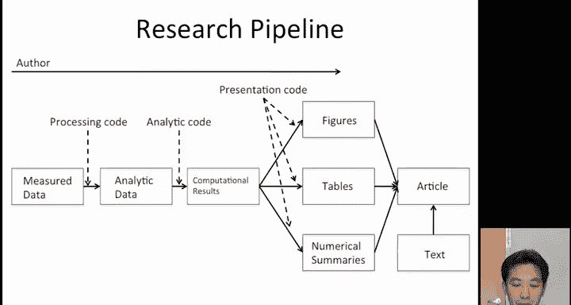
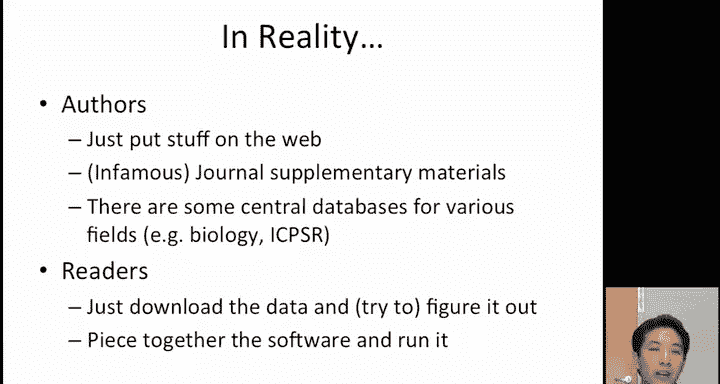

# 约翰霍普金斯大学《数据科学R语言基础｜Data Science： Foundations using R》中英字幕（deepseek - P139：3_可重复研究概念和思想第2部分.zh_en - GPT中英字幕课程资源 - BV1tsFQemEts

So the basic issue here is now is that you know when you read an article in the literature。

 a research article， for the most part what you get is the article and you as the reader get nothing else but of course you know everyone knows behind the scenes that theres a lot that went into this article。

 and that's what I call here the research pipeline。

And you can see here that on the left side here the author is kind of going from left to right along this research pipeline and then the you the reader is kind of going from right to left。

 so you read the article and you want to know more about what happened。

 where was the data what was used here and so the basic idea is behind reproducibility is to focus on this kind of analytic data and this computational results box here and so with reproducibility。

 we hope we try to allow the author and the reader to kind of meet in the middle so to speak。

There's been a lot of discussion of reproducible research in the media and in the scientific literature。

 the journal Science had a special issue on reproducibility and and data replication。

 there was a recent feature on the TV show 60 minutes looking at an incident at Duke University where many results were found to be not reproducible。

 and this led the to a large kind of controversial series of events where studies or clinical trials had to be stopped and a lot of investigation which is still ongoing had to occur Finally the Institute of medicine。

 in response to a lot of events involving reproducibility of scientific studies issued a report kind of setting out best practices or things that should be done to promote and encourage reproducibility。

 particularly in what's called omicsbased research releases like genomics proteomics。

Other types of areas， so this was a very important report and one of the many recommendations that they had。

 they recommended that things like data and metadata be made available that computer code be fully specified and so that people can examine to see what happened and then all the steps of the computational analysis be kind of described so that people can study it and reproduce it。

So what do we need for reproducible research So what is the definition。

 And I think there's a variety of ways to talk about this。

 But one basic definition that we've come up with is that the analytic data be available。

 So the data that we' used for the analysis that was presented This is different from the raw data because very often in a given analysis。

 the raw data are not are not all used for an analysis。

 but rather some subset is used Now it may be interesting to see the raw data。

 but it may be impractical to actually have it。 So the analytic data is key to examining a data analysis。

 the analytic code is also important， So this may be the code that look at that was applied to the analytic data and produced key results。

 So this may be regression modeling code and may be other types of things。

 documentation of that code and the data is very important， of course。

 and finally some standard means of distribution。 So it has to be easily accessible all this data in this code。

It's important to realize that there are multiple players when you talk about reproducibility。

 so there's different types of parties that have different types of interests so there's and roughly speaking。

 there are authors who produce research and they want to make their research reproducible and they need tools to kind of to make their lives easier to make their work reproducible and then there's also readers who are reading research and they want to reproduce that work and they also need tools to kind of make their lives easier so some of the challenges that are out there right now it's that authors of research have to undergo considerable effort to make their results available on the web so to publish data to publish code is not necessarily a trivial task and although there are a number of resources available now that were not available even five years ago。

 it's still a bit of a challenge to kind of get things out there on the web。Furthermore。

 once even if things are out there， readers have to download the data。

 they have to download look at the results， they have to download the code。

 they have to piece things together， usually by hand。

 and it's not always an easy task to put these things together furthermore readers may not have the same resources that the original authors did so if the original authors use an enormous computing cluster for example to do their analysis the readers may not have that same enormous computing cluster at their disposal so it may be difficult for readers to to do exactly reproduce the same results and then so and generally the toolbox for doing reproducible research is small。

 although it's definitely growing but it still there are a lot of needs so what happens in reality is that authors just kind of throw things up on the web there may be journal supplementary materials that are famously disorganized and there are only a few central databases where that authors can take advantage of to post their data to make their data available So if you're working in a field that。

hass a kind of essential database that everyone uses that's great。

 but if you're not then you're kind of out of luck Furthermoremore。

 the readers just end up just kind of downloading the data。

 putting the code together by hand and they have to kind of piece together the software and it can be difficult to do。

😊。

