# 约翰霍普金斯大学《数据科学R语言基础｜Data Science： Foundations using R》中英字幕（deepseek - P143：7_数据分析的结构第2部分.zh_en - GPT中英字幕课程资源 - BV1tsFQemEts

In this lecture we're going to continue the data analysis example that we started in part one if we recall we laid down have a list of steps that generally one might take when doing a data analysis and previously we talked about the first roughly half of these steps and in this lecture we're going to talk about the remaining half。

 so this includes exploratory data analysis statistical prediction and modeling， interpretation。

 challenging your results， synthesizing and writing up the results and creating reproducible code。

So if you recall， the basic question was， can I automatically detect emails that are spam or not？

And more a slightly more concrete version of this question that can be used to translate into a statistical problem was。

 know， can I use quantitative characteristics of the emails to classify them as spam or ham？

So our data set again was from this UCI machine learning repository。

 which had already been cleaned up and it was available in the current lab package as a data set。

 so this data had 4，600 observations or emails， that had been kind of characterized along 58 different variables。

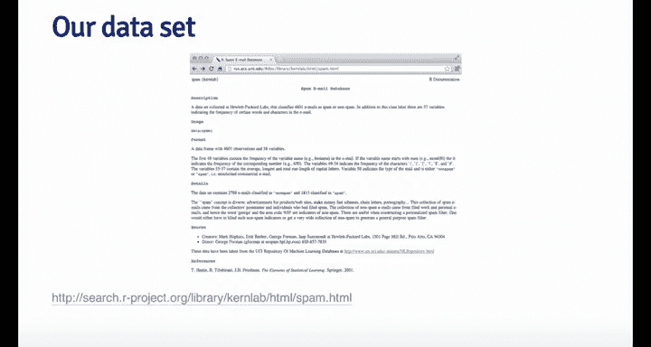

So the first thing we need to do with this data set if we want to build a model to kind of classify emails into spam or not is that we need to split the data set into a test set and a training set。

 so the idea is that we're going to use part of the test of the dataset to build our model and then we're going to use another part of the data which is independent of the first part to actually determine how good our model is at kind of making the prediction so here I'm taking a random half of the data set so I'm using I'm flipping a coin with the Rbinome function to generate a random kind of coin flip with probability a half so that it'll separate the the data set into two pieces so you can see that roughly 2314 or' going be in one half and 2287 it will be in the other half。

And so the training set well one set and the test set will be another。

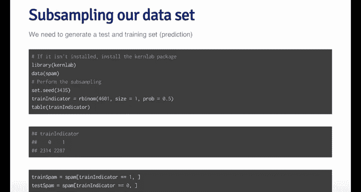

Said a data。So the first thing we're going to want to do is a little bit of exploratory data analysis we have not looked at this data set yet。

 and so it' would be useful to look at kind of what the data look like。

 what the distribution of the data， what are the relationships between the variables。

 things like that so we want to look at basic summaries。

 one dimensional two dimensional summaries of the data。

 we want to check for is there any missing data， why is there missing data there is。

 create some exploratory plots and do a little kind of exploratory analyses。

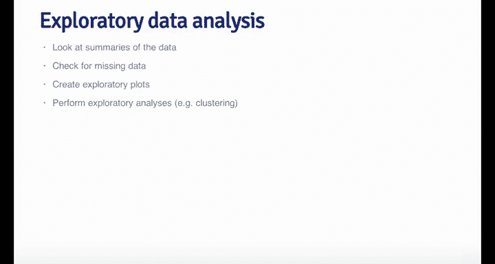

So if we look at the training dataset set， so that's what we're going to focus on right now as we do our exploratory analysis as we build our model。

 all that's going to be done in the training data set。

 and if you look at the column names of the data， you can see that they're all just words essentially and if you look at the first five rows we can see that basically these are the frequencies of which they occur in a given email so you you can see the word make does not appear in that first email and the word mail does not appear so things like that so these are all basically frequency counts or frequencies of words within each of the emails。

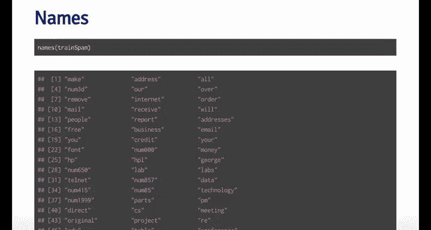

So if we look at the training data set and look at the outcome。

 we see that 906 of the emails are spaA are classified as spam and the other 1381 are classified as non spam。

 so this is what we're going to use to kind of build our model for predicting the spaAM emails。

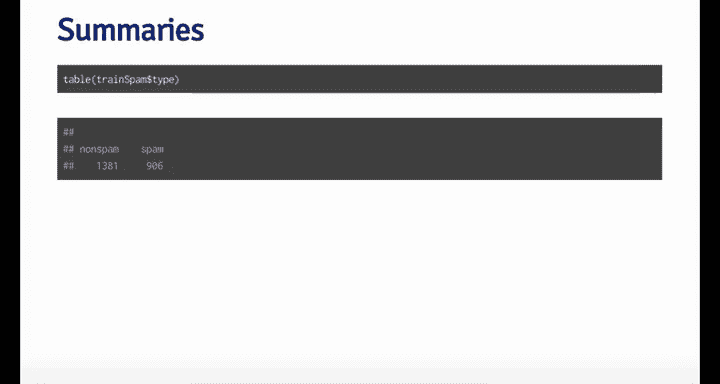

We can make some plots so we can compare， you know so what are the frequency the frequencies of certain。

Characteristics between the spam and the non spam email so here we're looking at a variable called capital A so the average number of capital letters and you can see that it's difficult to look at this picture because the data are highly skewed and so in these kinds of situations it's often useful to just kind of say look at the log transformation of the variable so here。

I'm going to take the base 10 log of the data or sorry the variable and compare them to spam and non- spam and since there are a lot of zeros in this particular variable taking the log of zero doesn't really make sense so we' just add one to that variable just so we can take a log and kind of get a rough sense of what the data look like typically you wouldn't want to just add one to a variable just because but since we're just exploring the data like making kind of exploratory plot it's okay to do that in this case so here you can see rather obviously that the spam emails have a much higher rate of these capital letters then the nonSm emails and if you've ever seen spam emails you're probably familiar with that phenomenon and so that's one useful relationship to see there。

We can look at kind of pairwise relationships between the different variables in the plots and here I've got a Parisis plot of a few of the variables and this is the log transformation of each of the variables and you can see that some of them are correlated。

 some of them are not particularly correlated and so that's useful to know。

So we can explore the predictor space a little bit more by doing a hierarchical cluster analysis and so this is a first cut at trying to do that with the H cluster function in R。

 and you can see I've plotted the dendrogram to see kind of what predictors or what words or characteristics tend to cluster together and it's not particularly helpful at this point although does separate out this one variable capital total。

 but if you recall that the clustering algorithms can be sensitive to any skewness in the distribution of the individual variable。

 so it may be useful to redo the clustering analysis after a transformation of the predictor space。

So here I've taken agged base 10 log transformation of the predictors in the training dataset and again I've added one to each one just so to make to avoid taking the log of zero and you can see that it's a little bit more interesting。

 the dendgramite that is is separated out a few clusters this capital average is one kind of cluster all by itself there's another cluster that includes you will or your and then there are a bunch of other words that kind of lump more ambiguously together and so this may be something worth exploring a little bit further if you see some particular kind of characteristics that are interesting。

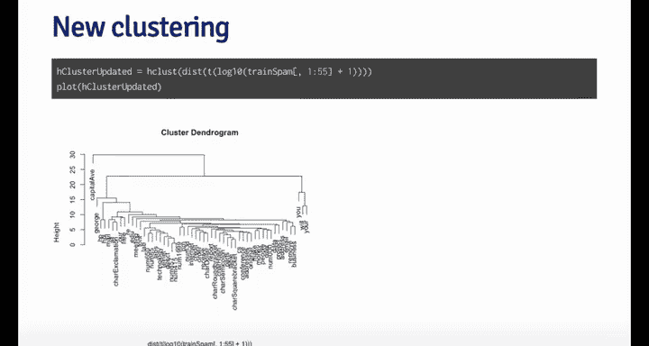

So once we've done exploratory data analysis， we've looked at some Uniivariate and bivariate plot。

 we did a little cluster analysis， we can move on to doing a more sophisticated statistical model and some prediction modeling and so any statistical modeling that you engage and should be informed by your kind of question that you're interested in。

 of course， and the results of any exploratory analysis。

 the exact methods that you employ will depend on the question of interest。

 and when you do statistical model you should account for the fact that the data have been processed or transformed。

 if they have in fact been so， and as you do statistical modeling。

 you always think about what are the measures of uncertainty。

 what are the sources of uncertainty in your data。

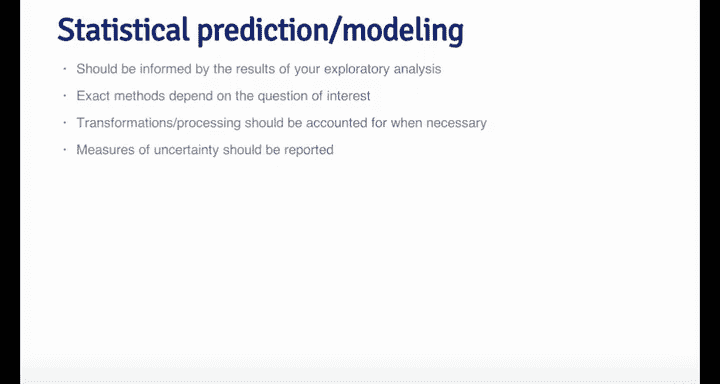

So here we're going to just do a very basic statistical model what we're going to do is we're going to go through each of the。

Variables in the dataset and try to fit a generalized linear model in this case。

 a logistic regression to see if we can predict whether an email is spam or not by using just a single variable so here using the reformulate function to create a formula that includes the response which is just the type of the email and one of the variables in the data and we're just going to cycle through all the variables in this data using this for loop to build a logistic regression model and then subsequently calculate the cross-valated error rate of predicting spam emails from a single variable and so if you run this loop in R and may take a little bit to run it won't but because it has to loop through all the variables to fit all the models。

So once we've done this， we're going to try to figure well， which of the individual variables。

Has the minimum crossvalated error rate and so we can just go we can take this vector of results。

 the CV error and just figure out which one is the minimum and it turns out that the predictor that has the minimum crossvalated error rate is this variable called char dollar which is an indicator of the number of dollar signs in the email so just keep in mind this is a very simple model each of these models that we fit only has a single predictor in it and so of course we could maybe think of something more complicated。

 but this may be an interesting place to start。

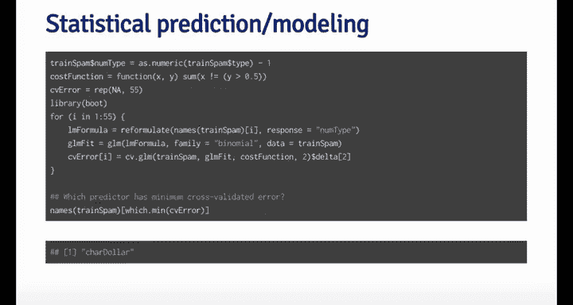

So if we take this best model from this set of 55 predictors。

 this is this char dollar variable and I'll just refit the model again right here and so this is a logistic regression model we can actually make predictions now from the model on the test it so we' going gonna recall that we split the data into two parts and we built the model on the training data set and so now we're gonna to predict the outcome on the test data set to see how well we do and so in a logistic regression。

 we don't get specific predictions out of01 classifications of each of the messages we get a probability that a message is going be spam or not and so then we have to take this continuous probability which ranges between 0 and1 and determine at what point at what cutoff do we think that the email is spam and so we're just going to draw the cut off here at 0。

5 so if the probability is above 50% we're just going to call it a spam。疫苗。

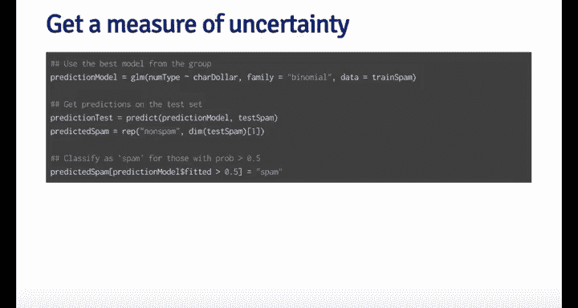

So once we've created our classification， we can take a look at the predicted values from our model and then compare them with the actual values from the test data set because we know which was spam and which was not and here is the classification table that we get from the predicted and the real values so we can just calculate the error rate and so the mistakes that we made are on the off diagonal elements of this table。

 so 61 and 458， so 61 were classified as spam that were not actually spam and 458 were classified as non- spam but actually were spam and so if we calculate this error rate it's about 22%。

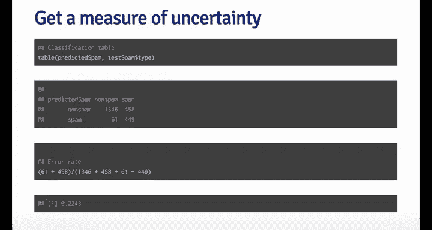

So now that we've done the analysis， we've calculated some results。

 we' calculated our kind of best model， we've looked at the error rate that's produced by that model。

So now we need to interpret our findings and it's important when you interpret your findings to use appropriate language and to not be to not use language that goes beyond the analysis that you actually did and so you want to be in this type of application where we're just looking at some data we're building a predictive model you want to use words like prediction or correlates with or certain variables may be associated with the outcome or the analysis is descriptive and so just to think about carefully what kind of language you use to interpret your results it's good to give an explanation so if you can think of why certain models predict better than others it'd be useful to kind of give an explanation of what you think that is if there are coefficients in the model that you need to interpret if you can do that here and in particular it's useful to bring in measures of uncertainty to kind of calibrate your interpretation of the final results。

So in this example we might think of stating that the fraction of characters that are dollar signs can be used to predict of an email spam。

Maybe we decide that anything with more than 6。6% signs is classified as spam。

 more dollar signs always means more spam under our prediction model and for our model in the test data set。

 the error rate was 22。4%。So once you've done your analysis and you've developed your interpretation。

 it's important that you yourself challenge all the results that you've found because if you don't do it。

 someone else is going to do it once they see your analysis。

 and so you might as well get one step ahead of everyone by doing it yourself first。

 and so it's good to challenge everything the whole process by which you've gone through this problem。

 the question itself， is that is the question even a valid question to ask where the data came from。

 how you got the data， how you processed the data， how you did the analysis and any conclusions that you drew。

If you have measures of uncertainty are those the appropriate measures of uncertainty。

 and if you built models， know why is your model the best model。

 why is an appropriate model for this problem， how did you choose the things to include in your model so all these things are questions that you should ask yourself and should have a reasonable answer to so that when someone else asks you。

 you can respond in kind。And also it's useful to think of potential alternative analyses that might be useful。

 that doesn't mean that you have to do those alternative analyses in the sense that you might stick to your original just because of other reasons。

 but it may be useful to try alternative analyses just in case they may be useful in different ways or may produce better predictions。

Once you've interpreted your results， you've done the analysis， you've interpreted your results。

 you've drawn conclusions， you've challenged all your findings。

 you're going to need to synthesize the results and write them up so synthesis is very important because typically in any data analysis。

 they're going be many， many， many things that you did and when you present them to another person or to a group you're going to want to have to winnow it down to the kind of most important aspects and to tell a coherent story and so typically you want to lead with the question that you were trying to address that people understand the question then they can draw a context in their mind and kind of have a better understanding of the framework in which you're operating and so that will lead to what kinds of data are appropriate for this question what kinds of analyses would be appropriate and so you can summarize the analysis as you're telling the story。

 it's important that you don't include every analysis that you ever did。

 but only if it's needed for kind of telling a coherent story。

It's useful to sometimes keep these analyses in your back pocket though。

 even if you don't talk about it because someone may challenge what you've done and it's useful to say。

 well， you know， we did do that analysis， but it was problematic because of whatever the reason may be。

It's important to order the analyses that you did according to the story that you're telling and often that order is not the same as the order in which you actually did the analysis so it's usually not that useful to talk about the analyses that you did kind of chronologically or the order in which you did them because the order in which you did them is often very scattered and kind of doesn't make sense in retrospect so talk about the analyses in of your data in the order that's appropriate for the story that you're trying to tell and when you're telling the story or you're presenting to someone or to a group it's useful to include kind of very well done figures so that people could kind of understand what you're trying to say in one picture or two。

So in our example， the basic question was you know can we use quantitative characteristics of the emails to classify them as spam or ham。

 our approach was rather than try to get the ideal data set from all Google servers because we collected some data from the UCI machine learning repository and created training and test sets from this data set we explored some relationships between the various predictors。

 we decided to use a logistic regression model on the training set and chose our kind of single variable predictor by using crossvalidation。

 when we applied this model to the test set， it was 78% accurate。

So the interpretation of our results is that basically more dollar sign seemed to indicate that an email was more likely to be a spam and this seemed reasonable we've all seen emails with lots of dollar signs of them trying to sell you something and so this is kind of both reasonable and understandable of course the results were not particularly great a 78% test set accuracy is not that good for most prediction types of algorithms and we probably could do much better if we included more variables or if we did or we included a more sophisticated model maybe a nonlinear model and for example why did we use logistic regression we could have used a much more sophisticated modeling approach but anyway these are the kinds of things that you want to outline the people as you go through data analysis and you present it to other people so finally the thing that you want to make sure of is is that you document your analysis as you go you can use things like tools like our markdown and knitter in our studio。

To kind of document your analyses as you do them and so you can preserve the our code as well as any kind of a written summary of your analysis in a single document using knitter and to make sure that all of what you do is reproducible by either yourself or by other people because ultimately that's the standard by which most kind of big data analysis will be judged if someone cannot reproduce it then the conclusions that you draw be will be not as as worthy as one as an analysis where the results are reproducible so try to stay organized。

 try to kind of use the tools reproducible research to keep things organized and reproducible and。

And that will make the evidence for your conclusions much more powerful。

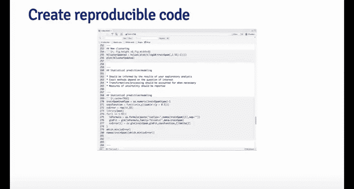