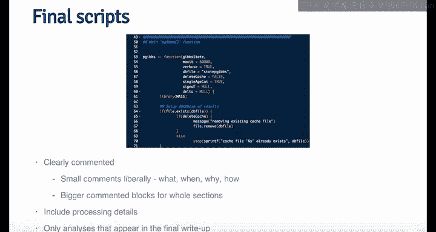
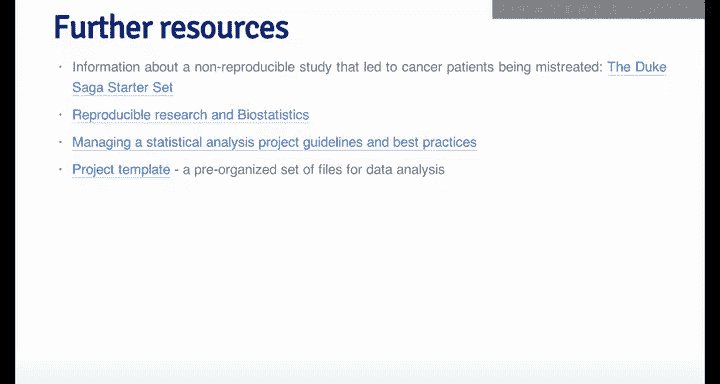

# 约翰霍普金斯大学《数据科学R语言基础｜Data Science： Foundations using R》中英字幕（deepseek - P144：8_组织你的分析.zh_en - GPT中英字幕课程资源 - BV1tsFQemEts

In this lecture， I'm just going to give a couple of basic notes on how to organize the data analysis Of course there's no universal way to do this that would apply to every single data analysis performed by anybody in the world。

 but I think there's some useful tips that can be used to help you kind of put things together to put things in logical places and ultimately you want to ensure that your data analysis is reproducible either by yourself or by someone else。

So if we were to kind of boil down what are the kind of the key data analysis files that you will probably retain and over the course of a major project。

 of course there's going to be some data， there's going to be raw data and there's going to be process data and you're probably going to want to save a lot of this in various places。

 you'll probably generate some figures or tables， for example。

 and there are going to be a kind of exploratory figures that you just kind of put together to look at the data to kind of produce this rough cut of what the data analysis might look like。

These exploratory figures are not going to be very polished。

 They're just going to kind be just good enough to going to get you a sense of what the data look like。

 Then there might be some final figures。 these final figures are going to be useful for you to put in reports you're going to show them to other people they're going to be well annotated kind of nicely organized and put together Of course there's going to be some code there might be some R code in the form of both raw and unused scripts so these are kind of things that you just kind of code up to see what's going on maybe in the process of making exploratory figures there's going to be R code that you eventually don't use in the end so you'll have some scripts lying around there will be some final scripts that you use in the final analysis and these will be a little hopefully easier to read maybe some commented and formatted better and then you might be writing some R markdown files that kind of annotate a data analysis using a kind of statistical analysis style and finally there's going to be some text that you write either in the form of readme files that explain what's going on in your project there might be a more formal report that you have to write。

In a paper that you plan on publishing， so all this text is going to kind of integrate everything that you've done in this data analysis with the data。

 the figures， the tables and the R code。So the raw data will come in any number of different forms they might come。

 for example， as just records or kind of formatted texts like you have here and you're going to do something to this raw data to kind of make it usable from a analysis type of program so for example。

 in this particular type of data you might do some text processing you might try to parse the data it's formatted in a special format and so that you can generate something that can be later used for modeling or other types of analysis and so you want to store this raw data in in your analysis folder you're working on a project and。

If the data were accessed from the web， you want to include things like the URL。

 where you got the data， what the data set is and kind of a brief description of what it's for。

 the date that you access the URL on the website and you might want to put this in like a readme file so when you look at it later or someone else looks at they know of where this data came from and what it's for Another thing that I like to do if you're using Git or equivalent and version control system to to track things that are going on in your project you can add your data set your raw data if it's possible if it's too big then it's not really feasible。

 but you can add your raw data to the repository and in the log file sorry in the log message when you add it you can talk about what the website was when you got it and what the URL URL was etc。

 And so that's sometimes a convenient place to put this kind of information。

Process data usually is a little bit as cleaner than the raw data it can come in a variety of forms。

 one possibility is as a table， so here you can see there this is a kind of classic data table with rows and columns process data should be named so easy to see you can name the files so it's easy to see kind of what script generated what data and so the process script is very important because it shows you how the raw data were mapped to the process data and so in any Readme file or any sort of documentation it's important to document what files。

 what code files were used to transform the raw data into the process data and finally the process data should be tidy so that you can use them in subsequent modeling or analysis types of functions。

Expllororatory figures are usually very simple figures these are figures that you kind of make in the course of your analysis as you're kind of getting a look at the data typically your data will be high dimensionional and because you'll be collecting lots of variables on lots of subjects or observations and so you're going gonna to be able to look at pieces of the data at a time and so exploratory figures serve the role of kind of giving you a quick look at various kind of aspects of your data of various cuts and so they're not all necessarily going to be part of your final report or final paper and and you so you'll tend to make a bunch of these along the way they don't need to be pretty but they need to be usable enough so that you understand kind of what's going on in the figure and how to reproduce it。

Final figures will generally be much more polished。

'll be better organized and better kind of much more readable So here you can see is a figure that's a four panel plot。

 it's not a single panel so' cramming in a lot more data into this type of four panel plot and the final figures usually make a very small subset of the set of exploratory figures that you might generate so for example。

 the typical paper in a journal or something like that might have for or maybe five figures in it because these figures take up a lot of space you typically don't want to inundate people with a lot of figures because then the kind of ultimate message of what you're trying to communicate will tend to get lost in these kind of pile of figures and so it's important to have these figures that are kind of labeled well and annotate so people understand what's going on with the data。

As you're doing a data analysis， you'll probably burn through a lot of different R scripts code files for various purposes。

 there'll be a lot of dead ends kind of that you'll go down and maybe they won't be that useful so there will be a lot of R scripts that kind of don't play into the final analysis and so these R scripts are going to be kind of less commented and maybe just kind of code that kind of puts some stuff together you may have multiple versions of these code files and typically will include analyses that are later discarded。

Final scripts will be much more clearly commented you have maybe bigger comment blockss for whole sections of code。

 there'll be lots of small comments kind of explaining what's going on any processing details any code that's used to kind of process the raw data be important to include and basically these final scripts you want to clean up so they for any analysis that would appear in a final write up or paper and so it's important when people see a final product like a paper or report that they understand you know what scripts went into this report and both processing and kind of analysis scripts might have gone into this so they know they can see the kind of the chain of events that occurred it's important of course to keep a lot of the other stuff that was not use in the final report just in case someone may want to look at some of the dead ends that you went down。

 but that can be placed in a separate part of the project directory。

Our markdown files are also very useful， they may not be exactly required。

 but it can be very useful to kind of summarize parts of analysis or an entire analysis itself our markdown files can be used to generate reproducible reports because you can embed code and text into the same document and then you process the document into something readable like a webp page or a PDF file these are very easy to create in our studio and they can be useful as a kind of either immediate step kind of something in between just kind of code scripts。

 code files and data and a polished final report。ReadMe files are really useful because they kind of explain what's going on inside your project directory if you use our markdown。

 you may not need them because the markdown file will typically document what's going on in a given file that's the idea behind literate programming or literate statistical analysis is you don't separate the documentation and the code and the data in separate little pieces rather you try to integrate them all in a single file however。

 if you don't use our markdown files you may want to have Readme files that explain what's going on so you can see kind of so that you or another person can get a sense of the organization of the project they could contain step bystep instructions for how the analysis conducted what code files are called first。

 what are used to process the data， what are used to fit models and what are used to kind of generate figures things like that so ReadMe files are really useful for explaining kind of what's going on。

Finally， in the end， you'll probably produce some document or a report。

 maybe a paper or a summary of all the analysis that you did and kind of and the point of this is to tell the final story of what you generated here and typically you'll have a title an introduction that kind of motivates your problem the methods that you used the results and any measures of uncertainty and then any conclusions that you might draw from the data analysis that you did。

 including any pitfalls or potential problems important things that you need to tell a coherent story and so you need to do take all the analysis that you did and kind of winn it down into a final product that has a coherent story to it you definitely should not include every analysis that you perform through the whole process so there many maybe many analyses that you did but you want to be able to kind of narrow it down to the important parts It does that mean that you need to delete everything that you ever did but the summary report should not include everything and you should always include some references for these statistical methods that you use so that would people know of what you。

WhatMaybe what software you use， what implementation was used。

 and so this is very important for again， for reproducibility by others。

So that's a quick overview of how to kind of organize your data analysis just some basic it tip because every data analysis will have its specific details just a couple pointers here to things that you may be interested in first is a kind of a a set of links on a kind of case study of a non-reproducible study involving cancer cancer data and analysis and so we have a link to that there's an editorial in the journal of Bistatistics about the reproducible research policy so you can take a look at that and a couple of links to managing statistical analysis and from some kind of projects guidelines and best practices from other people and then of course there's a software package called Project template which is actually an R package that can be used to automate a lot of the kind of mundane aspects of a data analysis project so I'd encourage you to take a look at that too。

