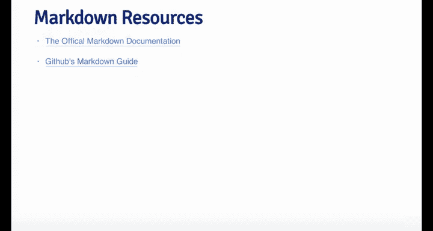

# 约翰霍普金斯大学《数据科学R语言基础｜Data Science： Foundations using R》中英字幕（deepseek - P146：10_Markdown.zh_en - GPT中英字幕课程资源 - BV1tsFQemEts

Markdown is a really useful language for creating documents without having to deal with a lot of the overhead and kind of complications of using standard markup languages。

 the idea behind markdown is that it's you know it's a simplified markup language and it really the goal is to allow you to focus on just writing your content and not have to worry about things like tags or other things like that。

 And so markdown you'll notice is very simple and we use it a lot here。

 all the slides for the course are written in markdown。

 and a nice thing about Markdown is that it's very easy to integrate it with our code and other programming languages。

 So in this lecture I'm going to talk about the very basics of markdown but of course beyond the basics actually there's not a whole lot。

 and so that's what makes markdown so nice。 And then once I'll just talk a little bit about kind the basic aspects and give you a few pointers and kind of where you can go to learn about more so。

So just to start off with Markdown is a text to HTML conversion tool for web writers Markdown allows you to write easy using an easy read easy to write plain text format and then convert it to structurally valid X HTML so the idea is that so the John grouper。

 the creator of Markdown wanted people to be able to focus on writing their content and not other kind of aspects。

And so the basic syntax' marked on is fairly simple for so you can。You can kind of format text。

 for example， with italics using the asterisks here， and then the text will be italicized。

 you can do things like create bold face with the double asterisk。

 and then the text will appear bold。You can create headings that are different sizes。

 so if you're familiar with HTML， you can think of this as H1， H2 H3。

 so the two hashes is a secondary heading， the three hashes is a tertiary heading。

 and then a single hash which I didnt here is like a main heading。

 a primary heading and so you can see that they're at different sizes here。

You can create very simple unordered lists by putting a little indicator there like a hyphen or an asterisk it doesn't really matter what the character is that you use there as long as it's kind of consistent across the list。

 so you can create an unordered list like this， but just starting it right away。

 there's no other formatting element， you can create an ordered list here by just doing one。

 two and3 and the truth is actually although it's a littles not immediately clear here。

 the numbering doesn't have to actually be in order。

 as long as you use a number as the kind of character kind of that indentense the line。

It will the markdown will create an ordered list and so if you decide that。

 oh you know you want to stick something in between one and two。

 you don't have to renumber every element on the list。

 you can just stick another item there under the first item and it could be another one or it could be a four or it could be any number。

 the numbers don't have to be in order， but when you process the document markdown will automatically order the list in the right way。

You can of course put links into a document this is very important if you're creating web documents and there are two ways to create links the first way I've got here puts the text in square brackets and then immediately following that put the URL in parenthesis so here I can see Johns Hopkins Bloomberg School of Public Health and the URL is right next to it and then download R with the our website right next to that and then it'll be formatted in an HTML document in the usual way the text will be highlighted and underlined。

The other way to create links in a markdown document is to put the again the text in square brackets and then and right next to it in square brackets put a number。

 which is going to be like an identifier for that link and then later on perhaps at the bottom of the document you can put the actual URL for the link that you meant so number one here is for our bloggers and at the bottom of the document I might put on number one and then the our bloggers URL and then the second link here is for simply statistics so for number two。

 I put the simply statistics URL the basic idea with this type of linking is that it makes the text in your document a little bit cleaner and easier to read especially if you have very long URLs and you don't necessarily want to put all these really long URLs in the document so it makes it hard to read this makes it a little bit easier to read while you're editing the document and puts all the links down at the bottom。

Lastly， new lines can be created in the text document by just putting a double space at the end of a line。

 so I just do first line， second line like this which is with no space after the first line。

 all the lines will run together like that， but if I put two spaces after the first line that you'll get a new line put in between so that's gonna be an easy gotcha that can be people newly coming to markdown will often discover so that's just a really really quick overview of markdown here some basic resources of the official markdown documentation on John Gruber's website is very easy to read it's relatively short you'll be able to learn it within minutes and you already know most of it just by looking at this lecture and then GiHub has its own kind of markdown flavor。

 which a few kind of enhancement so if you're gonna to be using GitHub and documenting things in Gitthub and might be useful to check out their markdown guide。

