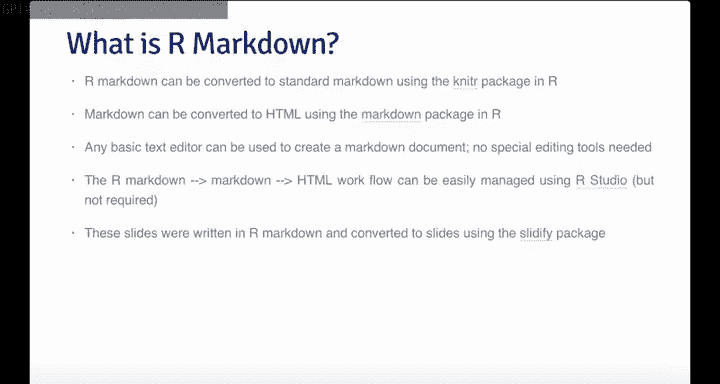

# 约翰霍普金斯大学《数据科学R语言基础｜Data Science： Foundations using R》中英字幕（deepseek - P147：11_R Markdown.zh_en - GPT中英字幕课程资源 - BV1tsFQemEts

This lecture is going to be about R markdown。 It's going to be a very short and just description of what this is because I talk about it in a little bit more detail when I talk about reproducible research。

 So the basic idea behind R markdown is that you want to have R code integrated with a simple language that can be used to kind of create documents and so the coupling is going to be the R language with the markdown language so。

First of all， what is markdown。 So markdown is a very simple kind of markup language a play on the word markup language。

 And the idea is that the markdown is designed to help you focus on actually writing things so we think about if you're experience with languages like HTML or latex or some of these or Xml or some of these other things one of the things that you notice is that you spend a lot of time thinking about the formatting and thinking about everything else except the actual content that you're trying to produce and so the basic philosophy behind markdown is to create a language that allows writers to do writing basically And so if you look at mark analytics it's very different from other types of kind of mark up languages like Xml or HTML or lateEx And so there are just very simple。

 very minimal kind of intuitive formatting elements， things like boldface and sections and lists。

 so the kinds of things that you would typically need in a basic document， but not the very fancy。

Things that you might have， but one of the advantages of Markdown is that you can insert kind of arbitrary HTML element so if you're familiar with HTML and you want something that's specific or particular and there isn't a basic markdown formatting element for you can just put some HTML in in the worst case scenario so one of the nice things about Markdown is that easily converted into HTML there are tool chains out there and let you take markdown and in fact converted into many different formats HTML just being one of them so you can get a lot of information at the website of John Gruber where he has a lot of documentation for Markdown and a little bit of background kind of how this project evolved。

So。So that was markdown。 What is R markdown。 So R markdown is basically the coupling of R code in a markdown document。

 So the idea is that if you want to embed R code in a document that's written in markdown you use R markdown and basic idea is that it's going to look a lot like a standard R I'm sorry a standard markdown document but there's going to be R code sprinkled in and what are called code chunks。

 and the code chunks will be denoted by a special formatting tags。

 which I'll show you in a little in a minute。 So when you integrate R code with markdown。

 that's an R markdown document， typically it has the RMD extension。

 And so the nice thing about using R markdown is it allows you to insert essentially live R code into a markdown document。

 So when you process the markdown document to create your HTML or your P ultimate format you can evaluate the R code as part of the processing for markdown。

 And so you know that the code。In the document， if you're trying to demonstrate a tool or you're trying to maybe show some data or whatever it would be。

 you know that the code works in the document because in order for the document to be produced in the first place。

 the code had to be executed and evaluated and run and so everything in the document。

 any code that you see in a document you know will work because it it had to work to create the document。

 So that's one nice thing about being able to embed live R code in a document that you can ensure a certain level of validity of the R code。

 So the basic idea is you you can evaluate our code the results of the R code is inserted into the markdown document and our markdown is a core tool and what's known as literate statistical programming and we'll talk about much more when we talk about reproducible research But for now it's important to just think of our markdown as a way to put our code in a document。

So you can evaluate R markdown documents using the knitter package in R so the knitter has a knitter essentially reads an R markdown file。

 evaluates all the R code in it it kind of sticks in the results of the R code and then write out a markdown file Now that markdown file can be converted into HTML using the markdown package in R and so so there's a kind of an extra step of the pipeline here。

 if you were just going to write markdown you can just convert that to HTML right away。

 but if're going to write R markdown， then you need to use something like knitter to kind of evaluate the R code。

 create the markdown document and then bring it to an HTML file。

So the near package and the markdown package are important for this any basic text editor can be used to create a markdown document or in our markdown document that's one of the nice features。

Of this type of markup language is that you don't need any fancy editors to visualize what you're trying to write。

 You can use any old text editor and it will be fine。 you don't need any special editing tools。

 So the basic workflow that you're going to use if you write in R markdown is you write in your basic your core document is R markdown file so it has markdown formatting elements and it has R code in it and then you convert that into a markdown file using the knitter package and then you take that markdown file。

 which is essentially an intermediate file that you're not going to edit this file and you would take that markdown file and you convert to HTML using the markdown package and then HTML is kind of what you would view in your browser or other viewer So now the key elements of all this is that don't you never edit the intermediate or final product So you never edit the markdown file and you never edit the HTML file the only file that you ever gonna edit is the R markdown file which has the kind original R code and original markdown。

The whole workflow is very easily managed if you're using something like ourSt。

 ourSt has knitter and Markdown integrated into it and furthermore even has a little web browser built in so you can actually view the final product if you're using RSt and I'll show a little demonstration of how to do that in ourSt and just as one very quick example the slides that you're looking at right now they were written in R markdown of course there's no R code in here so it's more or less just plain markdown but I build these slides using the slide to5 package which calls knitter and the markdown packages to convert them into HTML so can there's a lot of flexibility when you're using a format formatting language like R markdown or just markdown because you can convert them into a lot of different other presentation styles。

😊。

