# 约翰霍普金斯大学《数据科学R语言基础｜Data Science： Foundations using R》中英字幕（deepseek - P148：12_R Markdown演示.zh_en - GPT中英字幕课程资源 - BV1tsFQemEts

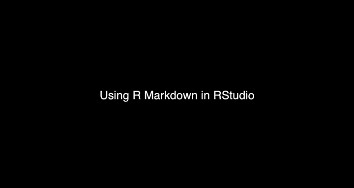

So this is just going to be a quick demo on how to create and edit a R markdown document。

 So you can see I've got our studio launched here and nothing's open。

 So I'm just going to start up create a new document in R markdown。

 So I can go to the menu here and there's a couple of options of different types of files you can open So I'm going to create an R markdown file。

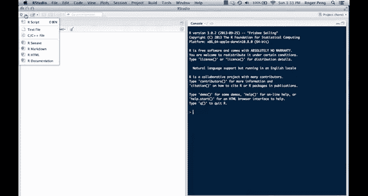

And you can see that actually it starts writing our studio actually populates the document with a little bit of kind of filler material just to get you started。

 So in case you're not familiar with markdown， you can see a little bit of how it's done。

 So let me just show you the whole thing here。 And I think the easiest thing to do right now we can just knit this document so we can run the document through knitter it's going to run the R code It's going produce the markdown file it's going convert the markdown file HTML and launch it in our studioio's little web browser So why don't we just click on the knit HTML button。

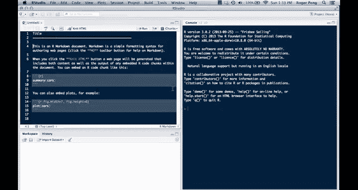

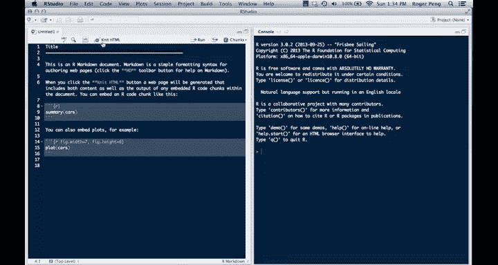

And see what happens。Oh， so I first have to save this file， so I'll just call it Markdown demo。

And I'll use the file extension RMD， which is traditional， but not necessary。

You can see it's running the processing the file and it produces this nice HTML output so you can see it matches the title。

 it has the text it' just plain text the R code is put in the gray boxes and the output from the R code is right below it there's more R code here which is the plot and you can see that the plot just appears right here so so it's nice in that this document here which only has R code and it can be evaluated and the output can be embedded inside。

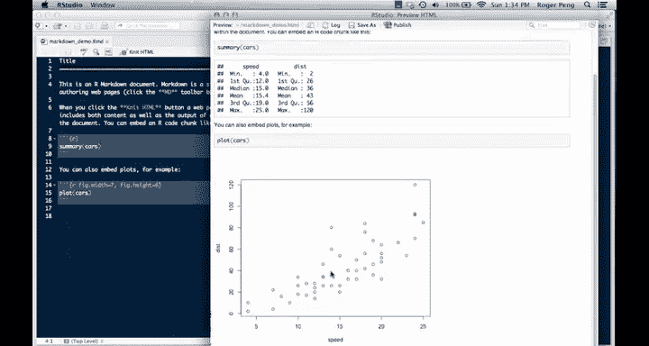

The output document without you having to create a plot separately and then kind of include it。

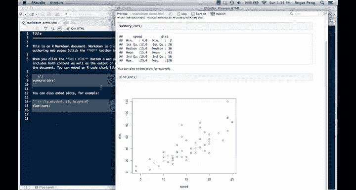

And you get a nice document like this。 So， but this obviously is not the document that we wanted to write。

 So the first thing you're going to have to do， typically is just tose everything here。

 So the first thing you want to do is probably start to put some sort of title in。

 So you can say call it something like my first our markdown file。

And if you put this kind of equal sign under here， that'll make it look like a title。 And then。

 And if you can add some text here， This is my。First。Our markdown file。Here is。

We're going to load some data。And then here I'm going to add some R code yet。

 I want to load some data to either plot it or maybe fit a model。

 So the first thing you want to do is three back ticks here。And with the curly braces。

 you can wrap the letter R in curly braces， the lowercase R。 Next。

 see how the highlighting change a little bit in the editor。 So now I'm gonna be writing R code。

 right So maybe the first thing I want to do is load， Ill load the air quality data set from R。

 which is a very basic data that has data on ozone。 So I'm gonna load it from the。Data sets library。

 sorry data package， it's called air quality。And I'll call summary on it。Just to see what it's about。

 Okay， so now I can close the R code chunk with three back ticks again， I can see that the format。

 the highlighting changes now to dis plain text。 Okay， so the first code chunk。

 it basically loads the data package， loads the air quality data set。

 which is a data frame and then gives me a little summary and then maybe the next thing I want to do is do a summary plot。

 So I want to open another R chunk。嗯。And I'm going to take my air quality data set。

 and I'm going to call pairars on it and make a pairs plot。

And it is what that will look like and probably you want to have a little descriptive text here just so I'm not flying blind here so。

所以。So now I'm going to make a parish plot of the data， so I'm going to save this file。

I could also hit Apple S on the Mac。

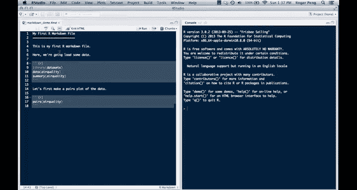

And I'm going to hit， I'm going to knit it。So you can see processes。

 the process of the file and here you can see the R code that I wrote， here's the summary。

 which is just for each column in the data frame， it just gives me a little kind of five number summary plus the mean and tells me how many NAs if there are any so you can see that for example。

 the median ozone is 31。5 and the median wind is 9。

7 and the median solar radiation is 205 so that's just a little bit of summary data。

I can make you look at the pairs plot of the data right here。

 when I saw I called the pairs function on the whole data frame。

 and you can see that the all the all the pairwise bivariate relationships between all the variables in the in the data set。

 So you can see it's not a very large data set。 There are only six variables in it。

 And you can see how they're related to each other。 So lastly。

 I might want to fill a little regression model。 So。

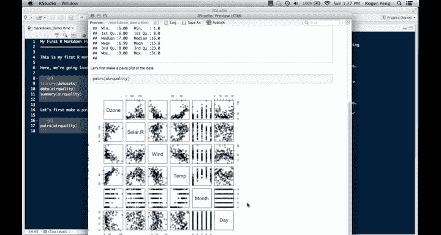

Here's a regression model。Of ozone on wind solar radiation。And temperature。So I'll load the。

I'll start a code chunk again， three back ticks and the R and curly braces。

 I'm going to fit a regression model here， so I need the stats package。Typically。

 the stats package will be loaded already when you start to R， but just to be safe。

 I'll load it explicitly。 And I want to fit a model here as I'm going to call the LM function。

 I'll say Ozone is。Related to wind solar radiation。Temperature。The data set is the air quality。

And then I'm going to summarize this fit because I want to look at regression coefficients and standard errors and P values and things like that。

 so I'll close that code chunk。 I'll save my file， So let me just double check that I saved it。 Yes。

 I did， and then I'll knit it。

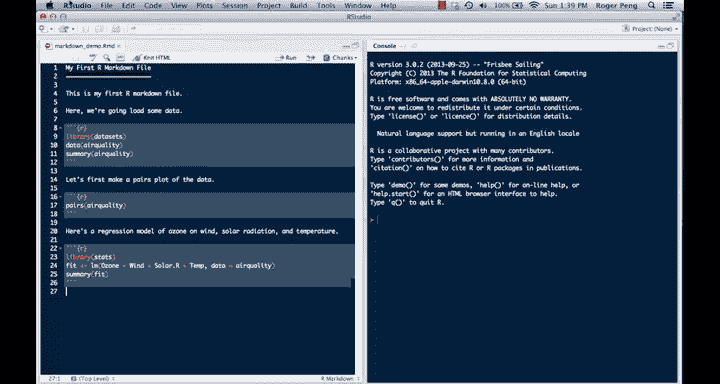

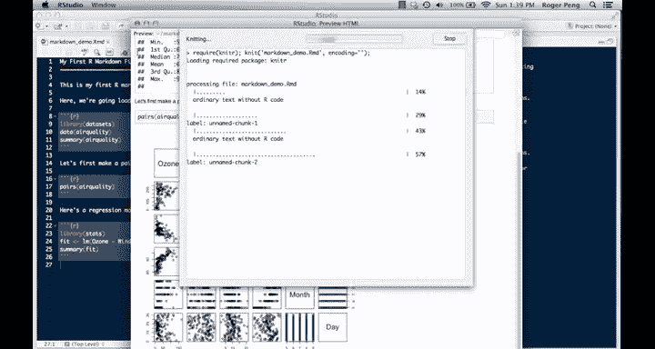

AndNow you can see after the pair plot， if I scroll down。

 I've got my regression model fitting code so you can always reproduce the code if you want by just kind of cutting and pasting that code in there。

And you can see the output from the regression models right here。

 So it seems that all three of those variables， wind solar radiation and temperature appear to be associated with ozone。

 So this is a quick demo of how how you can start an R markdown file basically you have to know how to write text which is fairly straightforward and you have to know how to write our code。

 which hopefully you do after this course and then once you know how to do that you can mix and match these things together。

 There are a couple other important formatting elements that you can check out on the website that I pointed to in the slides。

 for example， you can write an unordered list so。Like this and you just you dont have to do much thinking about it。

 you just start adding things。嗯。And then you get yourself an unordered list so if I save this。

And then knit it up。See everything else before looks the same。

 but I got my little unordered list down here， which is using bullets so there are a couple other formatting elements like that you can add raw HTML and if you're familiar with lateek using the knitter package you can also have latex in it and so you can add mathematical annotation so that's a quick demo of R markdown so check out our studio and start you can start editing your first R markdown file in the editor and see how it looks。

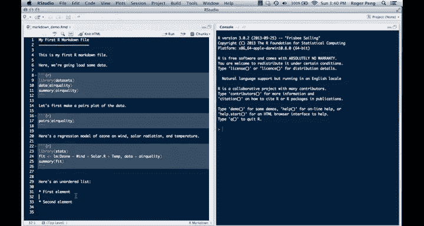