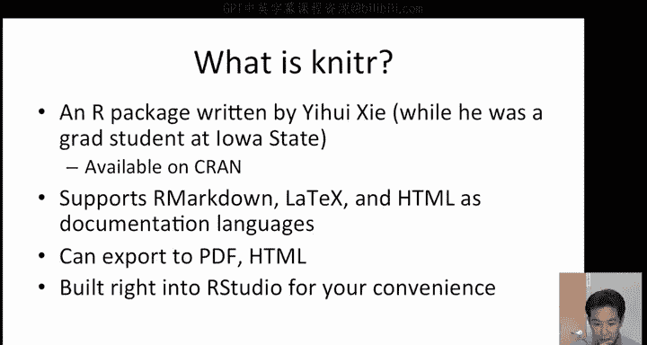
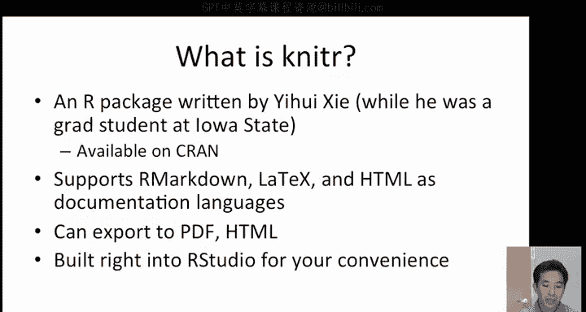
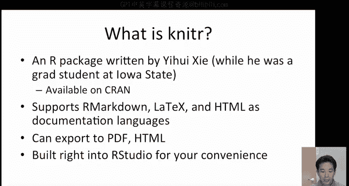
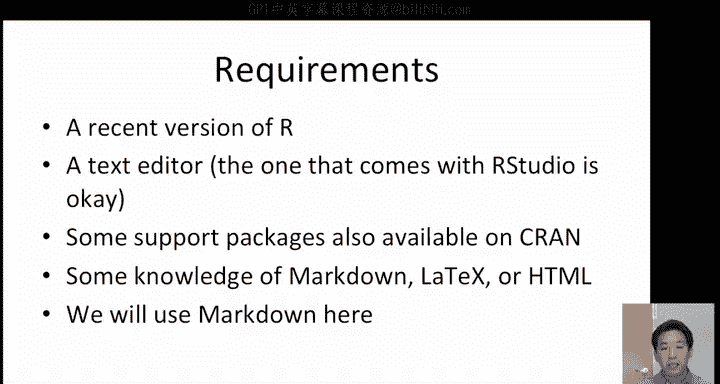
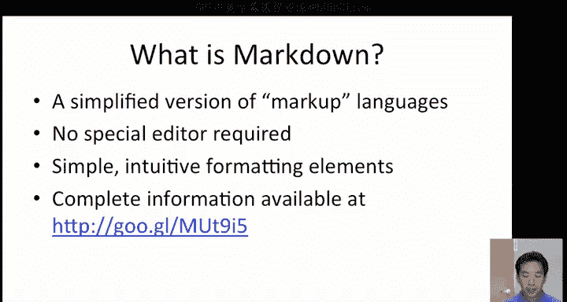
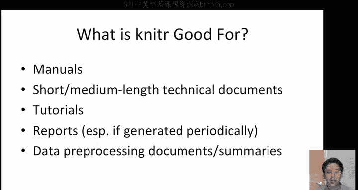
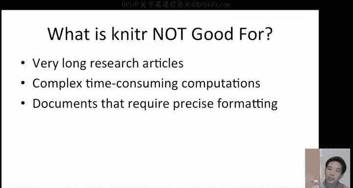
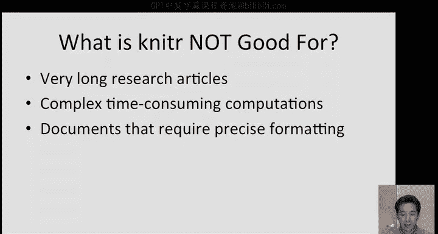

# 约翰霍普金斯大学《数据科学R语言基础｜Data Science： Foundations using R》中英字幕（deepseek - P150：14_knitr第2部分.zh_en - GPT中英字幕课程资源 - BV1tsFQemEts

So what is knitter So knitter is this tool that I'm going to talk about that can help you make these reproducible documents Niter is an R package written by Ehe Sia while he was a grad student at Iowa State。

 it's available on Crran if you happen to use the package R studio it's actually built into R studio and so it's integrated into the graphic user interface and so you don't even have to obtain it separately if you're using R studio so it supports for the documentation language it supports something called R Markdown。

 it also supports lateek and HTML so these are three languages that are commonly used and then it can export it to P and HTML and you can also export it to other formats using other external tools like Pandoc it it's built right into R studio for your convenience as I just mentioned so what do you need to use knitter you need a recent version of R you need a text editor you can use the one that comes with Rt if you happen to be using that otherwise any old text editor will do you need some support packages that are available。

From Crran these will be automatically downloaded if you use the install packages function you need some knowledge of one of the three documentation languages so you need to need no markdown latex or HTML and I'll talk about markdown here since it's a fairly simple language to understand so what is markeddown well it's a simplified version of common markup languages so latete and HTML can be thought of as markup languages where you take regular text and you kind add things to the add tags and other types of annotation to kind tell indicate what you want to do with the text one problem with markup languages is that they can be kind of like with they can be very difficult to read because there's all this kind of tags and things that that can obscure the actual text so the purpose of markdown which kind of simplify all that make it easy to read just the text and only have a few kind of formatting elements that you need to enter into the document there's no special editor requiring a standard text editor notpa whatever you want to use。

Simple intuitive formatting elements and you can get all the documentation at this website here。

So what is knitter good for in terms of creating reproducible documentss well personally I think is good for things like manuals。

 if you want to instruct someone at how to use a piece of software。

 a short or mediumlink technical document so you're going explain some technical concept tutorials if you want to again this is like a manual but maybe more extended a tutorial on some topic reports。

 they're especially useful for reports， if you have to for example every week generate a report on some database or some data set if you're running a study and you have subjects that are constantly being enrolled in the study and then maybe every week you generate a report on it has summary statistics about about you study them in these kinds of live documents are very useful because you can recalculate all the summary statistics as you generate the document you don't have to do it by hand and then stick it into a report separately。

 and then also for data preprocessing so often its useful if you're going to preprocess a data to create a clean data to create a knitter type document where that document。

It's all of the things that you do to the data set to make it clean， maybe you remove some outliers。

 maybe you fill in some missing data， maybe you transform a variable here and there。

 all of that can be documented in this kind of knitter style where you simultaneously say what you did and then you actually do it in the code。

What is knitter not good for in my opinion is not very good for very long research articles so if you're writing a very complex very involved analysis like I said before because everything is stored in a single document and can get a little bit confusing to kind of edit this document if there's a lot of code and a lot of text if you have very complex or time consuming computation。

 then knitters is often not a good format because you have to recompile this document every time you want to look at it and so if your computations are very slow this just kind of make everything slow and furthermore。

 if you have a document， if you want to create a document that requires very precise formatting so if you have a special layout and the pictures have to go here and the text has to go here or something like that。

 knits again not a super great tool for that because the formatting tends to be very ad hoc。

