# 约翰霍普金斯大学《数据科学R语言基础｜Data Science： Foundations using R》中英字幕（deepseek - P152：16_knitr第4部分.zh_en - GPT中英字幕课程资源 - BV1tsFQemEts

So the processing of the knitter document happens in a certain way first the R markdown document is processed and creates a markdown document。

 then the markdown document is converted to HTML and then the HTML file is what you view and the PSA final product General speaking you do not want to edit or mess with any of those secondary document so you don't want to edit the markdown document or the HTML document because those are automatically generated if you edit them and then you reproces the original document all of your changes will be overwritten in the HTML file or in the markdown file so only edit the R markdown file that contains the original text and the original R code。

So here's another example I've got my first knitter document and I have my name there as the author and I start a section called the introduction and I say here's some text here's a code chunk and I name the code chunk simulation I notice I added this option echo equals false and so that means that indicates to knitter that I don't want the code for this code chunk to be echoed in the output document I just want the result to show so here I've got my level one heading indicated by the single hash。

 the level two heading indicated by the two hashes I say don't echo the code so now this is the output document that again and you can see it looks like the original document that I had in the previous example。

 but I don't see the code I only see the output which is the mean。

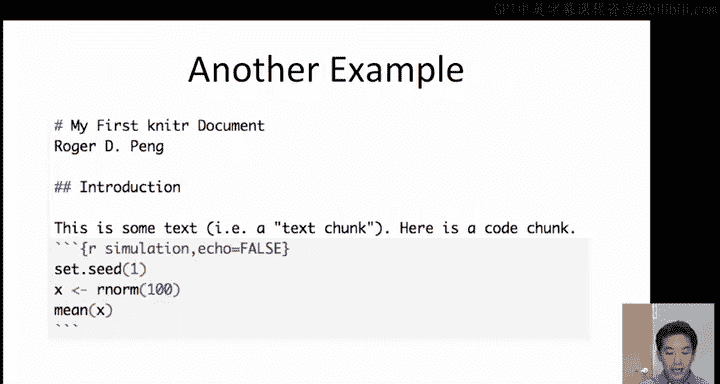

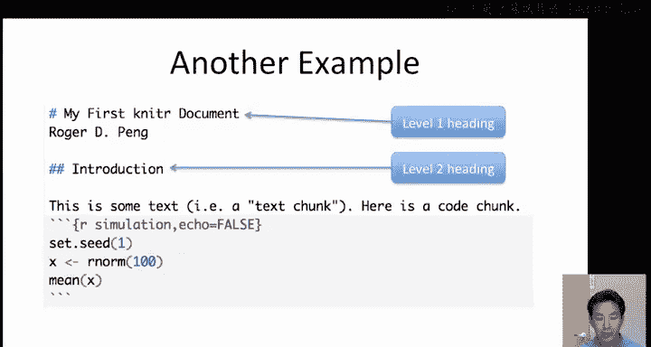

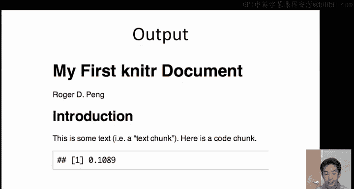

You can also hide the results too if you want to， in this case it doesn't make too much sense but you could do it by adding the results excuse me the results equals hide option。

 and then when you see the output document you see that all the text is there。

 but there's no code and there's no results。

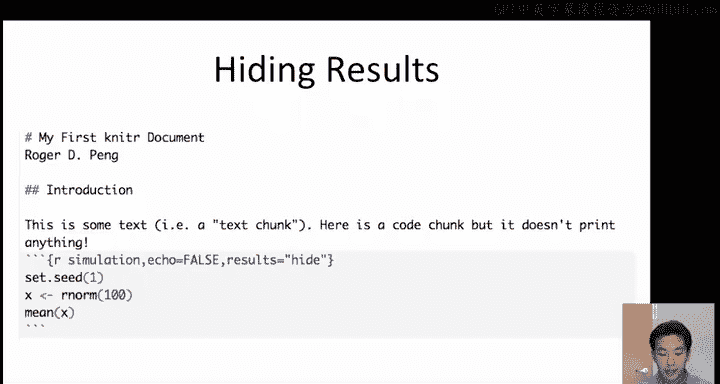

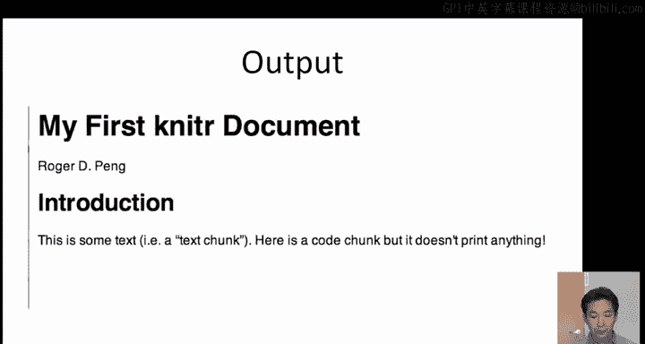

One of the nice things about a knitter document is that you can write sentences and text and if you need to fill in a number or a statistic or some sort of computation in the middle of a sentence。

 you can just add that directly into a sentence， so for example here I have a code chunk which computes the time。

And。Using the assist time function and then I also generate a random number okay and so now I can write a sentence so that code I don't echo the code because I don't want people to see that code what I want people to see is the sentence immediately after which says the current time is and then I'll just plug in the current time and then the next sentence is my favorite random number is and then I'll just plug in a random number。

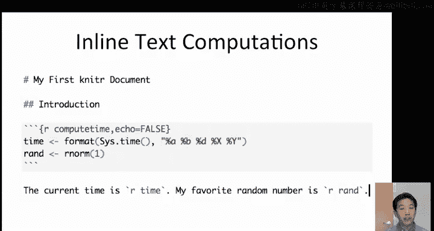

So here you can see the output is the current time is Wednesday。

 September 4th and there's the time in 2013 and you can see my favorite random number is 1。

1829 so that's how you can plug in computed variables or computed results in the middle in line with text。

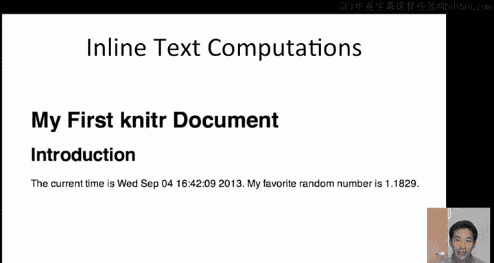

Another important aspect of any report probably is gonna be some graphics so you want to make plots of data or maybe or any sort of visualization so you can easily add this into an knitter document so here I've simulated some data and then in the first arc a code chunk I simulate some data and then the second code chunk I make a plot so I use the power function to set the canvas with the margins and the LAS option and then I call plot to make generate the plot and you know as I added an option here which adjust the figure height and so actually a fig out height equals4 which makes a little bit squish then more than usual so it'll be a rectangular type of plot rather than a square plot and so what knitter produces is a little bit interesting it creates an HTML file through the processing so you can see if if you're familiar with HTML you can see this is basic HTML I cut off a lot of stuff on the top so I just put the body in and this is a basic HTML you can see down here at the bottom you'll see there's an image tag but rather than point to an actual。

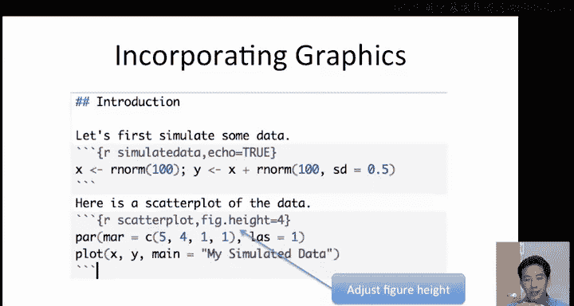

File that's the image it actually embeds the entire image into these HTML file itself so you can see this is a base 64 encoded image and so actually this HTML file stands alone it doesn't depend on any external image files which is not necessarily the most efficient format but it's actually quite useful because then you could take this HTML file give it to someone else and they don't have to worry about whether about whether they have these other files or not because everything's embedded。

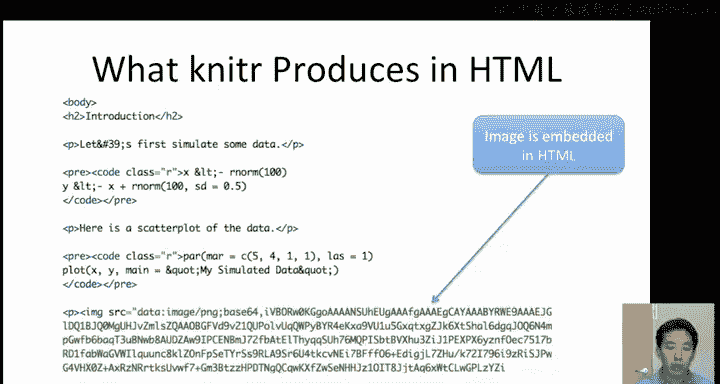

So here's the result， I so you can see I echo the R code。

 I have the result of the plot and you can see it's kind of this rectangular shape and that's my scatter plot。

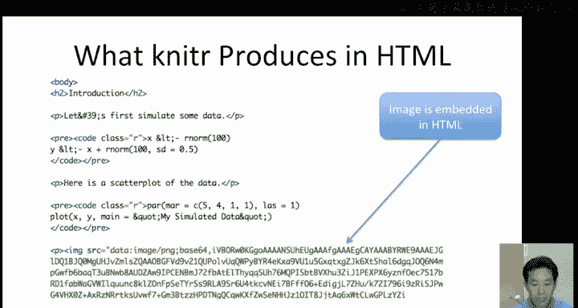

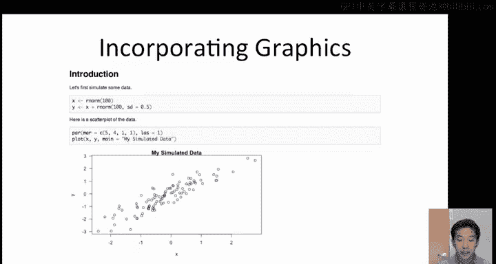

So another handy thing you can do in an inter documentment is make a table and often you want to make a table that summarizes the result of some calculation like a regression model。

 so here I have a code trunk which load some data and I fit a linear regression model to it here I'm modeling ozone concentrations as a function of wind temperature and solar radiation。

And I want to summarize the output from this linear regression model in a kind of pretty format。

 so not just your standard kind of R model format， so I'm going to use the Xtable package。

 which is available on CRN， you have to install it separately。

 doesn't come with R and I'm going to use the X table function to summarize the fit and I'm going to print it to HTML。

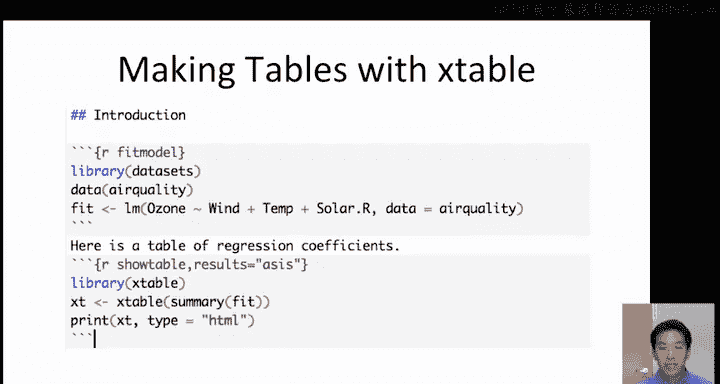

I can see that in the resulting sorry HTML output， after I process it with knitTter。

 I get the code that I ran for the regression model and I get it echoes the code。

 but at the very bottom here I can see that I've got a table of regression coefficient standard errors T values and P values。

 which is formatted in HTML， and so it'll be kind of in attier format rather than standard text mode。

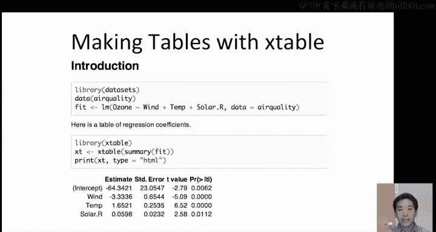

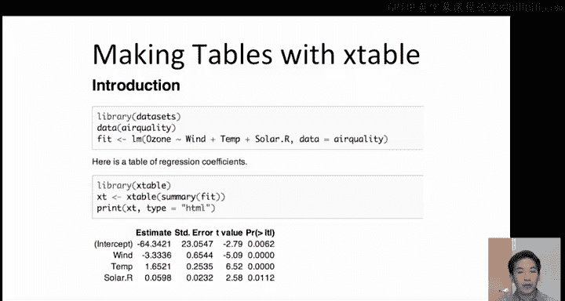

So sometimes you want to set options for the entire document so these are called global options and you want these options to apply to every single code chunk so maybe if you never want to echo the code for example。

 you want every code chunk to say echo equals false so it can be a bit of a pain to have to specified every single code chunk so you might want to set a global option for something like that and so。

The way you can do that is you can create a separate code chunk in the very beginning of the document here I call it set options and you can modify there's a special object called Ops underscore chunk which has a function built into it called set and if you call that set function you can set the global option so here I've set echo equal to false and I've set the results equal to high so by default every code chunk in this document will not echo the result sorry not echo the code and it will hide the results so here I've got some code chunks here I simulate some data I make a plot。

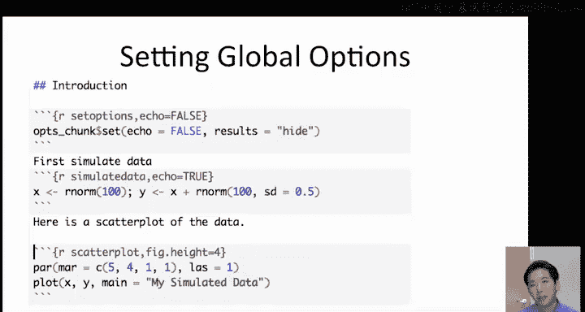

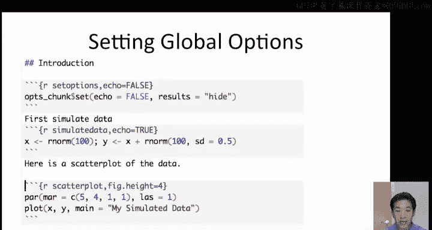

嗯。But when I see the HTML output。sorry， let me go back I can see first of all in the first code chunk I overred the default for the echoes I want to echo equals to true and then for the second code chunk I don't want to echo the plotting code and so I let the default occur so here the code that generates the data is echoed but the code that creates the plot is not echoed。

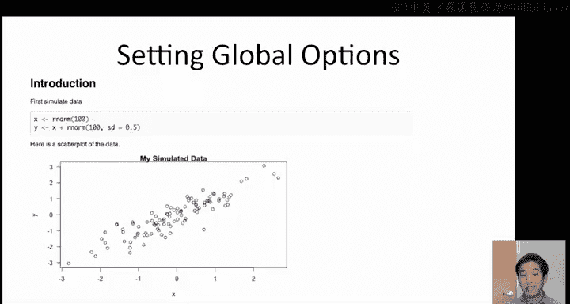

So some of the common options that are good to remember。

 of course you can always go back to the documentation on the knitTter website so the results can be specified as either hide or is as is means don't post processces the results just show that kind of the raw results from whatever the output is。

 echo can be true or false so if you want to echo the code or not。

 for figures usually you might want to modify the height and the width to be a specific type of size so fig height fig outt width or common options to set there。

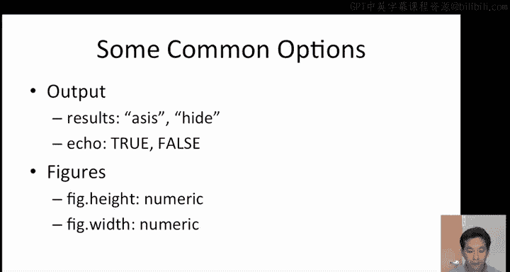

So one special case is when you have a code chunk and the computation takes a really long time to run now every time you process the knitter document to look at the HTML output。

 you're gonna to have to run this computation so one strategy to avoid having to sit around a wait a long time is to cache the computation and so cache and computations can be very useful for kind of complex code chunks and so the idea is that for each code on this special option called cache you can set cache equals to true and what will happen is that for that code chunk the first time you process the document it will have to run the code in order to figure out what the output is。

 but then what it will do is it will store that output on the disk and so that the next time you process the document as long as nothing has changed。

It will load the results from the disk， which is typically a lot faster than having to redo all the computations again。

 so this will save you a lot of time if you're doing this over and over again。

So if the data or the code or something changes then you will have to rerun the code again is really no getting around that and so the caching will kind of update to represent the new results if one code chunk depends on another code chunk that was previous to it。

 this dependency is not explicitly tracked by default and so you'll have to make sure that if a previous code chunk has a dramatic change to it and further a downstream code chunk depends on it。

Then you rerun everything so that the cash doesn't get mixed into it。

Chunks with significant side effects may not be casualable。

 so if the code and a chunk has some effect kind of outside the document that it may not be possible to cache that。

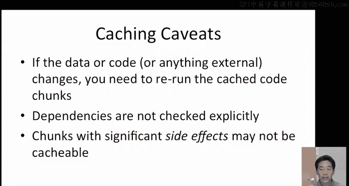

So just to summarize， I've talked about knitter in this lecture。

 which is a useful tool for doing literate statistical programming that will allow you to put text code and data and output all in one document。

 it uses a markdown formatting language which is kind of very simple and easy to learn and it creates HTML documents that you can view in any web browser so I think it's a powerful tool for integrating text and code as I mentioned before this pros and cons is not a perfect tool。

 but it may be useful to learn and for generating reproducible reports。

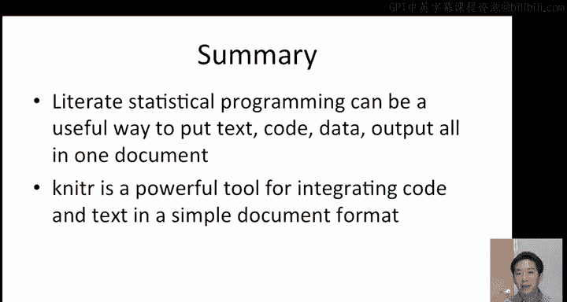