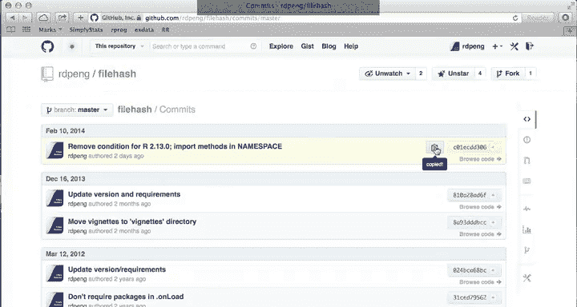
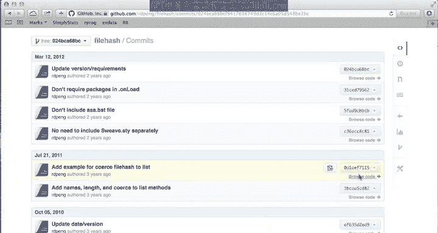

# 约翰霍普金斯大学《数据科学R语言基础｜Data Science： Foundations using R》中英字幕（deepseek - P153：17_课程项目1介绍.zh_en - GPT中英字幕课程资源 - BV1tsFQemEts

For this assignment you're gonna to have to do two things to successfullyively submit the assignment for the course First you're gonna to have to do a little bit of data analysis a fairly straightforward one I think and you're going to have to write up a report using R markdown and knitter so in order to submit your assignment you need to first check it into a Gitthub repository and then push your repository to GitHub then you need to submit the link to your Gitthub repository that's the first part and then the second part is you need to submit the Sha1 hash that indicates the specific commit that corresponds to the state of your repository that identifies your submission that way I know of which version of the files in your repository to look at remember in a Git repository things can change and you track the changes over various commits and so I just need to know which commit corresponds to your official submission for this assignment so I thought I'd just talk a little bit about how to do that just in case it's not immediately obvious。

So here I am I'm looking at my Github repository that I have under my account this project calls file hash it's actually a R package and you can see here is the latest information and there's two things that you need to know first is the URL for the repository so the URL for the repository for this project is just up here at the top here so it's Github。

 co/ RdP s file hash So that's the top level URL for this repository and that's where you're going to need to submit for this assignment as the first part or of course not for this repository but for the repository corresponding to your assignment。

The second part you're going to have to commit is the sorry。

 you're going have to submit is the Sha1 hash。 And so to figure out what that is， you can。

 you can go to this part over here。 And you can see I've got 245 commits to this repository。

 You will probably have less。 So itll indicate the number of。

Commitity have you can click on that and you can see it will list all the commits that you have going back through time。

 The most recent one is at the very top， you can see it's February 10。

 2014 and you can see on the very right over here theres a little abbreviated version of the Sha1 hash that corresponds to this commit So if the Sha1 hash that you want to submit it's just the very latest version of your repository you can just hover over this。

 you can see this little copy of the clipboard symbol。

 you can just click on that and then paste it in the Coursera web form where it asks you to submit the URL and the Shah one and that's pretty much all you have to do if you don't want to submit the most recent version of the repository。

 you say you want to scroll down a little bit and go to more an earlier version maybe from say March 12。

 2012 you can just scroll down to that commit。

And then copy the hash for that particular commit and then paste it in okay。

Now on the other side of the story， if you're gonna to be looking at someone's Gitthub repository。

 you can first go to the URL for that person's repository。

 so I'm going go back to the top and you'll be looking at the top level kind of repository and this will show kind of the latest versions of all the files then you're you're going again you're going go to the commit list and you're going take the hash that the person gave to you and you're going scroll you'll have to scroll down this list to see where you can word the hash and will match and if it's the most recent one。

 you'll see it'll match the top level one right here and if's not you'll have to scroll down a little bit scroll down a little bit but once you find that commit。

 let's say it's is the most recent one， you can go to browse code and this will show you the state of repository at that commit so it's kind of a snapshot of the project at that particular time。

And then all these files correspond to what the file looked like at that particular snapshot if you were to go back in time a little bit。

 I could see what you know what the repository looked like on March 12， 2012。

 I could go to browse code right here。And then this is what the repository looked like on March 12th。

 and so when you see a commit and a given URL for repository， go to the top level repository。

 click on commits and then find theS1 hash that corresponds to that commit and then click on browse code so that's how you'll be able to find the particular snapshot for a given project。

So that's pretty much it for submitting a GitHub repository URL and a S1 hash。

 so for this assignment you're gonna have to do first you're gonna have to submit those things for your version and then for the peer assessment you'll have to evaluate another person's repository by going to the URL that they point to and then finding the commit that corresponds to a given snapshot and so that's how you do that in GitHub it's fairly straightforward but I just want to make sure I showed it to you in case you were not familiar with it。

