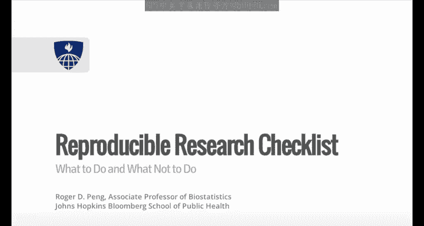
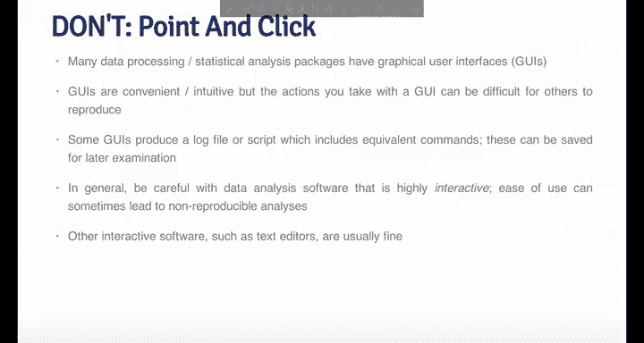

# 约翰霍普金斯大学《数据科学R语言基础｜Data Science： Foundations using R》中英字幕（deepseek - P156：20_可重复研究清单第1部分.zh_en - GPT中英字幕课程资源 - BV1tsFQemEts

In this lecture， I'm just going to present a short checklist of things that I think you should think about when doing any sort of data analysis project or any sort of investigation involving a lot of data and kind of processing and analysis this is by no means a comprehensive checklist and it doesn't come with necessarily any guarantees that everything's going to go well for you if you follow the checklist but I think over through my experience and through the experience of people I've worked with a lot of the items that I'm going to talk about in this checklist I think are important and will at least be a basis for you to kind of do your analysis and a reproducible manner so I'm just going to theres just a couple of do's and don'ts that I'm going go through and at the end I'll summarize with kind of the basic questions that you want to ask yourself anytime you're doing any sort of data analysis or project that's kind of beyond a trivial kind of analysis。

So the first thing you want to start with is some good sciences。

 and the idea here is that you got to be working on something that's interesting to you that you think is kind of interesting to other people because if you start with something that you don't like or you don't think is good。

 then you're just going end up probably with something that's not good on the out so garbage in garbage out is the basic idea here So start with some good science and make sure you have a question or a goal that's relatively focused and coherent if that's not always possible depending on the types of problems that you're working on。

But in general， the more coherent and focused question than you can work on。

 the simpler your problem will be and because a narrower question or a more focused type of question tends to rule out a lot of possibilities that you won't have to worry about but if you have a very broad and very vague type of question。

 then you'll have lots of things to deal with you have lots of things to think about and generally increase the complexity of your problem of course you should always work with people who are good collaborative people that youd like to work with people you think that have a good kind of。

Working with because if you don't have good working relationships and this can lead to other bad practices。

 so good collaborators generally reinforce good practices and of course。

 make sure that it's something that's interesting to you because if you are interested in the idea。

 then hopefully that will motivate you to kind of have some good habits。

 so the first thing you should always deal with is you know start with something that's good start with some good science。

 start with some good interesting topics。I think if there's one rule。

 if I were to boil everything down to one rule， when it comes to reproducibility。

 it would be don't do things by hand。 right So doing things by hand is usually where most investigations get tripped up and where things that are not reproducible come into play。

 And so I just give a couple of examples here are things that are often done by hand。

 The first one being editing a spreadsheet。 So if you use something like Microsoft Excel or something or a similar type of program。

's it's tempting to kind of load the data in Excel and then just clean up some of the messy data like you might have some outliers that you just want to remove or if you're doing some Q aqC on the data in some values might be out of the range or something like that。

 So you'll just fix them right there， you might validate certain types of measurements by using a couple of experts or something like that。

 these kinds of things are very easy to do and it particularly in spreadsheet programs。

 and it's very tempting to do that。 But the problem with doing that kind of。

Kin of in the spreadsheet analysis is that it's not really reproducible at all。

 unless you write down exactly what you did and how you did it and what were the criteria for doing certain things。

 for example， if you're going to remove outliers， what's the criteria for determining what an outlier is。

 etc cea like that。 So unless you write that everything very precisely like that。

 editing a spreadsheet by hand is often not reproducible。

 And so you should try to avoid it if you can editinging things like tables and figures this is maybe less of an issue。

 but it still maybe lead to something that's not reproducible， for example。

 if you change if you change the rounding in a table or something like that。

 that can be lead to something that is not reproducible。

Something is innocuous is maybe downloading data from a website。

 which maybe you might have to do a lot if you're kind of assembling many different data sets。

 you might think that well， this is very simple， I'm just going to open my web browser or click on a link and download a data but that's again。

 that's something that you do by hand， and if you were going tell someone how to someone else how to do it there would be a lengthy set of instructions you'd have to tell them what website to go to what link to click on and etc。

 So that's something that you should be careful about it should make sure that you write down everything that you did because you can determine whether someone else can kind of obtain the same data to do the analysis that you did even something simple and moving data around moving files around on your computer or maybe taking a large data file and splitting it in half if you do these by hand。

There's no record of you ever doing it。 and so if someone wants to repeat what you did。

 they have no instructions for how to do it or where to move things or what to do so you should think about this before you do them if you can and ask yourself if it's really necessary to do and if it is。

 then you should document it carefully it's always very tempting。

 especially in the beginning of an analysis to think well we're just going to do this once so we don't really need to kind of write a computer program to do it or something like that or write it down very carefully for example。

 you might only download the data just once and so you don't need to kind of automate that procedure but just be careful with if you find yourself saying we're going to do this just once。

 make sure you still everything is documented to a point where someone else who doesn't know you it doesn't work with you could potentially repeat what you're about to do and so the general rule is that why the reason you shouldn't do things by hand is because anything that you do by hand has to be precisely documented and this is a task from my experiences this is a task that。

much， much harder than it sounds because think little details that you may not think are important are actually very important to other people when they don't have the same context and the same background that you have。

Next rule is related to the first and involves not using point and click type of software and so there's a lot of software that has what are called graphical user interfaces or goUIis and graphical user interfaces are very convenient。

 they're very nice， they're very often very intuitive and they're easy for most people to use they don't involve a lot of instruction and so it's nice to use a gooI and a lot of software has these types of interfaces。

But the problem is that a lot of the actions that you take with a GuI like pointing and clicking are difficult for others to reproduce。

 So unless you specifically write down here， I clicked on this menu and then I clicked on this option it's difficult for someone else to know exactly what you did。

 So that's the danger of using things using graphical user interfaces in any type of data processing or statistical analysis some programs if they have a GuoI will produce a log file or a script that includes the kind of equivalent commands that to the pointing and clicking that you did。

 And so these log files and scripts can be saved and it can be examined by another person in the future if if they have to。

 So in general， any data analysis software or data processing software that is highly interactive。

 you should be careful because interactive software tends to be very nice to use and you can kind of do a lot of exploratory things with it。

But this ease of use can come at the price of reproducibility。

 and so just be careful when you are using interactive software。

That doesn't log what you do or keep track of the history。Now。

 of course there may be other software packages that you use that are not directly related to the analysis of data or the kind of data analysis pipeline。

 which may have goIs and that's fine， for example， like your text editor may have a graphical user interface and that something that you use to write the code or to write a report and that is usually that is usually fine because your analysis may not depend critically on exactly which text editor you use。

 however， if on that rare case it does then you need to be careful that everything is kind of appropriately documented。

