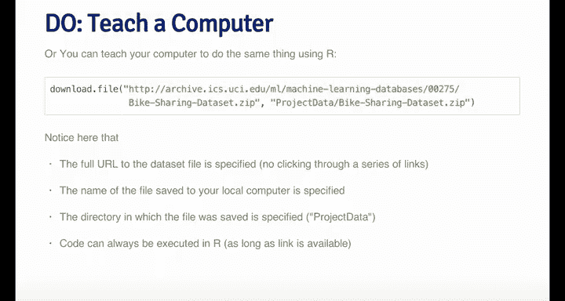
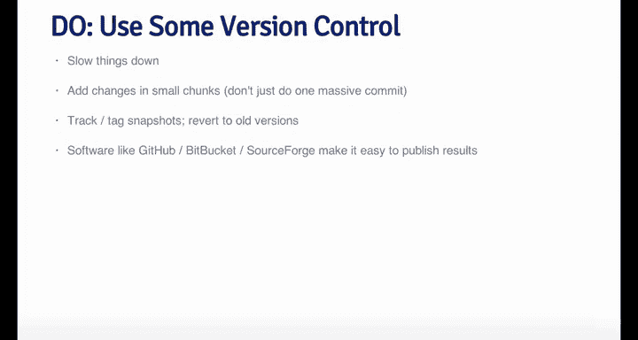
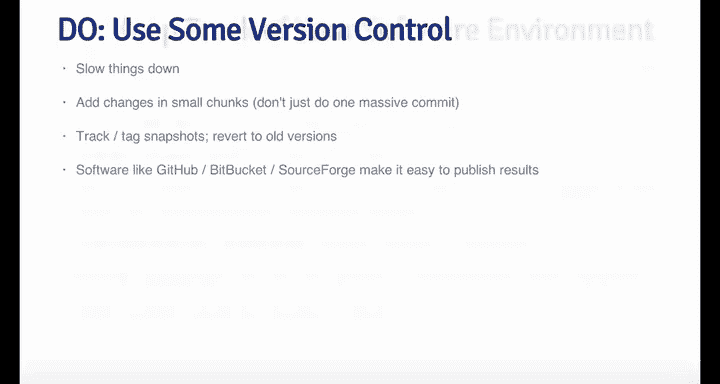
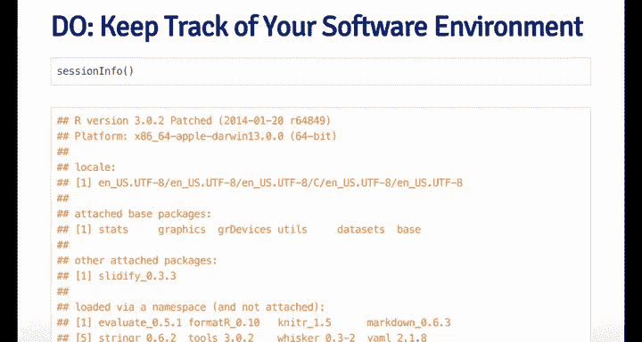
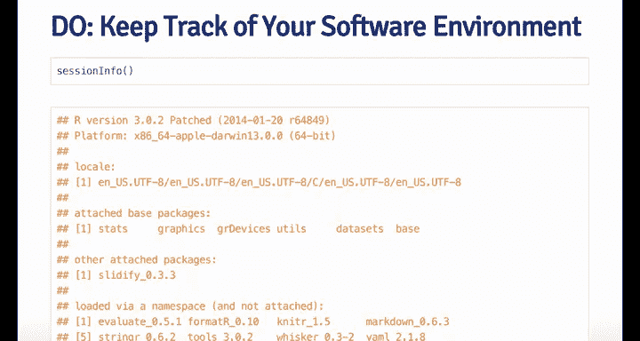
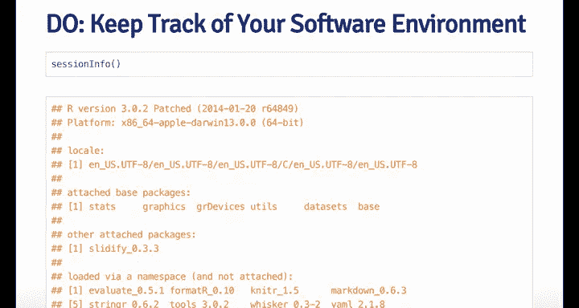

# 约翰霍普金斯大学《数据科学R语言基础｜Data Science： Foundations using R》中英字幕（deepseek - P157：21_可重复研究清单第2部分.zh_en - GPT中英字幕课程资源 - BV1tsFQemEts

So the antidote to doing things by hand is that you should always you should try to teach a computer to do whatever it is about to do so the idea is that you you want to try to automate in some sense everything that you do in your analysis so in particular if you're doing working with data the parts of your project that work with the data that process the data。

 you should always try to teach a computer to do it there's two reasons why you should do this one is that if if you can teach a computer to do it。

 then you have a solid rules and solid kind of concrete instructions for what to do and so there's no room for fuzziness to kind of play into the data analysis because a computer doesn't accept generally speaking won't accept that kind of fuzziness they need exact programming instructions and so when you give instructions to a computer essentially what you're doing is you're writing down exactly what you mean to do and how it should be done and that is essentially the definition of reproducibility。

Right so if you can teach a computer its almost guarantees that what you're going do is reproducible to a large extent。

 And so even if you're going to do something just once。

 it's useful to try to teach a computer to do it and it may involve a different using a variety of programming languages。

 you might use R。 you might use something else。 but if you can get your computer to do something for you that's always better for reproducibility。

 it may be less convenient for you because it takes longer to program a computer。

 but it it will pay you back in the sense that everything that you do in this way will be reproducible。

 So as a quick example， something that's very common that you'll have to do in most projects it to download some data and this data might be available on the web。

 So for one example， you might go to the UCI machine learning repository and go to that website then you might go to like there's the bike sharinghar data So you click on the bike sharing data web page you click on the data folder and then inside the data folder is a link to the zip file which contains the data。

 you can choose the kind of save。File as in your web browser。

 then you doubt and then you have to name a file in your local computer in a folder and then save it。

 right， So these are all things that are very natural to do。

 But you'll notice that the list of instructions that I had to discuss was actually rather lengthy for this very simple operation。

So an alternative is to just teach your computer to do all that。 and in fact。

 in R it's quite straightforward， you can use the download dot file function and then just download the file directly onto your computer So one of the nice things actually this example has some advantages because first of all。

 you'll notice that the full URL of the data is specified right so there's no ambiguity there you don't have to click on the website and they click on the folder and they click on the zip file you get the whole URLs to the data sets right there it's very specific。

That furthermore， the name of the file that you saved to your computer is also specified。

 So for example， if you download a file using a web browser。

 you always have the option of kind of renaming the file to be something else。

 but if that's not documented， then then it's very difficult to link the renamed file to the original dataset on the web。

 But here I explicitly specify in the code that the local dataset is going be called bike sharing data it。

 And so now I know what file to look for after this code has been executed。

 I know exactly which directory I save the data to。

 So I save the data to a directory called project data And so now I don't have to wonder what directory the data was saved for example in in the downloading from the website through the web browser and this code can always be executed in R even if you only need to do this once。

 someone else could execute the same exact code as long as you're using R。

 and as long as the URL and the website hasn't changed。

 they'll download the same data the same dataset Now of course there are many things that are out of your control。

If you don't run the website， then you'll have to depend on the operators of the website not making lots of changes。

 but to the extent that things are in your control， the more that you can code things like this。

 for example， this simple download。 fileile function， the better you will be。

Another general piece of advice is to use some sort of version control software and there are many different types of software in this course and in this series in general we tend to focus on Git which is a very nice version control software and it's coupled with nice websites like Github and bit bucket which can be used to kind of publish a code and other types of projects So I think the main feature to keep in mind when you use a version control system in a data analysis project is that it helps to slow you down a little bit so might that might sound like a bad thing but slowing people down is often good because often when you have a project and you're very excited about the data and you want to get into it。

 you just start doing things and you start working with the data and you're not really keeping track of what's happening and so the version control software whatever is that you use will help to kind of make you stop think about what's been done think about what changes have been made commit changes to a repository so that you can have a record。

Of what's been done and then kind of move along step by step And this is useful for a data analysis because then you have a log of kind of what has happened and what and what direction you've gone if you want to go back。

 you can go back and then there's a record of what you found。 So if in the course of for example。

 your exploratory analysis or whatever it is you're doing you find something interesting you have a history of kind of how you've got there and so version control systems can be very useful for this type of for this purpose。

Of course， software like Git can be used to track and tag snapshots of the project。

 you can revert to old versions， all this kind of stuff is pretty standard in version control systems and so it's useful if you can to as you' progressing in a approach to add project to add changes in small chunks so don't just add like 100 files at once in a massive commit。

 but if you can break your analysis down into logical pieces and add them piece at a time。

 this will help you into in reading the history and understanding of what was done in the past。

Keeping track of your software environment is very important for reproducibility because a lot of complex projects will involve chaining together many tools。

 emerging different data sets and some tools and datas may only work with certain environments and so the software in the general computing environment can in fact be critical for reproducing an analysis So there are a number of different features that you might want to keep track of in your software environment and not all of them are necessarily critical for every type of project but just keep a couple things in mind which are fairly common the first is your computer architecture and this is generally is usually not too important。

 it was probably more important in the past but the general understanding of what kind of computer architecture you're working on is useful if you need to communicate that to someone else So the CPU that you're using is in an Intel chip is an AMD chip and RM chip who makes the CPU can be useful another aspect of that is whether it's 32 bit or 64 bit that can have an impact on some software are you using graphical processing。

Units of GPUs， things like that are useful to keep kind of have in your mind and keep track of the operating system can be very important。

 So are you using a Windows operating system， Mac OS， Linux Uni。

 some other version of Linux this can be very important because some software only works on Windows some only works on the Mac etca like that。

 So if someone wants to reproduce what you've done and you've used a piece of software that only runs on Windows then they're going to have to find themselves a Windows machine or use a Windows emulator。

Your software tool chainin is very important and typically you'll be using lots of different pieces of software。

 some of it will be standard， for example， the web browser。

 pretty much everyone will have a web browser。But things like compilers and interpreters the shell that you're using are using the ba shellll or something like that。

 different programming languages that you use CPl Python or whatever it is。

 if you're using different database backends， it's important to know which ones you're using any data analysis software All these things should be noted because if someone wants to reproduce what you've done。

 they're gonna to have to reproduce this entire environment， all the compilers that you use， etctera。

 things like that。 And so that's very important to keep in mind。 any supporting software。

 in particular things like libraries， software libraries or our packages。

 which are and other types of dependencies are going to be important to keep track of any external dependencies。

 So these are things that are kind of outside your computer。

 external websites are you downloading data from central repositories Are there other remote databases that you'll be querying you get your software from other software repositories So things like that may be important for your analysis。

And for all of these things， it's usually important to keep track of the version numbers because as other people develop the software。

 they're going to make changes and that may break dependencies。

 And so if your project was done using a certain version of an operating system or software。

 it may be that it's only reproducible using that version in that future versions are not or cannot be used。

 So knowing the exact version number for everything。

 if it's available is important to keep a note of。 So one small example， for example， is in R。

If you use the session info function， what this will do is it'll tell you kind of as much as it can about your environment and you can see this is the output from my computer here。

 I'm using R version 3。0。2 patched and it even gives me the subversion or revision number which is 64849 so it's actually quite precise I'm on a 64 bit Intel compatible computer X86 and I'm using an Apple computer。

And I'm in the kind of the US English locale so that's the kind of language environment I have the following R packages installed stats。

 graphics to your devices， these are all the base packages that come with R I've got other packages installed and then there are other packages that are sorry loaded and there are other packages that are not loaded but there are namespaces available so things like NATO Markdown Yaml etc。

 and so these are all kind of what my R environment looks like as I was doing my analysis of course this is just a small piece of my entire software environment but it's useful to have this kind of detailed information in general。

