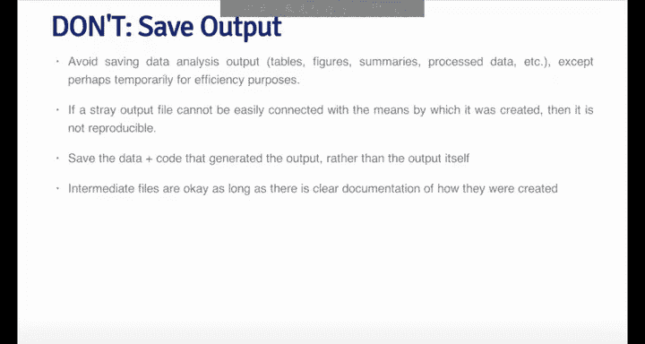
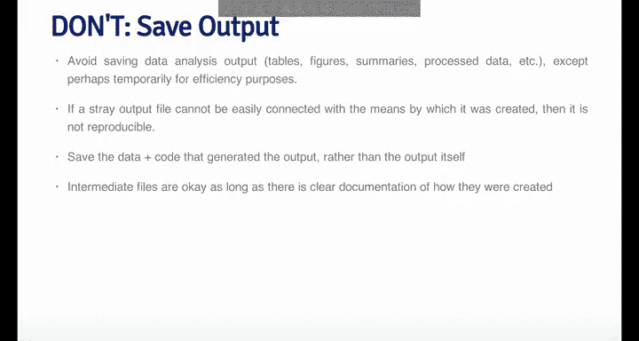
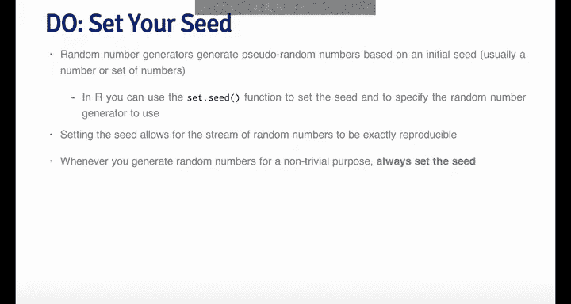
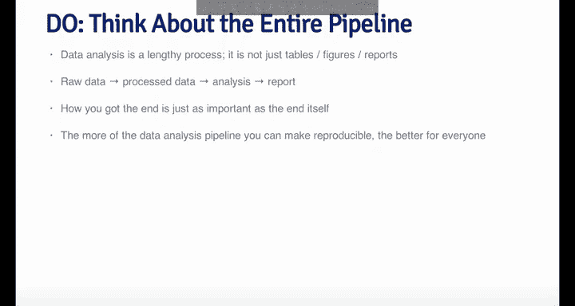
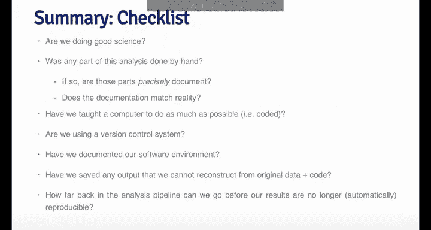

# 约翰霍普金斯大学《数据科学R语言基础｜Data Science： Foundations using R》中英字幕（deepseek - P158：22_可重复研究清单第3部分.zh_en - GPT中英字幕课程资源 - BV1tsFQemEts

One kind of quick rule that I try to keep in mind that I'm doing data analysis is to don't save any output Now this may seem a little strange because you need some output eventually。

 and the yes that's true， you will need things like tables and figures and summaries if you're going to write a report or a paper or something like that。

 but it's good to not keep that until the very end when you're actually doing that kind of kind of end stage activity because output a stray output file that's just sitting in your project directory if you don't know where it came from or how you produce it is not reproducible and so if it's not reproducible it's almost not worth saving at all because you'll always be wondering how you got those numbers and where how you made that figure so rather than save a piece of output like a table or a figure it's better to save the data and the code that generated that table or figure so that way you can always reproduce whatever it is that type of output that you need Of course in a very large project's going to be a very long pipeline of analysis that you do。

Maybe starting with raw data and then going to process data and then maybe processing the data even more and then doing some analysis。

 And so there may be a lot of intermediate files that are generated in this process and that's fine it's usually fine to keep those around because it will make the analysis much more efficient than if you had to kind of reproduce everything every single time。

 but if you do keep intermediate files around you have to make sure that it's critical that you make sure that every intermediate file is documented。

 that you have code that generates that intermediate file and that the data that goes into it is clearly documented so。

So it's usually better to not save any output because if you can save the code in the data instead。

 but if you need to save things like intermediate files。

 then make sure that you have the code and the data to go along with them。

This is what is a very specific issue， but it's very important because it can lead to very non-reproducible results so if you ever generate random numbers。

 almost all random number generators will generate pseudoran numbers based on a seed。

 something called the seed and so the see is usually a number or a set of numbers that kind of initialize the random number generator and then the random number generator kind of goes in a sequence and generates random numbers from based on the seed so for example an R you can use the set do seed function and you just give it a single integer which will will kind of initialize the random number generator and then。

Generate a sequence of random numbers。 If you use this if you call set dot seed and then generate random numbers。

 that sequence of random numbers will be always be exactly reproducible as long as you kind of set the seed again at a later time。

 And so these are important for things like simulations for things like Markov Cheman Carlo analyses anything that involves generating random numbers will need to set the seed。

 And so you should always remember to do this because otherwise you will get your numbers will just not be reproducible。

 And if you do an analysis， if you publish an analysis that's using random numbers and you don't use the seed。

 it's basically impossible to go back and try to figure out what it was。

 So think about this anytime you use random numbers。

So finally， I just want to mention that the entire process of data analysis and and kind of working with data is usually a very long pipeline and starting with kind of very raw data maybe you got it off the web or you got it from some investigation or experiment all the way to kind of cleaning it to processing it to analyzing it to kind of making the summaries and figures and then generatinging the data。

 I start generating the results， it's a very long process and you should think about that entire pipeline as you're working on it and to think about whether each piece of it is reproducible so as you go down this pipeline know the think about how you get to the end is just as important as the final product that you produce so the analysis or the report that you produce to the end is going to be a small subset of all the work that you did to get there the fact of the matter is that all the work that you got that you did to get there is just as important to keep track of。

And to document and as a general rule， the more the more of the data analysis pipeline that can that you can make reproducible。

 the better it is for you， the better it is for other people。

 and the more credible your results will be。 So think about the entire pipeline It's all important。

 It's not just the final product that's important。

So taking all these rules and summarizing them I just put together a simple list of questions that you should ask yourself as you're doing any sort of data analysis So of course。

 number one， are we doing some good science， is this interesting。

 is this worth even doing was any part of this analysis done by hand Now this may be unavoidable you may have to do something by hand so the only real issue here is that if you do something by hand。

 is it precisely documented in particular， you need to make sure that if it is documented that the documentation actually matches the reality because many times when you document something you write it down but then later on you actually change what it is that you actually did because you need to update something or maybe there was a mistake and so if you do update or change something then you have to change and update the corresponding documentation that goes with it so does the documentation match the reality of what you did。

Now， of course， you want to be able to teach a computer to do as much as possible。

 so have you coded as much as possible and have you kind of written down。

In a precise manner what you did， anytime you teach a computer to do something， this is a good idea。

 I think。Are we using a Viin control system are you using something like Git or SVN or something like that Have you documented the software environment so every tool。

 every library your operating system， your architecture these all have to be noted have you saved any output that cannot be reconstructed from the original data and code right so in general you want to avoid saving any output that can be can't be kind of derived from some data and code so it's better to save the data and the code rather than the output。

And then a final question might be， you how far back in the analysis pipeline can we go before the results are no longer reproducible Now if you're working on a piece of the pipeline。

 it may not be possible to go all the way back， for example to the raw data you may only go back to some process version of that data and that's fine。

 but just think about the entire pipeline and see how and try to make it as reproducible as possible。

 So these are my kind of general tips for thinking about reproducibility in a generic type of data analysis project。

 I think a lot of these will help you get kind of organize a project and make sure that you're thinking along the right things。

 the key things are careful when you do things by hand。

 try to code as much as possible and to document everything as precisely as possible。

