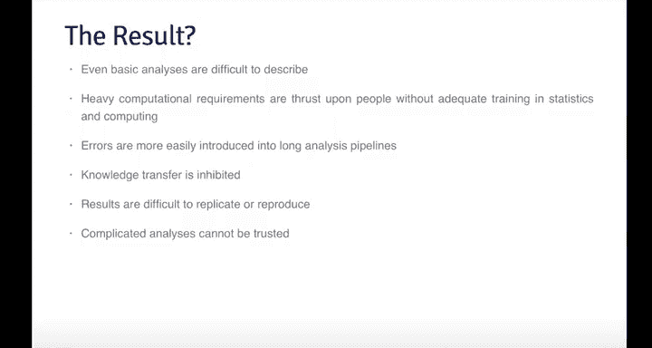

# 约翰霍普金斯大学《数据科学R语言基础｜Data Science： Foundations using R》中英字幕（deepseek - P159：23_基于证据的数据分析第1部分.zh_en - GPT中英字幕课程资源 - BV1tsFQemEts

I'm going to talk a little bit about replication reproducibility。

 I think in a lot of circumstances people tend to use these words interly。

 but for the purpose of this talk and I think we're also for Keith's talk next。

There's going to be a distinction so when I think I think about replication I think kind of like the usual thing that happens in science。

 the purpose of replication is addressed in my opinion in the the validity of a scientific claim right so if you say that X is related to Y the first question is well is this kind of true right and so you have to replicate it in another study or in a series of other studies with new investigators collecting new data using different analytical methods。

 laboratories instruments whatever be and and if you have a bunch of replication and no one can find the same thing then you think okay well's probably not true。

 but if everyone finds the same roughly the same thing in independent studies and you think okay that's probably a reasonable claim so replication is kind of how we've always done things and still I think the ultimate standard for kind of strengthening scientific evidence so that's replication。

Reproducibility in case you haven't heard the term is why refer to it as kind of focusing on the validity of the data analysis right so here you have situations where data are collected and they've been analyzed with someone else and they say something like X is related to Y so here the idea is that you can have new investigators but you look at the same data and use the same methods perhaps。

See if what they claimed is actually produced from the data and the analysis so the real question I think the question here is not so much is the claim true。

 but really can we trust this analysis okay so that's when I see the key question that reproducibility tries to address。

 can we take their approach apply to their data and get the same thing that they've gotten？

And I think this is key， reproducibility is particularly part in my area of work where replication is not possible。

So this is where I'm starting。And just I think some background that everyone's familiar with。

 there's been a lot of talk about reproducibility in recent years。

 some of the trends are just kind of a lot of studies just can't be replicated they're huge。

 especially in epidemiology you have these 25 year cohort studies they just can't be replicated in a reasonable amount of time there's a lot of technology which is affecting the rate of data collection。

 the complexity of data is very high， you have these kind databases that people are just burgeging together like crazy I mean I'm one of those people I say I'm seeing a lot of these data are used off label so for example you have administrative data sets are even used for health studies。

 things like that so this is very common then because it's an expensive。

 computing power is very sophisticated now so we can do very kind of complex analyses on just small data sets and then for every field X there's a computational X now。

Just some of the results basic analyses can be very difficult to describe now in just kind of like your standard methods section in a journal。

 oftentimes there very heavy computational requirements that are thrust on people with very little training。

 and so just a little with a context from where I'm coming。

 I think you think of the range of kind of computational ability from low to high。

 know most of the people in this room are over here。

 all the people in the room here maybe JeEpsso over here。

But there's a whole host of people on this end of the spectrum who are doing computational will have to do computational work for whether they like it or not and the reasons that they've got all this data coming in。

And so that can lead to problems， you can have errors introduced into the long of analysis pipelines。

And you can't tell people what we've done in a reasonable amount of space that time give us the transfer of knowledge。

In many cases， there's a sense that complicated analyses can't be trusted。

