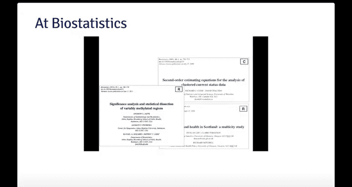

# 约翰霍普金斯大学《数据科学R语言基础｜Data Science： Foundations using R》中英字幕（deepseek - P161：25_基于证据的数据分析第3部分.zh_en - GPT中英字幕课程资源 - BV1tsFQemEts

So I just take this analogy from I said the slide sometimes when I talk about asthma。

 so if you think of the kind of asthma allergic sensitization and the pathogenesis。

 you think you might have some allergenic exposure which you brings to your body。

 the specific IG attach these ma cells which cansensitize and things produce these inflammatory mediators and these inflammatory mediators create kind of classical symptom bro constriction make generations like that and the way that we can attack this for very is through medication so you have like here inhalleorsteroids over here。

 you've got your kind ofuk triantide modifiers over here， you got your antiIG type stuff over here。

 and so that all does varying kind of jobs of affecting people's asthma。

But then there's also this part over here， so one of the reasons I'm excited about a lot of the environmental intervention stuff that we're doing is that it kind of affects the most upstream part of the disease process and not only does it affect this most upstream part。

 but it's actually very inexpensive relative to all this medication。

It's efficient and it's potentially powerful and so that's kind of nice so if you were to translate this over。

To kind of the way that research is disseminated， so there's people conducting research over here。

 it may be problematic， it may be incorrect in terms of the analysis。

They submit a paper to some journal that goes through end of the paper is published and after the paper is published you get the data。

 you get the code and you can see what they did。So the typical kind of safeguards are so you submit the payment of the journal maybe the editor thinks it sticks so he rejects it。

 or they send it up， then there's peer review， so the peer review so via a check on something。

 and then if it gets past peer review it gets published。

 so that's where reproducible research comes in at the most downstream aspect of the process。And so。

There's a lot of discussion now about doing this。And so the idea is that， okay， well。

 why wait for all the data in the code to be available after the thing is published。

 why not do it as part of the publication process？And I think that's not as a noble goal。

 but I think totally unrealistic because I don't think it's realistic to expect peer review views to kind of reproduce everything。

I speak from experience， so those of you who are not in statistics you know are not used to waiting the typical six to 12 months for your review to come in。

And if you add on top of that， the need to reproduce the entire analysis will be promoted 40 years from now。

 so that's reasonable and I'll get an example of that。

 but I think the question is well is there something that we can do in the most upstream part？

Of this process。嗯。And so that's what I want to talk about today so just one example of moving the reproducible part to the peer review as not exactly did the peer review but somewhere upstream a little bit。

 this is just that we have a policy at the Journal of Biostatistics。

 which is easily the best statisticsistic journal in the world。

And I'm the associateiate editor for what's called the Asciator for Reproducibility。

 and we have a very light policy which is totally voluntary where you can submit your date in your code to the editor。

 the Asator for Reproducibility， and he me will reproduce it and if you。

It's not a not 100% bulletproof policy， but if it's never happened that I haven't been able to reproduce anything。

 but if it is reproducible， you get this nice little R stamped on the top of your paper。

then there's two other options is a D and a C， if you submit your code then you get a little CO there。

 I don't check that I just assume that is fine， if you submit your data you get a D。

 you think your data and your code you get a D and a C and if I reproduce it you get an R and then this is Jeff's only contribution to this work。

いや。He got an R。It would be a week to reproduce it， but it was fine。Anyway， so that's one model。

 this is not really kind of。A deterrent so speak because it's totally voluntary。

 it happens after the paper is accepted from peer review。So， but anyway， so this is。

One model， perhaps。嗯。

