# 约翰霍普金斯大学《数据科学R语言基础｜Data Science： Foundations using R》中英字幕（deepseek - P163：27_基于证据的数据分析第5部分.zh_en - GPT中英字幕课程资源 - BV1tsFQemEts

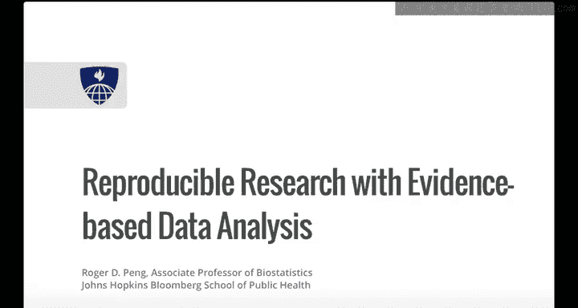

So my only thing is that we should just take this principle and apply it everywhere。

As much as possible to create analytic pipelines from evidencebased components and to standardize it。

 and so Jeff has his other contribution to this is he calls this the deterministic statistical machines。

 the idea that you have a algorithm or pipeline that produces a deterministic result given a set of data and a minimal。

 minimal set of input。And so that once this evidence based pipeline is established。

 you don't mess with it right so I call this kind of transparent box analysis right so it's a box so you don't mess with it。

 it's like Aleg Gore's lockbox。But it's transparent because you know exactly what's happening in there。

 so it's not a black box， you can see what's happening but the point is don' message。

So one of the goals of this is to reduce the so-called research of degrees of freedom where people can tinker with every single tuning parameter in the whole pipeline。

 which is kind of growing exponentially and to kind of get whatever they want out of the analysis。

So I think a lot of this is kind of analogous to what something I deal with put it did this is got a prespecified clinical trial protocol。

 so when you run a clinical trial， you have to say everything you're going to do。

 including how you have analyzed data and wouldn't it be nice if someone had just written this for you。

 well if you use a standardized kind of pipeline someone has written it for you and you can you can prespecify exactly what you're going to do for a given situation。

So the facing structure of this is just the cartoon of course will depend on what you're actually trying to what question you're actually trying to ask。

 but you have some data set， some minimal input metadata perhaps。

 and then there's a series of modules that it goes through which could be quite long and maybe preprocessing and sort of statistical methods involved in all these pieces here and you can imagine there'd be like a benchmark set of data sets or data that is used to evaluate various types of statistical methods。

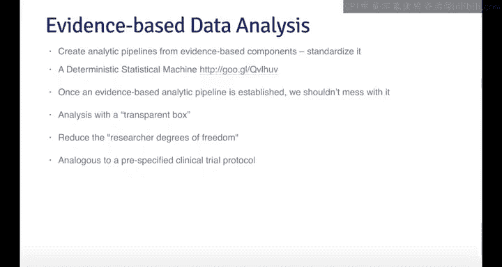

And then at the end you can produce some sort of report which could perhaps be cut and pasted into a methods section or you know posted in some public repositories so I just want to do a quick case study for what I mean by this one of the things that I do a lot is estating acute effects of ab air pollution exposure so these are correlational types of studies。

 a lot of the stuff kind of originated from the 70s and 80s so it's not like we started doing this yesterday we have a long history of this kind of research。

 the basic question are shortterm changes in pollution associated with shortterm changes in population health outcomes。

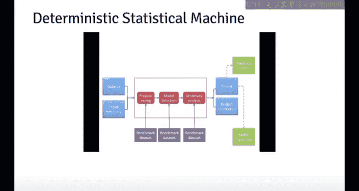

These things are usually conducted at the level of the community and we have a lot and there's a lot of statistical research that has gone。

 some of it done by myself that has gone into this type of analysis。

 so this is what the data typically look like you have death counts as in New York City。

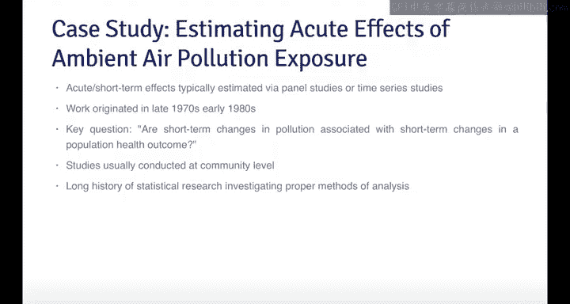

I've going for a couple of years here， and then we have particulate matter levels down here at the bottom。

And you can see there's not as much particular amount of data as there' is mortality because there's a lot of missing data。

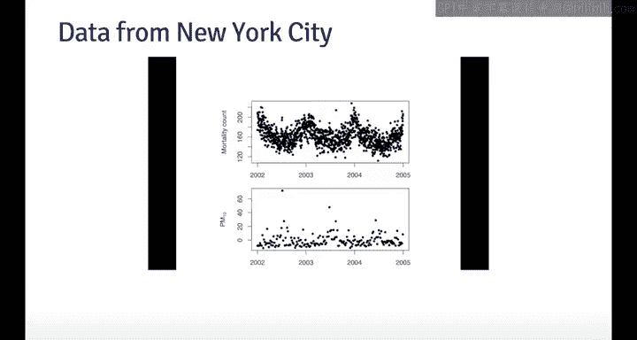

So and basically， you just want to say is this top thing correlated with this bottom thing？

So question is can we encode everything that we found in the statistical and epidemiological research into a single package and I think the answer is yes time series studies like this don't have a huge range of variation and so it typically involve similar types of data may be hospitalizations instead mortality or whatnot but often very similar and so can we create kind of deterministic statistical machine with this area So the basic kind of pipeline would it's a very simple pipeline it's not a very complicated analysis for the most part you want to check the data that's either any outliers high leverageage types of points pollution data is often skewed so you want to make a check for that with ro over dispersion do you want to fill in the missing data the answer is absolutely no there's been a lot of work done on that it doesn't turn out well the big question really here model selection。

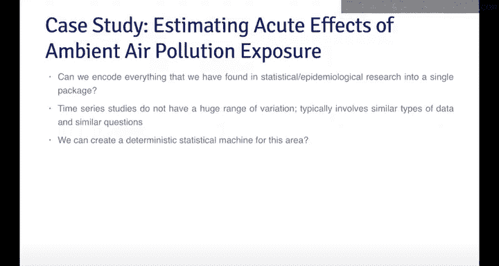

One of the things that we have to worry about is unmeured confounding these types of time series studies we don't measure a lot of the things that vary over time so I guess this is like your batch effects and so you have to there are various approaches to estimating how you adjust these unmeasurd founders when use semiparametric regression methods to do this so estimating the degrees of freedom this has the most profound effect on any kind of association that you might estimate so this is critical so but you know there's a。

There's actually research on how to do this iss been a couple of papers one of is mine。

 but one of the various approaches to estimating this number of degrees of freedom and you can settle on one or two approaches that are that are better than others so we can just implement that other aspects of the model tend not to be that important whether you adjust for temperature and whether kind of doesn't really matter how you do that those other things that you're typically interested in multiple lag analysis and sensitivity analysis so you want to see you can select a model here but you want to see if you move the model back and forth a little bit there' your association change dramatically right so those are the typical things that you want to see in this kind of analysis and when I review one paper a month of a time series study these are the things that I always ask for So 15 second response to why imputation is so bad and setting because the data are missing systematically so the pollution data is very difficult to collect and so it typically only measure once every six days so there's five days are missing for every six day days。

One observation every six days， so you can try to implement imp to impute it。

 but you just add a lot of noise for a little bit of savings bias。

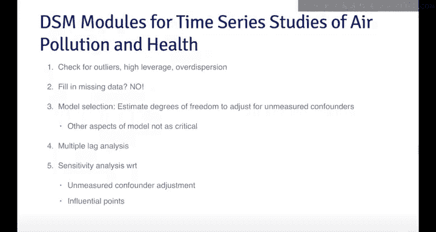

So so my thinking I feel like this is can't have one obviously there's lots of areas of data analysis。

 different problems have required different expertise I can't handle everything obviously so the idea is that we could create a curated library of these machines providing kind of the standardized state of the analysis pipeline the state of the different meetings in different areas obviously time series analysis of pollution is very well developed areas there's not a lot of research statistical research going on a lot of the questions have been settled so we could have a kind of archive with these kinds of data analysis and archive for data analysis one analogy is this kind of Cochrane collaboration which I don't know if many you are familiar with but it's basically an archive of evidencebased medicine so you can go to the Cochrane collaboration search for things like is as so you could search for can you use vitamin C to treat asthma and so here in the summary it says。

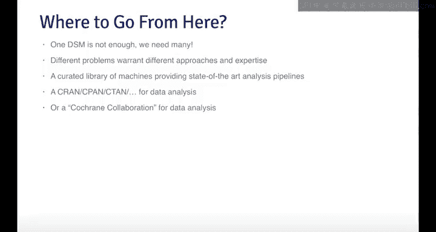

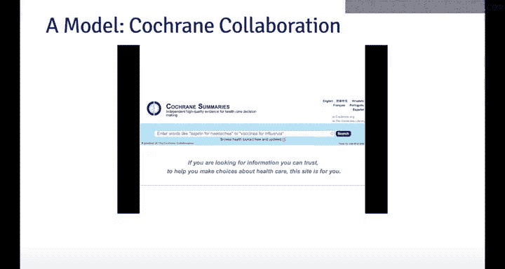

You know， we reviewed evidence， so they just basically do meta analyses。

 they review evidence from nine clinical trials of vitamin C， in general the evidence。

The trials are very small， it's not possible to recommend either the use of the avoidance of vitamin C and asthmas。

 so we don't have worry about vitamin C， it's not going to help us， but it's not going to hurt。

So something like this is the basis for a lot of evidence based interventions。

 evidence based treatments， so something like this could be done for data analysis。

So we could have packages that encode data analyses。

 pipelines curated by experts knowledgeable in the field， these don't have to be perfect solutions。

 but the idea is that they'd be pretty good solutions to kind of cover most of the bases。

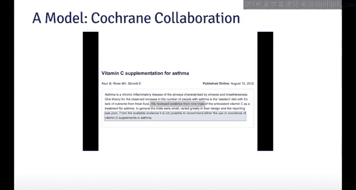

So that's kind of all I wanted to say， I kind of did a basis which I didn't really talk about reproducible research。

 but I do think it's important， except for the fact I don't think it really fundamentally addresses the kind of most important question of whether you can trust an analysis and so I think what I call this evidence-based data analysis which I know some people don't like the phrase。

 but the idea kind of have to come up with organized standardized best practices for given scientific areas and questions and it's not that I don't think that I don't think they exist。

 it's really a question of kind of organizing and getting together。

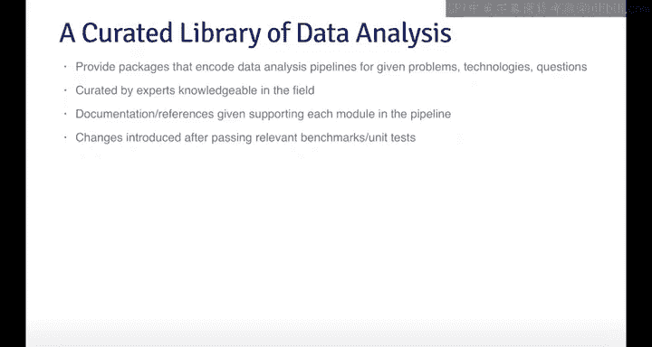

on it， I think this is something that could give reviewers a powerful tool without kind of dramatically increasing the burden on them like you know requiring them to reproduce the analysis would。

 and I think that we should put more effort into kind of addressing the upstream aspects of scientific research。

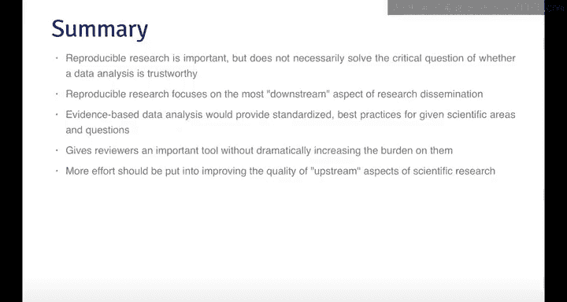