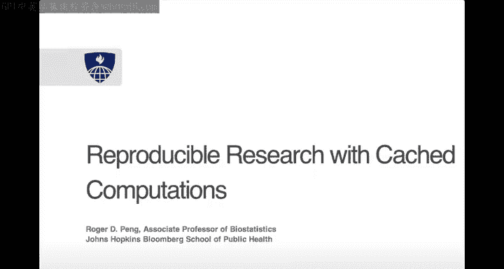
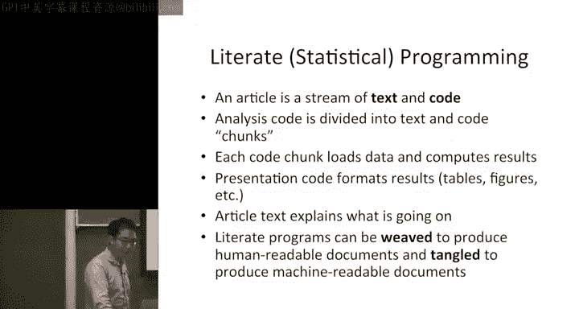
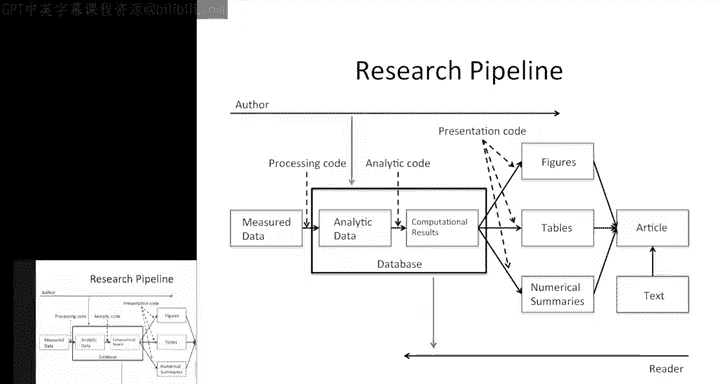
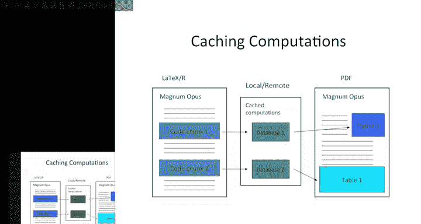
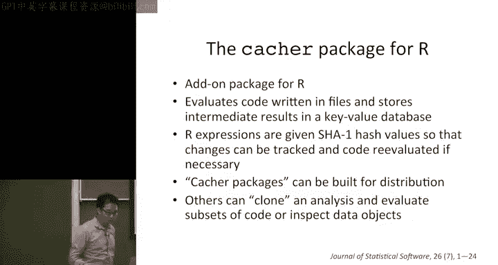
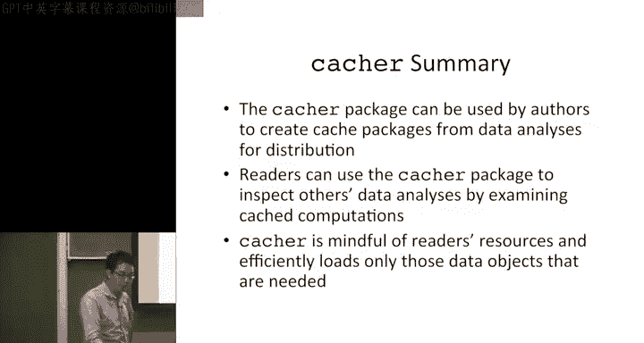

# 约翰霍普金斯大学《数据科学R语言基础｜Data Science： Foundations using R》中英字幕（deepseek - P164：28_缓存计算.zh_en - GPT中英字幕课程资源 - BV1tsFQemEts

So one idea that I kind of building on is this idea of literate statistical programming。

 So this comes from the literate programming idea， which is that。

 you know so here you think of an article as a stream of text and code。

 There's analysis code that has know， it analyze the data or does something with data。

 And those are chunks。 And then there's each code chunk kind of does something with the data。

 there can be presentation code that kind of formats results。

 And then there's text kind of all around that which explains what's going on。

 presumably And these literate statistical programs can be kind of weave to produce a human readable document en tangd to produce a machine readable document。

 So this all comes from this idea Don can do So。😊。

And so the literate。So the liver programming concept requires two things。

 one is a documentation language and a programming language。

 And so there's one particular package so I should have mentioned that I'm going to be talking mostly about the R statistical kind of analysis environment。

And， and so there's one particular package' called Sw。

 which uses lateek as its documentation language and R as its programming language。

 And it was developed by its leash。 and it has a nice website。

 And there are other kind of combinations that you can use。😊。

And so so one thing that I was interested in doing is taking the kind of definition that we had having analytic data and computational and analytic code and say。

 okay， well， let's take the process here， presumably the articles available because it's in a journal。

 and then let's make this part available too。 The idea is that we kind of store these things in some sort of database of sorts and then make it available so the readers the reader kind of wants to go this direction。

 they want to take the article and dig in and articles and authors are kind of taking their data and they're going that way。

 They're producing articles。😊，And so the idea is to take these kind of aspects of of the work and kind of store them in a database to make make it available to readers。

 So in the kind of literate statistical program framework， you have like your paper here。

 which is has text and code and text and code， you take the code chunks。 and you store their results。

 So the code chunks kind of do something with the data。

 you store the results in the code in some central in some database。

Make that you publish essentially the database part along with the paper and then this is the paper here。

 which is generated。 so that you generate the figures and the tables from the materials stored in the database。

So we came there's got two packages that we have， one is this is called Cash sleeve。

 which is for which I won't talk about today， but it interacts with S and the other one is called Caier here。

 which is standalone package。And the idea is that it assumes that you have some code in an R file。

And。And basically it kind of reads your code， evaluates it and stores the results in a kind of a key value database。

 so our expressions。 so the code expressions are all given kind of Sha1 hash values so that if there are any changes that they can be tracked and code be revaluated and necessarily the idea is that you kind put everything code and data in a package that you could just give to someone and we this I call this a cache or package the other people can of can get the analysis called clone or clone analysis and look at subset of the codes or inspect specific data object and one assumption that I made is that other people do not necessarily have the resources that you have and so they may not want to run the entire Markov chain money Carlo simulation that you did to get posterior distribution or the histogram you've got at the edge。

 they might just want to look at specific end products that then maybe when they see the end process oh well maybe I do need to look at the whole MCM but the idea is you kind peel the onion a little bit rather than just go straight to the core。

So and so the model is basically that you have some code source file， there's code that goes in。

 there's data that goes in and outcomes， results， right。So as an author。

 the idea of cache is that it kind of parses the source file。

 it creates directories and subdirecties for storing things。

 and then it evaluates each expression also if you run it multiple times if an expression hasn't changed。

 it won't run it again so it just load the as it runs expressions。

 it cache as the results of the database So if you run it again and nothing's changed。

 you just kind of load the results back from the database and then it writes out a bunch of metadata for each expression and then once you kind of evaluate your whole analysis and granted this might take a long time everything all the kind of intermediate results are stored in the database and you can kind of wrapped that up into a package。

😊，So that's the idea here with this cache package function。

 And it basically it it becomes a zip file， a package， and it can be kind of distributed to others。

So that's kind of what happens as an author here。 And so a very simple analysis。 You know。

 you're loading some packages， youre loading a data， you fit some simple linear model。

 And then you if you want to summarize with the fit was look at the regression coefficient。

 things like that。 And then you make a plot here。 So here you're just plotting some diagnostics here。

 So the idea is that any any expression that kind of has that does something then the results of that something or stored in the database。

 But expression doesn't do anything。 maybe just print something to the console。

 then nothing is stored。 So something。Creates a variable。

Right so in our if something is created in the environment then that is stored。Yes。

The figure yeah right， so we don't store the figure itself。😡。

And then the idea is that the package would have an identifier like Sha one here。

 and then so the idea that you could say， if you were writing an article， you can say， well。

 everything in this article can be found in this package。 and here's the identifier strings。

 It's ugly。 but you know， you can just use for you can use the first four characters。

 and that's usually enough to identify。The package itself。 So on the reader side。

 then if you're reading something like this in a journal， you could say， okay， well I'll take this。

 I'll take the string and maybe I don't want to read the whole thing。

 I'll just get the first four characters out and you can clone the whole thing And so Ill get to where it comes from later。

 But and the idea is that you can see you can clone。

 you can see what files were cached there and and then kind of go through the analysis。

 So some local directories are created。 The source code files and the metadata are downloaded。

 But the data themselves are not downloaded initially。😊，Right， because it could be a lot， right。

 know， And so that's not done by default。 And but references to the various data objects that have been created are loaded So that the idea is that these are lazy loaded into the environment。

 Once you want to look at something， then it gets downloaded into your into onto your computer。嗯。

And so the idea is you look at the code， and so this is just some simple analysis that I've done。

 you can make a graph of the code。So this takes all the data objects in your kind of this simple analysis that I've done and kind of graphs how they've kind of come together。

 So like these three things， the cities variable， the classes and this vars thing came together to create this data and then data was combined with this quasi Poisson function to create estimates and then you know so and the estimates were later used to create this effect and standard error。

 So I mean， that's the kind of rough graph of how the analysis worked。And so the idea is okay， well。

 someone might look at this of course， youd have to do some reading to figure out what exactly was going on here。

 But the idea was if you were interested in this and knowledgeable a little bit you can say， okay。

 well， I'm interested in this data object， what went into the creation of that data object And so this object code function。

 you can grab the name of the object and it will show you the specific lines of code that were used to generate that。

 So if you have a file， there may be many lines of code。

 but only subset set of which were important to generating a specific object。

And so these specific lines， it turns out it's just one through5。

 but these specific lines of codes were what kind of created this data object， right。

 So there may maybe different types of objects。In the， in the analysis。

 and you can kind hone in on some of them and say， okay， what was the code that generated this。

Object。You can also execute the code with the run code function。And what it does is it。

It runs the code， but it runs it in a way that that it just loads things from the database without actually executing code by default。

 So if you just kind of want to run it and see kind of some results at the end as a first cut。

 then it's not do everything from scratch by default And so it's a lot faster on the first go but then of course things' things that aren't stored in the database。

 So if you make a plot，'s still going have to generate the plot because that's not stored in the database。

But， but by default， it just loads things， loads objects from the database to make things faster。

 You can， of course， force it to just run everything from scratch， and then it。

 it will do all the calculations from scratch。But there may be， for example。

 there may be some expressions that you want to run from scratch and some that you just want to load from the database because they're going to。

 you know， they're going to take a long time。But in art and then importantly。

 So the check code function evaluates all the expressions from scratch。

 so it doesn't load anything from the database。 It runs it all straight away。

 And then the evaluations are checked again stored results。

 So the idea is that if a function creates an object， when the author create the package。

 the kind of signature for that object was stored so that if you create the object again。

 it'll check the signature to see if they match。😊，Of course。

 you've got to set things like random number generator Cs for this kind of thing to work。嗯。呃。

And then there's another kind of side function that checks each individual data object to see if any corruptions basically checks the signatures。

嗯。So you can load you can look at specific data objects and so what this load cache functions So what the load cache does is it just loads loads pointers to specific data objects that are that may be sort on a server or something like that。

 And the idea is that once you once you print something out to the screen or you want to make a plot。

 any time you access the object it will transfer from wherever it's coming from。

 So here it's transfering from the cache database file。

 and then each object has a signature and that's the signature。And then it shows you what it is。

 So once it's loaded into your system， it's loaded for you。 You't have to do it every single time。

Just the first time。 And then these are just different things that you might want to look at。

That that are transferred from from a server。 So， so the summary。

 the basic idea of this package is that you can authors can kind of create their kind of package their analysis in some sense。

 and then just give it to people and then people can down readers can download the analysis and look at。

 you know， look at specific objects or maybe rerun the whole thing。

 But there's some flexibility in terms of not having to kind of recreate the entire environment if it's a very complicated type of thing。

And so I try one of the goals is just to be mindful of readers resources and to kind of efficiently load things that are needed。

啊。