# 约翰霍普金斯大学《数据科学R语言基础｜Data Science： Foundations using R》中英字幕（deepseek - P166：30_案例研究：高通量生物学.zh_en - GPT中英字幕课程资源 - BV1tsFQemEts

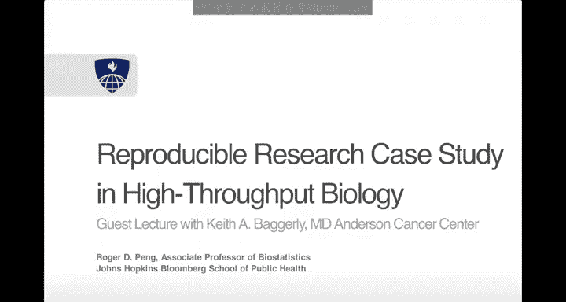

Hey everyone， this lecture features Keith Baagerly who is a professor in the bioosstatistics and Binformatics department at the MD Anderson Cancer Center here in this lecture he's talking about a case that happened with some researchers at Duke University regarding using high-disional genomic signatures in cancer outcomes。

 so take a look at this lecture it's a really important story and I think there are a lot of important lessons that you can learn from the experience that you went through。

Okay， so thank you for sticking around for the very last session we're in the home stretch so I really appreciate you being here so that's a very good thing and I want to talk a lot about a theme that we haven't focused on explicitly in this conference so far。

 which is the importance of reproducible research in high throughput biology。

 as we're generating better and better assays and we're generating more and more measurements thousands of things it becomes increasingly important since the analysis takes a larger and larger chunk of time that at some stage not only us but others。

😊，Should be able to precisely reproduce what we did。 In other words。

 if they start with the same numbers， should they get the same results。

 And we'd like that to be true。 Now， this is actually really important in high throughput biology。

 for a somewhat different reason， which is simply that。😊，And once I will get this advanced。

 then we will tell you what it is，s。Okay well I can gesture and I can tell you what it is。

 which is simply that our intuition about what makes sense in high throughput biology actually is pretty darn poor what I mean by that is that in many cases I've worked with clinicians where I've gone in and I've said this gene has gone up and that means these people are most more likely to develop advanced cancer and the clinician has turned to me and said no what that means is that you've got strronal contamination in your samples because I've worked with that gene for 15 years and I know how it behaves and they're right。

 they have intuition for single genes on the other hand if I go to that same clinician and I give them the following signature of 100 genes and I say this goes up。

Well they'll stare at this list of 100 genes and they'll say yeah I can see that because this will influence this and this will influence this and it's wonderful it's a roachch test for biologist to give them a gene list of 100 things and unfortunately we've tried the null experiment of giving a random list to some of our biologists and they still find patterns so this is somewhat of a warning now in light of this we find it somewhat dismaying that when we go to the literature and we take a typical paper and we try to figure out what was done。

 the documentation is often poor and if the documentation is poor in some cases if the finding is important。

 we are forced to resort to what we have come to refer to as forensic bioinformatics which involves starting with the results and the rawea and saying what must they have done to get from one place to the other regardless of what the methods say they did and I want to illustrate this and how important this might be by considering a specific clinical example specifically using signature。

😊，Gomic signatures to try to predict response to cheemmoensitivity and this is actually based on work that appeared a few years ago now at the end of 2006 this is a paper that showed up in nature medicine and what they said if what they claimed in this paper was that they've figured out a really great thing specifically starting with cell lines they figured out how to come up with genomic signatures of sensitivity to a whole bunch of drugs so here's how this worked they're not just working with any panel of cell lines they're working with the NCI 60 and the NCI60 as was alluded to in the last talk is a very special thing one reason it's very special is that it's a standard panel maintained by the National Cancer Institute and what that means is that if you've got a new chemtherapeutic that agent will be sent to the National Cancer Institute and they will test it for efficacy against this panel of 60 cell lines and that information about which drugs are most effective against which cells that's public data you can go and you can download it and you can download this。

For every single chemotherrapeutic now available so if you can figure out how to leverage that information that's potentially a way to use or choose the best single drug that's out there for a given patient so what they said was they said okay using the NCI60's start with the drug of interest like do ofaxile let's most sensitive and most resistant cell lines those are our extremes let's take array profiles of those cell lines okay fine let us contrast them and identify the genes that are most different between group one and group two these genes will comprise elements of our sensitivity signature and then they say let's fit a model to come up with the sensitivity signature and for doing this they use metagenes which sounds really cool but to mathematicians we otherwise know it as principal components and I'm going to use that terminology and they're going to say okay using these metagenes let's try to fit the the cell lines and predict on clinical samples and they tried this with a whole bunch of public data sets using seven commonly used。

They reported great results and I know this was really splashy because within two weeks of this paper appearing。

 we had three different groups of MD Anderson coming to us in bioinformatics and saying we want to do this。

 help us do it and being helpful bioinformaticians we said well sure we'd love to do that and in particular since all of the data involved is public we should be able to go out and figure out how to do it ourselves and generalize it to other trials okay so let's try that and we decided to try that starting with those aaxel so we starting with the most sensitive and most resistant cell lines in this case we're going to be using un95 a arrays for the Nci 60 these arrays were running in triplelics we've got three for each and when we did this and we tried to the training data here is a plot of the first two principal components of these things and what you can see not too surprisingly is that you have some pretty clear separation between all the resistant ones at the left and all the sensitive ones at the right this little triangle of three things those are three replicates of the same cell lines so that's sort of what we expect to see now this separation should not。

😊，Surprise you this is the training set we have picked the genes specifically to achieve this separation what we now want to see is we now want to see clinical samples project it into this same space and see this separation so that we can use it ourselves so we took predicted the actual patient information and we projected it into this space。

And we did not see the separation that we were really hoping and expecting to see。

 So of course this led to the natural question of did we do something wrong and this is of course now we're going to start to reconstruct exactly what was done and to do this we began by saying okay okay what were the signatures or the specific genes that they used for the individual drugs and this is actually somewhat easy because in the supplementary material to their paper they included here are the lists for each drug of all the apimetrics probe set IDs that are involved in all the genes that are involved and in the paper they also gave some explanations about here are some genes that make sense in the context of this drug because it explains the biology and so on like that so okay so we decided to pick one of the drugs and we started with fivefouricil and what we want to be able to do with this is we want to be able to construct a heat map that looks like this this is a heat map that actually showed up in the paper this is of the 45 genes that they picked out for fivefouricil and one of the things that you can see is this clad pattern because every one of the 40。

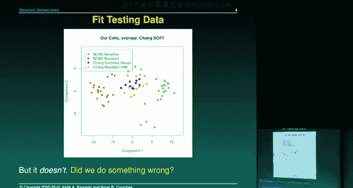

5 genes has a pattern that we like when in other words it's either high in one group and low in the other or low than high so okay extreme separation that's what we expect。

 that's what we want in the cell lines so well howd they pick these well they pick these using two sample T tests and I'm a PhD level statistician so I've figured out how to do two sample T tests by this point so we tried it ourselves so here's our best 45 using T tests so okay great and then we said all right let's take the list of a fewmetric probes that ID for their 45 and take a look at that heat mapap and。

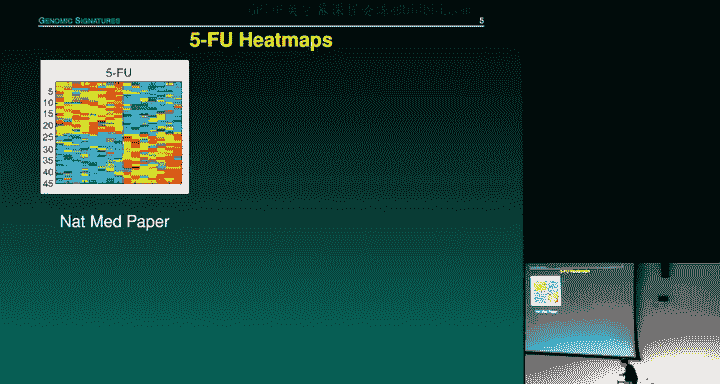

We didn't see again what we were expecting to see， so we then decided to try something which we've learned to unfortunately do every once in a while。

 which has been just a bit paranoid about the data and what we did then was we took our list and theirs and we put them。

Side by side， so there's their list and there's ours。Does anybody notice a pattern here？😡。

What we have here is indeed un off by one indexing error。

 this is true for all of the genes in this signature now what does that say to you about whether or not certain genes making sense in terms of the biology really holds when they're referencing a set of genes that actually isn't involved。

😡，So now of course this is just one drug they looked at seven， so there's six others。

 so what we decided to do for these six others was we basically took their reported at IDs。

 moved down one and looked at the P values to see if they were really small， so let's see well。

Tpo Tcan y they're all off by one Etoppoide off by one Adriaosin mostly off by one there's a few we can't explain packletaxel mostly off by one doseotaxyl mostly off by one and cytotoxin we have no earthly idea what they did with this drug so okay fine we've got this and we know that that's one problem Now how is it that this problem could arise and to answer that one we went in and we looked at the software that they were using and as a side note if you want to read documentation on how this software works you should go to our website because I wrote it because we couldn't find any and one of the things that we noted was that their software in order to work required two input files the first input file is the quantification matrix genes by samples and this matrix needs a header row where the header is either zero1 or two to indicate that this is a training sample sensitive training sample resistant or a test sample who's and we don't know that's the first input。

 the quantification matrix the second input is a list of gene9s gene names。

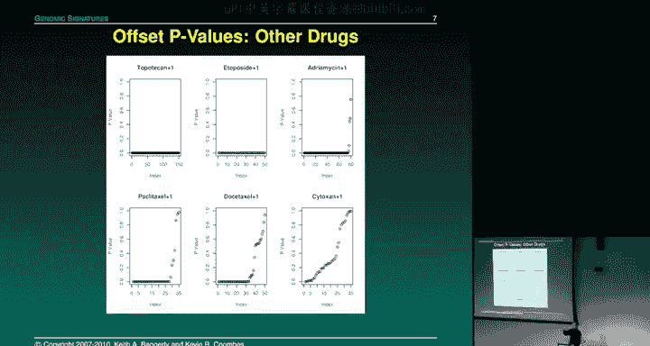

In the same order as in the quantification matrix， but for their software to work correctly。

 this second input must not have a headerro。 So if you start with an Excel file and you copy and you paste and you've got a title at the top that says gene name。

 guess what happens。😡，You will get it off by one indexing here and as you run this through your software we tried this with those ataxel and we perfectly match the heat maps and we also got some of these offset genes so we know that that works but again that's one drug。

 dose aaxyl out of sevens what happens with the other six well let's take a look toppotekin we can perfectly match the heat maps。

 we know what cell lines are involved， we know what genes they should be producing fine adumomyosin perfect Etoppoocyte perfect5 at h perfect packotaxyl well we mislabeled to a cyclclohoside in the paper。

 but and cyclhosmide we still have noworth the idea what they did with this gene So okay there's this things that we can perfectly match the heat maps for six of the seven drugs we understand what they did Now actually before we go on I should note that this should actually bother you and the reason it should bother you is that we perfectly match the heat maps for six of the seven drugs but we managed to perfectly match the gene list for only three。

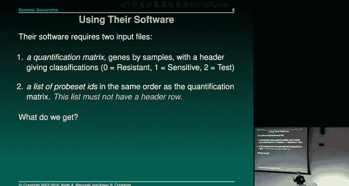

For four of the drugs there are included other genes that we can't explain just yet they are outliers and we'll come back to those because before we get there we also noticed in using their software that something that was more important to us which was that their software also gave predictions and this is the clinical thing that we're really interested in we want to know is this patient going to be sensitive or not so we wanted to see can we get good predictions out of this software and the way we're going to check this well there's a bit of a problem in that the paper doesn't say for the fit and data sets that they fit this patient turned out to be sensitive this one resistant they just gave us an overall rate of accuracy okay so that got if they've got 24 patients they got 22 of them right okay fine so we're going to say that we understand the classification algorithm or this thing well enough to use it if we can get accuracycuracies at least as good as the ones that they report okay that's our bar so that of course brings about the next question which is just how good are the accuracy rates that they obtain。

So we're going to look at this in the context of dosotaxel and this top plot is a figure from the paper and you can see the scores for the sensitive patients and they're mostly low with blue squares。

 that's good resistant ones are high and they've got red triangles and that's good and I have a question here I have an analysis question for the audience the analysis question is how many blue squares are there。

13 that is correct we have up there in the top plot13 sensitive samples and 11 resistant ones Now there's a second panel on this page right here。

 The thing is this panel doesn't come from this paper。

 This panel comes from a paper by Chital they're the ones that actually introduced the test set being analyzed here and according to Changital they thought that they had 11 sensitive and 13 resistant so 13 11 or 11 and 13 that may be a problem so we decided to take a look at a different drug namely Addriaosin and for those of you who are real math whizzs here how many red triangles are there。

😊。

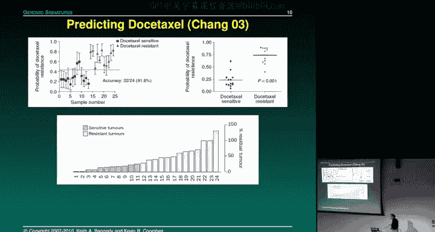

Okay， for those who aren't quite that ambitious， are there more red triangles or blue squares？How on。

 this is not a trick question。I hear red triangles or what so basically we've got a whole bunch of patients that are resistant to therapy the problem is in this case。

 the underlying data set that supplied this thing， this was from a paper on childhood leukemia the reason this is a problem is that childhood leukemia is a disease for which we've actually got a pretty good cure rate around 80% and what that means is that if we've got a drug to which most of the patients are resistant we wouldn't be using it。

And indeed， if we go back to the original paper that submitted it。

 they thought that most of their patients were sensitive。So what do we think is going on。

 we think that for0 and1， they swapped the interpretation in feeding it into the data and they didn't realize what they were doing Now。

 what does this mean clinically， it means that well they're going to use that signature and they're going to administer Addriaomyosin just to the patients who will derive no benefit from it。

This is poor clinical practice so we don't think this is a good idea so given this there is the question of okay if they're mixing things up this badly how is it that they're getting good predictions in the first place and actually this leads back to one of the things that we passed on just a few minutes ago which is that there were some other genes and in particular for dose ofaxel there were 50 genes if we take our list of dose ofaxel and we do this off by one trick we match 31 that leaves 19 of these 19。

 there's the question of where can they come from Well if you go back to the initial table by cha ital that supplied the test set they say if you want to separate our resistance from our sensitives here's a list of 92 genes that'll do the job so we said okay let's take a look at the 19 we can't match and compare them with the 92 they report and we find out that there is an overlap of 14 genes there you go there are entries 7 through 20 in this list one contiguous block I think we have some statisticians in the audience so quick question if I pick 14 items at random from a list with 92 in it how often do they all。

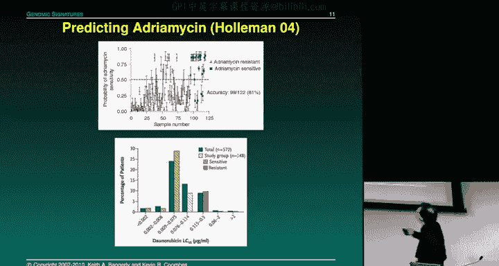

You're right next to each other。The PW is small， you can get published with this one Okay now of course this still leaves five。

 one of the other five well there are the ERCC1， ERCC4 Ub B2， BL 2111 and 23。

 thing the common theme of these five is that these are the genes mentioned by name in the paper to explain why the signature works。

So for the dootaxile signature， we have the genes that work to split the test set。

 the genes that work to split the training set and the genes that are there to explain why it works。

 and there is no overlap between these three。We thought this was somewhat disturbing。

 so we wrote a letter to nature medicine and one of the things about this being a talk on reproducible research is that you don't have to take my word for it。

 which means that you can go to nature medicine， you can read the paper you can also read our reports which contain all of our code you can run it through our and you will get the same numbers we do as a side note for data compression our note to nature medicine is 700 words there's 140 pages of supplementary material for those 700 words there so there's a bit of a compression there so that one's fun and so all the data is there and then of course we waited to see okay is there a response so they say。

 oh well whoops we got it wrong， we'll fix it next time well no that wasn't quite the response。

 The response was well unfortunately the analysis of Bagggerly and cooms is deeply flawed and amongst other errors well。

 first off for Addrianemiaosin。 the labels， this is the one where they have a lot of red triangles the labels are actually correct and we've posted details on our website to illustrate this and they must be wrong because we've gotten this approach to work again and in their rebuttal they note that。

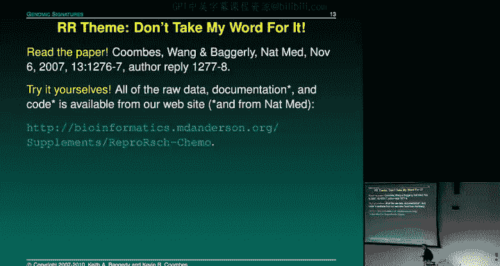

e it twice in newspaper papers with editorials and things like that。

 so we must have screwed up and well。Given the timing I'm not going to be able to go through all of these。

 but I want to look at some of the data for one or two of these just illustrate what might be going on So let's start with Addrianosin for Adrianosin。

 they say they've got the labels correct on their website so we went to their web page and we said what's there well actually when we went there we saw that there's a table of quantifications for 144 samples 22 for training cell lines and 122 for tests these are the patient ones for which they're making predictions and we said well maybe we can find something that separates the responders from the non-responders so we decided let's try to cluster it and as a prelude to that let's just check the correlations between individual pairs of elements and what I'm going to show you now is a plot of all the really high correlations we see in this matrix of 144 samples here's the submatrix corresponding to the training data the cell lines and here's the test data Now the red line on the main diagonal we expected samples are indeed highly correlated with themselves that's good。

However， we didn't expect these red dots off the main diagonal， what's going on。 Well。

 turns out they have 122 test samples。But the 122 are not all distinct There are some samples that they have reused to three or even four times and there's a sample right about here which has been reused four times which has been labeled as resistant three times out of four now that's the same sample so we're pretty convinced that the labels are not all correct even now so we sent a further note to nature medicine about this and nature medicine forwarded this on the authors and then they got back to us and said well they' all adjust it so we'd see no need to publish your note okay fine and indeed what they said later in August of 08 was that they had read on the analysis using only the 95 unique samples and they again gotten great results now for those of you who are listening to me carefully before you will recall that I said that there were actually 84 distinct samples so hearing that there were 95 was a bit of a surprise to us so okay but fine and what they do not well when they corrected this in August 08 they actually took down the quantifications and they just put up a list of the 95 geoIs of the arrays involved so let me show you。

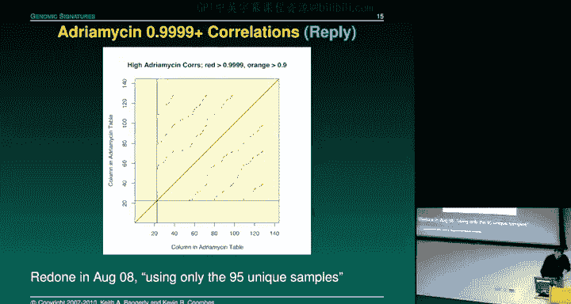

The first 20 of the 95 they now list。😡，And I've highlighted a few of them。

Because that seems twice that seems twice， this one used twice and labeled both ways so actually of the 95 which is this is the second correction by the way。

 15 are in duplicate of those 1566 are labeled both ways and furthermore since they've actually now told us the geoIDs of the individual arrays。

 we can actually go back and figure out what the initial submitters thought they were in terms of resistance or sensitive so the group the Duke group says that 61 are resistant 13 are sensitive and 6 we don't know the people submitting the data thought that 22 were resistant。

 48 were sensitive and 10 they labeled as intermediate they didn't classify them。😊。

So for Addum Iosin， we're not convinced this works。Well all right。

 there's still other things that they put out there。

 there's other papers with editorials let me show you one of those。

 This is a paper that showed up in the Journal of Clinical oncology by Suette Hall and in this paper they extended the approach to deal with two new drugs isplin and Pemts it these are important being treating lung cancer and one of the things that they thought was really neat was that they said okay we actually don't like the NC60 for all drugs so we're going to shift to a different set of cell lines and these cell lines were profiled on FU133 as and one of the things that they did using this was they came up with a signature for Cipltin versusspltin they pointed out something important specifically that the signature they found contained ERcc1 ERcc4 and DNA repair genes that's important because there have been several papers in the New England journal saying these are related to how you treat lung cancer so that's really cool so what we do well we took the data and we said all right let's try to see if we can match the heat map so we know the cell lines and the genes involved and after with some work and that's another compression thing there we did managed to exactly match the heat maps and fors plain after we。

Exactly matched the heat map， we took a look at the genes involved。

 and we discovered that we could match 41 of the 45 genes they report after accounting for this off by one error that's still there。

There's four that we can't match at all。Do I have any guesses from the audience as to the identities of those four？

The four that we cannot match are ERCC1， ERCC4， ERCC1 again in F M and of these four the last two are special because as it turns out。

 those two aren't on the U133 ARAs。 They're on the U133B So two of their best genes they haven't measured yet。

 but hey， who needs to conduct experiments if you know the answer。

 This is a wonderful finding okay great so we were disturbed by this as a side note we submitted a correction for this one to JCO and they sent us a note back saying we're sorry we can't publish this and we said okay fine and over the next few years what went on from there is that there were other papers that kept on coming 070809 but middle of last year we learned something new that sort of disturbed us and what we learned middle of last year。

Was that they'd already started running clinical trials。

 using these rules to allocate patients to treatment arms。

They're doing this using Pemmetreids platin， Pemetrxid and venyleline， dotaaxin doxyriicin。

 and for several of these drugs， these are in cases where in the posted signatures they've gotten the sensitive and resistant labels reversed。

So we think this is a problem so we wrote up a paper on this we first circulated it to a biological journal and got the comment back that we're sorry this story seems too negative。

 can you fix that at which point we said well， we probably can't so we sent it off the aisleles of Applied Staistic on the 1s of September it was accepted and published online by the 14th at which point was covered by the press Duke starts an internal investigation and suspended the trials pending the end outcome of the investigation that was October of last year so what happened next？

As of the end of January of this year。Duke decided to restart the trials and in particular。

 they said that their investigation， which was now concluded had strengthened their confidence in this evolving approach to personalized cancer treatment Now we were not really pleased by this and the main reason we were not really pleased is that we asked them well okay。

 we don't understand the data， can you show us the data and stuff that you used to come to reach this conclusion and they said well。

 no， while the reviewers that conducted these things approved our sharing our report with the National Cancer Institute。

 we considered it a confidential document so no you can't see it。

which disturbed us and as a side note， there's's just one more thing。

 which is that this investigation took place between October and January。

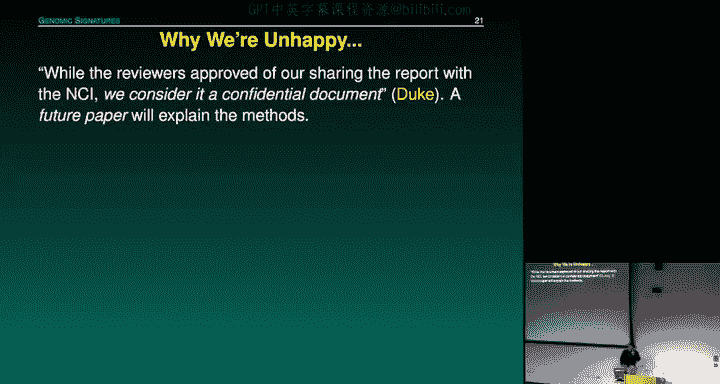

Well as it happens in November， something new happened In November， they posted data。

 They posted new data for one paper dealing with cispltin and Pemmerexit。

 These are two of the drugs they're using in clinical trials and in this data。

 they said here are the 59 samples that we're using as a validation set to show that this works these 59 samples are a subset of this one geoda set and we're using it to make predictions。

 So we said okay cool， we see these 59 samples， we've got the ovarian ones。

 let's go in and take a look at them。 So the very first thing we did with these 59 samples was we said let's go back to the geodata set and see if we can match them up and when we did here's what we found so what if the names matched up for all the 59 samples。

 we should see 59 red squares lying on this blue diagonal line。

How many red squares do you see lying on that blue diagonal line？

This is not a hard counting question。No。43 of the samples they got the labels wrong for 16。

 they didn't get the labels wrong， or at least the problem is for these 16 we can't tell the reason we can't tell is that for those 16 they've scrambled the gene labels so badly that we don't know what samples they correspond to what this means is that for their validation data set every single sample is incorrect。

For two drugs they've been using in clinical trials for two years。We think this is disturbing。

So what happened next， we pointed this out at the end of January。No response。So we then said。

 can we do anything else and it occurred to us that they said， well， we won't show you the report。

But the reviewers approved of us sending it to the NCI。

Now the NCI in the US is a federally funded institution and what that means is that they are subject to federal law。

 specifically the Freedom of Information Act， so in April we filed a request with the NCI to get the report under the Freedom of Information Act and at the start of May a redacted version of the report was indeed supplied and we looked at and we found a few things that were rather interesting in the report or weren't in the report。

 the two main things that we found were that first off。

 the review committee that went through this stuff， the people who evaluated it said by the way。

 we couldn't figure out from the data that's been published how to do this。

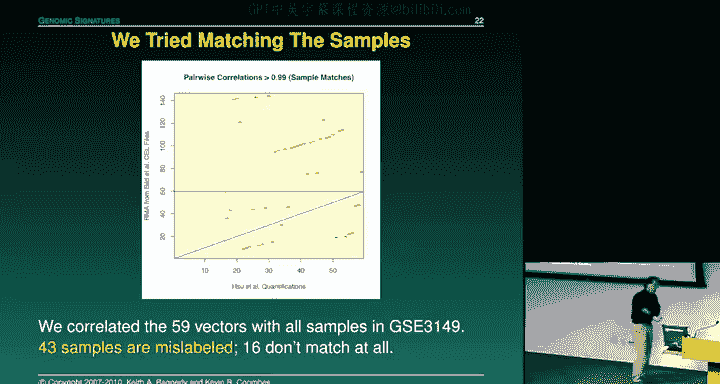

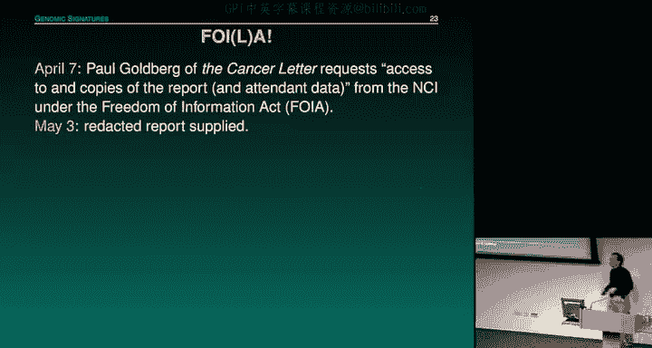

The only way we got it is because there was extra information supplied to us。

 And we really recommend that the investigators make that public。 So that's one thing。

 The other thing that we found rather disturbing was what wasn't there。Specifically。

 this report makes no mention of those problems with cisplin and Pemmettrexa that I just told you about it's not there。

So we pointed this out in May and also in May we asked the National Cancer Institute。

 what do you think about what's going on and while they said let's look at the trials。

 we actually don't fund those three clinical trials， we do fund another one it's a phase three。

 and actually based on that they reinvestigated the rationale they yanked that signature from the phase three clinical trial in the middle of the trial。

That's mid May。We said， okay， is there anything further that's going to happen with the three ongoing trials at Duke。

 nothing happened？Nothing happened for two more months。And then in mid July。

 we found out something new that's a bit orthogonal from your normal statistics。

One of the PIs used to claim he was a Rhodes Schar。The Rho's trust in Britain says no， no， he wasn't。

 So indeed， it appears there was some C fudging involved。

Now what happened then was that I knew that there were a few statisticians who'd been talking about saying maybe we should write a letter on so I emailed a few of them the day this came out and said you know if you want to write a letter。

 now's about the best time so the following Monday three days later there was a letter from  33 biostatisticians find a few that you like and the cancer letter comments that Duke's administrators have accomplished something monumental。

 they triggered a public expression of outrage from biostatisticians cool but the fun thing about this letter was that it went to the newly appointed head of the National Cancer Institute Harold Burace and to Duke and to the DOD and to the press so this one got some coverage。

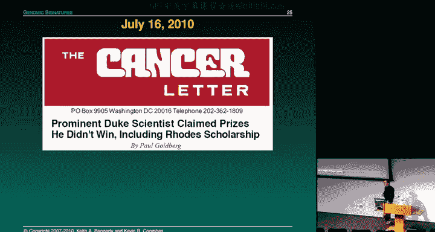

So what happened then？Duke suspended the trials。This has since been covered just a bit in a few other outlets like NPR Science nature and some other their flyby night journals and a few other investigations are underway and there's actually a new Google group devoted entirely to reproducible research and things like that。

 but as we've been looking at this there is a caveat that I think we should keep in mind and that caveat is that unfortunately some of these mistakes like the off by one。

We've seen them before。 This is not the only time we've seen some of these examples going back to 2002。

 2003， 2005， these types of errors have been around for a while。 This is an egregious combination。

But the problems are there， so some observations。The most common mistakes are simple ones。

 For example， in statistics， the simplest one here for genomics is complete confounding of the experimental design。

 Others involve mixing up sample labels， gene labels， things that are easy to do in Excel。

 Okay those are easy to mistake Now the fun thing about simple mistakes is that if you see them。

 they're easy to fix。 But if the documentation is poor， you won't see them。

 So they will slip by because our intuition is no good。

 And what that means is that if you go out to the literature， we sort of suspect。

That the most simple mistakes are more common than we would like to admit。Now。

 what would we like to have happen？Well， for papers。

 we've got a little thing of saying here's some things we really would like to see。

 in addition to data like this stuff at GeO， we' really like some idea of if you're going to supply us with a table of quantifications。

 please label the columns， tell us which samples are which。And provide code。

 So these are some other things。 and these are recommendations for papers。

 but we think they should be absolute requirements before you start clinical trials。Now， do we。

 as the phrase goes， walk the walk， what do we do？

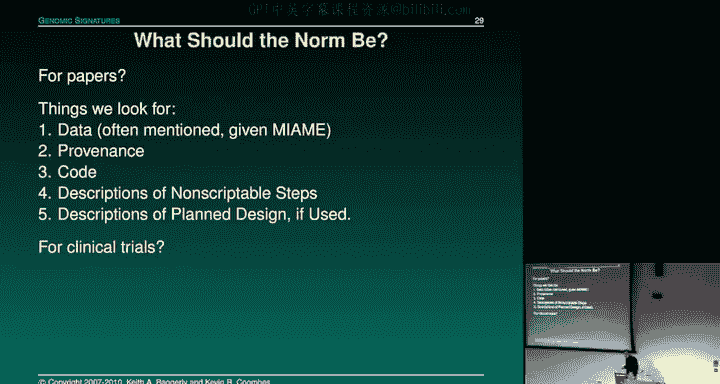

Partially in response to this about in early 2007， Kevin Cooms and I went into our Department of bioioinformatics at MD Anderson。

 we said， guesss what， henceforth， we are announcing by Fiat。

That all reports that we write are now going to be written in Sweave。 combination of R and law tech。

 The fun thing about Sweav is that you can take these reports。 You can run them through R。

 Some else can run them through R and get the same numbers。As a side note。

 most of our reports now go are written by stat analyst， faculty member teams。

 the analyst writes the report submits it to the faculty member。

 the faculty member proofreaded that reruns the code if necessary and only after that second approval does it go off to the biological PI。

This has actually helped our reproducibility quite a bit。

 so actually if you ask us what we did in any report going back for about three years now。

 we can tell you exactly， we find that useful。But the buzz phrase in all of this is reproducible research。

Now， so I've given you some observations and I've told you the lessons that I really want you to derive from it。

 so I have one last slide and that is to acknowledge some folks。

 so Kevin Cooms is my primary co-author in all these things。

 some other folks at MD Anderson to various groups that provided money at the MD Anderson and of course if you want to read more you can go to the Annals of appliedlied statisticsistic and you can read the paper you can look at the code even better you can cite the paper because that'll make me famous and my mom happy and she can buy me more micro highs for Christmas and I have one last acknowledgement which is to you my kind audience for bearing with me for the past half hour and that's what I got thank you。

You very much。

