# 约翰霍普金斯大学《数据科学R语言基础｜Data Science： Foundations using R》中英字幕（deepseek - P17：16_实验设计.zh_en - GPT中英字幕课程资源 - BV1tsFQemEts

Now that we've looked at the different types of data science questions。

 we are going to spend some time looking at experimental design concepts as a data scientist。

 you are a scientist and as such， need to have the ability to design proper experiments to best answer your data science questions。

 experimental design is organizing an experiments so that you have the correct data and enough of it to clearly and effectively answer your data science question This process involves clearly formulating your question in advance of any data collection。

 designing the best setup possible to gather the data to answer your question。

 identifying problems or sources of error in your design。

 and only then collecting the appropriate data going into an analysis。

 you need to have a plan in advance of what you are going to do and how you are going to analyze the data if you do the wrong analysis you can come to the wrong conclusions。

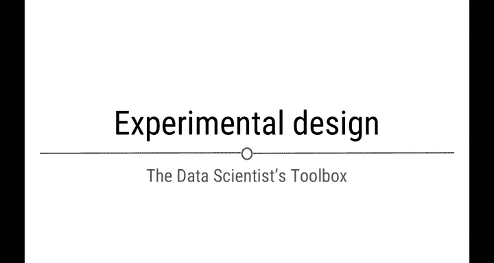

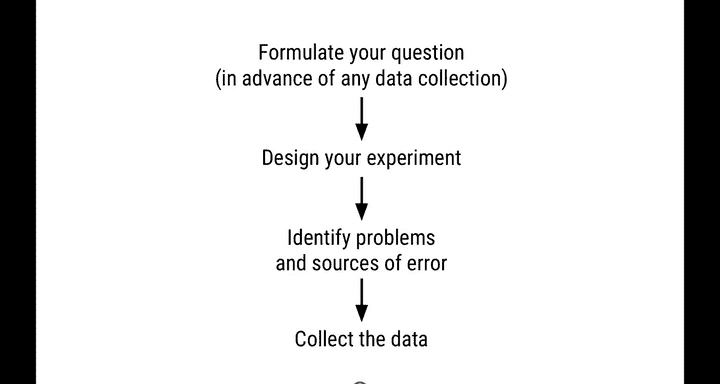

We've seen many examples of this exact scenario play out in the scientific community over the years there's an entire website retraction Watch dedicated to identifying papers that have been retracted or removed from the literature as a result of poor scientific practices and sometimes those poor practices are a result of poor experimental design and analysis occasionally。

 these erroneous conclusions can have sweeping effects。

 particularly in the field of human health For example。

 here we have a paper that was trying to predict the effects of a person's genome on their response to different chemotherapies to guide which patient receives which drugs to best treat their cancer as you can see。

 this paper was retracted over four years after it was initially published In that time this data which was later shown to have numerous problems in their setup and cleaning was cited in nearly 450 other papers that may have used these erroneous results to bolster their own research plans。

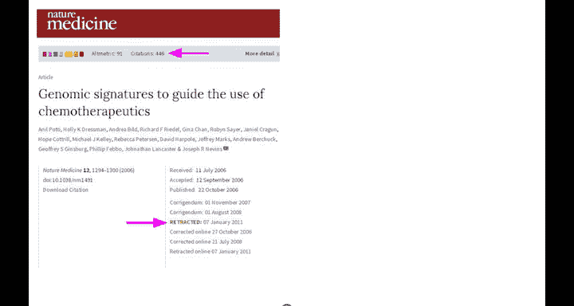

On top of this， this wrongly analyzed data was used in clinical trials to determine cancer patient treatment plans when the stakes are this high。

 experimental design is paramount， there are a lot of concepts and terms inherent to experimental design let's go over some of these now In variable akaA factor is the variable that the experimenter manipulates。

 it does not depend on other variables being measured。

 often displayed on the X axis dependent variables are those that are expected to change as a result of changes in the independent variable。

 often displayed on the Y axis so that changes in X。

 the independent variable effect changes in Y so when you are designing an experiment you have to decide what variables you will measure。

 and which you will manipulate to effect changes in other measured variables Additionally you must develop your hypothesis essentially an educated guesses to the relationship between your variables and the outcome of your experiment。

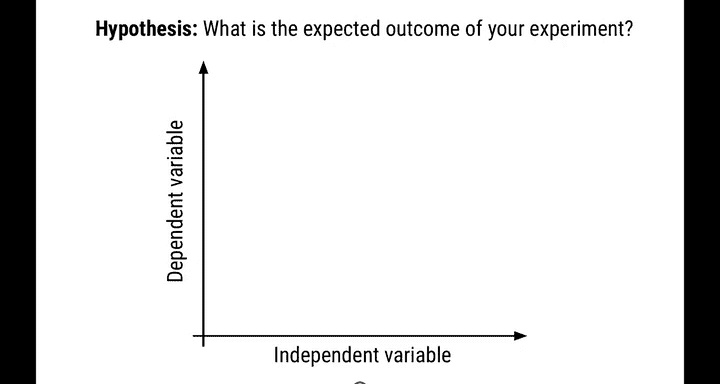

Let's do an example experiment now let's say for example that I have a hypothesis that a shoe size increases。

 literacy also increases in this case， designing my experiment， I would choose a measure of literacy。

 Iy， reading fluency as my variable that depends on an individual's shoe size。

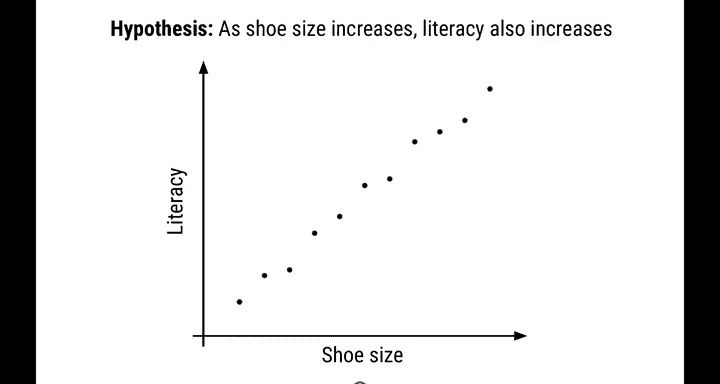

To answer this question， I will design an experiment in which I measure the shoe size and literacy level of 100 individuals sample size is the number of experimental subjects you will include in your experiment；

 there are ways to pick an optimal sample size that you will cover in later courses。

Before I collect my data though， I need to consider if there are problems with this experiment that might cause an erroneous result In this case my experiment may be fatally flawed by a confounder；

 a confounder is an extraneous variable that may affect the relationship between the dependent and independent variables In our example。

 since age effects foot size and literacy is affected by age。

 if we see any relationship between shoe size and literacy。

 the relationship may actually be due to age， age is confounding our experimental design。

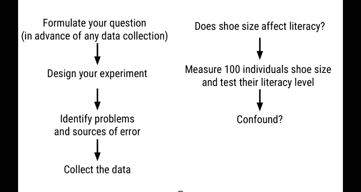

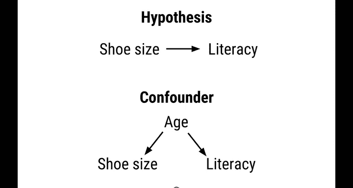

To control for this， we can make sure we also measure the age of each individual so that we can take into account the effects of age on literacy。

 another way we could control for age's effect on literacy would be to fix the age of all participants if everyone we study is the same age then we have removed the possible effect of age on literacy in other experimental design paradigms a control group may be appropriate this is when you have a group of experimental subjects that are not manipulated so if you were studying the effect of a drug on survival you would have a group that received the drug treatment and a group that did not control this way you can compare the effects of the drug in the treatment versus control group in these study designs there are other strategies we can use to control for confounding effects。

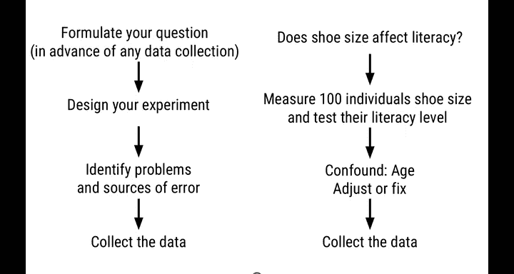

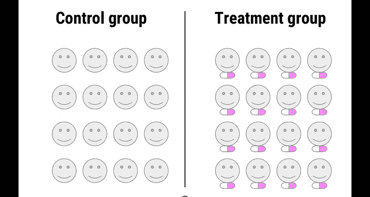

One， we can blind the subjects to their assigned treatment group sometimes when a subject knows that they are in the treatment group II receiving the experimental drug。

 they can feel better not from the drug itself， but from knowing they are receiving treatment this is known as the placebo effect to combat this。

 often participants are blinded to the treatment group therein。

 this is usually achieved by giving the control group of mock treatment I given the sugar pill they are told is the drug in this way。

 if the placebo effect is causing a problem with your experiment。

 both groups should experience it equally， and this strategy is at the heart of many of these studies。

 spreading any possible confounding effects equally across the groups being compared for example。

 if you think age is a possible confounding effect。

 making sure that both groups have similar ages and age ranges will help to mitigate any effect age may be having on your dependent variable。

 the effect of age is equally between your two groups。

 this balancing of confounders is often achieved by randomization。Generally。

 we don't know what will be a confounder beforehand to help lessen the risk of accidentally biasing one group to be enriched for a confounder。

 you can randomly assign individuals to each of your groups；

 this means that any potential confounding variables should be distributed between each group roughly equally to help eliminate s reduced systematic errors。

There is one final concept of experimental design that we need to cover in this lesson。

 and that is replication Replication is pretty much what it sounds like。

 repeating an experiment with different experiment subjects a single experiments results may have occurred by chance a confounder was unevenly distributed across your groups there was a systematic error in the data collection。

 there was some outliers etc however， if you can repeat the experiment and collect a whole new set of data and still come to the same conclusion。

 your study is much stronger also at the heart of replication is that it allows you to measure the variability of your data more accurately。

 which allows you to better assess whether any differences you see in your data are significant once you've collected and analyze your data one of the next steps of being a good citizen scientist is to share your data and code for analysis now that you have a Github account and we've shown you how to keep your version controlleded data and analyzes on GiHub this is a great place to share your code In fact。

 hosted on Github。

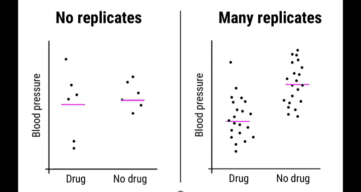

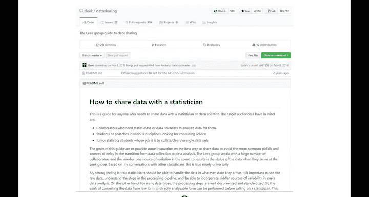

group， the leak group has developed a guide that has great advice for how to best share data。

 One of the many things often reported in experiments is a value called a Pvalue This is a value that tells you the probability that the results of your experiment were observed by chance This is a very important concept in statistics that we won't be covering in depth here if you want to know more check out the U2 videolink。

 which explains more about Pvalue What you need to look at for is when you manipulate P values towards your own end Often when your Pvalue is less than 0。

05 In other words， there is a 5% chance that the differences you saw were observed by chance a result is considered significant but if you do 20 tests by chance you would expect one of the 20 that is 5% to be significant In the age of big data。

 testing 20 hypotheses is a very easy proposition and this is where the term Phacking comes from this is when you exhaustively search a data set to find patterns and correlations that appears。

Statistically significant by virtue of the sheer number of tests you have performed these curious correlations can be reported as significant and if you perform enough tests。

 you can find a dataset set and analysis that will show you what you wanted to see check out this 538 activity where you can manipulate and filter data and perform a series of tests such that you can get the data to find whatever relationship you want XKCDms this concept in a comic testing the link between jelly beans and acne。

 clearly there is no link there， but if you test enough jellybean colors Eventually。

 one of them will be correlated with acne at Pvalue less than 0。05。

In this lesson we covered what experimental design is and why good experimental design matters we then looked in depth to the principles of experimental design and defined some of the common terms you need to consider when designing an experiment Next we deterred a bit to see how you should share your data and code for analysis and finally。

 we looked at the dangers of P hackcking and manipulating data to achieve significance。

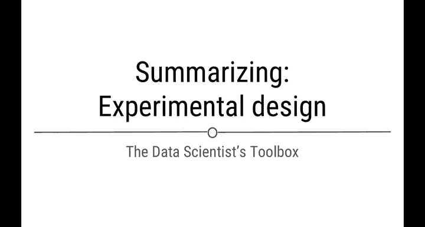