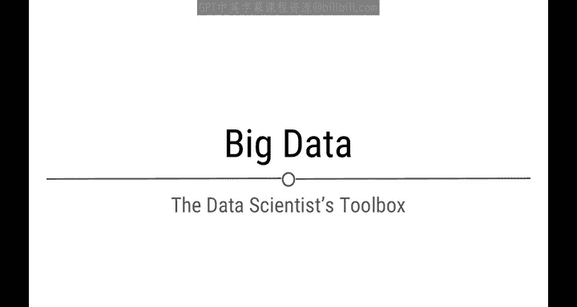
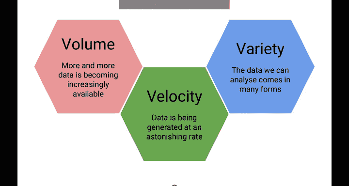
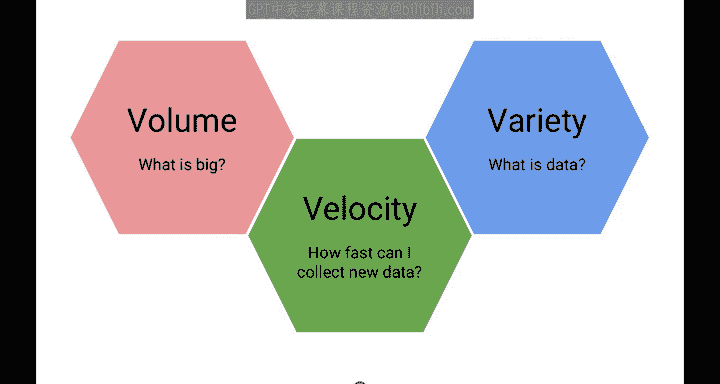
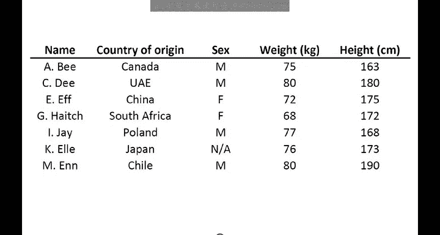
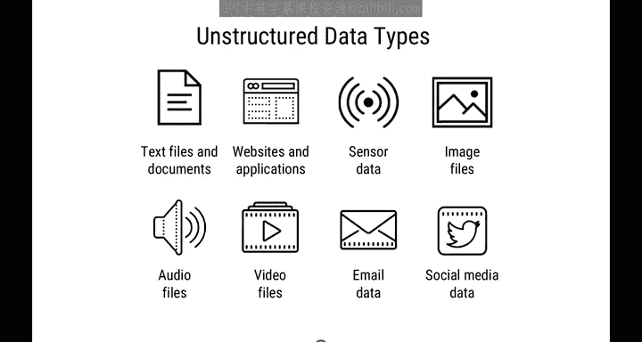
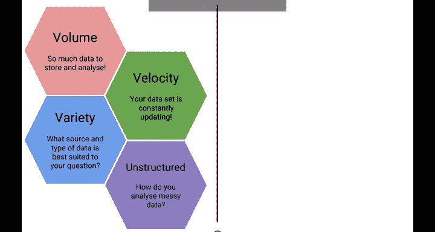
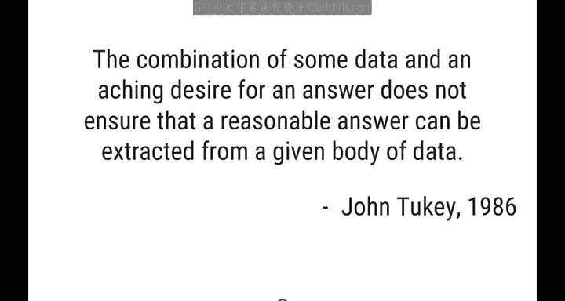
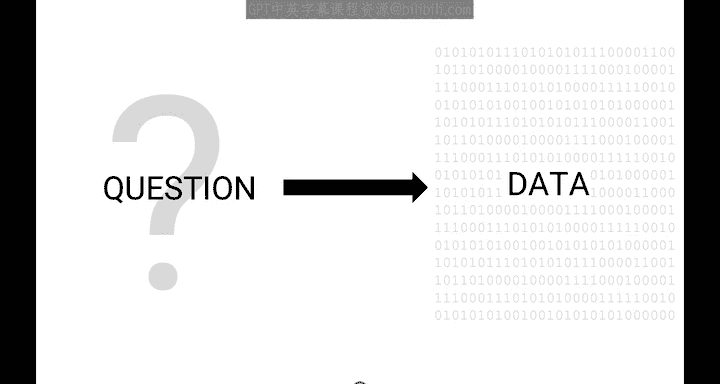
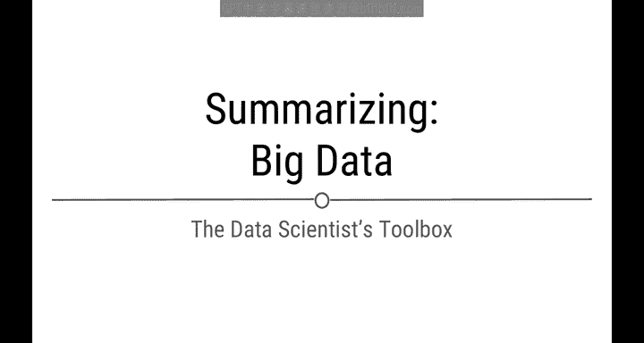

# 约翰霍普金斯大学《数据科学R语言基础｜Data Science： Foundations using R》中英字幕（deepseek - P18：17_大数据.zh_en - GPT中英字幕课程资源 - BV1tsFQemEts

A term you may have heard of before this course is big data， there have always been large data sets。

 but it seems like lately， this has become a buzzword in data science， but what does it mean？

We talked so little about big data in the very first lecture of this course as the name suggests big data are very large data sets。

 we previously discussed three qualities that are commonly attributed to big data sets volume velocity variety from these three adjectives we can see that big data involves large data sets of diverse data types that are being generated very rapidly but none of these qualities seem particularly new why has the concept of big data been so recently popularized。

 in part as technology and data storage has evolved to be able to hold larger and larger data sets。

 the definition of big has evolved to Also our ability to collect and record data has improved with times such that the speed with which data is collected is unprecedented Finally。

 what is considered data has evolved so that there is now more than ever companies have recognized the benefits to collecting different sorts of information and the rise of the internet and technology have allowed different and varied datas to be more easily collected and available for analysis。

One of the main shifts in data science has been moving from structured data sets to tackling unstructured data。

 structured data is what you traditionally might think of data， long tables。

 spreadsheets or databases with columns and rows of information that you can somewhere average or analyze however you like within those confines unfortunately。

 this is rarely how data is presented to you in this day and age the datas we commonly encounter are much messier。

 and it is our job to extract the information we want and corral it into something ti and structured。

 with the digital age in the advance of the internet。

 many pieces of information that were in traditionally collected were suddenly able to be translated into a format that a computer could record store。

 search， and analyze， and once this was appreciated。

 there was a proliferation of this unstructured data being collected from all of our digital interactions。

 emails， Facebook and other social media interactions， text messages， shopping habits， smartphones。

 and their GPS tracking websites。

How long you are on that website and what you look at CCTV cameras and other video sources etc The amount of data and the various sources that can record and transmit data has exploded。

 It is because of this explosion in the volume Ve and variety of data that big data has become so salient concept these data sets are now so large and complex that we need new tools and approaches to make the most of them As you can guess given the variety of data types and sources。

 very rarely as the data stored in a neat ordered spreadsheet that traditional methods for cleaning and analysis can be applied to given some of the qualities of big data above。

 you can already start seeing some of the challenges that may be associated with working with big data For one it is big there is a lot of raw data that you need to be able to store and analyze Second it is constantly changing and updating by the time you finish your analysis there is even more new data you could incorporate into your analysis Every second you are analyzing is another second of。

Data you haven't usedThird， the variety can be overwhelming。

 there are so many sources of information that it can sometimes be difficult to determine what source of data may be best suited to answer your data science question and finally it is messy you don't have neat data tables to quickly analyze you have messy data before you can start looking for answers。

 you need to turn your unstructured data into a format that you can analyze So with all of these challenges why don't we just stick to analyzing smaller more manageable curated data sets and arriving at our answers that way sometimes questions are best addressed using these smaller data sets but many questions benefit from having lots and lots of data and if there is some messiness or inaccuracies in this data the sheer volume of it negates the effect of these smaller errors so we are able to get closer to the truth even with these messier data sets Additionally。

 when you have data that is constantly updating while this can be a challenge to analyze the ability to of real time up to date information allows。

To do analyzes that are accurate to the current state and make on the spot rapid。

 informed predictions and decisions One of the benefits of having all these new sources of information is that questions that weren't previously able to be answered due to lack of information suddenly have many more sources to glean information from and new connections and discoveries are now able to be made Que that previously were inaccessible now have newer。

 unconventional data sources that may allow you to answer these formerly unfeasible questions Another benefit to using big data is that it can identify hidden correlations Since we can collect data on a myriad of qualities on any one subject。

 we can look for qualities that may not be obviously related to our outcome variable。

 but the big data can identify a correlation there。

 instead of trying to understand precisely why an engine breaks down or why a drug side effect disappears。

 researchers can instead collect and analyze massive quantities of information about such events and everything that is associated with him looking for patterns that might help predict。

F occurrenceB data helps answer what， not why， and often that's good enough。

Big data has now made it possible to collect vast amounts of data very rapidly from a variety of sources。

 and improvements in technology have made it cheaper to collect， store and analyze。

 but the question remains how much of this data explosion is useful for answering questions you care aboutRegardless of the size of the data。

 you need the right data to answer a question a famous statistician， John Tki said in 1986。

 the combination of some data and an aching desire for an answer does not ensure that a reasonable answer can be extracted from a given body of data。

Essentially， any given data set may not be suited for your question， even if you really wanted it to。

 and big data does not fixed this， even the largest data sets around might not be big enough to be able to answer your question if it's not the right data。

In this lesson， we went over some qualities that characterize big data， volume， velocity。

 and variety， we compared structured and unstructured data and examined some of the new sources of unstructured data。

 then we turn to looking at the challenges and benefits of working with these big data sets and finally we came back to the idea that data sciences question-driven science and even the largest of data sets may not be appropriate for your case。

