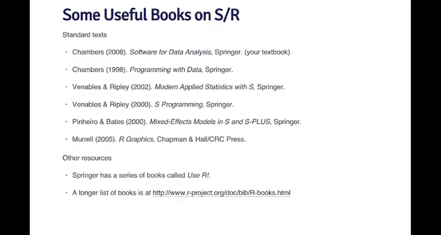

# 约翰霍普金斯大学《数据科学R语言基础｜Data Science： Foundations using R》中英字幕（deepseek - P25：6_R的概述和历史.zh_en - GPT中英字幕课程资源 - BV1tsFQemEts

And in this lecture， I'm going to give a little overview and a very brief history of the R statistical programming environment。

So the very first question I think is most obvious which is what is R and the answer is actually quite simple。

 it's basically R is a dialect of S so that leads to the next logical question which is what is S。

So S was a language or is a language that was developed by John Chambers and at the now defunct Bell Labs。

And it was initiated in 1976 as an internal statistical analysis environment。

 so an environment that the people at Bell Apps could use to analyze data。

 and initially it was implemented as a series of four trans libraries to kind of implement routines that were tedious to have to do over and over again。

 so there were four trans libraries to repeat these statistical routines。

 early versions of a language did not contain functions for statistical modeling that did not come until roughly version three of the language。

So in 1988 the system was rewritten in the C language and to make it more portable across systems and it began to resemble the system that we have today。

 so this was version 3 and there was a seminal book called the statistical models in S written by John Chambers and Trevor Hasty。

 sometimes referred to as the white Book and that documents all the statistical analysis functionality that came into the that version of the language version 4 of the S language was released in 1998 and it it's the version that we more or less used today the book programming with data。

 which is a reference for this course is written by John Chambers sometimes called the Green Book and it documents a version 4 of the S language So R is a implementation of the S language that was originally developed in Bell Labs。

So just a little bit more history here in 1993， Bell Labs gave a corporation called Statsci。

 which became InCful corporation an exclusive license to develop and sell the S language in 2004 InCL purchased the S language completely from Ilucent。

 so Bell Labs became Luccent technology， for $2 million and became the current owner in 2006。

 Alcateel purchased Luccent technologies and it's now called Alcateel Luccent。

So insightful developed a product， which was an implementation of the S language under the product name S+ and it built a number of fancy features into it。

 for example， graphical user interfaces and all kinds of nice tools and that's where the plus comes from in S plus in 2008 In Sful Corporation was acquired by a company called Tco for 25 million and that's more or less where it stands Tco still develops S plus although in a variety of different types of business analytic type products and it continues to this day so you can see the history of the language is a little bit tortured because of the various。

Corporate acquisitions， but it still survives to this day。

 the basic fundamentals of the S language have not really changed since 1998。

 and the language that existed in 1998 looks more or less like what we use today。

 at least superficially， and it's worth noting that in 1998。

 the S Langu won the Association for Computing Machinearies Software System Award very prestigious honor。

So in a document called The Stages in the Evolution of S， John Chambers。

 who was the original writer of the S language， the original creator。

 kind of laid out his key principle with designing the S language。

 and it's very important I think to see this， which is that basically they wanted to create an interactive environment。

Where he didn't have to think of themselves as programming。

Then he says then as the needs became clear and their sophistication increased you should be able to slide gradually into programming when the language and system aspects would become more important。

 so the basic idea behind the S language and then later the R language is that people would enter the language in an interactive environment where they could use the environment without knowing about any sort of programming or whether having to know very detailed aspects of a language so they could use the environment to look at data to add do basic analyses。

 and then when they kind of outgrew their environment。

 then they could get into programming they could get into learning the language aspects and learning to develop their own tools and the system would very kind of would promote the kind of transition from user to programmer。

And so that was the basic philosophy of the S language。

So that's enough about S we's go back to R so what is R about so basically R is a relatively recent development in 1991。

 it was created in New Zealand by two gentlemen named Rossi Haa and Robert Gen。

And they talked about their experience developing R in a paper published in 1996 in the Journal of Computal and Graphal Statistics in 1993 the first announcement of R was made to the public。

 1995， Martin Meler convinced Ross and Robert to use to license R under the Gnew General Public licenseense and we'll talk a little bit more about that in a second。

 and that made R what we call free software， in 1996 a mailing list of developed so there's two main mailing list called one called RHe which is a general mailing list for questions and R developed。

 which is a more specific mailing list for people who are doing development work in R。In 1997。

 what's called the R core group was formed and this contained a lot of the same people from the S+ who developed S+。

 and the core group basically controls the source code for R。

 so for the primary source code for R can only be modified by members of the R core group。

 however a number of people who are not in the core group have suggested changes to R and they have been accepted by the core group。

So some of the features are the first one， which was important kind of back in the old days when people were still using S+。

 but the syntax is very similar to S which made it easy for S+ users to switch over this feature isn't quite so relevant than today where most people generally go to R directly。

The semantics are superficially similar to S in that it looks like it's S。

 but in reality are quite different， so we'll talk more about this in the future lecture。

 one of the main benefits of Rs that it runs on pretty much any standard computing platform or operating system。

 Mac， Windows， Linux， whatever you want even under your PlayStation 3 and there are frequent releases so there are annual major releases and often there are bug fix releases in between so there's very active development going on and so things are happening。

The software， the core software of R is actually quite lean。

 its functionality is divided into modular packages so you don't have to download and install a massive piece of software whereas you can download a very small piece of fundamental core kind of functions and then add things on as you need them so its graphics capabilities are very sophisticated and give the user a lot of control over how graphics are created and in my opinion are better than most sta packages it might even be the best for kind of a general purpose statistical package。

 it's very useful for interactive work as I said before。

 but it contains this powerful programming language for developing new tools。

 so it eases the transition from the user to the programmer。

And fundamentally actually in ver language like this is that there's very active and vibrant user community。

 so the mailing lists like RHep and RDeel are very active。

 there's many posts per day and there's also a series on stack overflow where questions can be answered so the user community is one of the most interesting aspects of R it's where all our packages come from and it creates a lot of kind of interesting features。

😊，Of course， one of the probably the most critical features are is that it's free。

 both in the sense of free beer and the sense of speech。

 so what I mean by that is that it doesn't cost any money so you can download the entire software from the web and also it's free software so I'm going divert for a second to talk a little bit about free software so with free software there are four basic principles you have four basic freedoms that you have the freedom zero is the freedom to run the program for any purpose so you don't need there's no restrictions on how you can run the program or when you can run the program or what you can or cannot do with it。

Freedom1 is the freedom to study how the program works and adapt it to your needs。

 so this happens almost every day， which is that you can look at the source code for R itself。

 you can make changes to it if you want， you can improve it or make a better version of you can sell changes to it if you want you you can modify the program any way you want and adapt it to your needs of course so you can look at the source code for this to get freedom one Free two is that you have the freedom to redistribute copies so you can help your neighbor and so the idea is that you can give copies to other people。

 you can sell copies， you can do whatever you want with it。Lastly。

 you have the freedom to improve the program and release your improvements to the publics of the whole community benefit。

 So this is freedom 3。 the idea is that when people。Make changes to the program。

 they can release them to the public so that everyone gets those changes and so these basic freedoms are outlined by the Free Soft Foundation you can see more about it at their website there。

So there are a couple drawbacks of R I won't go through all of them and probably other people have many other complaints。

 but there's some basic drawbacks which are one is that it's essentially based on 40 year old technology So the original S languages developed in the 70s was based on a couple of principles and the basic ideas have not changed too much since then and so one of the results of that for example is that there's little built in support for a dynamic or 3D graphics but things have improved greatly on that front since the old days and there's a lot of interesting tools now and packages for doing dynamic and 3D graphics another drawback of R that I hear a lot about is that the functionality is based on consumer demand and you basically user contributions so if no one feels like implementing your favorite method then that's your job to do and so you can' there's no corporation there's no company that you can complain to there's no helpline that you can call to say that to demand a specific implementation or specific feature。

If feature is not there， then you have to build it， or at least you can pay someone to build it。

Another drawback which is a little bit more technical is that the objects that you manipulate in R have to be stored in the physical memory of the computer and so if the object is bigger than the physical memory of the computer。

 then you can't load it into memory and then therefore you can't do something in R with that object so there have been a lot of advancements to deal with this too both in the R language and also just in the hardware side there are computers now you can buy with tremendous amounts of memory and so some of those problems have been resolved just by kind of improvements in technology。

 but nevertheless， as we enter the kind of big data era where you have larger and larger data sets。

 the model of loading objects into physical memory can be a limitation。And finally。

 I'll just say that R is not ideal for all possible situations， and so many people， I think in a way。

 this is a good thing they have very high expectations for R。

 they expect it to be able to do everything， but it doesn't do everything and so you should go into this knowing that fact。

So the basic R system is divided into two we can think of two conceptual parts。

 there's the base R system that you download from a Crran which is the comprehensive R archive network and that's kind of the go to place for all things R and then there's kind of everything else and so the base system contains what's called the base package which has all the kind of lowlevel fundamental functions that you need to run the R system and then there are other packages contained in the base system which includes。

 for example utility， stats， data sets graphics and a bunch of other packages that are kind of fundamental packages that。

More or less everyone might use and then there are a series of recommended packages。

 so boot for bootstap class for classification， cluster， code tools。

 foreign and a variety of other packages these are the commonly used packages they may not be critical packages。

 but they're commonly used by many people So all these packages come with the base are system that you download from Crran。

Now but there's much more than this obviously and on CRran there are right now there are about 4000 packages that have been developed by users and programmers all around the world。

 these packages are user contributed， they're not controlled by the R core and they are uploaded to CRran every day on a periodic basis and the Crran has a number of restrictions and standards that have to be met in order to get a package onto Cr so one of the nice things about Crran is that that the packages that you download have to meet a certain level of quality and so there have to be for example。

 there has to be documentation for all the functions that are in the package and there has to be and they have to make sure that they pass a certain number of tests so Crran has a lot of different packages written by users and the number is really increasing every day so it's very exciting to see all these packages on CRran and to see new ones come up every day。

There are also packages associated with the Bconductor project。

 package which is a project designed to implement our software for kind of genomic and kind of biological data analysis and of course there are also all their packages made that people make available on their personal websites and there's really no reliable way to keep track of how many packages are available in this fashion so there's really thousands of packages out there written by people that you can discover and use to analyze data。

So there are a couple documents that you can find on the R website as you're learning to use R you may want to flip through some of these one is an introduction to R。

 which is a relatively long PDF document now that kind of goes through the basics of how to use R how to use the language there's the writingri R extensions manual which is really only useful to read if you're thinking of developing R packages which are these these extensions to the main R system the R data import and export manual which is useful for getting R data into R in the various different ways the R installation and administration manual is mostly useful if you're want to build R from the source code and I'll talk about that in another video and then the R internals manual。

I a really technical document for how R is designed， how is implemented at a very low level。

 and it's not really for the faint of heart， but if you're that kind of a person who wants to know how R works at a very。

 very low level， this is the document for you。So I'm just going to end here with a couple of texts that are kind of standard or classic texts in this area。

 of course， the books by John Chambers software for data analysis and programming with data。

 both published by Springer， and then there's two books by Bill Venables and Brian Ripleley。

 one is called Modern Applied Statistic with S and another one's called S programming。

 although they have they talk about S in the title these books are both very relevant for R programminging2。

There's a book by Py and Bates， which is mixed effects models in SNS plus。

 that's also quite useful for our programmers too。And finally， Paul Morerell。

 who designed the R graphic system has written a book called R graphics and actually it's currently in its second edition right now。

 so a couple other resources， one is that Springer。

 the publisherlish Springer has a series of books calledU R which is a lot of very kind of relatively short books on how to use R for different types of topics。

 different application areas and this is quite a nice series of books that you may be interested in and there may be a book written for your particular area of application。

 and there's a longer list of books on the R website。

So that was a brief overview of R and the history of how it kind of came to be。

 and starting with the next video， I'll start talking about the details of the R programming language and how we can use it to analyze data。

