# 约翰霍普金斯大学《数据科学R语言基础｜Data Science： Foundations using R》中英字幕（deepseek - P26：7_获取帮助.zh_en - GPT中英字幕课程资源 - BV1tsFQemEts

This video is about how to get help when learning to use R and taking this course because basically of the size of the course and the number of students that are enrolled it's going to be difficult to be asking lots of questions on a one on- one basis and so we're going to have to resort to a few other tools to get answered questions answered in particular the discussion boards and generally through email and so its a certain type of way to ask questions that that will hope to maximize the chance of you getting the right answer or the answer that you're looking for and so the main thing to remember is that asking questions via email is a little bit different from asking questions in person you don't necessarily know that the people on the other side the people that you're asking for example on a discussion board or on a mailing list you don't necessarily know that they have the same background information that you have further they may not know you personally and so may not know what you mean when you say certain types of things so that's important to keep in mind when you're emailing questions as opposed to when you're talking。

someone in person keep in mind that of course that elder people are very busy and their time is limited and although they may be willing to help you by answering a question。

 they may only have a certain amount of time to devote to answering that question now I am here of course as the instructor to help you in all circumstances but furthermore I may not be able to answer all possible questions and so you you're going to want to use the resources that you have available to you in this course。

😊。

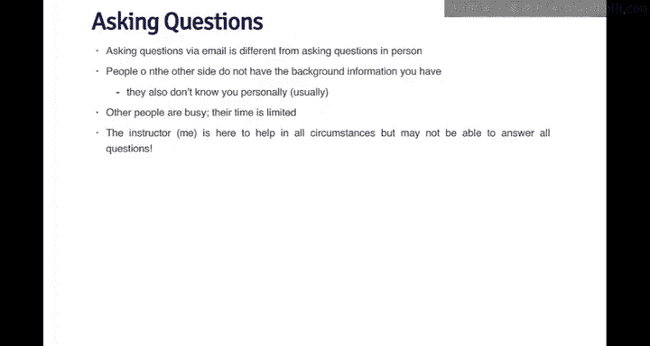

So in your search for answers， there are a variety of things that you can do on your own before venturing off to ask other people for the answer so if you're going to be emailing a question to a forum or to a mailing list。

😊。

It it's important that you search the archives of that forum for the answer。

 So it's possible and depending on the size of the forum。

 almost very likely that someone has asked the same question that you're asking and if someone else has asked that question and has been answered。

 then the answer is going to be in the archives of that forum。 So if the answer is already there。

 you'd save everyone a lot of time including yourself。

 if you search the archives for that form and just find the answer。 Of course。

 the web is very large and has many answers and your first reaction when you have a question is to search the web for given the type of program you're using。

 for example， here we're using R， there are many manuals that are available and many answers may exist in the manual there's a frequently asked question or a fact that's on the our website that you can look for that contains many questions that are commonly come up up on the mailing lists and on the forums。

Another thing that you might want to try to do before go venturing out to ask people for the answer is to play around with the problem and try to find the answer by inspecting or experimentations。

 maybe if you have a function that's not working right。

 maybe change the inputs and see if the outputs change or if the error message changes if you're lucky enough to have a skilled friend who knows something about R。

 you can ask them personally and it'll be easier it's usually easier to ask a person on a one on one basis than to email a group of people in a form Furthermore。

 then lastly， if you're a programmer， you may be able to find the answers you're looking for by reading the source code。

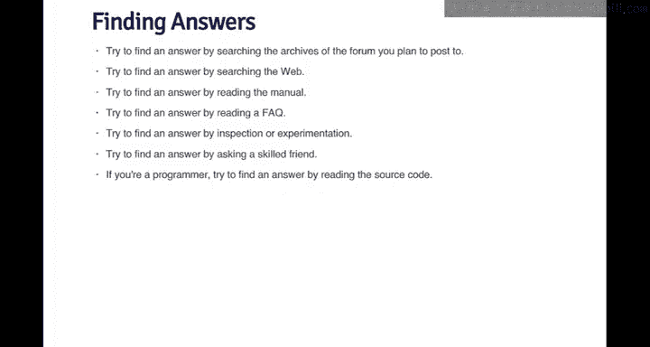

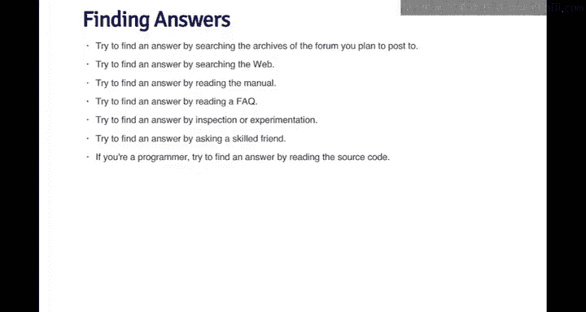

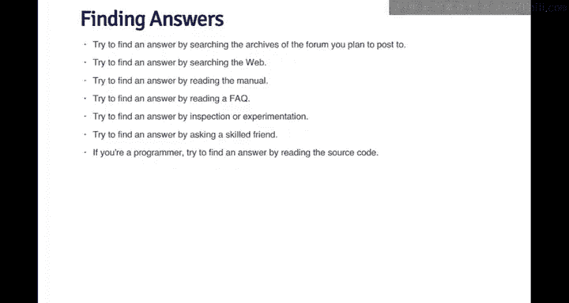

So all the things in the previous slide are useful things to do on your own before venturing out to ask people questions。

 however， if you don't find the answer it's important to let other people know that you did all those other things on the previous slide because if。

 for example， the answer is in the documentation for the programs， for example。

 it's in one of the R manuals that someone who knows the answer will usually respond by saying read the documentation or read the manual and then you've just wasted one round of email because you'll have to respond saying I did read the manual and it didn't find the answer there and so letting people know that you've done your homework and you've looked in a variety of places is' very useful and it saves a lot of time。

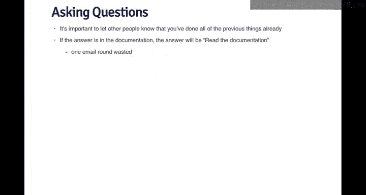

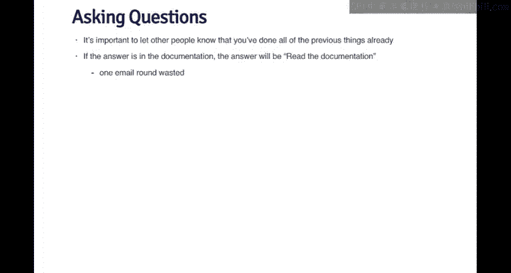

So here's a very simple example of what might happen as you're using R So here I'm loading the datasets package and then I'm going to load the air quality data from that package and then I want to run the correlation function on this air quality data frame so immediately I get an error it says error in core air quality missing observations in Co core so you might be wondering well why am I getting this error what does it mean So the first thing you can do is go to Google and in many circumstances Google is going to be your friend and this is no different when you're learning a new programming language or when you're learning R and so the easiest thing to do is to take the error message that you get and literally cut and paste it into the search box for Google when I search on that I get a number of results and particularly this third result looks very promising it looks like someone asked this question on the R helpp mailing list and it looks like and so maybe maybe worth clicking on that to see if someone replied with the answer。

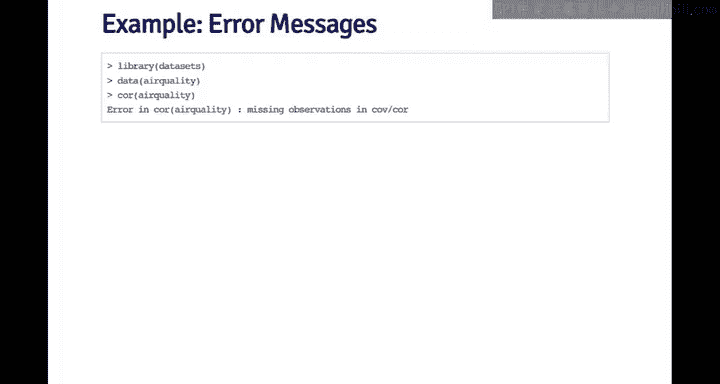

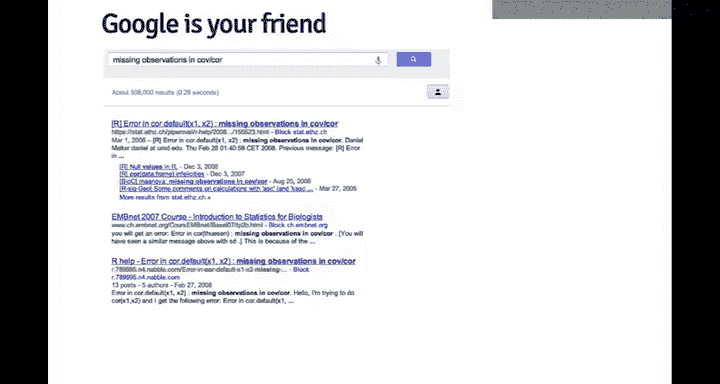

So when you ask a question on a mailing list， so assuming that Google't wasn't able to help you out。

 if you're going to ask a question on the discussion board or on the mailing list。

 there are a couple things that you need to think about before you ask that question first is it possible to reproduce your problem if someone else can reproduce your problem it makes it a lot easier for that other person to figure out what the solution is going to be and so if you can provide some code or a very simple example that will reproduce your problem。

 this will be enormously useful to everyone else involved and if you don't do this typically the first response that you'll get will be can you please provide a reproducible example。

Second， it's important to understand what you expect the output to be because if your expectation is wrong。

 then of course， it may or may not be an error depending on what your expectation should be So what you expect the output to be will indicate the nature of the error and what needs to be solved and then given your expectation you need to say well。

 what do you see instead， So what was the thing that was unexpected that gave you the question other information that's important to specify when you're asking a question is the version of the product you're using So for example。

 what version of R are you using what version of the R packages you're using if it's specific to a given package because often there may be legitimate bugs and versions in older versions of R or R package is and that your problem might be solvable if you' just upgrade to the latest version So if you're using the latest version of R it's important to mention that。

Sometimes it's important to know what operating system you're using。

 so whether you're using a Mac or Windows or Linux or some other Unix machines。

 some problems can be traced to the type of operating system that you're using and depending on the question that you have there may be additional information that you need to provide。

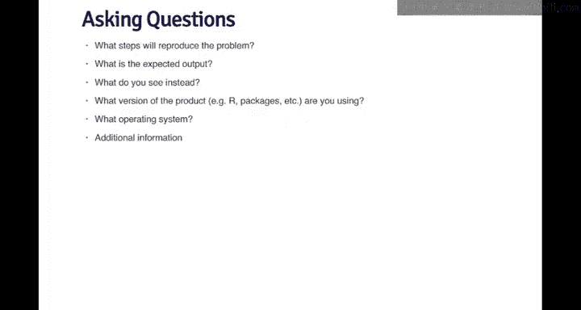

So when you send an email to a forum or to a discussion board。

 it's important to get as much information in there as much useful information in there as possible。

 and this includes the subject line for the email。 So there's a couple of examples of subject lines that range and usefulness。

 So the first one is probably the least useful。 It just says help can't fit linear models。

 So here there's very little information here， all I know is there's there's some problem with linear models。

 I don't know anything else about what the user's problem is。 So the second version is much better。

 it tells me that on our version 2。15。0。 the LM function produces a Seg fall which meaning that R crashes with a large data frame。

 and it's furthermore it says I'm using Macos 110。6。3 So here I've got the operating system。

 the version of the operating system。 I've got the version of R I've got what function I'm using and I've got a summary of what actually happened。

😊，So just a little bit smarter than that would just be to reformat the message so that I specify what version of R I'm using the function and then the version of the operating system and then so that gives me the context and then after that I can say what the problem was in this case was Se fault on a large data frame so here the important details right away put in the subject header before I even get to the body of the message。

So a couple of things that you definitely want to do when you're asking a question on a forum or a mailing list first is to describe the goal。

 not the steps， so you may have many， many steps that you're going through and maybe one of those steps is causing a problem it's useful for other people to know what the bigger picture is in terms of what you're trying to do because for example they might have a better idea about how to go about achieving that goal which may be faster or simpler and may work around whatever problem you're having so describe the ultimate goal and then talk about what the problems are and don't just narrow down to the one little step that you're having a problem with。

Be explicit about your questions。 So remember provide details about what you're trying to do and you have to provide the minimum amount of information necessary。

 So not the maximum amount of information， the minimum amount of information。

 And so it's common to see on some mailing list posts that lots of output is produced and that's not very helpful because volume doesn't really help you in terms of diagnosing the problem。

 we need to know exactly to narrow down kind of where the problem is going be So and of course。

 a couple of things know being courteous never hurts anyone and and promoting civility on mailing list is always a nice thing And if you find the solution later on it's useful for everyone else in the community if you follow up with the solution and explain what the problem was and what the problem was and how you solved it。

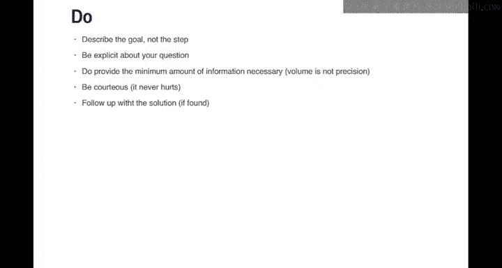

A couple of things you definitely do not want to do when posting to a forum。

 you don't want to claim that you found a bug。 This happens all the time。

 and usually I'd say 99 times out of 100。 it's not a bug and it's just misunderstanding about what should have happened So so a mistake in the expectations of the user Gling is a substitute for doing your homework that's not usually look well upon and you definitely shouldn't do that definitely don't want to post homework questions on the mailing lists or forums。

 and the reason is because people who write the homework the homework questions are reading those mailing list and will be able to identify all homework questions without a doubt。

 So we've seen them all don't bother trying to get the answers to your homework on mailing lists don't ever email multiple mailing lists at once。

 So this is a little bit annoying because people will subscribes and different mailing lists and we be getting your message more than one time。

 it's useful it's important to。Figure out which mailing list is the most appropriate mailing list for your question and then send the message to that mailing list or forum。

And then lastly， don't ask others to debug your code without giving some sort of hint as to what the problem might be。

 so it's very difficult when a person posts a long listing of code and says there's a problem in here somewhere I don't know where please help it's better to give to kind of specify where you think the problem is and what you're trying to do so that everyone can save some time。

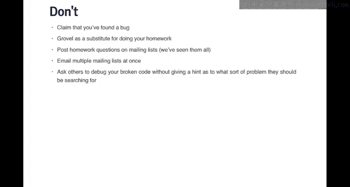

So this is just a very brief case study on using a recent post to the R development mailing list。

 so the R mailing list is an email list for people who are doing development work in R。

 so either they're developing packages or they're making modifications to the R source code itself and。

The subject was you can see from the subject that is gonna to be a problem。

 the subject is large data dash confused。 So right away you know there is not that much information here to go on。

 It's not clear what the problem is and the message that says I'm trying to load a data into a but I'm completely lost This is probably due to mostly to the fact that I'm at a complete R new but it's got me stuck in a research project So you have to ask yourself what do I know about this person's problem from reading this message and the truth is very little And so the response was somewhat predictable basically the first persons response said yes you are lost and then there is a pointer to the posting guide which everyone should read before sending an email to the mailing list and then also a list of manuals and so here you can see that a one round of email was immediately wasted because probably the answer to the question was in one of the manuals。

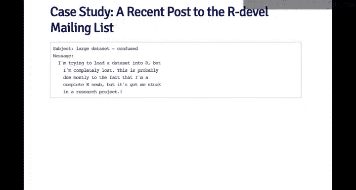

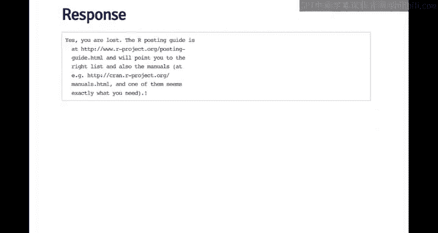

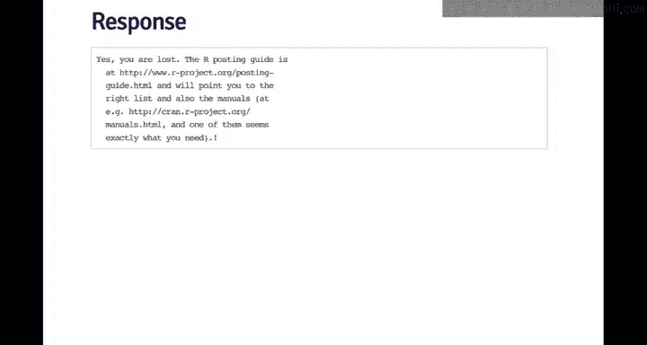

And so and the user didn't specify whether he or she had already done that。

 So in terms of what went wrong with this little exchange。 first， of course。

 the question was sent to simply the wrong mailing list。

 the R mailing list is for development questions and for more sophisticated programmers Its not a mailing list for questions for as this person stated nus。

 So that question really should have gone to the R help mailing list where it would have been better received。

 However， in addition to that， the email subject was very vague。

 It was not clear what the problem was。 The question itself was very big there was no reproducible example there。

 there was nothing there was not possible for other people who were reading the email to reproduce what that person's problem was。

 and there was no evidence that any effort was made to solve the problem。

 So there was no evidence that they searched the web or check the manuals or experimented with the problem or anything like that or even looked at the forums。

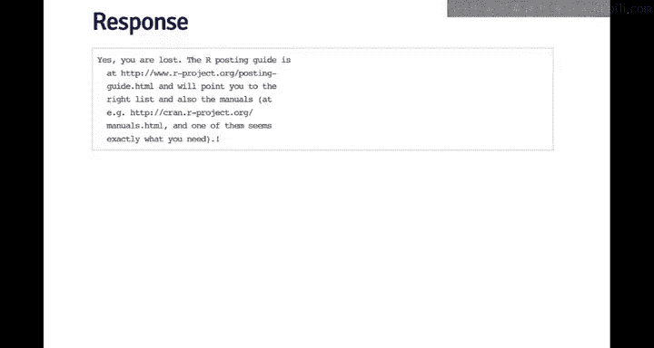

And so the end result was a complete recipe for disaster。

 and it is likely that this person did not get the answer to their question。

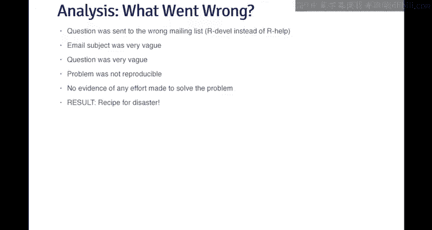

So a couple of places to turn for this course， first of all。

 the class discussion board I think will be the most useful because your fellow students can help you out there and I can respond to you on the discussion board outside of class there the RHe mailing list which I just described and you can post this mailing list as and it's useful to of course follow all the rules that we talked about just now and depending on what other projects you might be working on。

 there are other Project specificific mailing lists for other types of software and so this talk was inspired by Eric Raymonds posting calledHow to ask Que the Smart Way and I encourage you to read that it's much longer it has a lot of other useful tips。

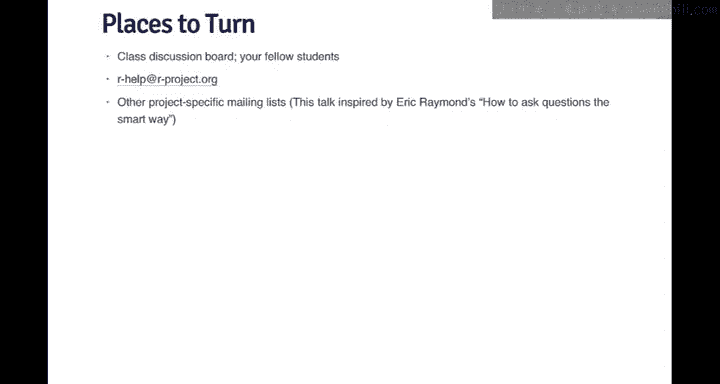

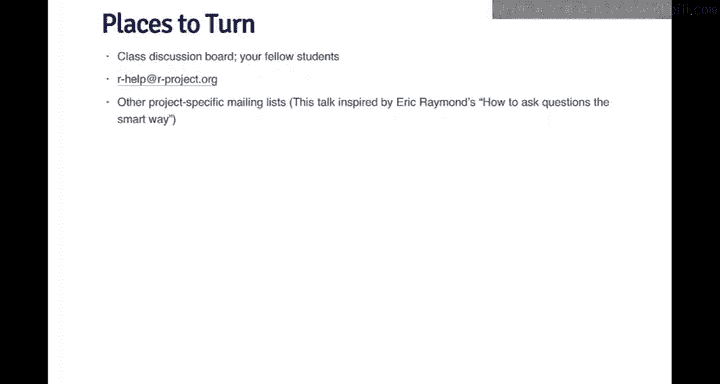