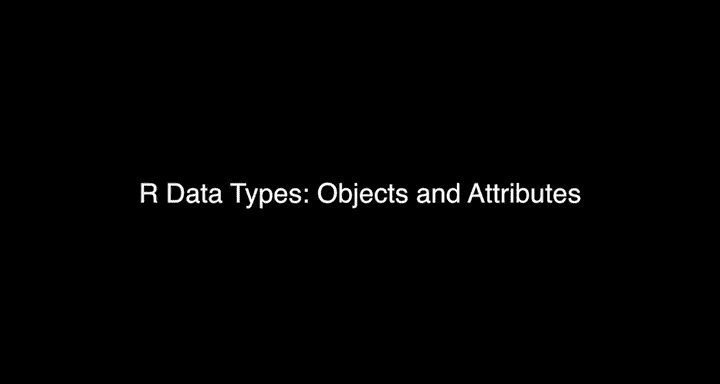
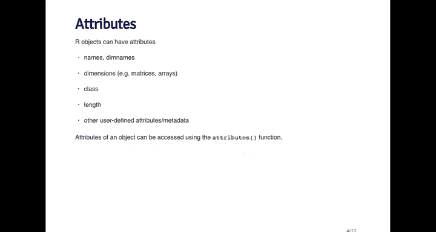

# 约翰霍普金斯大学《数据科学R语言基础｜Data Science： Foundations using R》中英字幕（deepseek - P28：9_数据类型R对象和属性.zh_en - GPT中英字幕课程资源 - BV1tsFQemEts

In this lecture， we're going to start getting into the nitty gritty and the details of R in particular I'm going to talk about different data types that are used in arm and some basic operations on those data types。

So first it's important to kind of get the language right correctly。

 so all the things that you manipulate in R all things that we encounter in R are what might be called objects。

 objects can be all different kinds can contain all different kinds of data。

 but everything in R is an object。So the R has five basic atomic classes of objects。

 so these are kind of the very low level or basic classes of objects， and they are character numeric。

 so these are like real numbers or decimal numbers， integers， complex numbers and logical。

 so logicals are just true false type things。And so the most basic object in R is what's called a vector and a vector contain multiple copies of。

 for example， of a single type of object。 So it can have a vector of characters or a vector of integers。

 One thing you cannot do with a standard vector is have mixed types of objects。

 So you cannot have a vector of characters and numerics or numerics and integers or integers and logicals。

 everything in a vector has to be of the same class。 of course， with any great rule。

 there's always an exception。 and this one is no exception。

 So in with vectors is one type of vector that can have multiple different types of classes。

 and that's called a list。 So a list is represented as a vectors。

 So there's it's a sequence of objects。 but each element of vector can be a different can be an object of a different class。

 So for example， you can have a list。That has a character， it has a numeric， it has a logical。

 you can have a list that's inside the list， another one element of a list can be a data frame。

 so any element of the list can be anything and that's actually why that what makes lists so useful so the list is one exception to the general rule that affectors can only contain elements of the same class。

So you can create an empty vector with the vector function and the vector function has two basic arguments。

 the first argument is the class of the object， so the type of object that you want to have in the vector and the second argument is the length of the vector itself。

Perhaps the most important type of object in R， of course， is the number。

 So numbers in R are generally treated as what are called numeric objects。

 so pretty much all numbers are treated as double precision real number。

 So even if you're looking at a number that's like one or two R thinks of those numbers as numeric objects there is a way to explicitly say you want an integer and you can specify the the L sub the capital L suffix there。

 So for example， if you just enter the number one in R that gives you a numeric object but entering one with a capital L next to it explicitly gives you an integer。

This distinction is not very important right now but it will become important later there's also a special number called IF which stands for infinity an If is like a real number。

 it can be used in calculations and youll get the expected results so for example。

 if you take one divided by zero you'll get infinity and if you take one and divided by infinity you'll get zero so in is a special number and you can also have minus infinity2。

There is another special value called NAN or Nan and this represents an undefined value so you can think it is not a number。

 so for example， if you take0 over0， that's not a number it's not defined。

 so you'll get a NN back NanN can also be thought of as a missing value。

 but we'll talk a little bit more about missing values a little bit later。

So another thing that comes with each object in R is an attribute。

 so not every object in R necessarily has attributes but but attributes can be part of an object in R some of the most common types of attributes that will counter are names or dim names or def dimension names dimensions。

 so a matrix will have dimensions， for example， it have a number of rows and a number of columns if you have a multidimensional array it'll have more than two dimensions。

The class of the object， so every object will have a class so for example， numeric objects。

 their class numeric and integer objects， their class as integer every object also has a length。

 so for a vector it's quite simple the length of the object is just the number of elements in the vector。

And then there may be other user defined attributes or metadatas。

 which so these are things that you can define separately for an object using various attribute functions。

 there is a general function called attributes which allows you to set or modify the attributes for an R object。

