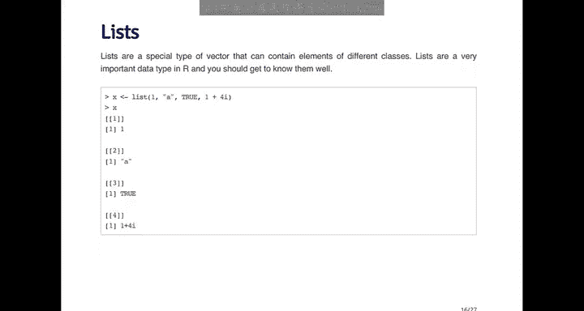

# 约翰霍普金斯大学《数据科学R语言基础｜Data Science： Foundations using R》中英字幕（deepseek - P29：10_数据类型向量和列表.zh_en - GPT中英字幕课程资源 - BV1tsFQemEts

So the C function is another function that can be used to create vectors of objects and you can think of C kind of as the standing for concatennate because it can be used to kind of concatenate things together so for example I can create an object called x by concatenating 0。

5 and 0。6 and that will give me a numeric vector of length2 where the first element is 05 and the second element is 0。

6 in the second example here I've got a logical vector where concatenating true and false。

So shorthand for true and false， you can use T and F， capital T and capital F。

 so these two lines give you the same object。You can create a character vector by concatenating a bunch of characters。

 you can create an integer vector by creating a sequence with a colon operator。

 and you can also create a vector of complex numbers where the I is a special symbol which indicates the imaginary part of the complex number。

So using the vector function， you can also create a vector of a certain type and a certain length。

 so here I'm going to create a numeric vector of lengths 10 and by default it will initialize the vector with a default value and for numeric vectors the default value is 0。

So what happens if you take a if you create a vector and you mix two different types of objects and so the general rule is that R will kind of create the least common denominator vector。

 so it will not give you an error but will happen is that it will coerce the vector to be the class that's kind of the least common denominator so it's here in this first example。

I've gotten from concatenating the number 1。7 and the letter A。

 So clearly these are not of the same class。 One is numeric and the other is character。

 So the least commons denominator here is going to be character。

 And so what you're going to get is that y is going to be a character vector where the first element is going to be the string 1。

7 and the second element is going to be the letter A。So in the second example here。

 I've got' concatenating true， which is a logical and two， which is anumeric。

And so what's going to happen here is that you're going to get a numeric vector and the true is going to be converted into a number and so how does that happened so in the end by the convention in R true is represented as the number one and false is represented as the number0。

And so what you're going to get here is a vector 1，2。Lastly。

 this last example here I'm concatenating the letter A and the logical true。

And so here the least common denominator again is going to be character。

 and so the vector that you end up with is the vector where the first element is a。

 and the second element is the string true。 So T R U E is's not going to belogical。

 So you need to be a little bit aware of the types of coercion that can occur in R when you mix different types of elements in a vector。

And because you won't get an error， but the coercion will happen behind the scenes。

That in the previous slide， we talked about kind of a implicit coercion that occurs behind the scenes。

 but you can explicitly coerce objects from one class to another using functions that usually start with the word as so for example。

 if you want to convert something to a numeric you can use the function called as dot numeric and you want to convert something into character you can use the function as dot character Now if you apply these functions so if you apply as dot numeric to a numeric vector nothing will happen so here in this example I'm starting off by creating an object called x which is a sequence of zero to6 so this is going this is an integer sequence as you can see when I call class on the object。

But I want to convert it into a numeric sequence， and so I can call as dot numeric on x。

 and you can see that it prints out 0，1 through 6， which looks like an integer object。

 but it's actually going to be numeric， or I can convert it into a logical。

 And so I can say as dot logical on it and what happens。 Well。

 as you can see the convention is that0 is false。 and any number that's greater than0 is going to be true。

 So here Ive when I convert to logical， I get false and then everything else is true。

When I call as dot character on X， it takes all the numbers and converts them into characters。

 so now I've got the string0， the string 1，2， etc。And finally， if I call as dot complex。

 this is fairly straightforward because can all it does it says that you have a complex number where all the imaginary components are zero。

Now coercion will notice doesn't always work and when it doesn't work you get what called NA values。

 so nonsensical coercion will result in NA so for example。

 if I take the vector ABC and call as dot numeric， well there's really no way to convert the letters A B and C to numeric variables and so what you'll get is a vector of NAs and plus a warning。

Similarly， if you call as do logical on x， you're going to get a vector of Ns。

The next data type I'm going to talk about is the list Now I mentioned lists a little bit earlier in this lecture and the idea is that they're lico vector。

 except that every element of a list could be an object of a different class so that makes list very handy for kind of carrying around different types of data and they're very useful in R and they become very common especially when in conjunction with other types of functions that we're going to learn about。

 So here I'm creating a list called X， using the list function。

 which is which can be used to construct the list and the first element is a numeric value。

 numeric object of one， the second element is a character letter a third is a logical and the fourth is a complex number So this is not a problem with lists。

😊，And when I autoprint the list， you'll see that it prints out a little bit differently。

 it doesn't print out like a vector because every element is different。

 so you can see that in the double brackets here， so the elements are indexed by double brackets so the first element is a vector1。

 the second element is a vector with a the third element is a vector with true and the fourth element is a vector with the complex number1 plus4 I So lists are index you'll youll notice that elements of the list will have double brackets around them elements of other vectors just have the single brackets So that's one way to separate a list from other types of vectors。

