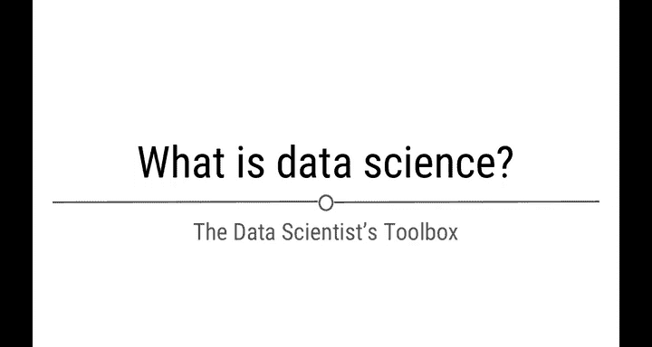
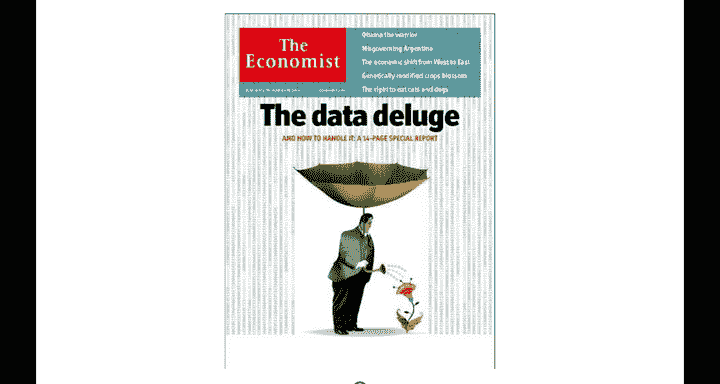
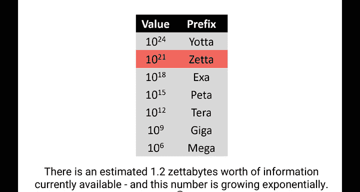
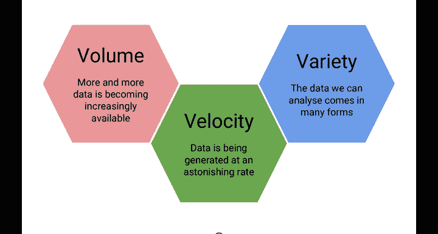
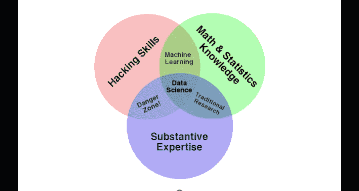
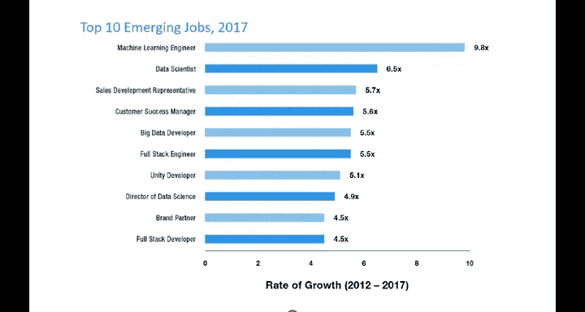
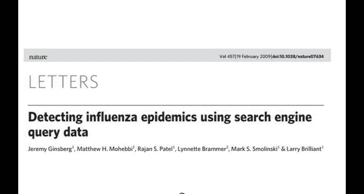
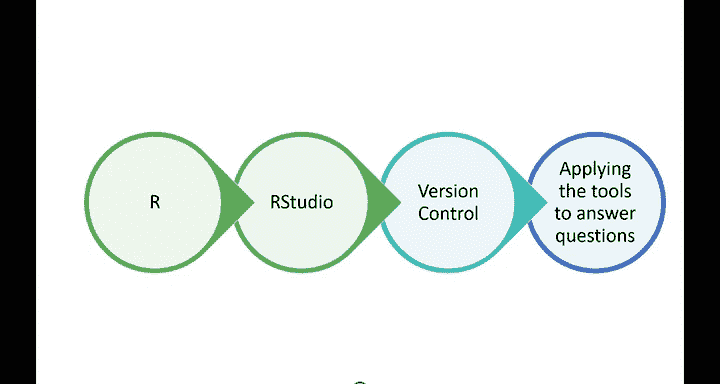

# 约翰霍普金斯大学《数据科学R语言基础｜Data Science： Foundations using R》中英字幕（deepseek - P2：1_什么是数据科学.zh_en - GPT中英字幕课程资源 - BV1tsFQemEts

Hello and welcome to the Data scientistient toolbox。

 the first course in the data science specialization series here we will be going over the basics of data science and introducing you to the tools that will be used throughout the series。

 so the first question you probably need answered going into this courses what is data science and that is a great question to different people this means different things but at its core data science is using data to answer questions this is a pretty broad definition and that's because it's a pretty broad field data science can involve statistics。

 computer science mathematics， data cleaning and formatting and data visualization and economists special report sums up this me long of skills well。

 they state that a data scientist is broadly defined as someone who combines the skills of software programmer。

 statistician and storyteller/ artist who extract the nuggets of gold hidden under mountains of data and by the end of these courses hopefully you will feel equipped to do just。

That。One of the reasons for the rise of data science in recent years is the vast amount of data currently available and being generated。

 not only are massive amounts of data being collected about many aspects of the world in our lives。

 but we simultaneously have the rise of inexpensive computing this has created the perfect storm in which we have rich data and the tools to analyze it。

 rising computer memory capabilities， better processors。

 more software and now more data scientists with the skills to put this to use and answer questions using this data there is a little anecdote that describes the truly exponential growth of data generation we are experiencing In the third century BC。

 the Library of Alexandria was believed to house the sum of human knowledge Today。

 there is enough information in the world to give every person alive 320 times as much of it as historians think was stored in Alexandria's entire collection。

 and that is still growing。

We'll talk a little bit more about big data in a later lecture。

 but it deserves an introduction here since it has been so integral to the rise of data science。

 there are a few qualities that characterize big data The first is volume as the name implies big data involves large data sets and these large data sets are becoming more and more routine for example。

 say you had a question about online video Well YouTube has approximately 300 hours of video uploaded every minute you would definitely have a lot of data available to you to analyze but you can see how this might be a difficult problem to wrangle all of that data and this brings us to the second quality of big data Ve data is being generated and collected faster than ever before in our YouTube example new data is coming at you every minute in a completely different example。

 say you have a question about shipping times or routes Well most transport trucks have real-time GPS data available you could in real-time analyze the trucks movements。

You have the tools and skills to do so The third quality of big data is variety In the examples I've mentioned so far。

 you have different types of data available to you in the YouTube example。

 you could be analyzing video or audio， which is a very unstructured data set。

 where you could have a database of video lengths， views or comments。

 which is a much more structured data set to analyze。

So we've talked about what data sciences and what sorts of data deals with。

 but something else we need to discuss is what exactly a data scientist is the most basic of definitions would be that a data scientist is somebody who uses data to answer questions but more importantly to you what skills does a data scientist em body and to answer this we have this illustrative Venn diagram in which data science is the intersection of three sectors。

 substantive expertise， hacking skills and math and statistics to explain a little on what we mean by this we know that we use data science to answer questions so first we need to have enough expertise in the area that we want to ask about in order to formulate our questions and to know what sorts of data are appropriate to answer that question once we have our question and appropriate data。

 we know from the sorts of data that data science works with oftentimes it needs to undergo significant cleaning and formatting。

 and this often takes computer programming slash hacking skills Finally， once we have our data。

We need to analyze it， and this often takes math and stats knowledge In this specialization。

 we'll spend a bit of time focusing on each of these three sectors。

 but we'll primarily focus on math and statistics knowledge and hacking skills for hacking skills will focus on teaching two different components computer programming or at least computer programming with R。

 which will allow you to access data play around with it analyze it and plot it Additionally we'll focus on having you learn how to go out and get answers to your programming questions one reason data scientists are in such demand is that most of the answers are not already outlined in textbooks a data scientist needs to be somebody who knows how to find answers to novel problems。

Speaking of that demand， there is a huge need for individuals with data science skills。

 not only are machine learning engineers， data scientists and big data engineers among the top emerging jobs in 2017。

 according to LinkedIn， the demand far exceeds the supply they state data scientists trolls have grown over 650% since 2012。

 but currently 35，000 people in the US of data science skills。

 while hundreds of companies are hiring for those roles。

 even those you may not expect in sectors like retail and finance。

 supply of candidates for these roles cannot keep up with demand。

 this is a great time to be getting into data science， not only do we have more and more data。

 and more and more tools for collecting storing and analyzing it。

 but the demand for data scientists is becoming increasingly recognized as important in many diverse sectors。

 not just business and academia Additionally， according to Gladoor。

 in which they rank the top 50 best jobs in America， data scientists is the top job。

U in 2017 based on job satisfaction， salary and demand。

 the diversity of sectors in which data science is being used is exemplified by looking at examples of data scientists。

 one place we might not immediately recognized the demand for data sciences in sports Daryl Moy is the general manager of a U。

S basketball team the Houston Rockets despite not having a strong background in basketball Morey was awarded the job as GM on the basis of his bachelor's degree in computer science and his MBA from MIT he was chosen for his ability to collect and analyze data and use that to make informed hiring decisions。

Another data scientist that you may have heard of is Hillary Mason。

 she is a co-founder of Fastforward Labs， a machine learning company recently acquired by Cloudodera。

 a data science company， and is the data scientist in residence at ExcelL broadly she uses data to answer questions about mining the web and understanding the way that humans interact with each other through social media。

 and finally， Nate Silver is one of the most famous data scientist or statisticians in the world today。

 he is founder and editor in chief at 538， a website that uses statistical analysis。

 hard numbers to tell compelling stories about elections， politics， sports， science。

 economics and lifestyle， he uses large amounts of totally free public data to make predictions about a variety of topics。

 most notably he makes predictions about who will win elections in the United States。

 and has a remarkable track record for accuracy doing so。

One great example of data science in action is from 2009。

 in which researchers at Google analyzed 50 million commonly searched terms over a five-year period and compared them against CDC data on flu outbreaks；

 their goal was to see if certain searches coincided with outbreaks of the flu one of the benefits of data science and using big data is that it can identify correlations in this case。

 they identified 45 words that had a strong correlation with the CDC flu outbreak data with this data。

 they have been able to predict flu outbreaks based solely off of common Google searches without this mass amounts of data。

 these 45 words could not have been predicted beforehand。

Now that you have had this introduction into data science。

 all that really remains to cover here is a summary of what it is that we will be teaching you throughout this course to start。

 we'll go over the basics of R R is the main programming language that we will be working within this course track。

 so a solid understanding of what it is， how it works。

 and getting it installed on your computer is a must。

 we'll then transition into our studio which is a very nice graphical interface to R that should make your life easier。

 we'll then talk about version control， why it is important and how to integrate it into your work。

 and once you have all of these basics down， you'll be all set to apply these tools to answering your very own data science questions。

 looking forward to learning with you， let's get to it。

