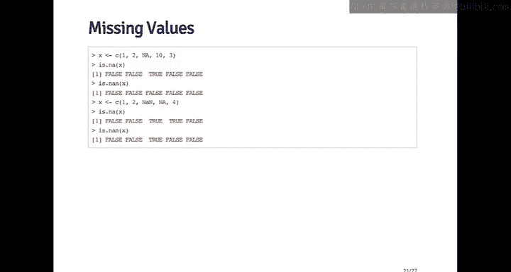

# 约翰霍普金斯大学《数据科学R语言基础｜Data Science： Foundations using R》中英字幕（deepseek - P32：13_数据类型缺失值.zh_en - GPT中英字幕课程资源 - BV1tsFQemEts

So there's a special type of object that we haven't talked too much about yet。

 and these are missing values， missing values in R are denoted by either NA or NAN。

 which we talked about before， NAN is used for undefined mathematical operations and NA is pretty much used for everything else。

And so there's a function in R called is dot NA， which is used to test objects to see if they are NA to see if they are missing values in that object。

 There's another function called is dot NAN， which is used to test for NANs。

 so NA values can have a class too， so you can have missing integer values or you can have missing character values or missing numeric values etcter。

And so even though it looks like it's all NAs， the NAs can have different classes potentially。

 and then its an NAN value is considered to be also NA， so for example， an NAN value。

 a NN value is missing is considered to be missing but the reverse is not true。

 so an NA value is not necessarily a NN value。I've got a few different types of missing values listed here。

 So here Ive created a vector X， which is 1，2 NA 10 and3。 So now this is a numeric vector。

 and the NA value in here is going to be a numeric missing value。

 So when I call is dot na on x what it returns is a logical vector and the logical vector indicates whether each element of the vector X is missing or not。

 And so there's only one missing element in this vector， and so that's the third element。

 So you can see that the logical vector that's returned， the first two are false。

 the third is true in the fourth and the fifth are false。

 So the element that's true indicates where the missing value is。

 if I call is dot n on this vector you'll see that the vector that's returned is all false because there aren't any NAN values there aren't any n values in this vector So everything's false。

Of course， if I create a vector that has a n value in it and an NA value in it。

 you'll see that is dot NA returns true for both of them。

 but is dot n only returns true for the value that's actually NAN。

