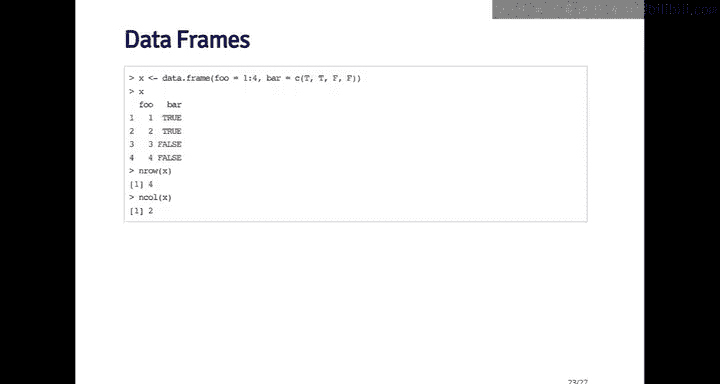

# 约翰霍普金斯大学《数据科学R语言基础｜Data Science： Foundations using R》中英字幕（deepseek - P33：14_数据类型数据框.zh_en - GPT中英字幕课程资源 - BV1tsFQemEts

The last data type I'm going to talk about here is the data frame the data frame is a key data type use in R and it's used to store tabular data so of course tabular data make up a lot of what we use in statistics。

 of course not all types of data are tabular but because so much data becomes a tabular form。

 data frames are very important in R so data frames are basically represented as a special type of list where every element of that list has the same length right so you can think of each column of the data frame is an element of the list and of course in order to be a table every column has to have the same length。

However， each column doesn't have to be the same type， so the first column could be numbers。

 a second column could be a factor， the third column could be integers。

 the fourth column could be logicals， it doesn't matter what the different types are。

So unlike matrices which have to store the same type of object in every single element of the matrix data frame can store objects of different classes and so data frames also have some special attributes first the first special attributes is called the row name so every row of a data frame has a name and this can be useful for kind of annotating the data。

 so for example， each row might represent a subject enrolled in a study and then the row names would be the subject ID for example。

 however sometimes the row names are not interesting and often you'll just use row names of one。

23 etc。Data frames can be created by calling most often calling the read dot table。

 the read do CSv function and we'll get into that a little bit when I talk about reading data into R and you can also create a matrix from a data frame by calling the data dot matrix function Now you can't if you have a data frame that has many different types of objects and then if you coerce that into a matrix it's going to for each object to be coercied so that they're all the same so you may get something that's not exactly expected。

So data frames can be created besides using read dot table or readdot CSV you can use the data dot frame function and here I've created a very simple data frame where first the first column is called is the F variable and the second column is the bar variable the F variables and integer sequence from one to four and the bar variable is a logical vector with two truths and two falses so when I auto print the data frame app。

You'll see it prints out the two columns and here the row names since I didn't specify any special row names。

 just defaults to  one， two，3，4 because there's four rows and then when I call the n row function on X I see that this four rows and the N call function shows me that there's two rows。

