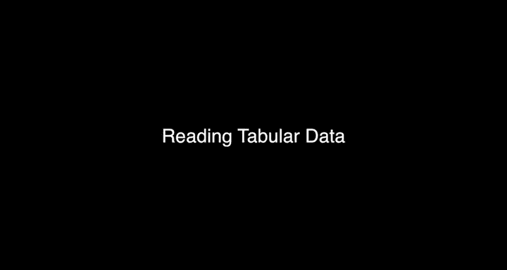
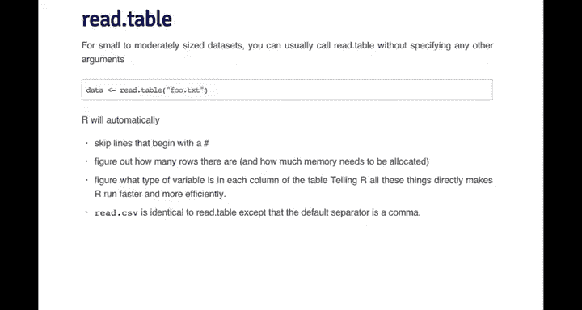

# 约翰霍普金斯大学《数据科学R语言基础｜Data Science： Foundations using R》中英字幕（deepseek - P36：17_读取表格数据.zh_en - GPT中英字幕课程资源 - BV1tsFQemEts

This lecture is going to talk about reading and writing data in R so there's a few different types of ways you can do this and I'm going to talk about some of the primary functions that you use in R to read and write data so there are a few principal functions that we're going to talk about for reading data into R first two are read dot tabled and read do CSV and these are for reading tabular data and they're probably two of the most commonly used functions for reading data into R these functions read text files that contain data that are stored in kind of rows and columns type of format and return a data frame in R。

The function read lines is for reading lines of a text file and but this can read any type of file really。

 it just gives you text as a character vector in R The source function is important for reading R code。

 so if you have a R code for example functions or anything written to a file。

 the source function will read all that code into R。

The D get function is also for reading R code files。

 but for R objects that have been what are called D parsed。Into text files。

 we'll talk a little bit more about this later。 The load and the unseerialized functions are for reading binary objects into R。

So the analogous functions for writing data are right dot table， right lines， dump， de， save。

 and serialized， and those kind of pair up with their reading analog。

So the read dot table function is the most commonly used function for reading data into R。

 and it's important that you know kind of how the arguments work。

 what the arguments are and understand what they mean so the first argument is pretty obvious it's the name of a file or the name of a connection which we'll get to a little bit later。

Usually you're going to give this a file name it's going to be a string and it's going to be a path to a certain file in your computer。

 The header is a logical flag indicating whether the first line is a header line。

 so if the first line， for example it has all the variable names in it。

 then that's not really a piece of data， that's just a line that has labels on it。

 so you want to tell read table function whether the first line contains the variable names or not or whether the first line just right away contains data。

The set argument stands for separator， it's a string that indicates how the columns are separated。

 so for example， if you have a file that's separated by commas then the separator as a comma。

 you might sometimes files are separated by semicollonons or by tabs or by spaces and so you want to tell read that table what the separator is going to be call classes is a character vector which whose length is the same length as a number of columns in the data and the character vector indicates what is the class of each column in the data so for example the first column is numeric and the second column is logical and the third column as a factor etc。

 and so the call classes a vector。Which is not required。

 but tells it tells readdot table what the class of the data is for each column and rows is the number of rows in the data said this is not required。

 but it can be used。 comment do cha is the character string that indicates what's the comment character。

 So so the default， for example， is the pound symbol or the sharp symbol and anything after anything to the right of that symbol is ignored the comment characters。

 So you can specify other characters to be comment characters and lines of lines of the file that begin with that comment character will be ignored。

Sip is the number of lines to skip from the beginning。

 so sometimes there may be some header information or some nondata region at the beginning of the file and you want to skip right over that and so you can tell the read that table function to skip to say the first 10 lines or the first 100 lines and then only start reading data after that。

The last argument is strings as factors， this defaults to true and the idea is that the question is whether do you want to encode character variables as factors so by default anytime our readt table encounters a column of data that it looks like it's a character variable。

 it will assume that what you mean to read in as a factor variable。

 if you don't mean to read this in as a factor variable that you can set strings as factors equals a false。

So for small and kind of moderately sized dataset sets and as computers kind get better and better every day。

 the definition of small and moderate is kind of growing， but you can use read dot table。

 usually without specifying any of the are the arguments besides the file name so you can say read dot table on say food text so this is just the name of the file and it will automatically take care of figuring out what the classes of the different columns are it will figure out how many rows there are etc。

 so you don't have to specify any that information if you don't feel like it this will return an object here that I call data and that will be a data frame so itll automatically skip any lines that begin with the comment symbol it will figure out how many rows there are again itll figure out what type of variable is in each column of the table So tell you can tell are all these things and if you want to and the reason you might do that is to make it run faster and more efficiently So small and moderate sized data sets is's really not much advantage to doing that because。

It'll be pretty fast and pretty efficient as it is。

The reddot CSV function is identical to readdot table。

 except for the key differences is that the default separator for the readdot CSv function is the comma whereas the default separator for reddot table is a space reddot CSv is useful for reading CSV files these can usually the stands for comma separated value it's usually something that you get from a spreadsheet program like Microsoft Excel or something similar to that so CSv is a very common format that most spreadsheet types of programs will understand The other thing that readdot CSv specifies is that it always specifies header to be equal to true。

