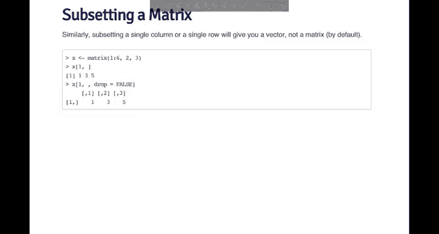
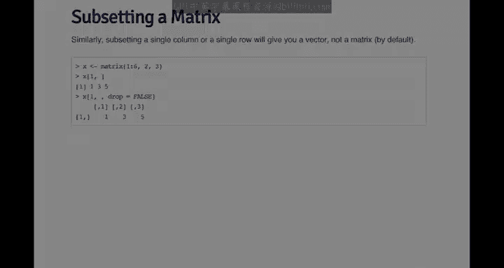

# 约翰霍普金斯大学《数据科学R语言基础｜Data Science： Foundations using R》中英字幕（deepseek - P42：23_子集矩阵.zh_en - GPT中英字幕课程资源 - BV1tsFQemEts

Marices can be subsetd in kind of the way that you expect so the first index is going to be the row index and the second index is going to be the column index and we can use numbers for this two。

 so for example x is a matrix it's a two by three matrix with the numbers one through6 in it if I take x with the bracket one comma 2 that gives me the first row second column and so that's going to be the number3 and then the。

The second row first column is going to be the number two you don't have to always specify both indices when subsetting a matrix。

 So for example， if I say x bracket1 comma and then blank for the second index that notation indicates that I want the first row of the matrix in which case this is a vector 135 if I wanted the second column of the matrix。

 I could just leave the first index blank and say x bracket and then comma 2 and that gives me the second column which is 34。

So by default， when a single element of a matrix is retrieved is returned to vector of length1 rather than a one by one matrix。

 so remember I said that before the single square bracket operator always returns an object that's the same class So the one thing sometimes is a little bit unexpected is that if I subset out a single element of a matrix I don't get back a matrix。

 what I get back is just a vector with that number in it。

 So if I say x12 that gives me the first row second column of the matrix。

 that's just the number three and what I get back is a number three not a one by one matrix with a number three in it This is usually what you want。

 although sometimes it can cause problems and so you can turn off this default behavior by adding an extra argument to the subsetting operation which is called drop the idea is that by default drop is equal to true and it drops the dimension and so rather than getting a two dimensional object back。

 you typically get a one dimensionmensal object back however。

 if you want to preserve the dimensions of the object you can say drop equal to。False。

 and when I subset out the first row second column。

 what I get back is a one by one matrix with the element 3 in it。Now。

 also when you subset a single column or a single row， by default。

 you don't get a matrix back so for example， if I subset out the first row here。

 you might think that well what should be returned。

Is really a1 by three matrix where there's one row and three columns and the elements are 1，35。 Well。

 that's not actually what you get back。 What you get back is a vector with the elements 135。

 Usually this is what you want and it's okay。 but if it's not。

 then you can always set the drop equal to false argument when you subset the matrix and then you get a 1 by3 matrix with the elements 1。

3 and 5 in it。

