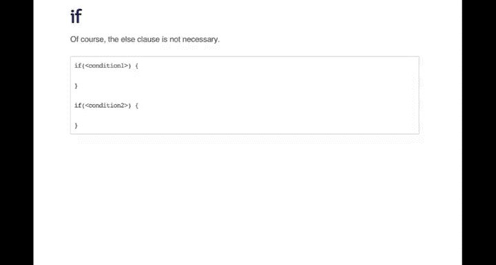

# 约翰霍普金斯大学《数据科学R语言基础｜Data Science： Foundations using R》中英字幕（deepseek - P48：29_控制结构if else.zh_en - GPT中英字幕课程资源 - BV1tsFQemEts

So the first structure is if so this the if combined with else allows you to test logical conditions and to let the R program do something whether or not depending on whether or not that condition is true or false。

 so if the condition is true， then you do something else you do something else。

 that's a typical kind of construct， the else part is optional so you could just have an if statement to do something if something is true。

 but you can have the else part if you want to do something alternatively。

 if you want to do more that there's more than one possible type of condition you can test you want to check you can say if and then else if and then else else if there can be any number of else if conditions in a construct like this and the else1 has to be at the end。

So there are a couple of different ways that you can formulate the if else construct in R this is a little bit different from other languages。

 in case you haven't seen something like this， so the first is pretty standard if the symbol x is greater than 3。

 then you set y equal to 10， if it's not greater than 3， then you set y equal to 0。

So that's inside the if elses construct， theres there's an assignment of y to a specific type of value。

 depending on what the value of3 of x is。 But however， in R， you can do it a different way。

 You can say y is equal to the entire if elses contract。 So if x is greater than 3，10 or 0。

 depending on whether that condition is  true or not。 So this is a valid formulation also。

 sometimes it it' it's useful to read this type of。

Writing because it allows you to realize that the entire FL construct is all about assigning a value to Y。

So as I said before， the else clause is not really necessary。

 you can always test the condition and do something and then do nothing if that condition happens to be false and you can just test multiple conditions in a row if you want。

