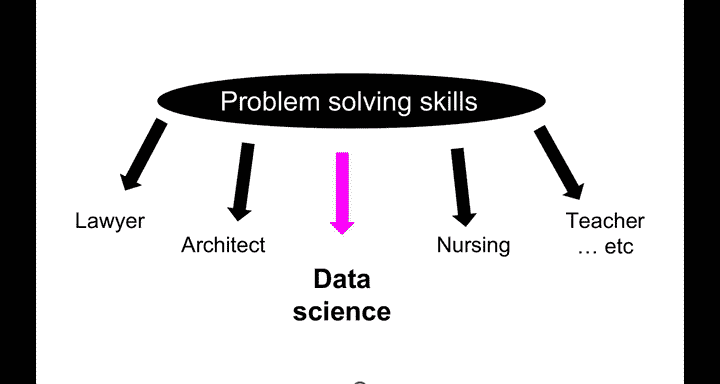

# 约翰霍普金斯大学《数据科学R语言基础｜Data Science： Foundations using R》中英字幕（deepseek - P4：3_获取帮助.zh_en - GPT中英字幕课程资源 - BV1tsFQemEts

One of the main skills you are going to be called upon for as a data scientist is your ability to solve problems and sometimes to do that you need help the ability to solve problems is at the root of data science。

 so the importance of being able to do so is paramount In this lesson we are going to equip you with some strategies to help you when you get stuck with a problem and need some help much of this information has been compiled from Roger Pang's video on getting help and our agreements how to ask questions the smart way so definitely check out those resources before we dive into how to get help we first need to focus on why you need these skills in the first place First off。

 this course is not like a standard class you have taken before where there may be 30 to 100 people and you have access to your professor for immediate help In this class at any one time there can be thousands of students taking the class no one person could provide help to all of these people all of the time so we'll introduce you to some strategies to deal with getting help in this course also。

We said earlier，Being able to solve problems is often one of the core skills of a data scientist。

 data science is new， you may be the first person to come across a specific problem and you need to be equipped with skills that allow you to tackle problems that are both new to you and to the community。

Finally， troubleshooting and figuring out solutions to problems is a great， transferable skill。

 it will serve you well as a data scientist， but so much of what any job often entails is problem solving。

 being able to think about problems and get help effectively is of benefit to you and whatever career path you find yourself in。

Before you begin asking others for help on your problem there are a few steps you can take on your own oftentimes the fastest answer is one you find for yourself One of your first stops for data analysis problems should be reading the manuals or help files for our problems trytyping question mark command if you post a question on a forum that is easily answered by the manual you will often get a reply of read the manual which is not the easiest way to get at the answer you were going for Next steps are searching on Google and searching relevant forums Common forums for data science problems include stack overflow and cross-valated Additionally for you in this class there is a course forum that is a great resource and superhelpful before posting a question to any forum try and doubleche that it hasn't been asked before using the forum search functions while you are googling things to pay attention to and look for our tutorials。

 FAQs or vignettes of whatever command or program is giving you trouble these are great resources。

To get you started， either in telling you the language s words to use in your next searches or outright showing you how to do something as you get further into this course and using R you may run into coding problems and errors and there are a few strategies you should have ready to deal with these In my experience coding problems generally fall into two categories your command produces no data and spits out an error message or your command produces an output but it is not at all what you wanted These two problems have different strategies for dealing with them。

 If you are getting an error message I've been there。

 you type out a command and all you get are lines and lines of angry red textex telling you that you did something wrong。

 and this can be overwhelming but taking a second to check over your command for typos and then carefully reading the error message solves the problem in nearly all of the cases。

 The error messages are there to help you it is the computer telling you what went wrong and when all else fails。

 you can be pretty assured that somebody out there got the same error message panicked and posted to a forum。

An is out there on the other hand， if you get an output。

 consider how the output was different from what you expected and think about what it looks like the command actually did。

 why it would do that and not what you wanted Most problems like this are because the command you provided told the program to do one thing and it did that thing exactly it just turns out what you told it to do wasn't actually what you wanted these problems are often the most frustrating you are so close but so far these sorts of problems give you plenty of practice thinking like a computer program。

All right， you've done everything you are supposed to do to solve the problem on your own you need to bring in the big guns now other people easiest is to find a peer with some experience with what you are working on and ask them for helplash direction this is often great because the person explaining gets to solidify their understanding while teaching it to you and you get a hands on experience seeing how they would solve the problem In this class your peers can be your classmates and you can interact with them through the course forum doubleche your question hasn't been asked already but outside of this course you may not have too many data science savvy Pes What then rubber duck debugging is a long health tradition of solitary programmers everywhere in the book the pragmatic programmer there is a story of how stumped programmers would explain their problem to rubber duck and in the process of explaining the problem identify the solution Wikipedia explains it well many programmers have had the experience of explaining a programming problem to someone else possibly even to someone who knows。

noth about programming and then hitting upon the solution in the process of explaining the problem。

 in describing what the code is supposed to do and observing what it actually does。

 any incongruity between these two becomes apparent， so next time you are stumped。

 bring out the bath toys。

You've done your best you've searched and searched you've talked with peers you've done everything possible to figure it out on your own and you are still stuck it's time time to post your question to a relevant forum before you go ahead and just post your question you need to consider how you can best ask your question to garner helpful answers try to include details such as a very specific question that you were trying to answer and what steps you have already taken in your troubleshooting give details on how to reproduce the problem and include sample data for troublesshoooters to work from Ex what your goal and expected output are in details on what your output was instead If you got an error message definitely mention that in your post Additionally。

 relevant details about your operating system or version of the product and question are often helpful details to your potential problem solvers。

One of the most important details of your posting is the title It is what signals to others what you are having trouble There is an art totling your posts without being specific。

 you don't give your potential helpers a lot to go off of they don't really know what the problem is and if they are able to help you instead you need to provide some details about what you are having problems with answering what you are doing and what the problem is are two key pieces of information that you need to provide this way somebody who is on the forum will know exactly what is happening and that they might be able to help Use titles that focus on the very specific core problem that you are trying to get help with it signals to people that you are looking for a very specific answer the more specific the question often the faster the answer。

Following all of the tips mentioned so far will serve you well in posting on forums and observing forum etiquette you are asking for help you are hoping somebody else will take time out of their day to help you。

 you need to be courteous often this takes the form of asking specific questions doing some troubleshooting of your own and giving potential problem solvers easy access to all the information they need to help you formalizing some of these do's and don'ts。

 you get some guidelines to follow Before posting， make sure you asking your question in an appropriate forum and read the forum posting guidelines make sure you describe your goal and are explicit and detailed in your explanation of the problem in your problem-solving steps so far provide the minimum information required to describe and replicate the problem don't bugg people down with unrelated details and finally the big two One be courteous these people are helping you and two make sure to follow up on your post and post the solution not only do the people helping you deserve thanks but this is helpful。

Anybody else who has the same problem as you later on there are also pretty clear guidelines on what not to do First。

 nobody wants to help somebody who assumes that the root cause of the problem isn't because they have made a mistake but that there is something wrong with the program spoiler alert It's almost always because you made a mistake Similarlyly。

 nobody wants to do your homework for you they want to help somebody who is genuinely trying to learn not find a shortcut Additionally for people who are active on multiple forums。

 it is always aggravating when the same person posts the same question on five different forums or when the same question is posted on the same forum repeatedly be patient pick the most relevant forum for your purposes post once and white。

 there is an art to problem solving and the only way to get practice is to get out there and start solving problems。

In this lesson， we look at how to effectively get help when you run into a problem This is important for this course。

 but also for your future as a data scientist， we first looked at strategies to use before asking for help。

 including reading the manual checking the help files and searching Google and appropriate forums we also covered some common coding problems you may face and some preliminary steps you can take on your own。

 including paying special attention to error messages and examining how your code behaved compared to your goal Once you've exhausted these options。

 we turn to other people for help we can ask peers for help or explain our problems to our trusty rubber ducks。

 be it an actual rubber do or an unsuspecting coer Our course forum is also a great resource for you all to talk with many of your peers go introduce yourself and if all else fails。

 we can post on forums be it in this class or at another forum like Sta overflow with very specific reproducible questions before doing so be sure to。

up on your forum mete it never hurt anybody to be polite， be a good citizen of our forums；

 there is an art to problem solving， and the only way to get practice is to get out there and start solving problems get to it。

