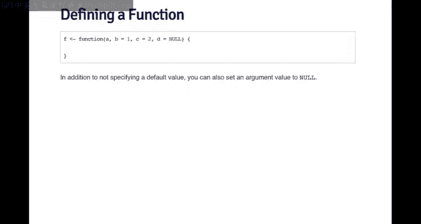
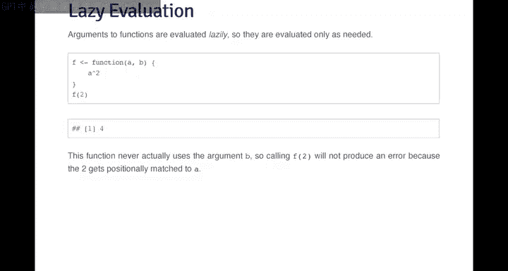
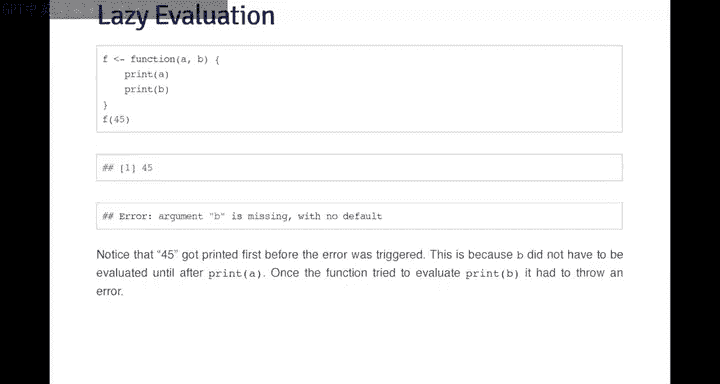
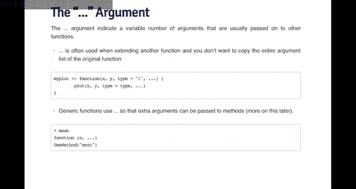
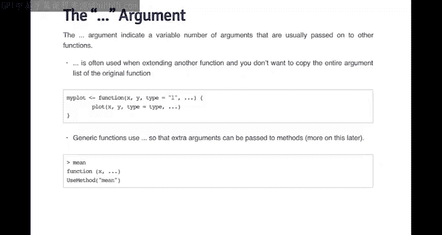
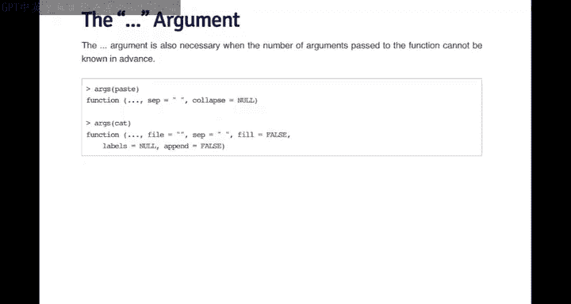
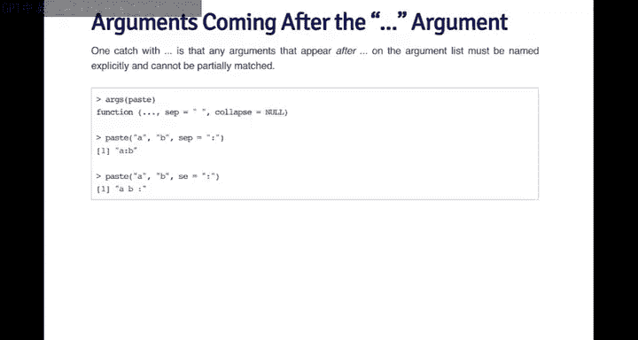

# 约翰霍普金斯大学《数据科学R语言基础｜Data Science： Foundations using R》中英字幕（deepseek - P54：35_函数第2部分.zh_en - GPT中英字幕课程资源 - BV1tsFQemEts

So here's a function with four arguments， A， B， C and D， So A has no default value， B。

 C and D all have default values， and so when you define a function you want to it both specify the names of the arguments and whether or not any of the arguments have default values。

 So null is a common argument sorry common value to assign to an argument which can mean a variety of things usually means that there's nothing there。

So one of the key features of our language is what's called lazy evaluation。

 so lazy evaluation is a common model in a variety of programming languages and the way that it works is that all the arguments to a function are only evaluated as theyre needed and so for example。

 if you take a look at this function over here， you can see it takes two arguments A and B。

But the body of the argument only does one thing， it takes a and it squares it and then returns it。

 Now recall that in a function， the return values is whatever the last expression is that's evaluated。

 So there's only one expression in this function。 so that's the last expression。

 And so it's the return value。 So if I say f of 2， what happens well。In R。

 what happens is you get  four because two squared is 4。 Now。

 you might be wondering well what happens to B。 when I call F。

 I never specify what the value of B is。 And furthermore， B doesn't have a default value。

 And so what happens Well what happens is nothing happens Because the function F doesn't actually use B。

 And so the argument is never evaluated。 And so because it's never evaluated。

 there's really no error there's nothing that's going wrong here。 Now you might say that， of course。

 well the function F is kind of poorly defined。 So why would you give an argument where that's never actually evaluated。

 And that's a reasonable objection。 But in this case， the function will operate correctly because。

Because the value of  two is positionally matched to the argument A， which is then squared。

Here's another example of a function that's only slightly more complicated than the previous one。

 so this is another function that takes arguments A and B。

 but now what the function does is it prints out A and it prints out B。

And so when I call F of 45， look what happens， I get， well。

 I get an error that says in print B argument B is missing。

 So here what happened is that it printed out 45 because 45 was matched to the argument A。

 and so there was no error up until the first line of the function， there was no error occurring。

 But then when it got to the second line， it had to evaluate the argument B and because B had no value assigned to it and no default value then an error had to occur。

 So here but you notice that the error only occurs after the 45 was printed out And the lazy evaluation implies that because the argument is only evaluated when it's needed。

 everything else that comes before it， if that's valid。

 then it will execute until it hits the part that which causes an error。

So there's a special argument in our functions， which is the dot dot dot argument and it's used to indicate a variable number of arguments that can sometimes be passed on to other functions。

 so the three dots are often used when extending another function and you don't want to copy the entire argument list of the original function So for example you might want to extend the plot function and just to have a little bit of a tweak or to change some of the defaults for example。

 and so for example you might create a function that's called my plot and the my plot will replicate some of the arguments of the original plot function like x and y but it's going to change the default type arguments so that instead of creating circles for points you want it to create line so you say type equal to L but of course plot the default plot function has many。

 many other arguments and you want to leave them all to be the same and so what you can do is you can pass dot dot dot。

And then that can use to be used to kind of absorb all of the other arguments in the plot function。

 And then what happens is I'll take the dot dot dot and then pass it down to the original plot function。

 And so all those original arguments can be preserved and I don't have to retype or reconstruct all of those arguments in my extended function's another function sorry's another use of the dot dot dot argument and this what are called generic functions so that extra arguments can be passed in method。

 So we'll talk a lot about more this later when we talked about object oriented programming。

But the basic idea is that in R there can be special functions called generic functions which don't do anything。

 but what they do is they dispatch methods for different types of data。

 and so the dot dot dot is used very heavily in this type of setup。

So lastly， the dot dot dot argument is necessary when the number of arguments that are passed to a function cannot be known in advance。

 So one good example of this usage is in the paste function。

 so the paste function what it does it paste it concatenates a set of strings together to create one string or vector of strings and it can take a variable number of arguments so there's no way for the function to note advance how many arguments it's going to have to paste together and so the first argument for paste is actually dot dot dot and therefore you can take a number of different R objects that are character vectors and then paste them together using a separator and in which a case the default is the space so there are other arguments to paste which are set and collapse but they come after the dot dot dot argument。

Another function that has dot dot dot as the first argument is cat and what cat does similar to it pasts together a number of strings。

 then it prints out the concatenated string either to a file or to the console。

 and so you can see there are many other arguments to cat but the first argument is going to be the set of our objects that are going to be concateninated。

So one catch with the dot dot dot argument is that any arguments that appear after the three dots on the argument list must be named explicitly furthermore cannot be partially matched so you can't use positional matching or partial matching for arguments that come after the three dots because in this kind of makes sense because otherwise there's no way for r to no whether you're passing something to the dot dot dot or whether you're passing something to a different argument so if in this first example here if I try to paste together A and B so A and B are going into the dot dot dot argument and then I say sep equals colon which means that I want to paste them together by separating them into with the colon however if I try to do partial matching with CP what happens is that the partial matching gets ignoredd ignored and so when I say paste Aab and then se equals to colon well the ses in another circumstance might be partially matched but in the paste function it can't use partial matching so it just ignores that and just assumes that colon is just another string to be。

together so then you get the string A B colon。 so just be careful when you're using functions that have dot dot dot as an argument that any arguments that appear after the three dots have to be named explicitly and in full。

