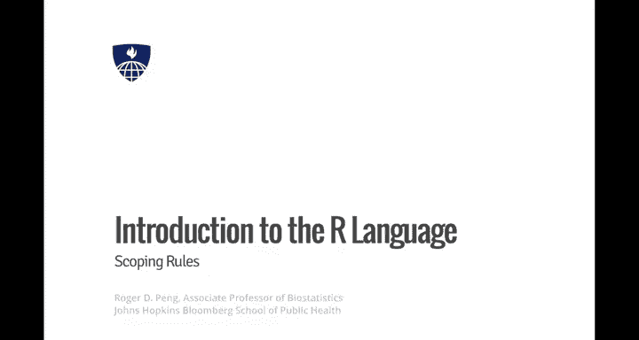
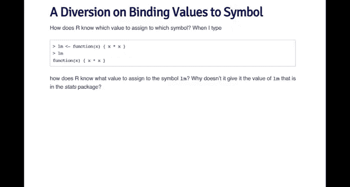
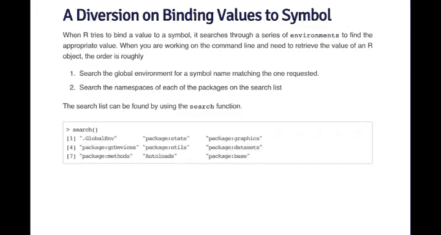
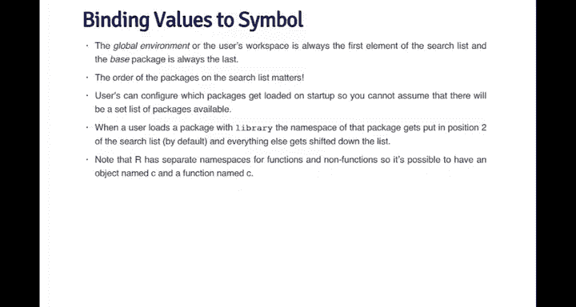
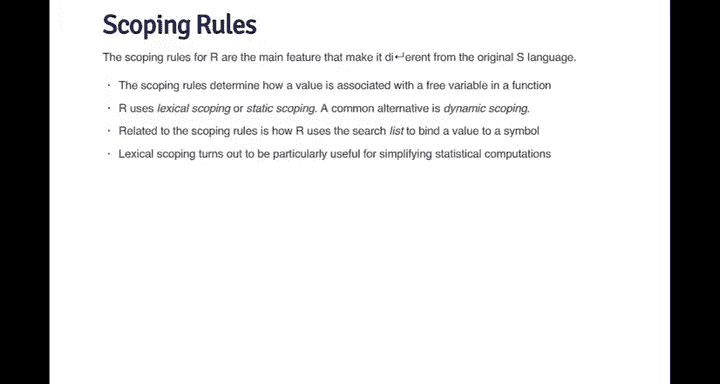
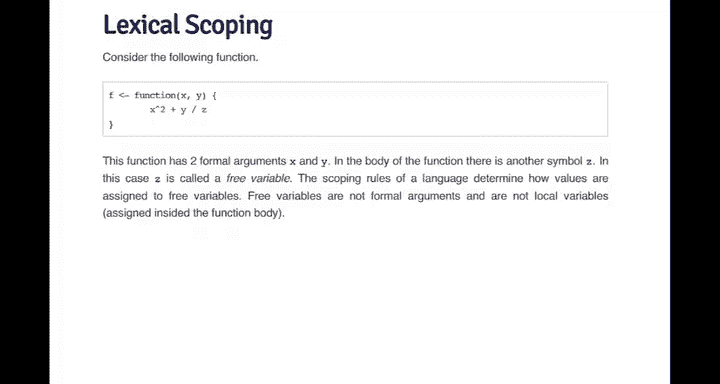
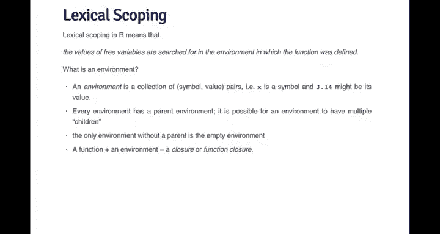
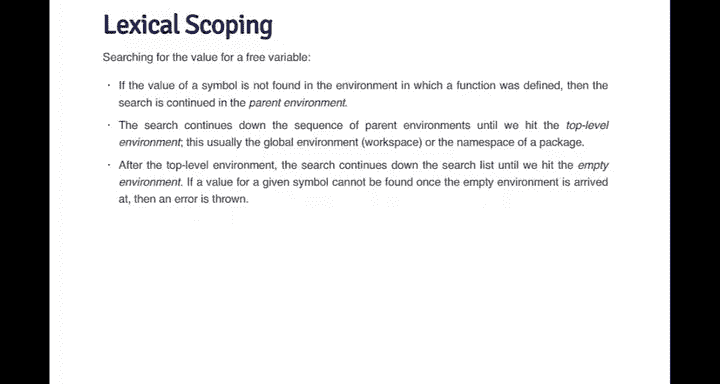

# 约翰霍普金斯大学《数据科学R语言基础｜Data Science： Foundations using R》中英字幕（deepseek - P55：36_作用域规则符号绑定.zh_en - GPT中英字幕课程资源 - BV1tsFQemEts

One topic that's important to discuss in R is a question of you know when a function sees a symbol in its body and it's running and it's executing inside their R environment。

 how does it assign a value to that symbol so for example take a look at this function here that I've defined called LM So LM here is a function which takes its argument X and it multiplies at times itself so you can think of it as the squaring the input now。

Now there's already a function in R called LM。 So I've created a function here， also called LM。

 So when I call LM in somewhere else in R， maybe in another function or something like that。

 how does R know what value to assign to the symbol LM So it sees the symbol LM and how does it know whether to call the function that it justified here or the LM function that's in the stats package that's used to model know it's a fit linear models And so。

The idea is that R needs to bind a value to a symbol。 So in this case in the previous slide。

 the symbol was Lm and it needs to bind a value to it。

 and the value is going to be a function of some sort。

 it's either going to be my function or it's going to be the function in the stats package and so when R tries to bind the value to a symbol what it does is it searches through a series of environments to find the appropriate value So environments are kind you think of them as lists of objects and values or symbols and values And so when you're working on the command line and you need to retrieve a value of an R object basically what happens is the first thing that happens is you search for the global environment for a symbol name matching the one requested。

 and so the global environment is just your workspace and consists of all the things that you've defined or loaded into R And so if there's a symbol there that matches the name of the one that you're requesting then it will take that symbol and then retrieve the value that's associated with that symbol So in this case I。

Find LM in my global environment。 And so that because that exists。

 if I'm working at the command line when I call LM， it's going to find that object first。

So if there's no match in the global environment and then what happens is the R will search the namespaces of each of the packages on the search list。

 So if you look so the search list consists of all the R packages that are currently loaded into R and so you'll see that there there's an order to the search list and it goes starts at the first element which is the global environment that's number one on the search list that's always number one on the search list you can see second on the search list is the stats package and the graphics package。

 the GR devices package all the way down at the very end is the base package and so somewhere in this list of packages。

 R is going to look for a function called LM and of course， if it's not in the global environment。

 then it will eventually find it in the stats package which is the function that's used to fit linear models。

So as I said before， the global environment is equivalent to the user's workspace and it's always the first element on the search list and furthermore。

 the base package is always the last element on the search list so clearly because of the way that the search process works in terms of going down the list of packages。

 the order of the packages on the search list matters and furthermore users can configure which packages get loaded when you start up and users can also load packages whenever they want so you cannot assume that there's going to be a set list of packages available or that the packages will be in any sort of order so they can be in different orders at any time to give depending on what the user has decided to do in a given session。

So when a user loads a package with the library function。

 what happens is the namespace of that package， which is the environment that has all the symbols and the values for the symbols。

 the namespace of that package gets put in the second position of the search list so right behind the global environment and then everything else can kind of get pushed down one level。

😊，So and then the search will kind of go down will include that new package。

 including in addition to all the other packages that were originally on the search list one thing to note is that R has separate namespaces for functions and nonfunctions。

 so it's possible to have an object named C somewhere and the function named C。

 of course in your global environment there can only be one symbol named C。

 but it's possible to have for example a vector named C and that won't necessarily interfere with the function that already exist that's also named C。

So this leads us to the scoping rules for R which which I think is the main feature that makes it different from the original S language since most of you probably did not use the original S language this may this may not this may be something of a moot point but the point is that the scoping rules are essentially what makes R different from the original So what are the scoping rules so the scoping rules determine how a value is bound to a free variable in a function。

 So if you're in a function。There's two types of variables there's the function arguments that are passed through the definition of the function。

 and then there may be other variables or other symbols that are found in the function that are not function arguments and the question is how do you assign a value to those symbols and so R uses what's called lexical scoping or static scoping and this is a common alternative to something called dynamic scoping and so。

And so this is related to the scoping rules is how R uses the search list to bind a value to a symbol and one thing that's nice about lexical scoping is that turns out to be particularly useful for simplifying things specifically statistical calculations So take a look at the following function So this function has two formal arguments they're called x and y and the pi of the function basically it squares x and it adds the ratio of y divided by z so x is clear and y is clear but where did z come from so in this case。

 x and y are formal arguments， but the symbol z is what's called a free variable because it wasn't defined in the function in the function header and so the question is well what value do we assign to z assuming that values were inputted to the function for x and Y and so the scoping rules of the language determine how we assign a value to something like z which is a free variable。

So were the lexical scoping， the rules in R can be summarized by the following sentence。

 which is basically the values of free variables are searched for in the environment in which the function was defined。

Okay， so think about that for a second and maybe repeat it a few times。 And so what's an environment。

 environment is a collection of symbol value pairs， right， So x is a symbol and 3。

14 might be its value。 So every symbol has a value bound to it。

 And and you can think of everything in R as being pairs of symbols and values right So another symbol might be y and its value is a data frame。

 for example。 And so。Every environment which is a collection of these symbol value pairs。

 has a parent environment， so it's kind of like the environment that sits on top of it that it inherits from and it's possible for an environment to have multiple children so there might be one parent environment in many children environment and so。

😊，There's only one environment without a parent and that's the empty environment。

 And so R uses a lot of these types of environments。 So you think of the global environment。

 which is your workspace， that is a set of symbol value pairs right so you have a bunch of things that you've created in your workspace and they all have names and each one of those things has an object associated with it so they might be a vector of numerics or it might be a data frame or might be a list or whatever and so there are all kinds of these each package has a name space and that's like an environment that has a bunch of symbols and values associated with it and so。

😊，the key thing in R is that if you take a function and you associate it with an environment。

 then that creates what's called a closure or function closure。

 and these closures are key to a lot of different types of interesting operations in R。

So if you're in a function and you encounter a free variable in that function， what happens？

The first thing you look for is the function in which the environment in which the function was defined。

 So， for example， if the function was defined， if I defined a function in the global environment。

 then the global environment is the functions。is the environment in which the function is defined。

 So if I see a free variable in this function， what's going to happen is that if I can't figure out a value inside the function。

 then I'm going to look in the global environment because that's where the function was defined if I can't find something in the global environment。

 then the search continues in what's called the parent environment of the global environment And so and what happens in the usual case if I define a function in the global environment。

 then the function is defined in the global environment and then its parent environment is the next thing down on the search list So what happens is that you just go down the search list until you eventually find the value for this free variable。

😊，Now it's possible to define a function outside of the global environment and so generally speaking。

 what happens is that a function will look for a value in the environment in which it was defined。

 and if it can't find it there， then it's going to look for the parent environment。

 and then if it can't find it there， search it will keep looking at the parent environment of the parent etc。

 until we hit what's called the top levell environment。

The top level environment is usually the global environment， however。

 if the function is defined in a package， then the top level environment is the namespace of that package if you can't find a value there。

 then once you hit the top level environment the search will continue down the search list until we hit the empty environment So after the base package。

 for example， then we hit the empty environment if you can't find a symbol in all these environments and we've hit the empty environment。

Then we throw an error saying we can't find a value for this symbol。

