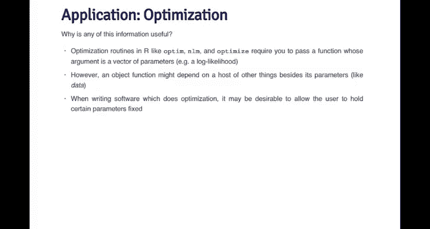
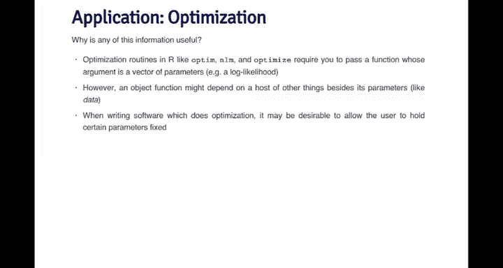
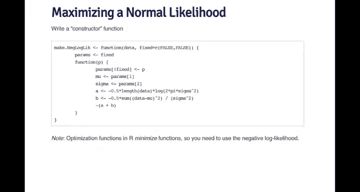
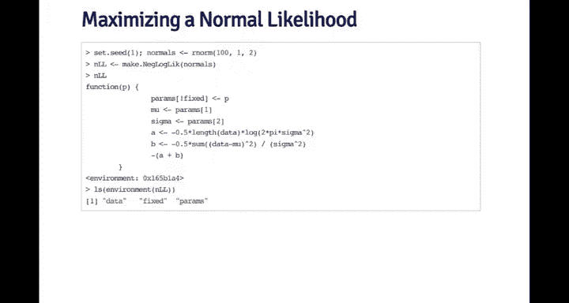
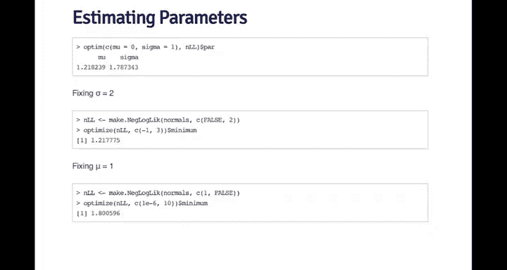
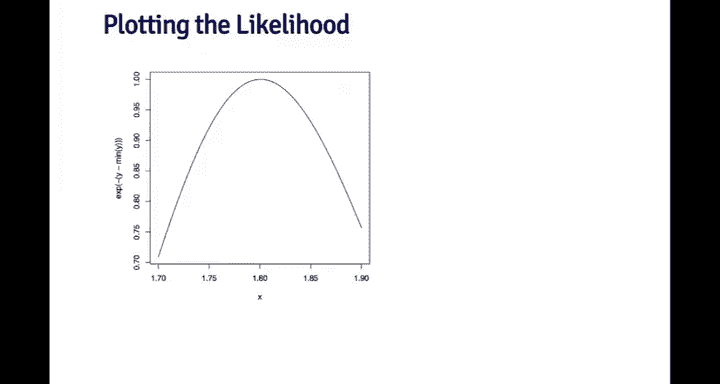
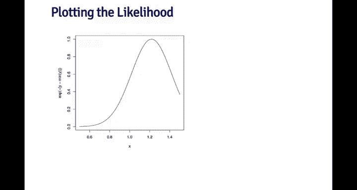

# 约翰霍普金斯大学《数据科学R语言基础｜Data Science： Foundations using R》中英字幕（deepseek - P57：38_作用域规则优化示例（可选）.zh_en - GPT中英字幕课程资源 - BV1tsFQemEts

So far we've talked about functions and the scoping rules in R。

 and you might be wondering why any of this information is at all useful。

 so in addition to just writing regular functions for manipulating data or for doing calculations。

There's one combination of the scoping rules and functions， which can be very useful in statistics。

 and that's for optimization。SoThere are a few optimization routines in R called Opim。

 an NLM and another one called Op， and they all require that you pass a function to those functions whose argument is vector parameters。

 so for example there's going to be some function that you want to minimize or maximize over a range of parameters and functions like optum NLM and optimize take that kind of objective function and try to find the minimum or the maximum。

The idea is that but in statistics， this objective function that we're trying to minimize or maximize such as like a log likelihood is going to depend on other things besides just the parameters that you're maximizing over so in particular it's going to depend on things like data and so the question is。

 well how do you specify a function that depends on parameters and data and perhaps many。

 many other things in a clean way and to write it in a kind of readable programming style and to make it easier for the user to use these types of functions and and furthermore。

 when you're doing these kinds of optimizations， in many cases it's useful to hold certain parameters fixed and so for example。

 fix a parameter to a certain value than optimize over the other parameters？

So the basic idea with any optimization problem in R is you can create a constructor function which constructs the objective function and then once and the objective function the idea is that it would have all of the data and all the other things that it depends on would be kind of included in the defining environment of that functions and so kind of carry along those other things like baggage in its enclosing environment and so that way you don't have to specify those things every time you call the function。

 the only thing that you need to specify as a value of the parameter so for here I've written a constructor function that creates a negative log likelihood so just as a note most of the functions like optum and NlM and optimized in R they all attempt to minimize functions by default and so when you write your objective functions if they're designed to be maximized and you have to kind of take the negative of those functions so that you can minimize them。

So another thing is that all the code in this example will be on the website so you can take a look at the code and try to run it yourself if you want。

 here I've got a constructor function that's making a negative log likelihood because I want to minimize the negative log likelihood function so this is my objective function it's going to depend on some data and so that's the argument so the data is the first argument to this make dot negativeg log like function The second argument is a logical vector called fixed and it determines whether or not I want to want to fix some of the parameters。

So now inside the constructor function， I define another function which is takes an argument called P for the parameters and this is going to be the parameter vector that I want to optimize over。

 so basically what this function is going to do is going to return the log likelihood for a normal distribution and I'm going to want to fit my data to this normal distribution and so we know that a normal distribution has two parameters a mean mu and a standard deviation sigma so those is going to be the two parameters that I want to optimize over。

And so here I'm just defining the log likelihood and taking the negative so I can minimize it and then what the constructor function does is it returns the function as the return value。

So here I'm going to simulate some normal random variables at mean one and and sorry the standard deviation2 and then I'm going to make my constructor function I'm going to call my constructor function with these random variables and create my NLL or negative log likelihood function。

 So when I print out this function here， you'll see that I see that the body of the function looks like the code for the normal distribution just like in the constructor function before。

 but if you look at the environment， you'll see this little tag down here at the bottom that says the environment and that's the enclosing environment for this function and normally because when you define a function in the global environment it would just there wouldn't be a special environment tag down here。

 however when you define a function inside of another function then there has to be a pointer to to that defining environment so that R can remember kind of what the values of all the free parameters are going to be。

And so if you look at this 0 x 165 b1 a4， that is an hexadecimal number which gives the address of where the defining environment is located in memory So if you look at the body of the NLL function here you'll see that pretty much everything here is either a local variable or parameter it comes from the parameter vector P however there was one argument sorry there's one variable here the data variable which is not an argument to the function and it's not a local variable。

 so it's a free variable but the data come from the make Neg log like function。

 the constructor function which originally passed the data to that and so the data can be looked up in the environment that the function was defined and it knows what the data are you don't have to tell it what the data are it's already fixed in the function。

So if you look at the environment for this negative log likelihood function by calling LF。

 you'll see that the。The data variable is there， the fixed variable there。

 which indicates which parameter should be fixed， and then there's also the parameterss variable there。

 so those three things are all free variables inside this negative log likelihood function。

 but they're defined in the defining environment。

So now I can call optum on my NLL function， and I'm going to pass in some initial values for mu is equal to 0 and sigma is equal to1 and it'll run and you'll see that when it optimizes the function the estimates turn out to be 1。

2 for mu and 1。78 for sigma so pretty close to the truth remember which was 1 and 2 Now I could if I wanted to I could fix sigma to be equal to its true value and then just optimize over mu to get the mean And so when I call make so I need to reconstruct my objective function by calling make dot egg log like and here I set the fixed。

Variable to be false for mu and then2 for sigma。 So I'm setting sigma to be equal to 2。

 and I'm letting mu be free。 So here now I can just call optimize because optimize will minimize a function of a single variable only And because I only have a single variable in this function I can use I can use optimize。

 and you can see that it estimates mu to be about 1。21。

 So slightly different from the previous optimization。

 I can also fix mu to be equal to 1 and try to optimize over sigma and and by that in order to do that。

 I have to construct another function for optimization and call optimize on that here I get my estimate to be a sigma to be about 1。

8。

If I want to can plot the likelihood or the log likelihood and this is very easy to do when I have a function that doesn't depend on a lot of other parameters。

 so here I'm going to make the negative log likelihood I'm going to fix mu to be equal to 1 and I want to plot the negative log likelihood as a function of sigma and so I construct my function here and L I construct a sequence of grid values for the x coordinate and then I apply anLL function to all those grid points and create my y variable。

 so now I can just plot this as I can plot the x's and the y's and connect the dots using the type equal to L。

Similarly， I can plot the negative log likelihood as a function of the mean by fixing sigma equal to 2 and letting mu vary。

 and similarly， I create points another set of grid points。

 and I evaluate the NLL function on those grid points and I make a plot。

So the nice thing about lexical scoping in R is that if you're doing minimization or optimization of some sort。

 you can build these objective functions which contain all the necessary data and all the other kind of bells and whistles that are required to evaluate that function。

Into the enclosing environment of the function so that when you call the objective function。

 you don't need to specify the data and all those other things every single time。

 they're kind of built into the environment and they will be automatically looked up in the right place so you don't have to carry around these long argument lists that in order to evaluate the function every single time so this can be very useful for interactive work and for exploratory work like for example。

 making these plots and so the code for these types of functions can be very very simple and kind of cleans because you don't have to carry around these long argument lists so just for reference。

 the main reference for this type of the lexicalcooping rules in R is the paper in the journal of Comput and graphical Staistic called Lexicalco and statistical computing and Robert gentleman or Roihaka who created R have some very nice examples in this article。

