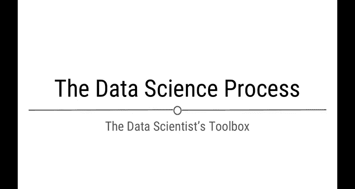
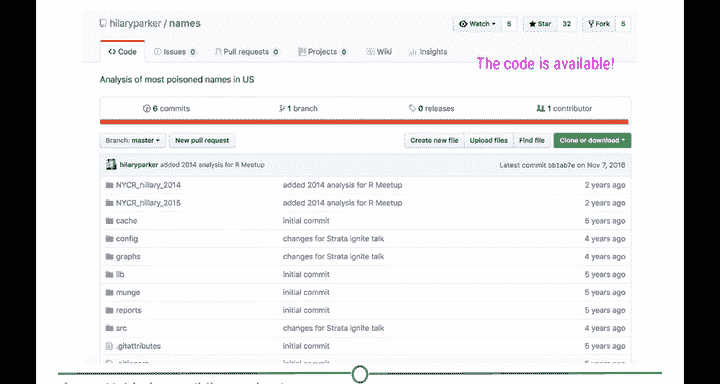
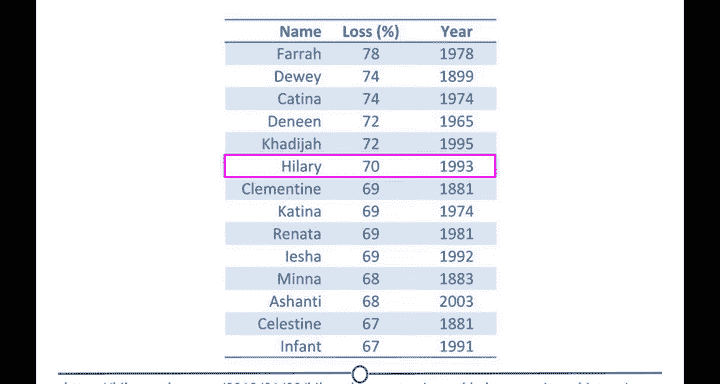
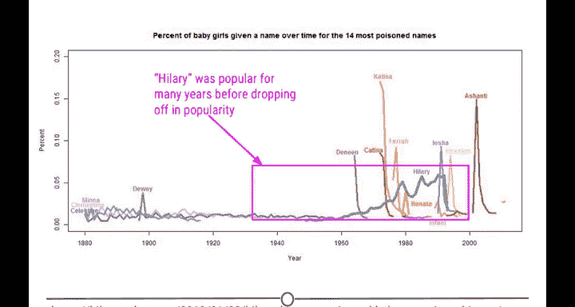
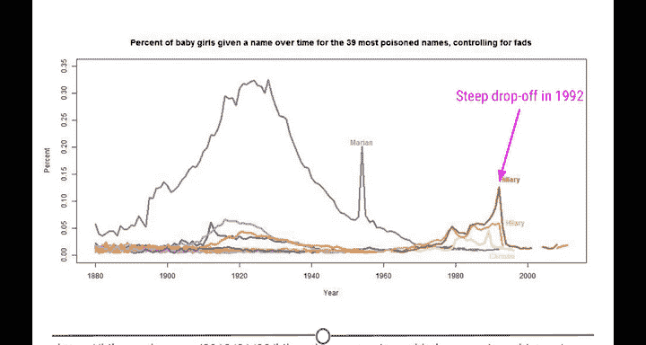
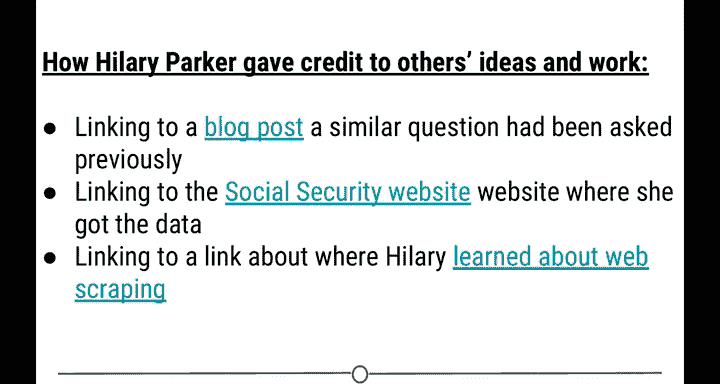
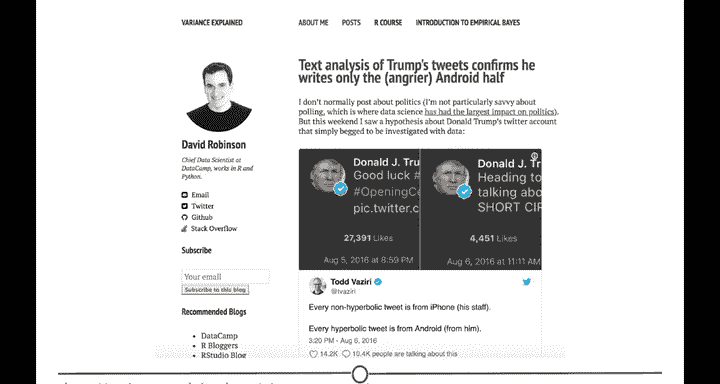
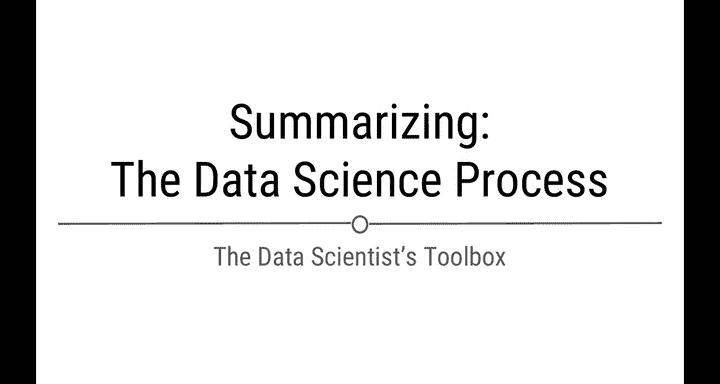

# 约翰霍普金斯大学《数据科学R语言基础｜Data Science： Foundations using R》中英字幕（deepseek - P5：4_数据科学过程.zh_en - GPT中英字幕课程资源 - BV1tsFQemEts

In the first few lessons of this course we discuss what data and data science are and ways to get help What we haven't yet covered is what an actual data science project looks like To do so。

 we'll first step through an actual data science project。

 breaking down the parts of a typical project and then provide a number of links to other interesting data science projects Our goal on this lesson is to expose you to the process one goes through as they carry out data science projects。

Every data science project starts with a question that is to be answered with data that means that forming the question is an important first step in the process the second step is finding or generating the data you're going to use to answer that question with the question solidified and data in hand the data are then analyzed first by exploring the data and then often by modeling the data which means using some statistical or machine learning techniques to analyze the data and answer your question After drawing conclusions from this analysis。

 the project has to be communicated to others sometimes this is a report you send to your boss or team at work Other times it's a blog post Often it's a presentation to a group of colleaguesRegardless a data science project almost always involves some form of communication of the project's findings we will walk through these steps using a data science project example below for this example we're going to use an example analysis from a data scientist named H Parker her work can be found on her blog。

the specific project we'll be working through here is from 2013 entitled Hillary。

 the most Poed baby name in US。 History to get the most out of this lesson。

 click on that link and read through Hillary's post Once you're done。

 come on back to this lesson and read through the breakdown of this post。

When setting out on a data science project， it's always great to have your question well definedAdditional questions may pop up as you do the analysis。

 but knowing what you want to answer with your analysis is a really important first step Hillary Parker's question is included in bold in her post。

 highlighting this makes it clear that she's interested in answer the following question is Hillary slash Hillary really the most rapidly poison name and recorded American history to answer this question Hillary collected data from the Social Security website This data set included the 1000 most popular baby names from 1880 until 2011 As explained in the blog post。

 Hillary was interested in calculating the relative risk for each of the 4110 different names in her data from one year to the next from 1880 to 2011 by hand。

 this would be a nightmare thankfully by writing code in R， all of which is available on GiHub。

 Hillary was able to generate these values for all these names across all these years。

It's not important at this point in time to fully understand what a relative risk calculation is。

 although Hillary does a great job breaking it down in her post。

 but it is important to know that after getting the data together。

 the next step is figuring out what you needed to do with that data in order to answer your question For Hillary's question。

 calculating the relative risk for each name from one year to the next from 1880 to 2011 and looking at the percentage ofba's name each name and a particular year would be what she needed to do to answer her question what you don't see in the blog post is all of the code Hillary wrote to get the data from the social Security website to get it in the format she needed to do the analysis and to generate the figures As mentioned above she made all this code available on Github so that others could see what she did in repeat her steps if they wanted In addition to this code。

 data science projects often involved writing a lot of code and generating a lot of figures that aren't included in your final results This is part of the data science process too figuring out how to do what you want to do to answer。

Your question of interest is part of the process doesn't always show up in your final project and can be very time consuming That said。

 given that Hillary now had the necessary values calculated。

 she began to analyze the data the first thing she did was look at the names with the biggest drop in percentage from one year to the next By this preliminary analysis Hillary was sixthist。

 meaning there were five other names that had had a single year drop in popularity larger than the one the name Hillary experienced from 1992 to 1993 in looking at the results of this analysis the first five years appeared peculiar to Hillary Parker it's always good to consider whether or not the results were what you were expecting from any analysis。

 none of them seemed to be names that were popular for long periods of time to see if this hunch was true Hillary plotted the percent of babies born each year with each of the names from this table what she found was that among these poisoned names names that experienced a big drop from one year to the next in popularity。

The names other than Hillary became popular all of a sudden and then dropped off in popularity Hillary Parker was able to figure out why most of these other names became popular。

 so definitely read that section of her post The name Hillary， however。

 was different It was popular for a while and then completely dropped off in popularity to figure out what was specifically going on with the name Hillary。

 she removed names that became popular for short periods of time before dropping off and only looked at names that were in the top 1000 for more than 20 years The results from this analysis definitively show that Hillary had the quickest fall from popularity in 1992 of any female baby name between 1880 and 2011 Marion's decline was gradual over many years。

For the final step in this data analysis process， once Hillary Parker had answered her question。

 it was time to share it with the world， an important part of any data science project is effectively communicating the results of the project。

 Hillary did so by writing a wonderful blog post that communicated the results of her analysis。

 answered the question she set out to answer， and did so in an entertaining way。Additionally。

 it's important to note that most projects build off someone else's work。

 it's really important to give those people credit。

 Hillary accomplishes this by linking to a blog post where someone had asked a similar question previously to the Social Security website where she got the data and where she learned about web scraping。

Hillary's work was carried out using the R programming language throughoutout the courses in this series。

 you'll learn the basics of programming in R， exploring and analyzing data and how to build reports and web applications that allow you to effectively communicate your results to give you an example of the types of things that can be built using the R programming and suite of available tools that use R below are a few examples of the types of things that have been built using the data science process and the R programming language。

 the types of things that you'll be able to generate by the end of this series of courses Masters students at the University of Pennsylvania set out to predict the risk of opioid overdoses in Providence Rhode Island。

 they include details on the data they used， the steps they took to clean their data。

 their visualization process and their final results while the details aren't important now。

 seeing the process and what types of reports can be generated is important Additionally。

 they've created a shiny app， which is an interactive web application this means that you can choose。

What neighborhood in Prodence you want to focus on all of this was built using our programming。

The following are smaller projects than the example above。

 but data science projects nonetheless in each project。

 the author had a question they wanted to answer and use data to answer that question they explored visualized and analyze the data then they wrote blog posts to communicate their findings take a look to learn more about the topics listed and to see how others work through the data science project process and communicate their results My Al Salmon looked to use data to see where one should live in the U。

S given their weather preferences David Robinson carried out an analysis of Trump's tweets to show that Trump only writes the angrier ones himself and Charlotte Geellfin used open data available from the city of Toronto to build a map with information about sexual health clinics In this lesson。

 we hope we've conveyed that sometimes data science projects are tackling difficult questions can we predict the risk of opioid overdose while other times the goal of the project is to answer a question you're interested in personally is Hillary the most rapidly poisoned baby。

and recorded American historyIn either case the process is similar you have to form your question。

 get data， explore and analyze your data， and communicate your results with the tools you can learn in this series of courses you will be able to set out and carry out your own data science projects like the examples included in this lesson。

