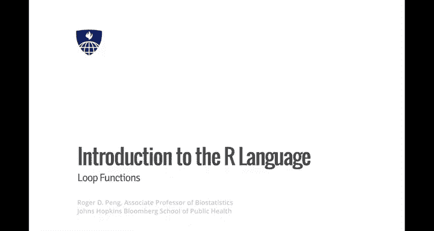
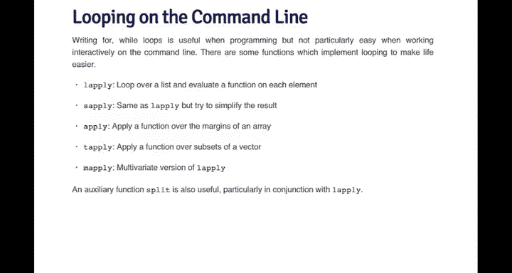
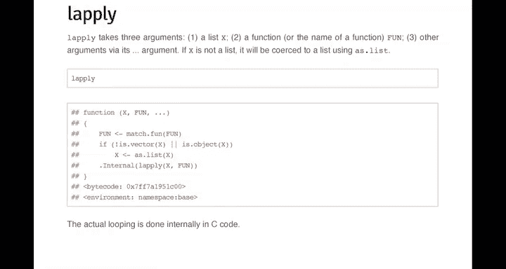
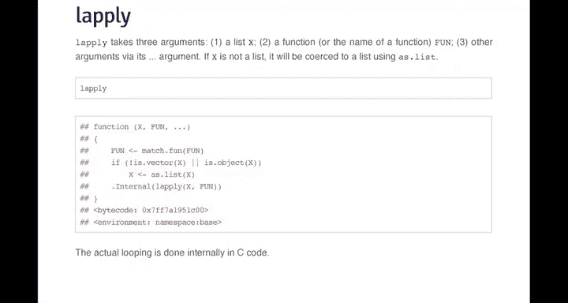
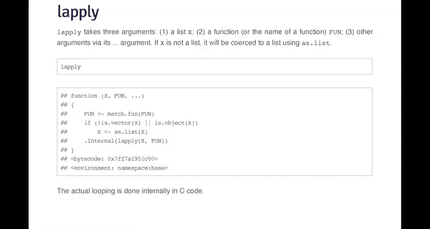
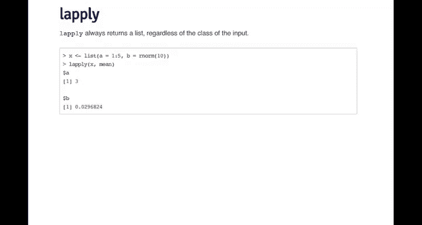
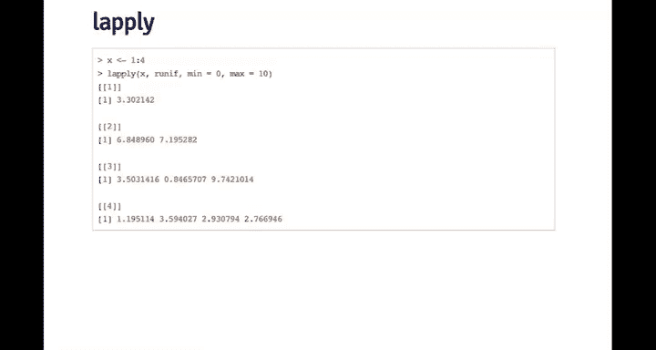
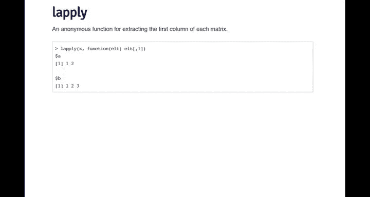
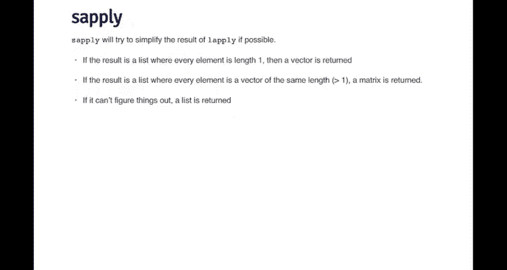
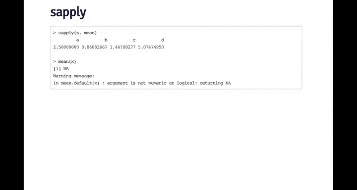

# 约翰霍普金斯大学《数据科学R语言基础｜Data Science： Foundations using R》中英字幕（deepseek - P60：41_循环函数lapply.zh_en - GPT中英字幕课程资源 - BV1tsFQemEts

Loop functions are some of the most powerful functions in the R language and they make it kind of very easy to use。

 especially in an interactive setting。 The idea behind a loop function is you want to execute a loop over an object or a set of objects in a way that's kind of that does a lot of work in a very small amount of space that way you don't have to type as much on the command line Of course we already learned about loops we know about four loops and while loops things like that and those are all work very well however they are less compact in a certain way So there are a couple of loop functions in R and they usually have the word apply in them somewhere。

So some of the key ones are L apply， S apply， apply， T apply， and M apply。

 and the real workhorse function that I'd like to talk about here is L apply and the idea behind L apply is that you have a list of objects and you want to loop over the list of objects and apply a function to every element of that list and so it's the very general concept and it can be used very powerfully as you do a lot of computation in in just a little bit of typing S apply is a variant of L apply that simplifies the result。

Apply is a function that operates over the margins of an array。

 so this is very useful if you want to take summaries of matrices other or higher dimensional arrays。

 T apply is short for table apply and it applies a function over subsets of a vector and M apply is a multivariate version of L apply。

 so I'll go into details about how these work in a minute。

 it's also another function called split which doesn't actually apply anything to objects but it's often useful in conjunction with functions like L apply or S apply because it' splits objects into subpieces。

So I'll apply。L apply takes three arguments， basically the first argument is a list which is called x the second argument is a function or the name of a function and then there are other arguments that can be passed through the dot dot dot argument and dot dot dot argument is used to pass arguments that go with the function that that's being applied to each of the elements of the list if x is not a list then it will be coercce to a list if possible if it's not possible to coerce the object to a list then it would get error so the L apply function you see is very simple the code for it is right here basically we look for the function if the object is not a list。

 then it's coercce to a list using as dot list and then the rest of the L function is implemented internally in C code to make it a little bit faster So the idea with L apply is that you're going to take this list of things remember a list can contain any number of different types of objects so it could be vectors or matrices or data frames or whatever it may be and。

Apply a function to each one of these elements of the list。

 and that function is going to return something。It may not be the same thing that it originally was in the list。

 So for example， it may take as an input as a vector， but then it may return a scalar as a result。

 So the function is going to return something for every single object in that list and the return values are going to be assembled in a new list and that's what L apply is going return。

 So L apply it's key to remember it always returns a list。 What goes in may or may not be a list。

 but it will be coerce to a list and what comes out will always be a list。

 So here's a simple example I'm creating a list with two elements。

 The first ones called a and it's a sequence from one to 5。

 The second one is called B and it's 10 normal random variables。

 So what I want to do is I want to loop over this list of two elements and apply the mean function to each of those elements。

 So you can see that when I call L apply on x and I apply the mean function I get another list back and notice that the list has the same names as the original list A and B。

 But now I get the mean of the first element and the mean in the second element。 and so that's how。

P works。

Here I've got a slightly more complicated list， I've got four elements and I'm calling L apply to each of those elements and I'm getting the mean of each of those elements。

 so now I've got a list with four elements， the names are preserved and notice that of course each of the elements of the original list was a vector of a numeric vector of some sort。

 but what I'm getting back is a vector with just a single number in it。For each element of the list。

So here's another way to call L apply here I'm creating a sequence of x1 to 4。

 and I'm calling runF which generates uniform random variables。

To using a random number generator Now the first argument to run if is the number of uniform random variables that you want to generate。

 So if I say runf1 is going to generate a single random variable say run of 2 it's going to generate a vector of two random variables。

 So here I'm applying the run if function to the sequence 1，2，3，4。

 So what I'm going to get is a list or the first element is a single random random uniform。

 the second element is going to be a vector of two random uniforms is a third element is going to be a vector of 3 and the fourth element is going to be a vector of four random uniforms。

 And so you'll if you know the run if function， you'll know that it has other arguments to it beyond the number of uniforms to generate。

 but those other arguments have default value so I don't need to specify them。

Now suppose I want to call the runf function on each one of these elements of x。

 but I didn't want to just generate a uniform between 0 and 1 which is the default。

 Supp I want to generate a uniform between 0 and 10。

 So now I need to pass some arguments to the runF function which are not the default values in particular I need to change the max value So I can do that with L apply by passing these arguments through the dot dot dot argument So here I'm calling L apply on X I'm calling I'm passing it the runf function。

 but that I'm specifying it I want the min to be 0 and the max to be 10。

 So now when I the list that I get out of this has random uniforms that are between 0 and 10。

So L apply and associated functions make heavy use of what are called anonymous functions anonymousyous functions are functions that don't have names so you don't assign them a name of some sort but you can kind of generate them on the fly so here's it's a quick example I'm going to create a list that contains two matrices in it the first is as a two by two matrix and the second three by two matrix so you can see the list here there two elements they're named A and B so suppose I want to extract the first column from each one of these matrices。

So what I can do is I can call L apply so there's no function that out there that already extract the first column of a matrix。

 but this is easy to do， you can just write a function that just takes the first element。

 the first column of that matrix。 So here I'm going to call L apply on x。

 andm going to write I'm going to write the function right here so I'm going to say function and then I'm going to give it an argument and then given that argument I extract the first column So here when I call L apply with this function I get the first column from a and the first column from B。

 So this function doesn't exist except within the context of L apply and after the L apply function is finished the function basically goes away So that's an anonymous function because it doesn't have a name and L apply and a lot of these other types of functions use anonymous functions very heavily because unless therere already exists a function that does the operation that you want to do you're going to have to write the function kind of on the spot。

So S apply is just a variant of L apply and all it does is it tries to simplify the result of L apply if possible。

 so recall that L apply always returns a list， but sometimes you don't want a list。

 sometimes you want something different。 so for example。

 if the result is a list where every element is a length 1。

Then what S apply will do is that it'll return a vector of all those elements so usually you don't want a list for every element is a single number for example。

 and so Supp will simplify that into just a vector if the result is a list for every element is a vector of the same length for example。

 if the list comes back and every element has a length 5 for example。

 then what Supp will do is it will put those elements in a matrix that's five by however long the list is so that's often what you want to happen but if it can't figure out how to simplify the object when it comes back for example。

 the object has many different types of things that come back then it's it won't do anything itll just return a list。

So here in this example， when I called L apply and I applied the mean to everything。

 what happens is I got a list back that's a length for and every element of the list is a single number。

 and so it would be a lot nicer if I just got my list back that was justm sorry if I just got a vector back with all these numbers in it and that's exactly what S apply does S apply called on x with the mean function gives me a vector with four numbers in it。

 Of course， if I called mean on the list by itself。

 that's not really going to work because mean is not meant to be applied to lists and so you'll get a warning message with NA back。

