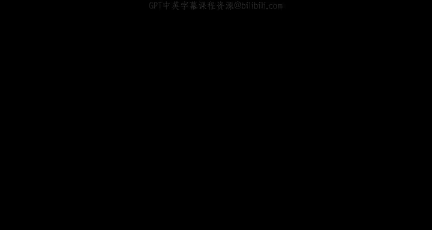
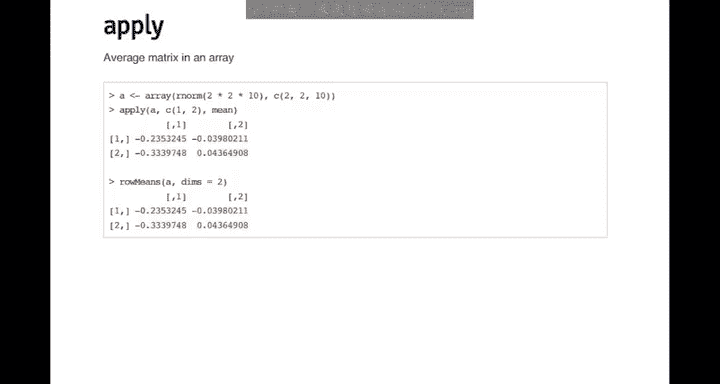

# 约翰霍普金斯大学《数据科学R语言基础｜Data Science： Foundations using R》中英字幕（deepseek - P61：42_循环函数apply.zh_en - GPT中英字幕课程资源 - BV1tsFQemEts

The apply function is another loop function that's used to evaluate a function over the margins of an array usually the function is going to be an anonymous one like we showed with L apply。

 or it could be a function that already exists like the mean， for example。

 it's usually used to apply a function to the rows or columns of a matrix， of course。

 matrices which are two dimensional arrays are going to be the most common type of array that we're going to use。

In R but you may have three dimensional arrays and such。

 so you can use out apply on general arrays such as taking the average of an array of matrices。

 for example， one thing to note and you may hear this out in the wild occasionally that apply using apply is somehow better than using a for loop or somehow it's faster than using a for loop and that's generally speaking not true it was true a long time ago in older versions of the S language in R but right now it's not true at all。

 the main reason you want to use a function like apply is that it involves less typing and less typing is always better because good programmers are always lazy。

SoApp is very useful in particular on the command line， because on the command line。

 when we're interacting with data， we're doing exploratory analysis。

 you want to do as little typing as possible because it just makes our fingers tired。

So how does apply it work so the first argument x is an array。

 it's an array is a vector that has dimensions attached to it。

 so a matrix is a two dimensional array， for example， a margin， which I'll get to in a second。

This is a vector an integer vector that indicates which margin should be retained and the last important argument is the function that you want to apply to each of the margins。

 and then the dot dot dot argument or other arguments that you want to pass include other arguments that you want to pass to the function。

 So here's a matrix that I'm creating and has 20 rows and 10 columns in the matrix it's just normal random variables that I've generated。

 So when I apply so what I'm going to do is I want to take this matrix and I want to calculate the mean of each column of the matrix。

 So the way I can do this is I can apply use the apply function on x I give it the margin2 and I'll say what that means in a second and I pass the function mean And so what happens is I get back with vector the length 10 that has the mean of each of the columns of the matrix。

And so the idea is that so the matrix has 10 sorry it says 20 rows and 10 columns and so you can think of the matrix as as so dimension1 has 20 rows and dimension 2 has 10 columns。

 So when you apply the function mean over the matrix the idea is that you want to keep the second dimension。

 which is the number of columns and you want to collapse the first dimension。

 which is the rows So the idea is that you're taking the mean across all the rows in each column and then and you're essentially elimining the rows from the array So what you get back is actually has one of the dimensions that been eliminated。

 it's really the first dimension that's been eliminated。

 and so you get this number which is vector which has each of the means for each of the columns。

 similarly you can take the means of all the rows of the array。

And I can call the apply function on x， I give it the margin 1。

 which means preserve all the rows but collapse all the columns and here I'm calculating the sum of each of the rows instead of the mean so I cast it the1 because it says because what I mean is I want to preserve the rows and collapse the columns so here I got a vector of 20 because there's 20 rows and inside each and for each row I calculate the sum of that row。

Now for simple operations like calculating the sum or calculating the mean of a column of a row。

 there are special functions that are highly optimized to do this very quickly。

 so for calculating the row sums and row means there's the function row sums and row means and similarly there's call sums and call means which do the same things for the columns。

 these are equivalent to using the apply function but they're very much faster than using apply because they're optimized do specifically do those operations。

 so if you want to calculate the sum or the mean of a column or row of a matrix use those functions instead。

Now you can use the apply function to apply other types of functions。 For example。

 suppose you have a matrix here。 I've generated again。

 a matrix of random normal variables that's 20 rows by 10 columns and suppose I want to go through each row of the matrix and calculate the 25th and the 75th percentile of that row so I can apply on x and I pass it the margin 1 because it means I want to preserve the rows and then I'm going to pass it the quantile function。

 Now the quantile function needs that needs the quantiles that you want to calculate so there's no default value for that So I actually have to pass it to the quantile function through the dot dot dot argument of apply So here the argument for quantiles called props and I I give it 0。

25 and。75 meaning I want to calculate the 25th percentile and the 7 percentile So what this call does it goes through each row of the matrix and for each row calculates the 25th and 7 percentile。

 for each row there's gonna be two numbers that are returned。

And what apply will do is it'll create a matrix that has two rows and the number of columns is equal to the number of rows in this matrix which happens to be 20 so here I'm going to get 2 by 20 matrix where in each column of this return matrix I've got the 25th and the 75th percentile for the corresponding row。

 so for example in the first row the 25th percentile is minus0。33 and the 5th percentile is 0。

92 and in the 16th row the 25th percentile is minus 0。95 and the 75th percentile is 0。

88 so you see how that works。😊，Now suppose I had more than just a matrix。

 suppose I had an array that I want to do something with so here I'm creating an array which has normal random variables and it has two rows and two columns and it's 10 and the third dimension is 10。

 I guess I'm not sure what you would call that dimension but you can imagine this you can think of this as being there are a bunch of two by two matrices that are kind of stacked together。

And the idea is like you can imagine I have a bunch of two by two matrices。

 and I want to take the average of those two by two matrices。

 So the average of a bunch of two by two matrices is going to be another two by two matrix。

 which is the mean and so I can call apply on this array and I want to keep the first and the second dimension。

 but I want to collapse the third dimension So here when I give the margin I give it one and2 which I want to preserve and then three is not there which means I want to collapse the third dimension。

 So here and the function I pass it is the mean。 So what this will do itll take my array and itll collapse it'll average over the third dimension and give you the mean matrix。

😊，Another way that you can do this is to use the rh means function。

 so even though this isn't a matrix， you can apply rh means to an array and you it and you pass the argument dims equal to2。

