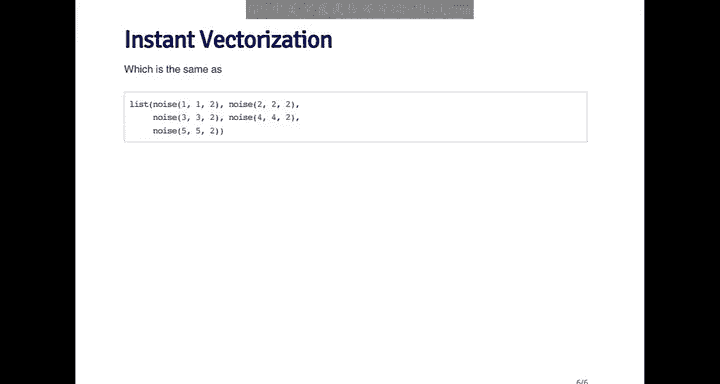

# 约翰霍普金斯大学《数据科学R语言基础｜Data Science： Foundations using R》中英字幕（deepseek - P62：43_循环函数mapply.zh_en - GPT中英字幕课程资源 - BV1tsFQemEts

M apply is a loop function that tries is a multivariate version of the kind of L apply and S apply functions that you've seen previously。

 and the idea is that it applies a function in parallel over a set of different arguments。

 So one thing we've noticed about the previous functions L apply S apply T apply is that they only they only apply a function over the elements of a single objects。

 So if you're think about L apply， the input to L apply was a list， a single list that is。

 and then the function was。Applied over the elements of that list So what happens if you have two lists that you want to apply a function over and suppose you have two lists and the elements of the first list go into the one argument of the function and the elements of the second list go into another argument of the function So L apply and S apply can't really be used for that purpose and so one way to do that is just to write a for loop where the for loop will index the elements of each of the different lists and then you can pass a function to each of those elements of the list。

Another way to do that though， is with M， where M can take multiple list arguments and then apply a function to the elements of the multiple lists in parallel。

So the function arguments for M apply are a little bit different just because it has to allow for the possibility of a variable number of arguments。

 So here the first argument to em apply is the function that you want to apply and the function that you're going to pass to M apply has to have the number of arguments that the function takes has has to be at least as many as the number of lists that you're going to pass to M apply So the list that you pass the things that will be coercce to a list will be passed through the dot dot dot argument and so if you have three lists。

 you'll pass three objects and then your function has to take at least three arguments to it so the more argument is just if you have more arguments that you need to pass to your function and the simplify argument is similar to the simplify arguments that you saw in S apply and also in in T apply。

So here， for example， I'm creating a list here and the list has I'm going repeat one。

 four times the integer 1， four times I'm going to repeat two， three times I'm gonna to repeat three。

 two times and repeat four just once so it's a little bit tedious to have to type something to do even though this is a fairly artificial example but with M applyly it's actually quite simple I can just do M apply rep So rep is the repeat function and then repeat it has two arguments the first set of arguments is going be one through4 and the second set of arguments is going to be 4 through1 and can see that in the list above here the first argument was one2。

3 and4 and the second argument was 4，32 and1 So so those are the two sets of arguments that I'm going to pass to M apply and you can see that when I do that I get my list41s。

32s，23s and one4 just like the list that I have above here。

So Emma plot can be used to apply a function to multiple sets of arguments。

So here's just another very simple function。 that just generates some random normal noise。

 and see the R norm sorry the function has three arguments。 the number of observations。

 the value of the mean and the value of the standard deviation。

 So if I just apply noise with a single set of arguments，5，1 and 2。

 I get five random normal variables with the mean  one and standard deviation 2。 however。

 this function doesn't work really correctly， if， if I pass out a vector of arguments。 So now。😊。

What's happening is I get a vector of five here when I pass it one through five and one through five。

 But really what I want to happen is to have one。One random normal with mean1。

2 random normals with mean 2， three random normals with mean 3， et cetera。

 and then five random normals with mean 5。 And so that's what I get here when I use the m function and by vectorize this noise function I give it three sets of arguments So one through5。

1 through5 and then two So I'm always going to fix the standard deviation to be 2 but I' gonna be changing the n and I'm gonna be changing the mean So now I've got one random variable with the mean 1 I' got two with mean 23 with mean 34 with mean 4 and then 5 with mean 5。

 So that's how I can instantly vectorize a function that doesn't allow for vector arguments。

So this is the same as I were to manually type out a list with these five different function calls。

 so this way it's nice to be able to instantly kind of create a function that doesn't allow for vector inputs and to kind of instantly vectorize it。

