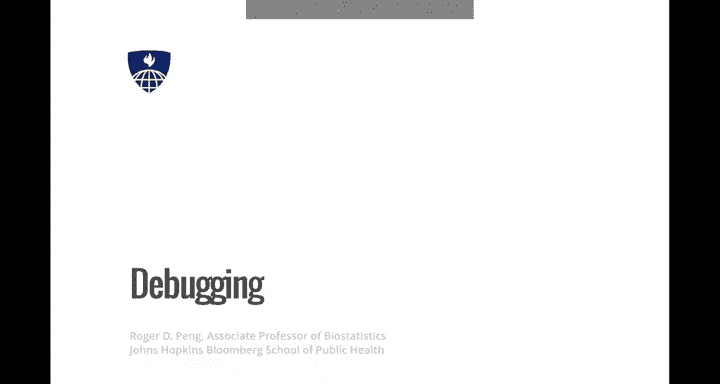
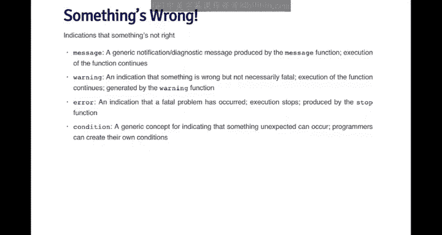
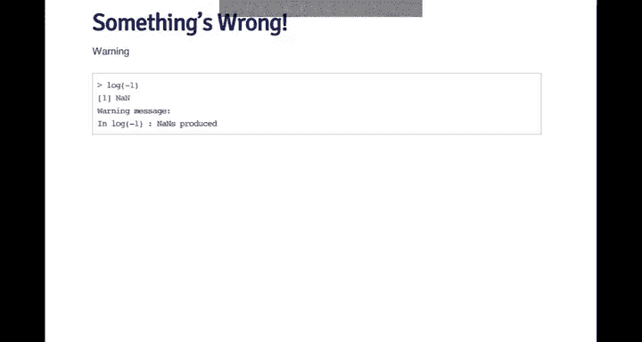
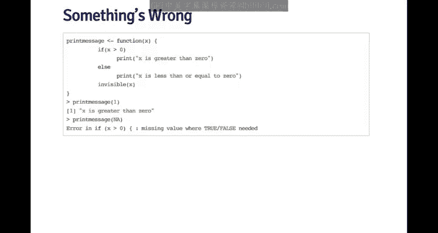
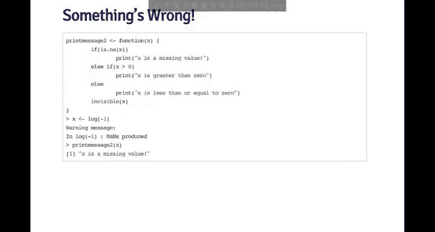
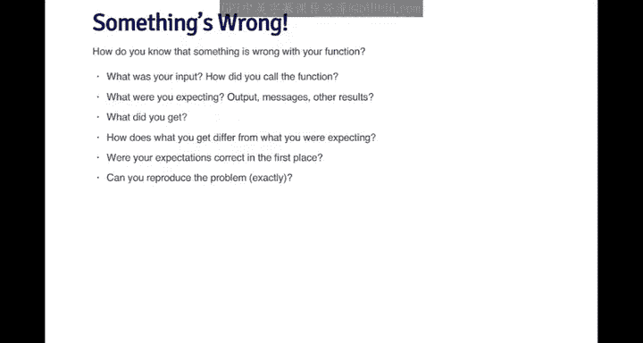

# 约翰霍普金斯大学《数据科学R语言基础｜Data Science： Foundations using R》中英字幕（deepseek - P65：46_调试工具诊断问题.zh_en - GPT中英字幕课程资源 - BV1tsFQemEts

🎼。All right。So today's lecture is about the debugging tools。嗯。That are built into R。

 So these come with R。 They're not part of any package， and。

They can be useful for kind of figuring things out。

 figuring out what's wrong after you've discovered there's a problem right so how do you know that there's a problem。

 So there are a couple of indications that R will produce that that will give you the sense that there's something going on and they kind of and this is roughly the gradient and so I think I mentioned this before。

 but basically there are three main types of indications。 The first is a message。

And a message is a very tame notification。 It's just an it could be a diagnostic message that something happened。

 but it could， it could be nothing。 Okay， And and so the message won't stop your function from executing。

 It will just。It'llll be a message printed to the screen and the execution of the function will continue。

 And and that's all The next level up is the warning。 All， So a warning is another indication。

 usually if you're writing a function and you're choosing trying to figure what's a message and what's a warning Furthermoremore。

 or if you're using a function and you're figure out what does that mean。

 a warning is indication that something unexpected happened， it's not necessarily a problem。

 and many times you you explicitly want to ignore warnings。 but something unexpected happen。

 So the function was expecting one thing and it got something slightly different。

 it wasn't enough to kill the whole thing but it was enough to kind of trigger this warning。

 So execution of the function will continue if a warning occurs。

 but you'll get a message after the end， So you'll get a message when the function complete execution。

 So when the function comes back when you get your console back， that's when the warning appears。

 So you won't get a warning in the middle of the execution。😊，By default。 So this is。

 these are generated by the warning function。 So I should say the messages are generated by the message function。

 And then an error is the last stop right So an error is a fatal problem。

 This stops execution of the function and， and these and error messages are produced by the stop function。

So and then there's a general notion of a condition， which is it's the higher level concept。

 all three of these things are our conditions。 And so you can imagine that so you can create new conditions if you want to。

 So if you have and generally you're not gonna going do this at this level。

 But if you have another type of condition that you want to kind of trigger when something when a special thing happen。

 So that's not an error。 it's not a warning and it's not a message you can create your own conditions and and using some of the functions that are available。

 So we won't be doing that now， but there is this notion of a condition。😊，And it's generic。

So this is your basic warning。 right， You take the log of a negative number。 You can't do that。

 right Now， notice that you get a value back。It's a nan， right， not a number。

And but you also get this warning， which occurred after the execution of the function。

 And it just says that in the log of -1 Ns were produced。 so this is your typical。

 and sometimes that's fine because maybe you're taking the log of a bunch of numbers and maybe some of them are negative but you don't really care。

 And and then you're gonna make some sort of plot or something like that。

 So so this is the kind of thing where you probably wouldnt you wouldn't want the functions behavior to just stop when any time it sees a negative number because sometimes these things just happen。

 you get negative numbers on occasion and you want to take the log anyway。 So so that's a warning。

Now I've got a little function here that I've created， it's very simple， it takes your input。

 it checks to see if it's greater than0， its greater than zero。

 it prints a message to x is greater than0。If it's less than or equal to 0。

 you get a message saying that it's less than or equal to 0。 So very handy function。

 I'm sure you'll all be using soon。 And， and then last， I want to mention this part here。

 So invisible is a function。😊，That。That， that stops or I should say， it prevents auto printing。

 right， So normally when you， if I if I'm at the command line and I type a function。

 remember and I execute a function， the function will return the last element of that's in its function body。

 right， So the last element in its function body is like is a numeric vector。

 it will return that numeric vector now。What happens is that if you just execute the function。

 that numeric vent vector will be automatically printed to the console because it got returned by the function and R will use auto printing to just print that to the console。

 if I call invisible on the return object， then it will still return the same object。But it won't。

 It won't do the auto printing。 So you can call the function and the object will be returned。

 but there won't be any auto printing。 So an example of a function like this is the load function。

 So we haven't really used that much。 but the load function loads objects from a save workspace。

 So it's like the opposite save， but and when it loads the objects。

 it actually returns a character vector containing the names of all the objects that it loads。

 But that doesn't get printed to the screen。 And because it it's returned invisibly。

 Okay So if you have a function that returns something invisibly。

 then the return what happens is that the object that gets returned by that function doesn't get printed to the console。

😊，And so sometimes you want that to happen and sometimes you don't。 sometimes it doesn't matter。

 So here I just added this here just so I can tell you about it。 It's not particularly important。

 But actually the print， actually say that the any print function here actually。

 the all print functions will return the string that it prints。Okay， so when you say print X。

 what gets returned is a string X， right， But you don't actually see that because the return value is。

 is， is returned invisibly， So it actually， so so you could assign the output of print to like an object。

 But generally speaking， youd never do that。 So anyway， that was a little diversion on invisible。

So here I create my print message function， and I call print message1， great， no problem。

 I get the message X is greater than 0。 Okay， so and so what is print message return。

 just before I go on， print message returns its argument， right， And so actually。

 if I had assigned the output of print message to some other object。

 it would be the number one in this case， right。😊，Even though it didn't print out the number one anywhere。

So now I'm going to pass it directly in NA and I'm going to get an error here because you can't make the comparison if NA is greater than0。

 It's not defined And so it doesn't know what to do。

 It can't move on And so it has to error out so you get an error saying that in this expression。

 if x is greater than0， the missing value， you have a missing value So it was expecting true false and instead it got NA。

 which is neither true or nor false。Okay。So something happened there。 That's wrong。

 Now I'm going to fix this problem。 so to speak， I'm I got a new function， print message to。

 And the first thing I'm gonna do is I'm gonna to check to see if the arguments in。😊。

Right， and so now I if it's NA。I'm going to print this message， right。

 So it's not going produce an error。 It's just going to predict print a different message。

 So this function is going print one of three messages for now。

 and it's going to return its argument invisibly。So when I call this now so what's something that might typically happen。

 why I calculate the log of 1 and I assignsign it to x， so that doesn't stop anything。

 I just get a warning and I move on now I'm going to print message on X。

And I'm getting x as a missing value， right。Now that there's no error there。

 but it's it may be unexpected， right， because maybe maybe I thought that， okay， well。

 the thing that I'm inputting into print message too is is like some positive number。

 So I thought I was gonna get the message X is greater than 0。

 But instead I'm getting this message is X is a missing value。 So what happened， right？

 And so this is the kind of thing where。What you thought you were going to get does it where your expectation is different from actually kind of what the function produced。

 right And so all I'm trying to say here is how do you know when something's gone wrong。

 right so sometimes it's easy to tell like in the case where we got the error message。

 but sometimes it's not easy to tell because here's no error。

But it's not exactly what I was expecting okay。

when you're looking at a function， you thinks something's gone wrong。

 there's a couple of questions you want to ask yourself to see whether something actually is wrong or maybe or there is something that you can call user error。

What was your So think about when you're kind of thinking about when you're debugging a function。

 you want to answer all these questions as you're going through your process here。

 So what was the input that you put， What did you feed into that function， Okay。

 not what you thought you fed into that function。 What did you actually feed into that function。

 Okay so I thought I'd fed that function a positive number， But in reality， I fed it a nan。

 right So how did you call the function， What were the arguments that you gave it， things like that。

What were you expecting So and this is important when you're asking someone for help or you're asking someone a question。

 I can't just， it's not that useful to say， oh， the print message 2 function didn't work。

How do you know it didn't work， right， Because and then you say， well， I was expecting this。

 but I got that。 Okay， that's how you know it doesn't work。 And then someone could say， well。

 you shouldn't have expected this because that's not what that function does or something like that。

 But or they can say， okay， here's the problem。 So what were you expecting is very important to be able to articulate。

At least to yourself and maybe to other people， what was the output that you were expecting were you expecting some message that you didn't get or other results of the numerical results。

 things like that。So what were you expecting and of course， what did you actually get。

 how did what you actually get differ from what you're expecting？And then， of course。

 were your expectations correct in the first place。 So if you're expecting something that was。

 in fact， incorrect， then your notion of what is correct and incorrect is now being challenged。

 right So and important， and then another key aspect of debugging， of course。

 is you have to be able to reproduce the problem because if you can never reproduce the problem。

 you'll never have a chance and figure out what went wrong because it only happened at one time right So this is very。

 very， very， very important。 And unless it's a very I mean。

 unless it's the most basic problem that I came say what that would be。

 you have to be able to reproduce the problem。 because you have to be able to show someone this is how I created the problem。

Because otherwise most people are not going to know if you just show them the output or the error message of what that means or where it came from and how you got there。

 Okay so the process by which you encountered the error or the problem is very important。

 so you have to know how to reproduce the problem。There are some problems and so when I was talking about。

 for example， in random number generation， you need to set the seed because it may be that only under a certain sequence of random numbers that a problem occurs and if you're not setting the seed。

 you will never be able to reproduce that problem because every time you run it。

 it's gonna be a different set of random numbers There are other types of problems that can be hard to reproduce but they're more complex usually for example。

 if you're writing networking networking functions you're doing parallel programming。

 often those kinds of problems can be very hard to reproduce because they depend on activity in other machines and things like that and you can't really reproduce that that if you're getting code over the internet if you're getting data over the Internet and your code is interacting with things on the web problems there can sometimes be hard to reproduce because servers on the other side may change or whatever and so you can't always freeze things in time。

 there's something that's just happening on your computer， it's usually gonna be easier to reproduce。

The problems。So unless I mean， only under very esoteric circumstances， circumstances。

 will it be hard to reproduce a problem on your computer？

