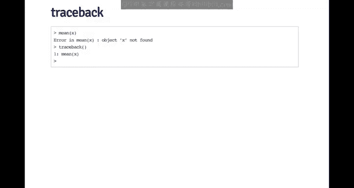
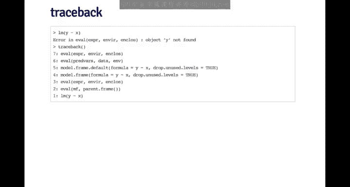
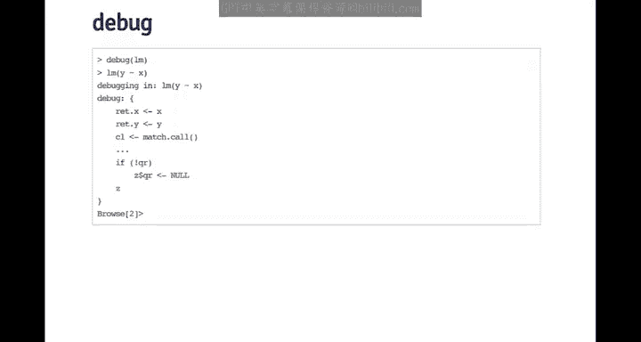
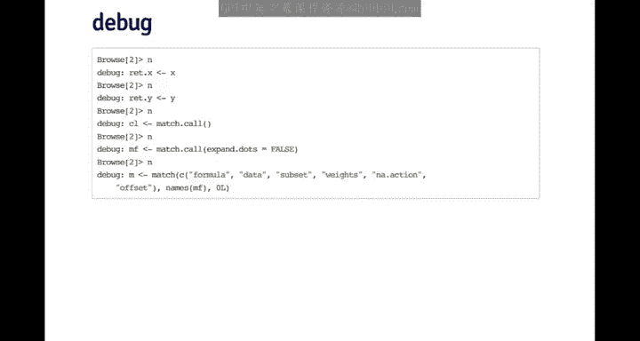
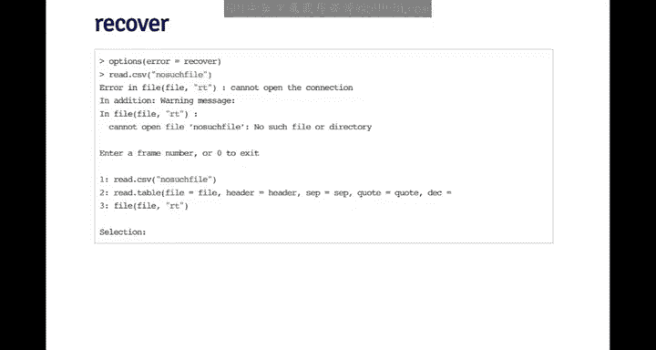
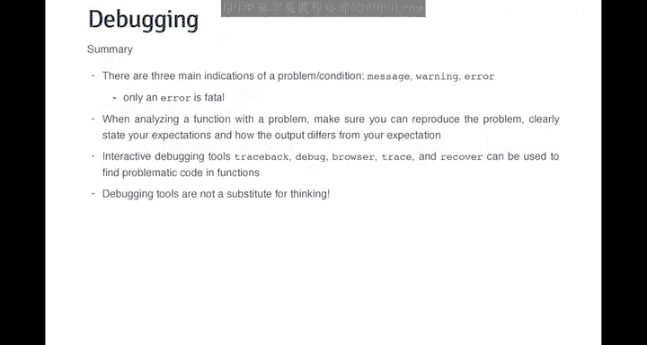
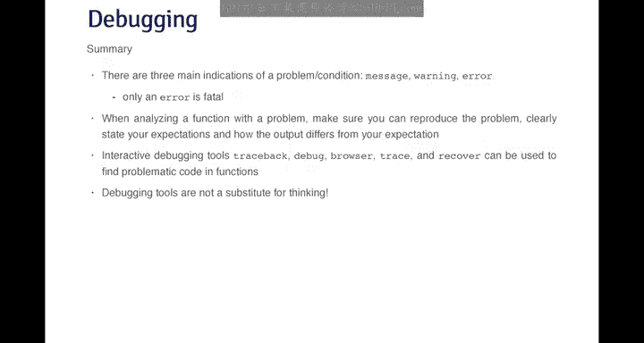
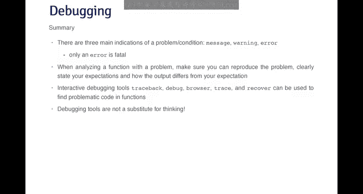

# 约翰霍普金斯大学《数据科学R语言基础｜Data Science： Foundations using R》中英字幕（deepseek - P67：48_调试工具使用工具.zh_en - GPT中英字幕课程资源 - BV1tsFQemEts

Let's take a look。 I'll just give you a couple examples and then I'll move to the actual R just so you can see things。

 So here's the mean。 I took the mean of X。 X doesn't exist。

So if you take the mean as something that doesn't exist。

 you're clearly going to get an error here it says。

 so you get the error message this is produced by the stop function， and I call the trace back。

 it tells me where the error occurs。 Well， the error just occurs like right away at the top of the mean function so the function mean didn't actually call any other functions。

Because it couldn't because couldn't figure out， it couldn't evaluate your argument。

And so that's where the error occurs。 So you know that's may or may not be used。

 many times that just that is where the error will occur at the top level function。

 So that in that case， the traceback is not very handy。

 one thing that's useful that the traceback is useful for for when you're communicating with someone else over email。

 for example， me and you say， you know， I get an error when I whatever function， it's very useful。

 if you just say here's the traceback when I get after I get the error And then I can see， okay。

 well， what was the list of function calls。 I mean unless the traceback look like this， about it。

 But when you're communicating with someone about an error and a function。

 it's very handy to print out the traceback so that you can see where the error occurred in the hierarchy of functions。

 you have to call traceback immediately after the error occurs if you execute some other code and then call traceback。

 it's not gonna work right because the traceback will only give you the most recent error。

If you execute another function and there's no error。

 well then there's no trace back to give because there's no error in the next execution。

 so you have to call it right away。

Here's a little slightly more interesting traceback。 So I called L M。

 which is the linear modeling function。 I said Y till to X。 So Y till to X， they don't exist。

 And so I'm getting an error that says Y cannot be found。Where did that error occur。

 Well actually occurred seven levels deep， actually。

 So here I called L N and the LM function is a little funky。 So I don't expect understand all this。

 but L M called eval on what's called the model frame。 and then that called eval again。

 which called the model frame function， which called the model frame default。

 model frame is a generic function， that called the model frame default function。

 called the eval function again on this。 and at the seventh level here。

 that's where the error occurred。 and it basically it occurred because it tried to evaluate my formula here。

 which is y till the x， that's what all these eval calls or for。 and when it evaluate the formula。

 couldn't find the actual values of y and X。 that's where the error occurred。

 So printing out something like this can be very useful if you're trying to get help from someone else。

 and you' trying to debug your function together。😊，So that's the trace back there。

The debug function doesn't really work well in the static format like this。

 but I'll just show you that。 but basically I could debug the LM。

 So you can debug any function It doesn't matter whether you wrote it or not。

 So I can debug the LM function。 And now when I call L M Y till the X。

 you'll get this debugging in and'll give you the expression that you called。

 And first thing we'll do is it'll print out the entire code of the function。

 So this is a lot longer than I saw I put I just cut it off in the middle here。

 But the first thing it does is print out the whole function body code。

And then you get this little prompt at the bottom here， the browser prompt。

 So now you're in what's called the browser。ok。And。The browser is just like your R workspace。

 Actually， you can think of it as like a workspace embedded within a workspace。

 and so but the elements of the workspace are sorry。

 the environment of that workspace in the browser is your function environment。

 So the things that are in your function are what are in your environment。

 So the very top of this function。 when you just actually。

 there's nothing in your environment except for the function arguments。 right。

 So what are the function arguments。 Well， the first one is the formula。

 So I have a formula in my environment， which is this white So X。 but that's it。😊，嗯。So， anyway。

 so now I can。Well， I should say there are other arguments to LM2 which have default values。

 but they're not listed there， but they do are I shouldn't say thiss more than just the formula because there's other arguments。

 So here， what I do is I press N for next。

And it runs the first line。 I hit and and then enter， and then it runs the first line。 and。

 then enter， runs the second line， and enter third。

 I just keep hitting and and and until I run just execute each line until I get to the line where the error occurs。

 So when you get to the line where error occurs and you execute it。

 you'll get an error just like you did before。 It's not going magically fix the problem by itself。

 But at least you'll know where that error occurred。So and furthermore。

 suppose you want you can debug functions within the debugger。

 right so you can I can call if I I can call so this Matdot call function。

 I just kind of stepped right over it， but I could have gone into this function by calling debug on Matdot call before executing it。

 and then when this got executed， I'd be in the third level of the browser。

And so these things can nest。 And then as you go out。

 So they're kind of like a stack of browser frames， right， So， so you can， you can。

 you can call the debug function on functions while you're even while you're in the debugger。

 And then so you can step through functions that even while you're kind of debugging your top level function。

The recover function。 So you can set the recover to be this kind of error handler。

 but using the options function。 So you can say options， error equals recover。

 And so that will set a global option right， So now this this will this behavior will curve ever。

 everything you do as long as your are session is open。 as soon as you quit， it'll go away。

 And then if you start up R somewhere else。 It's not gonna it's not going save that option。

 So now'm gonna what I'm trying to do is I'm gonna to read do CSv some file that doesn't exist。

 Okay and then you get an error。😊，And you get the error message cannot open the connection and you get some warning also。

 And now， but instead of giving my console back， I get a little menu here。

 And this menu is the function call stack。 Okay， so it's the same thing that you would get back if you called trace back after the error。

 right so。Read dot CS SV is what I called read read dot CSV is just a raper for read dot table。

 So read dot CV called read dot table。 and then read dot table called the file function because they wanted to create a file connection with my file。

 no such file， right， And then when it tried to create that file connection。

 obviously you couldn't find the file。 and that's where the error occurred。 Okay。

 so the error occurred at this third level in the call function call stack。 So what you can do。😊。

Is you can press a number 1，2，3， and then you can look you can kind of browse the environment of that function。

 So if I want to say， okay， what was the read what was going on in read dot CSV。

 I could suppress one here， and then it would show me kind of the environment in the read dot CSV and then I can break out of that and look at the environment to read dot table etc。

 And so can if you have a very long function call stack。

 you can kind of jump back and forth to see what was going on at each function call to try to pinpoint kind of where the problem occurs。

Okay。嗯。Okay。

So just to summarize really quickly。There are basically the three main indications of some sort of problem or conditions there's the message warning error and of the three。

 only the error will stop execution of the function when you're analyzing a function that have and you think has a problem。

 make sure you can reproduce that problem and then make sure you can articulate kind of what your expectations and what the output are and how the output differs from what you were expecting as I like to say what you're expecting so。

The interactive tools， traceback， debug， browser， trace and recover can be used and the key word actually here is interactive。

 the reason these tools are useful is because they are interactive。

 you can kind of do things at the console and of course the debugging tools are not a substitute for thinking and so you should always think about writing your code before just throwing it to the wind and hoping the debugger will catch it。

