# 约翰霍普金斯大学《数据科学R语言基础｜Data Science： Foundations using R》中英字幕（deepseek - P69：50_模拟生成随机数.zh_en - GPT中英字幕课程资源 - BV1tsFQemEts

I'm going to talk about simulation in this lecture。

 simulation is a very important topic for statistics and for a number of other applications。

 so I just want to introduce some of the functions in R that can be useful for doing simulation。

 So there are a couple of functions that are available for simulating numbers or variables from given probability distributions。

 probably the most important of which is the normal distribution and so we can generate variants from the normal distribution。

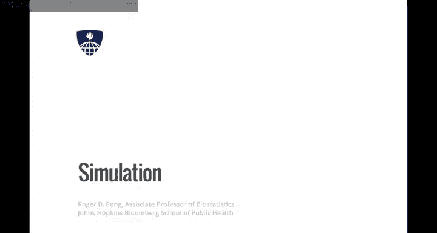

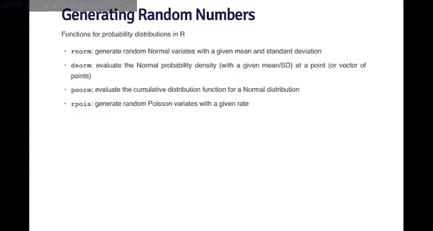

By specifying a mean and the standard deviation for that distribution and then calling the R norm function。

 So the R norm function will simulate normal random variables from a distribution that has given mean the standard deviation So there are corresponding functions for for the normal distribution that can be used to evaluate the probability density to evaluate the cumulative distribution function and for also for evaluating the quantile function。

 So another function for generating random variables is the R poise function or which generates poisson random variables from a poisson distribution with a given rate。

 And so。So there are a number of functions for generating random variables from the standard probability distributions。

 and you can use these to run simulations。

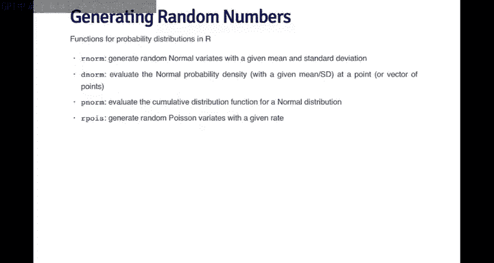

So probability distribution functions there are basically four functions associated with them。

 And so for any given distribution like the normal distribution。

 there will be a function that starts with the D a function that starts with an R of the P and a Q。

 So be four different functions for each distribution。

 So we've I've already mentioned that there's the R norm function。

 So the R norm function is for generating is for random number generation。

 there's a D norm function which evaluates the density of the probability distribution for a given mean and standard deviation。

 there's the p norm function， which evaluates the cumulative distribution and there's a Q norm function which evaluates the quantile function。

 So every distribution has of these four types of function。 So for the。😊，Gamma distribution。

 there will be a D gamma and R gamma， P gamma and a Q gamma function。

 and for the Poisson distribution， there's the R， D P po and Q po functions。

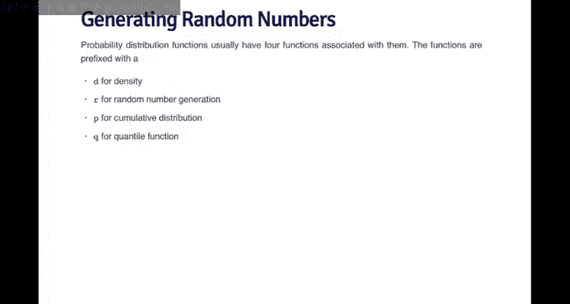

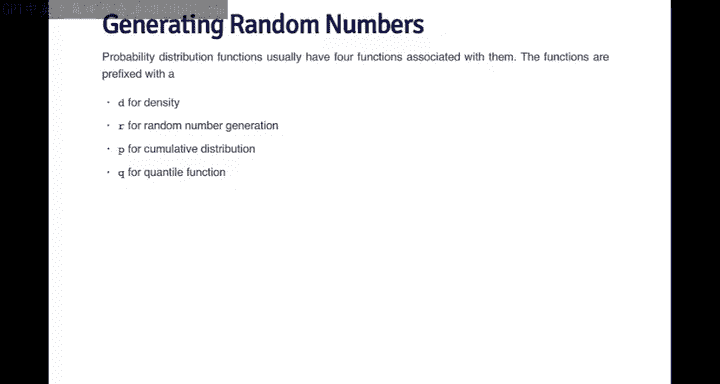

So working with the normal distribution requires these four functions， so I mentioned there's D norm。

 p norm Q norm and R norm， and you can see that each take a number of different parameters。

 all of the functions require that you specify the mean and the standard deviation because that's what specifies the actual probability distribution。

 if you do not specify them the default values are a distribution a standard normal distribution which has mean zero and standard deviation 1。

嗯。For the D norm function you can evaluate the density and there's is an option that allows you to evaluate the log of the density。

 Most of the time when you evaluate the density functions for a normal distribution。

 you're going to want to use the log of that value， but the default is false。

 for the P norm function and the Q norm function， there's also an option to evaluate it on a log scale but another option is evaluate is whether or not you want to evaluate the lower tail of the distribution So the lower tail which is the default is if you can think of if you look at the probability distribution。

 it's the part that goes to the left， it's the lower tail。 if you want to evaluate the upper tail。

 sometimes you want to do this， then you want to say lower tail equals false and that will evaluate the upper tail of the distribution。

Finally for our norm， there's only two parameters mean in standard deviation and then n。

 which is the number of random variables that you want to generate， so if n is 100。

 you'll get a vector of 100 numbers that are drawn from the normal distribution。

So just to be more explicit， if phi is the cumulative distribution function for the standard normal distribution。

 then p norm is equivalent to phi， and Q norm is equivalent to the inverse of phi。

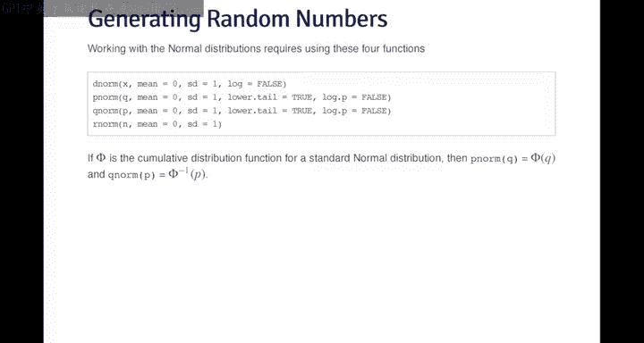

So just quickly， if you want to generate some random normal variants you can just call Rnome and pass an integer。

 which is the number of variables you want to generate so here I'm passing 10 and you can see that the vector that's produced will be random normal numbers which have mean0 and standard deviation 1 if I wanted to generate a vector that had mean 20 and standard deviation 2 I just need to specify that explicitly in my call to R norm so here this vector has our 10 random normal normal random variables and their mean is roughly 20 and their standard deviation is 2。

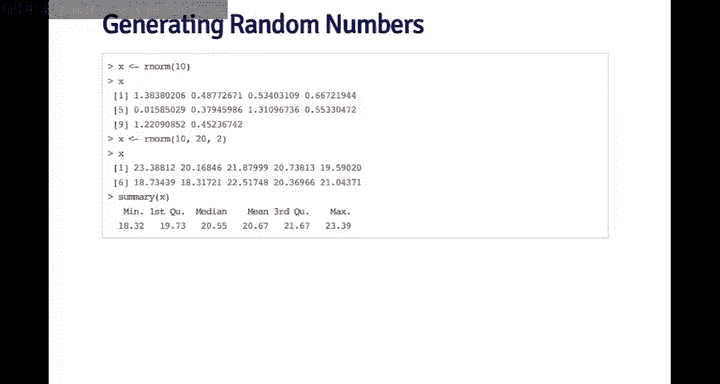

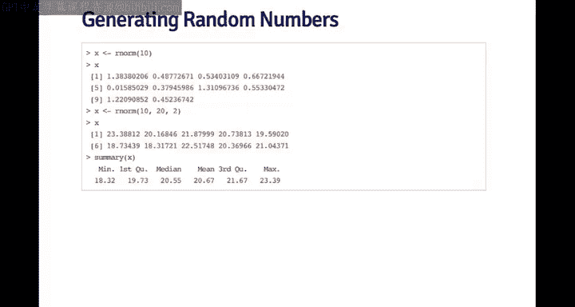

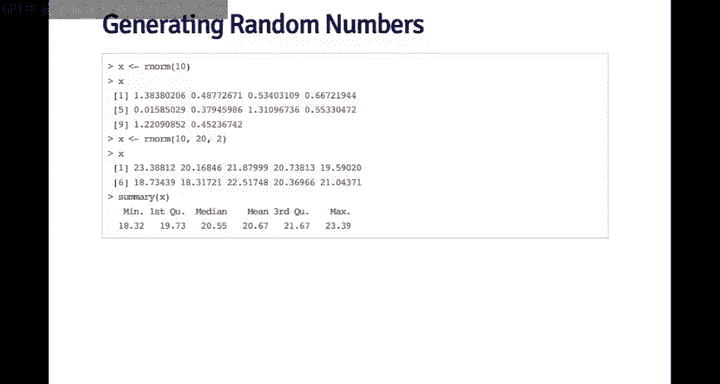

So when anytime you simulate random numbers from any distribution for any purpose。

 it's very important that you set the random number generator seed and this can be done with the set dot seed function So what's important to know is that on computers when you generate random numbers the numbers are not actually random but they appear random and that's the important thing and so the idea is that if you wanted to generate the same set of random numbers again。

 you could if you wanted to because the numbers are not actually random called they're what are called pseudoran numbers and so here I'm setting the seed to be one so the seed can be any integer you want you just pass it an integer and that's the seed So here I'm going to set seed equal to1 and then I'm going to generate five random normal random variables。

And so here I've got my five normal random variables they have mean zero and standard deviation 1。

 If I generate another5， you'll see that the vector is totally different because it's another random sample of5 however if I reset the seed to be one and I draw five again you'll see that they're exactly the same as the first five that I drew So anytime so when you set the seed it kind of sets the sequence of random variabless that's going to occur and if you reset the seed you kind of set the sequence to go back to where you started and then it will continue to generate random variables from there So this is important because it allows for you to reproduce a random numbers that you generate now that might sound strange because why would you want to generate the same random numbers twice but in many applications you do want to generate the same random numbers twice so that people can reproduce what you've done and particular if there are some errors or problems in what you've done。

 you want to be able to to kind go back to the exact situation that produced。

Those problems so whenever you do a simulation， you always want to set the random number seed so that you can go back and get the same results。

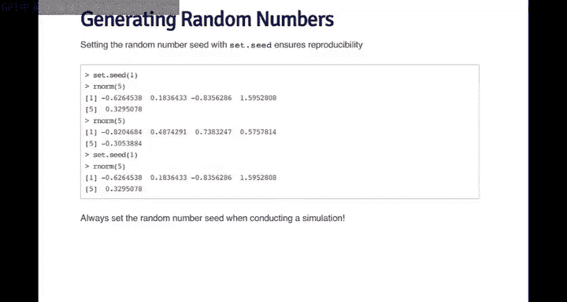

So I've demonstrated how to generate normal random variables。

 but of course you can generate random variables from other probability distributions。

 so the Poisson distribution is of course very popular here I'm generating a 10 poisson random variables with a rate of1 and so of course Poisson data are going to be integer here I'm generating a 10 poson random variables with the rate of 2 so you can see they're slightly larger and then here I'm generating 10 random variables poisson random variables with a rate of 20。

And so so for the Poisson distribution， the mean is going to be equal to the rate so you can see that roughly in each of these three cases。

 the mean is roughly equal to the rate that I specified。

 I could also evaluate the cumulative distribution function for the Poisson distribution So here'm in this first example I want to know what is the probability that a Poisson random variable is less than or equal to 2 if the rate is 2 and so this is the probability is 0。

67 roughly if I want to know what's the probability that a poisson random variable with rate2 is less than 4。

 less than or equal to 4 you can see the probability is getting bigger and here I can see the probability that a Poisson random variable is less than 6。

 less than or equal to 6 and it's very close to one。

So the cumulative distribution allows you to evaluate these probabilities。

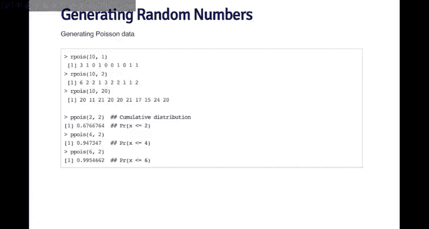