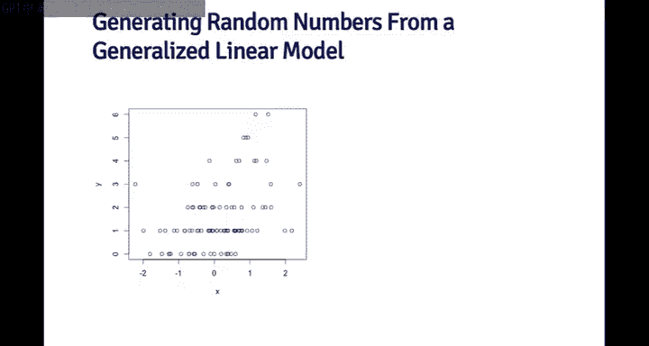

# 约翰霍普金斯大学《数据科学R语言基础｜Data Science： Foundations using R》中英字幕（deepseek - P70：51_模拟模拟线性模型.zh_en - GPT中英字幕课程资源 - BV1tsFQemEts

Now we've talked about how to simulate random numbers from simple probability distributions。

 but the question now is what if you want to as simulateim data from a model， so for example。

 like a linear model， so I've got a very simple linear model here it has a single predictor X and it's going to have random noise what I call epsilon that has a normal distribution with standard deviation 2。

There is the outcome is going to be generated by with using these two regression coefficients an intercept beta n and a slope beta 1 I'm going to assume that beta n is equal to 0。

5 and beta 1 is equal to 2 So the question is how do I simulate from this model now that I've specified what it is So I hear at the first I set the seed remember it's always very important to set that seed so I set it to 20 I generate x the predictor which has a standard normal distribution。

 I generate epsilon， which is going to have a standard normal distribution which means0 and standard deviation 2 and then I'm going to add them all together and after multiplying their regression coefficients to generate my y。

And so from the summary here， you can see that y has roughly a mean of 0。

68 and it ranges from about minus6 to plus 6。And then I can plot the data to see what they look like。

 and here they are on the next slide。So this is the plot of the X that I simulated and the y that I simulated from the linear model。

 and you can see that they very clearly have a linear relationship according that follows the model that we specify。

So just a slight variation of the previous example。

 what if x is instead of x being a normal random variable， what if x is a binary random variable。

 so maybe it represents gender or maybe some treatment versus control or something like that。

 So here that's very simple。 I can generate binary data from using the binomial distribution and the R binome function So I set the seed again and I generate 100 binomial random variables and these are going have this is from this comes from the binomial distribution which is n equal to 1 and p equal to half。

 So the probability of1 is going to be equal to 0。5。

So I generate 100 of those and then I generate my normal random variables， my normal error term。

 which is going to be mean 0 and standard deviation 2。

 and then I add them all together to produce my y。 So now when I look at the summary of y I see the mean is about 1。

4 and ranges from about minus3 to 6 or 7。 So now when I plot the data， of course。

 they'll look very different。Because the x variable is binary。

 but the y variable is still continuous， it's normal。

 so here you can see that there appears to be a pretty clear， again。

 linear trend between going from x equal to 0 and x equal to 1。

Now suppose we want to simulate from a slightly more complicated model a generalized linear model。

 perhaps with a poisson distribution and so for example。

 we might want to simulate some outcome data that are count variables instead of continuous variables。

 so we have to use a slightly more complicated approach to do this in particular because the error distribution is not going to be normal it's going to be a poisson distribution and so let's assume that the outcome y has a poisson distribution with mean mu and that the log of mu follows a linear model with the intercept beta do and a slope beta 1 so x is going to be one of our predictors。

So let's assume that beta n is 0。5 and beta 1 is 0。3。

 So how do we simulate from this model to get our poisson data so we need to use the r poise function for this and so we first set the cd as always。

 and we generate our predictor variable X which is going to have a standard normal distribution。

 then we're going to simulate generate our linear predictor log of mu which is just adding the slope in the intercept in the slope coefficient times x。

 So that's the log of our linear predictor but in order to get the mean for our Poisson random variable。

 we need to exponentiate that we simulate 100 of these Poisson random variables using the r poise function and we give it the exponential of our log mean。

So when we summarize this you'll see that the mean is about 1。

5 and it ranges between 0 and 6 when I plot this data you'll see that they look like Poisson data and that there's clearly a linear relationship between x and y as x increases the count for y generally gets larger。

 but the data still count variables here。

