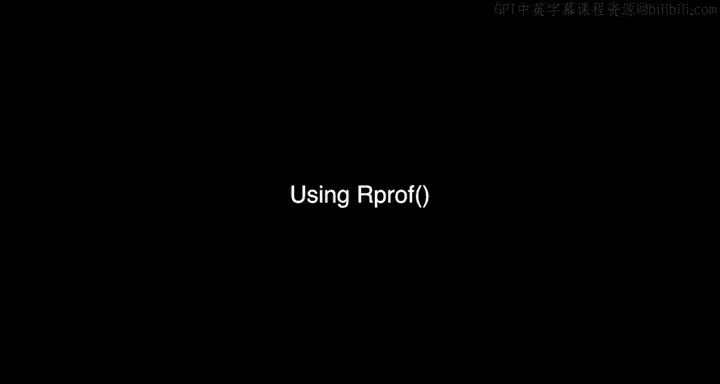
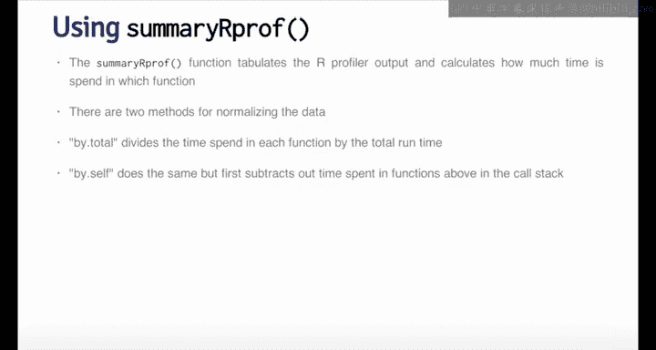
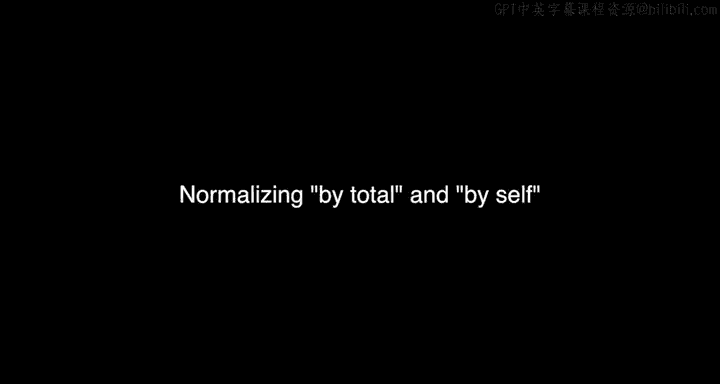
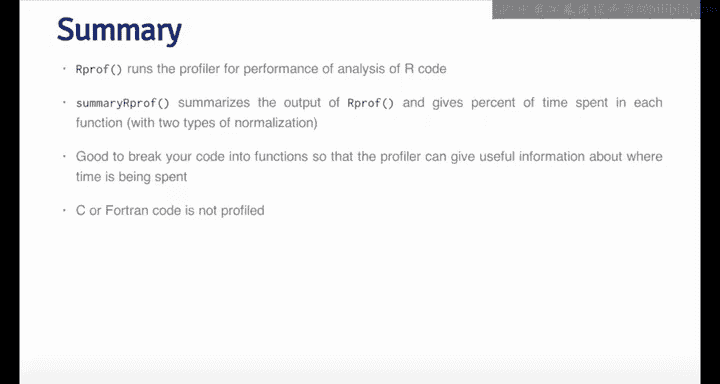

# 约翰霍普金斯大学《数据科学R语言基础｜Data Science： Foundations using R》中英字幕（deepseek - P73：54_R性能分析器第2部分.zh_en - GPT中英字幕课程资源 - BV1tsFQemEts

So that's the R Pror and the R Pror is a function in R， it's called R Prof。

 and an R Prof is used to start the profiler in R。One quick note is that R must be compiled with profiler support。

 and so it's not something that's kind of built in in all cases， however， in I'd say 99。

9% of the cases this is the true this is the truth so it will R will only be compiled without profiler support in some very special circumstances and so I wouldn't chances are your version of R can use the profiler the other function that's useful is the summary R Pro function which takes the output from the profiler and summarizes in a way that's kind of readable because the rawgged output from the profile is generally not very usable and so summary R Pro function is very important。

It's important to realize that you should not use the system time function and the R profiler function together。

 these are not really designed to be worked together to use together so you should always just use one or the other and not both。

So the RPro function keeps track basically what it does is it keeps track of the function call stack at regularly sampled intervals And so basically as your function is running。

 it kind of goes in it queries the function call stack。

 So how many functions functions that call the function that call the functions and it just prints it out it's all it does is it prints out the function call stack at very quick interval so about every 。

02 seconds it prints out the function call stack。 So first thing you'll notice is that。

If your function takes less than 0。02 seconds to run then the profiler will be useless and in general。

 because it will never sample the function called stack and in general。

 if your program runs very quickly， the profiler is not useful but of course。

 if your program runs very quickly， you probably wouldn't think to run the profiler in the first place。

 so it's usually not a problem but you really need to use the profiler in situations where your code is taking much longer on order。

 at least on the order of seconds。So here's just a quick example of the raw output that comes from the profiler Now generally speaking。

 you will not ever use this output， but I thought it might be interesting to look at what's going on。

 So you can see that I'm just calling the LM function with is kind of a univariate outcome and a univariate predictor。

And and what happens here， as you can see that each line of this output is the function call stack。

 So you can see at the very right is kind of the top at the very left is kind of the bottom。

 so to speak so at the very right， you can see that LM was called an LM called eval eval called eval。

 I'm going from right to left here and eval called model frame， which called model frame default。

 which called eval again at eval and then list。 So all these functions called each other。

 So you can see that the function call stack goes down fairly deep。

As you go farther in the evaluation， you can see that the function calls stack changes。

 so at the very bottom， you can see that LM calls LM。 fit。

And if you're not familiar with the LM function， LM。

t fit is really the workhorse of this function that does all the real kind of computation。

 and so you would suspect that it would spend a reasonable amount of time in the LM dot fit function。

So that kind of raw output is not particularly easy to read so that we use the summary R Pro function to tabulate the R profiler output and calculate how much time is spent in which function。

 So the idea is that once you see the function calls stack。

 you know that each line of the function call stack is separated up by 002 seconds because that's a frequency which it's sampled。

So given that you can calculate how many seconds are spent in each of the functions because if it appears in the function calls stack then you must be spending some time in it。

 so there are two methods for normalizing the data that you get out the R profile or one is called by dot total which divides the time spent in each function by the total runtime。

And by itself， which does the same thing， but it first subtracts out time spent in functions above in the call stack。

So it's important to realize the two separate concepts here of kind of by total and by self。

 The basic idea is that by total， I mean， the normalizing by the total amount of time spent in a function。

Gives you basically how much time was spent how many times that function appeared in the cost in the kind of printout here。

 And so， for example，100% of your time is spent in the top level function right so the function that you call suppose it's Lm you spend 100% of your time in that function because it was that the top level And so but the reality is that often the top level functions don't really do anything that's kind of important。

 all they do is they call helper functions that do the real work right And so chances are if your function is spending a lot of time doing something。

 it's spending a lot of time in those helper functions which is just being called by this top level function to kind of do all the work And so often it's not very interesting to know how much time is spent in these top levell functions because that's not where the real work occurs So you really want to know how much time is spent。

Yeah， in the top level function， but subtracting out all of the functions that it calls right So if it turns out that it spends a lot of time in the top level function。

 but even after you subtract out all the lower level functions。

 then that's something that's interesting。 But most of the time you'll notice that when you subtract out all the lower level functions that get called。

 there's very little time that's spent in the top level function。

 And because all the work and all the of the computation is being done at the lower level functions。

 So that's kind of where you want to focus your effort。

 So the by itself format is I think the most interesting format to use。

 because it tells you how much time is being spent in a given function。

 but after subtracting out all the other all the time spent in lower level functions that it calls。

 So it gives you I think a more accurate picture of know which functions are are truly taking up the most amount of time and which functions that you might want to target for optimization later on。

So here's an example of some output in the by dot total format。

 and you can see very clearly at the very top that 100% of the time is spent in the LM function。

 so the total time was 7。41 seconds for this run。And all of it was spent in LM of course。

 because LM was the top level function， but you can see that and so you can see that the second place winner was the Lm dot fit function。

 I mentioned Lm do fitt is where a lot of the computation occurs and so that was three to half seconds so about half of the time in that function Now Now you also see that a number of functions here。

 Model frame model frame default either all these functions don't really involve computation。

 but there is a reasonable amount of time spent within those functions。

 So that's kind of interesting。Now I think a more useful output is the by dot self output which kind of subtracts out any lower level function calls from and calculates the amount of time spent it's kind of truly spent in a given function and here you can see that LM dot fit is the clear winner because that's really where all the computation occurs in particular LM dot fit calls a fort routine for inverting a matrix and so that's usually where in most largescale regression problems that's where all the computation occurs。

The next function that takes a lot of time apparently or 11% of the time is the as dot list function or the as dot list data frame method。

 it's not immediately clear why so much time is being spent in this but spent in this function。

 but it's maybe something you want to investigate because it may be something that's not very important to the kind of core computation and so you can kind of go down the list here。

And see how much time is being spent in various functions and you can see a lot of these functions don't directly pertain to computation or kind of core computation。

 but really more kind of pertain to data formatting of the data and things like that。

The last part of the summary R Pro output which just the sample interval so you can see what time interval the sampling took place for printing out the function cost stack so you can see it's0。

02 seconds and the sampling time， which is just the total amount of time that the expression took to run This is the same kind of so this is the I think equivalent of the kind of eappsed time in the system time function。

So that's a quick tour of the R profile or in R， it's a very handy tool for doing performance analysis of R code it gives you some useful feedback。

 and I find often highlights functions that you may not have suspected as being kind of time hogs or bottlenecks because they're not really core to the kind of the real computation that you're working on。

So the profile can be really useful， I think for highlighting these kinds of situations and often finding things that you are kind of unexpected。

 The summary Rf function summarizes the output from RProf and gives you the percent time spent in each functions。

 and I think the buy dot self kind of type normalization is the most useful for kind highlighting bottlenecks in your code。

One one of the implications of using the profiler is that it's useful to break your code into function。

 So rather than have one massive function， it's useful to break your code into kind of logical pieces that are different functions and so the profiler can use this information to tell you where the time is being spent。

 So remember the profiler print out the function call stack。

 And if you break your code into multiple little functions the function names that you give will kind serve as little identifiers in the function call stack to tell you kind of where where the code is spending the most amount of time。

 So that's another little strategy that's kind of that's going be useful when your profiling your R code。

The last thing that's worth noting is that if your Rcode or any other Rcode calls C or Fortt code。

 this C and Fort code is like a black box， it's not profiled you won't see any information about that code all you' will know is that some time was spent there but you won't know any details about that So overall I think the profiler is very useful。

 I encourage you to use it rather than just try to guess at where to optimize your code and the profiler can be used to kind of collect data about where time is being spent。

