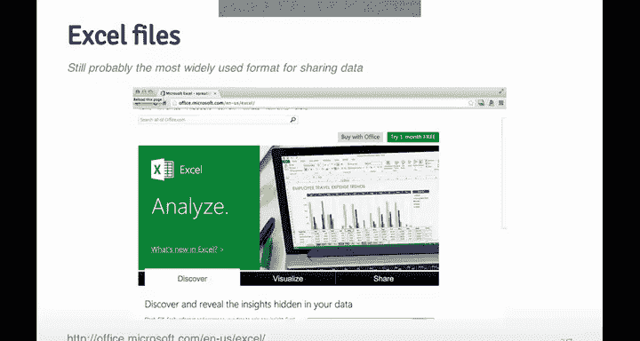
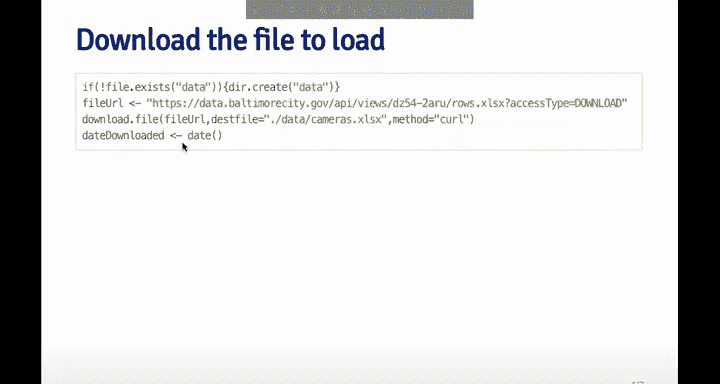
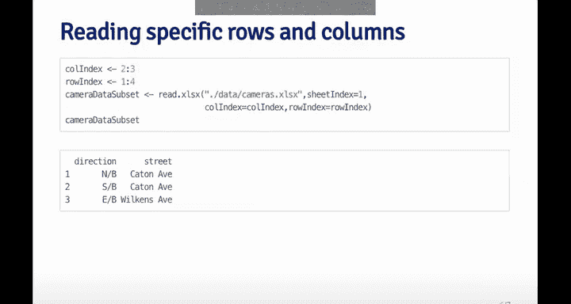
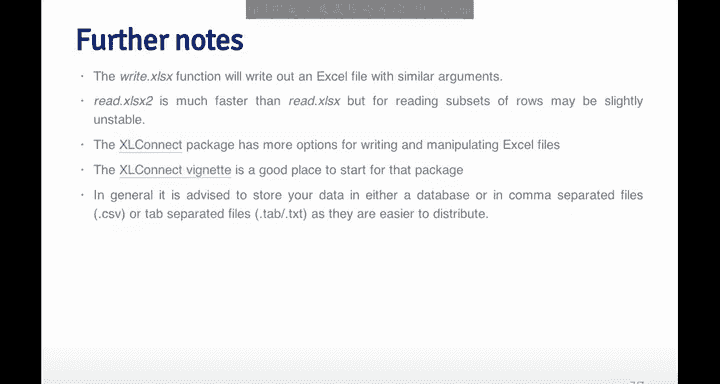

# 约翰霍普金斯大学《数据科学R语言基础｜Data Science： Foundations using R》中英字幕（deepseek - P79：5_读取Excel文件.zh_en - GPT中英字幕课程资源 - BV1tsFQemEts

Some data scientists show a certain snobbery about Excel files。

 but Excel files are still probably the most widely used format for sharing data。

 I think the reason is because a lot of people are used to using spreadsheets。

 So whether you're working in business applications or in science。

 people know how to use spreadsheets to collect and put data in and share it with each other。

 It's true now， even more than ever with things like Google's spreadsheets。

 which allow people to share them collaboratively on the Internet。

The problem for you is that when you're analyzing data with a scripting language like R。

 you need to be able to extract the data out of those files so that you can do downstream analyses and processing on them。

So we're gonna to go back to the Baltimore camera data。

 I guess I must be getting a lot of speeding tickets lately because I've been thinking about this dataset a lot and so now we're going actually download the Excel version of this data and so in this case the URL is a little bit different again you just pick the URL off the website and then what we're going to do is we're going actually download the file as a do exclsx file because that's the extension for Excel files and so now we've downloaded this file。

 we begin use download file which remember is agnostic to the file type so it just downloads the file and puts it into this file name that you've stated here and again we're going to collect information on when the file was downloaded so that we can know when the analysis was performed。

So the library the R library that is useful for this is the XLSX package。

 there's other packages Excel Connect that can also be used if you would like to。

 they might be provide a little bit more flexible interface but I like XlSX so what we do is we actually use the command read。

 XlSX and we assign it again to the camera data variable and now you need to pass a couple of parameters so we need to pass the sheet index so we need to say which sheet is the data store on and again we're going to tell it that there's a header line so that the column names are labeled and so when we load that into R again it looks almost exactly like the data that you got when you read the CSV file and you read it straight out of an Excel file。

One thing to keep in mind is that you can read specific rows and specific columns， so for example。

 if you want to read just the second and third columns and you want to read just the first through fourth rows。

 you can actually pass those as variables to call index and row index to this file。

 read XLSX and you actually only read a subset of the Excel file which might be useful if you only want to extract a little part of the file that you have。

So some further notes that might be useful for you or that you can use write do XlsX so if you're working with people that like Excel files。

 you can actually write them back out after your analysis and share them with people it's very similar and you pass it the object that you want to write out in the file name and it will write that file out read XlsX2 I've found is quite a bit faster than read XlsX。

 but especially if you're reading of subsets of rows， it might be a little bit unstable。

 at least in my experience。ExcLCon as I mentioned， is a lot more flexible for reading。

 writing and manipulating Excel files and so if you really need to do a lot of serious processing and Excel files。

 I found that Excel Connect might be a little bit better if you're going to be doing that the Excel Connect thanignette is actually a really great place to start it has a lot of information about how you can do all sorts of different things how you can manipulate and create files directly from R in general for the purposes of this class but also for the purposes of most analyses。

 it's a little bit faster and easier to read files if you store them as comma separated or tab separated flat files。

 they're also a little bit easier distribute as not everybody has Excel。

 it's not necessarily as cross platform as using something like a plain text file with just comma set or tab separated values。

