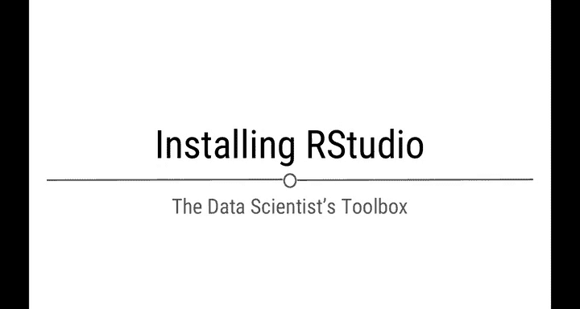
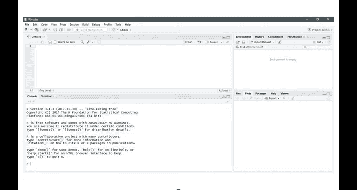
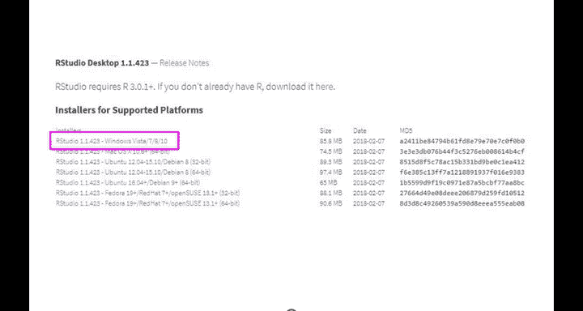
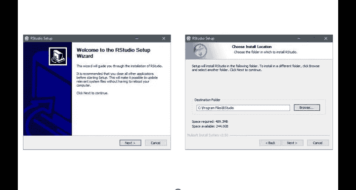
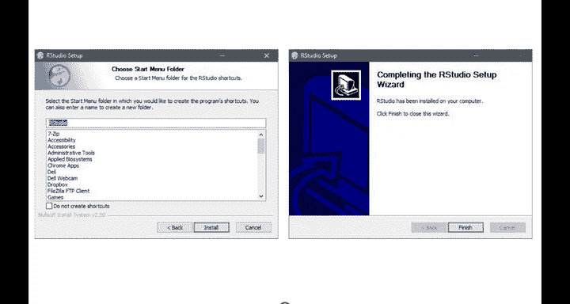
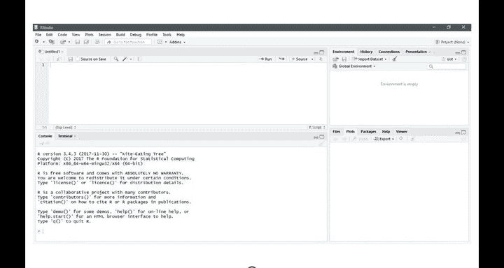
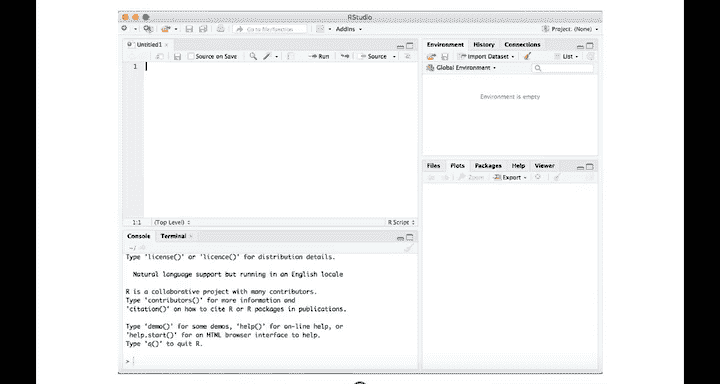
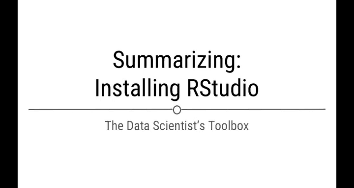

# 约翰霍普金斯大学《数据科学R语言基础｜Data Science： Foundations using R》中英字幕（deepseek - P7：6_安装RStudio.zh_en - GPT中英字幕课程资源 - BV1tsFQemEts

We've installed R and can open the R interface to input code。

 but there are other ways to interface with R and one of those ways is using ourSt in this lesson we'll get ourSt installed on your computer。

 ourSt is a graphical user interface for R that allows you to write， edit and store code， generate。

 view and store plots， manage files， objects and data frames and integrate with version control systems to name a few of its functions。

 we will be exploring exactly what our studio can do for you in future lessons。

 but for anybody just starting out with R coding， the visual nature of this program as an interface for R is a huge benefit。

Thankfully， installation of our studio is fairly straightforward； first。

 you go to the ourSt download page。We want to download the ourSt desktop version of the software。

 so click on the appropriate download under that heading。

You will see a list of installers for supported platforms at this point the installation process diverges for Mac and Windows。

 so follow the instructions for the appropriate OS。For Windows。

 select the ourSt installer for the various Windows editions Vista 7810 This will initiate the download process when the download is complete open this executable file to access the installation wizard you may be presented with a security warning at this time allow it to make changes to your computer Following this the installation wizard will open following the defaults on each of the windows of the wizard is appropriate for installation and brief on the welcome screen click next if you want our studio installed elsewhere browse through your file system otherwise it will likely default to the program files folder This is appropriate click next on this final page allow our studio to create a Start menu shortcut click Our studio is now being installed Wait for this process to finish our studio is now installed on your computer click finish Check that our studio is working appropriately by opening。

It from your start menu。

For Max， select the Mac OSxr Studio installser， Mac OSx10。

6+64 bit this will initiate the download process when the download is complete。

 click on the downloaded file and it will begin to install when this is finished。

 the applications window will open， drag the R Studio icon into the applications directory。

Test the installation by opening your applications's folder and opening the R Studio software。

In this lesson we installed ourSt， both for Mac and for Windows computers before moving on to the next lecture。

 click through the available menus and explore the software a bit。

 we will have an entire lesson dedicated to exploring our studio。

 but having some familiarity beforehand will be helpful。

