# 约翰霍普金斯大学《数据科学R语言基础｜Data Science： Foundations using R》中英字幕（deepseek - P80：6_读取XML.zh_en - GPT中英字幕课程资源 - BV1tsFQemEts

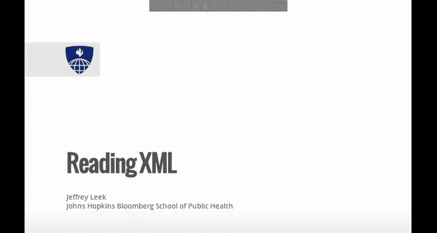

This lecture is about reading XML， so if you don't know about XML。

 it's extensible markup language is what it sounds for。

 So it's a frequently used to score structured data and it's particularly widely used in Internet application So you'll see it a lot when you're doing things like web scraping or trying to get data from an Internet API or trying to download data from say open data of websites。

 say like an open government website。So extracting HTML Xm is actually the basis for most of the web scraping that you'll see。

There are two components to an SMML file there's the markup that's the labels that give the text structure so you can imagine if you just started typing you would end up with sort of an unstructured text file。

 the markup is the way that you add labels so that the file ends up being structured and then the content is the actual text that you type in in between sort of the labels that give the structure to the text so to be a little bit more concrete we'll talk about tags。

 elements and attributes。

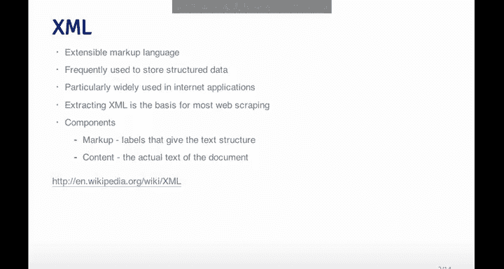

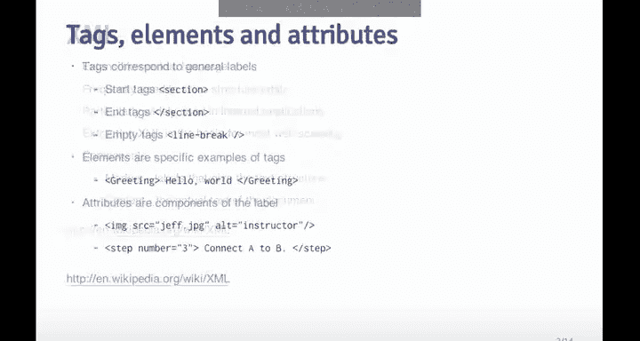

So tags correspond labels， they're labels that are going to be applying to particular parts of the text so that it will be structured。

 so there are start tags and so start tags look like this。

 so they start with an open carrot on one side and then they have a phrase and then a closed cart on the other side so you'll have that at the beginning of a certain part of the text and so that will start that text as a labeled section called section and then it ends with an end tag which looks like this it has the same phrase as before but it starts with a forward slash inside of the two carrots。

And so the empty tags are tags that correspond to lines where you don't necessarily need both an open and a closed tag to eliminate a certain part of the text。

 you might just want to denote one specific line say a line break and so what you do is you have the same sort of structure only you have the forward slash just over here at the right end。

So elements are specific examples of tags， so for example。

 one element of the XML markup could be the tag greeting with the end tag greeting over here on the right hand side and in between it the content。

 the hellello world。So attributes are components of the label so you can actually add to these tags components and so for example you might have an image tag and so what you might want to have corresponding to that image is an attribute that's the source so that's where the image is actually coming from and then an alternate phrase for that tag and that can be instructor for example。

So another example here is suppose that you have a tag that's the step tag and you might have multiple steps。

 so tag number step number one might be tagged with number equals1 and then two and then this is number three。

 step three， and then of course it just ends with an end tag just like you did before if you want to know a lot more about XML and it's probably a good idea before doing a whole bunch more with this lecture。

 you can go and see the Wikipedia entry on XML which is actually quite comprehensive and nice。

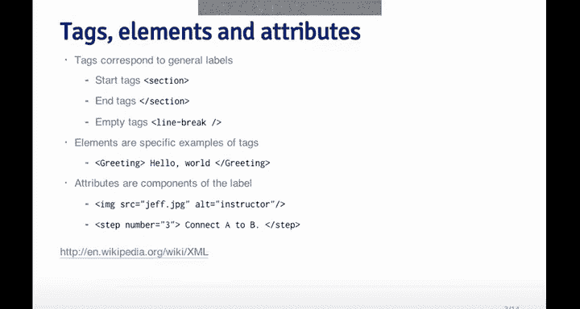

So this is an example XML file， it's a little bit hard to see but you can see it okay if you go actually to the web link here at the bottom of the page。

And so the idea here is you have a text file and that text file has lots of tags and content in it。

 So for example， here you have a tag that says food。

 and then here is the closed tag for that tag that says food down here。

 So you can see they're indented at the same level within this file and then for this particular food element。

 you actually have a name。 So there's the open tag for name and there's the closed tag for name and this particular element is named sort of Belgian waffle。

 So delicious。 And then there's other tags that correspond to the other components of this particular food element。

 and then you go down and there's another food element with another name and so forth。

 So that's what an XMl file look at it looks like and I encourage you to go look at the bigger version of that when you go to that web link。

😊。

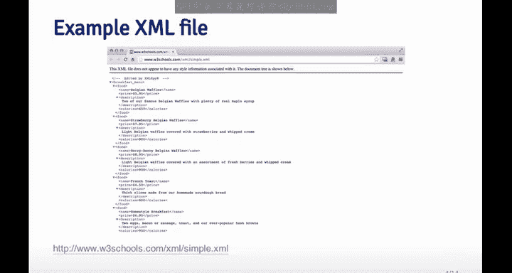

So you can read the file into R and you can do this with the XML package so we're loading the XML packages。

 all caps XML and then you give it a URL so in this case we're gonna give it the URL of the previous XML file we were looking at on that previous screen and then you can use the function XML tree parse to parse out that XML file So what this does is it loads the document into a memory into R memory in a way that you can then parse it and get access to different parts of it。

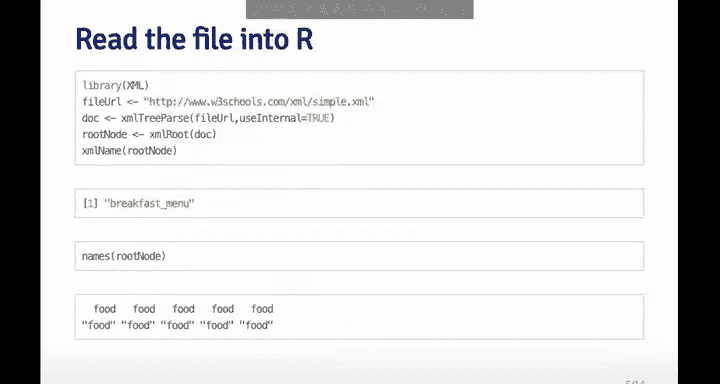

So within R it's still a structured object and so we have to be able to use different functions to access different parts of that object。

So the first thing we want to want to look at is the root node and so the root node you can get with XML root and so what that is is it's sort of the wrapper。

 you can think of it as the wrapper element for the entire document and so if you execute this XML root command you'll have access that particular element of the XML file and then if you want to get the name out you can actually use XML name applied to that node to get the name out and in this case it's the breakfast menu。

You can also look at the names of the root node and so when you do names of the root node what it's actually telling you is what all the nested elements within that root node are。

 so the root node wraps the whole document。And the whole document is a breakfast menu。

 and then there are five different breakfast items on this menu and each one is wrapped within a food element。

 so you get five food elements if you look at names of the root node。

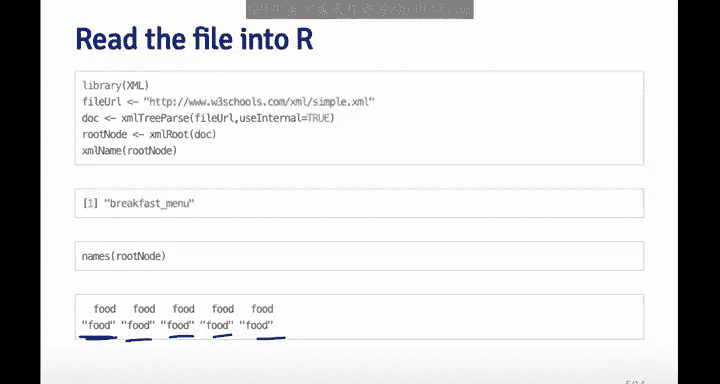

So the next thing that you can do is actually directly access parts of the XML document and you can do it in a little bit in the same way that you access a list in R and so for example。

 if you want to look at you have this root node element that we've extracted and we can look at the first component of that or the first element of that and we do it by using double brackets here that's how you access the first element say in a list and so what you get out actually is the first food element like this so it contains the food tags and it also contains all the information about the first food element。

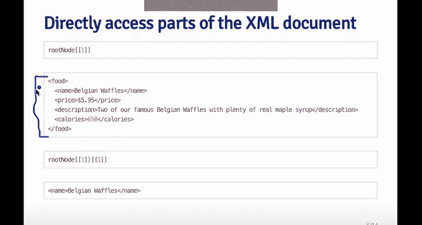

Then if you want to keep drilling down into smaller and smaller parts of the XML document。

 you can do subsetting just like you do with lists。

 so first this exit root node and the first bracket one will again give you this element here with the entire food component and then if you want to take the first element of that。

 you just repeat the process again and now you're going to be looking at just the name。

 the Belgian wffles because that's the first subcomponent of the first subcomponent of the root node。

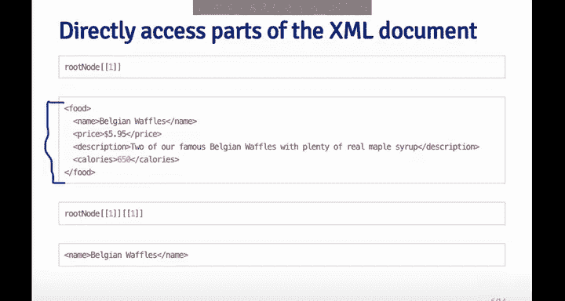

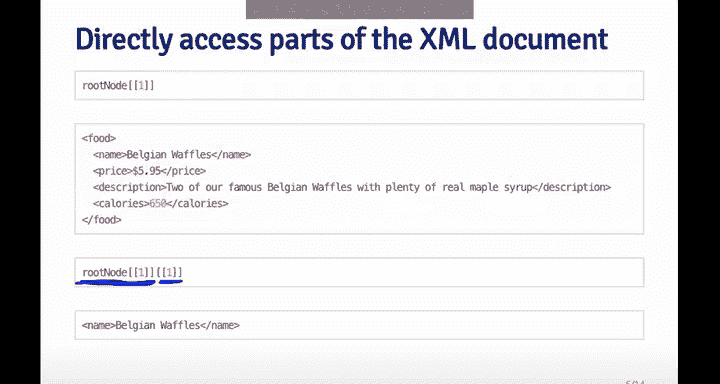

You can actually programmatically extract different parts of the file so you can do that with the XML Supp command。

And so what you do is you pass that a parsed XML object and then you tell it what function you'd like to apply so in this case XML value so what that's going to do is it's going to loop through all of the elements of the root node and get the XML value and by default this is going to do this recursively so if you apply it in this way since root node contains the entire document it's going to go through and get every single value of every single tagged element in the entire document and so you just get a bunch of text all strung together that's all the text that was in that document。

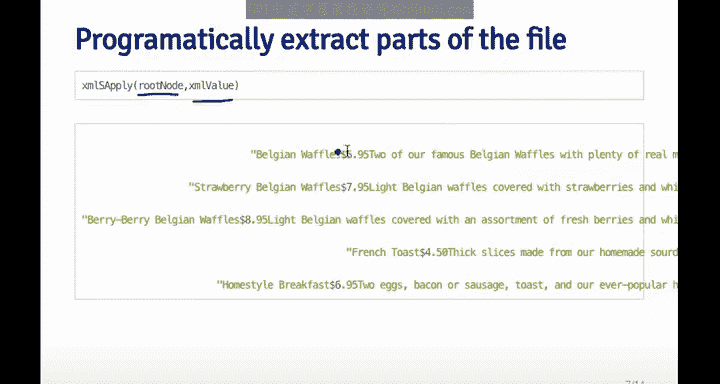

You might want to be a little bit more specific and get a specific component of the document out and you can do that using the XPAC language so unfortunately this is a whole other language that you have to learn in addition to@L to be able to access the data but if you learn just a few of the components then you'll be a long way along the way I'm going to talk a little bit about this but there's actually a really nice set of lecture notes that are available here that go into this in a little bit more depth if you are find yourself a little bit lost after this lecture。

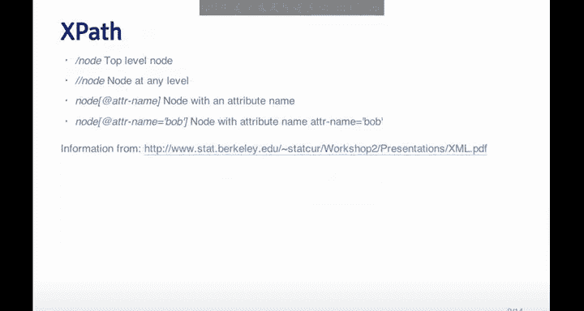

So the first thing that you're going to be looking at is the top level node of each element and that's you get with a forward slash node。

 the node at any level is double slash node and then you can actually extract specific nodes with specific attributes and we'll talk about how to do that over the next couple of slides。

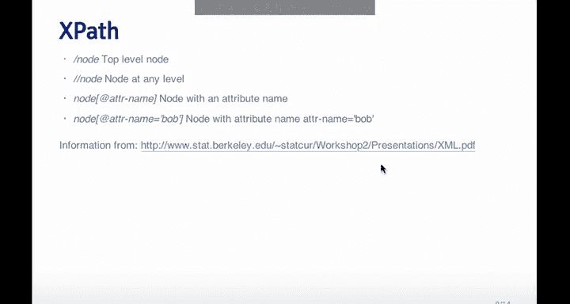

So the first thing that you're going to want to be able to do is get the items on the menu and their prices and so the way that we're going to do that is we're again going to use this X path S apply。

 but now we're going to be a little bit more targeted about which data we're going to be extracting。

So we're going to again pass it the root node that's the entire document and so then what we're going to be doing is we're going to be using this X path element here forward slashboard last name and so what that's going to do is it's going to go through and get all of the nodes that correspond to an element with title name and then it's going to get the XML value of those nodes so what it's going to do is it's going to take out basically all of the elements of that XML file that are tagged with name and so you can see you end up with the names of all of the items on the menu。

You can also do the same thing， you send the exact same root node to Xpath S apply only now you can say I actually just want the nodes that correspond to price and again I want their XML value and so it will plop out the XML values which are the prices of the value so now we've extracted from that XML file。

 the names of the menu items as well as their prices。

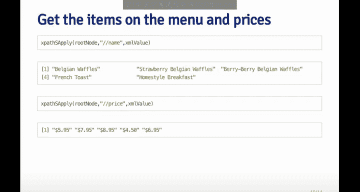

To give you an example that's a little bit more complicated I'm actually going to use a website of the Baltimore Ravens which is an American football team that is based here in Baltimore。

 so this is a homepage of that team on ESPN which is a sports channel in the US and so what we're going to do is actually look at the source code so if you right click on the page and say view source what you'll see is a source document that looks like this it's actually quite complicated's the source code that actually demonstrates that's a process to show you the website that you actually see when you go navigate your browser to that website。

So we're going to actually drill into this website source code and see if we can extract some information。

So again I'm going to pass it the file URL， this is the URL of that website if you go back to the previous page and so now since I'm parsing an HTML file instead of an XM file I'm going to use HTML tree parse instead of XM tree parse the differences are。

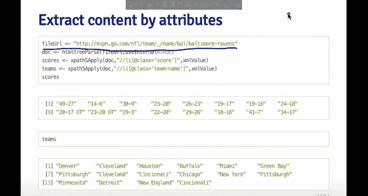

It's different enough that you want to use HTML tree parts when you're parsing an HTML file。

 and then I'm going to pass to the command， use internal equals true so that I can get all of the different nodes inside of that file。

So now what I'm going to do is I'm againm going to use the X path S applied to programmatically extract some components of this document。

 so I'm going to start with the whole document again and now what I'm going to try to do is I'm going to again extract the XML value to the value inside of certain elements。

But I want to find very specific kinds of elements so here's what I'm going to do I'm going to look for elements that are list items LI and that have a particular class so they have class equal to score and so what this is going to do is it's going to go through the entire document and anytime it sees a tag that is a list item it's going to check and see if it's class score and if it's class score itll return the XML value。

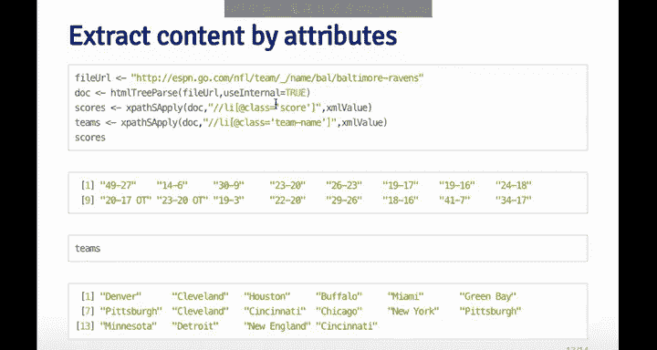

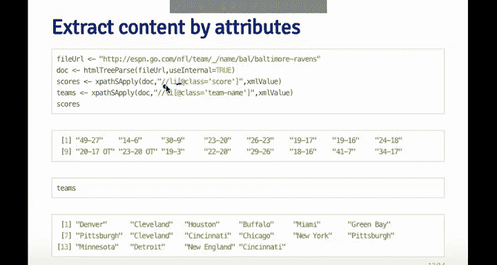

So it turns out if you go back to this website and you look very， very carefully there you can see。

 for example， there are these list items and the class in this case is equal to team name and so the next element that I'm going to be extracting。

😊。

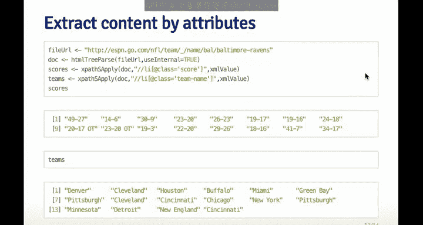

On this page is actually the team name so it's the same thing I look for at a list item with class equal to team name and it will extract those team names So the way this works is you go to the website and you find the tag and any attributes that you want to extract and then you need to write them into this expPA language to extract only the data for those specific elements with expPA S apply So if I do this I end up with the scores for each of the games and the teams so I've scraped from that website information directly using R。

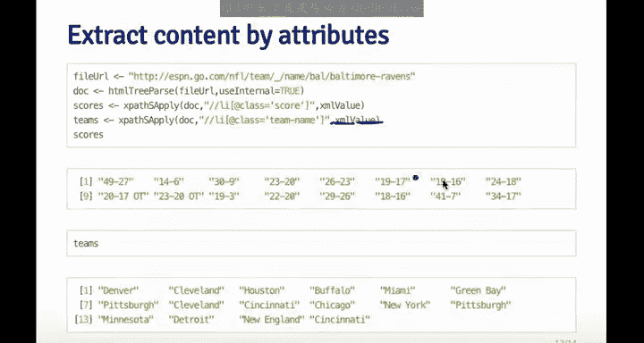

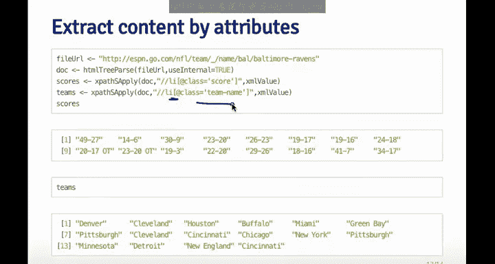

This is a very brief introduction to XML， the XML Pack R and XML in general。

 if you go and check out the XML tutorials for the XML package。

 there's a short one that's really good and a long one that's extremely extensive and should only be read after reading the short one so you get an idea of what's going on and then there's this really outstanding guide to the XML package that's linked to here as well that will give you a lot of information about how you can use XML to programmatically extract information from websites。

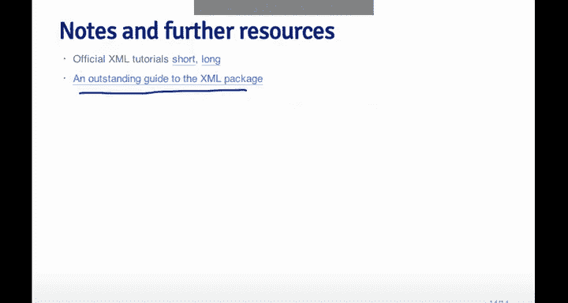