# 约翰霍普金斯大学《数据科学R语言基础｜Data Science： Foundations using R》中英字幕（deepseek - P83：9_从MySQL读取.zh_en - GPT中英字幕课程资源 - BV1tsFQemEts

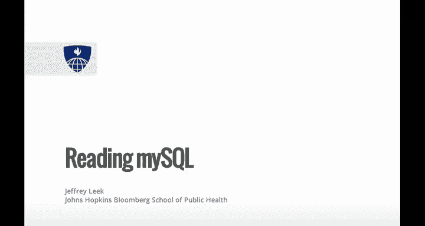

This lecture is about reading data from a MysQL database。

ISQL is one of the most widely used open source databases and it's widely used because partially because it's free but also because it works really well and it's again widely used in internet based applications data are structured in databases and then the databases within each database there's a series of tables。

And then within the tables there are a series of fields so you can think of each table sort of as a data and each field as say one of the columns of that data。

 so each row in the database is called a record if you want to little bit know a little bit more about MySQL structure。

 you can look at the Wikipedia page or there's quite extensive documentation at Mysql。com。

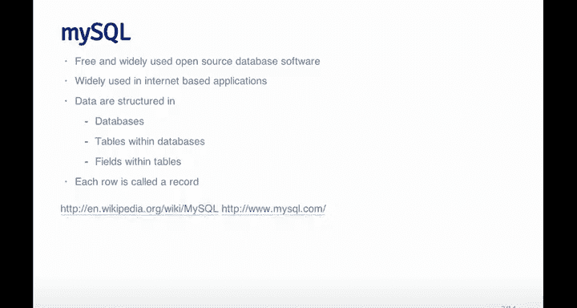

So here's an example structure that you would get for a particular database so what you have is here this is a database of employees and so what you might have here are several different tables that are all linked together so for example you might have the departments that the employees are employed in the employees themselves you might have information about their salaries in a different table and you might have information say about who their managers are in yet another table and information about their titles and yet another table so for each table you get a slightly different kind of data type and so one thing to note is that what this database schema shows is each of these tables you can think of is corresponding to so one box corresponds to one data frame and are so to speak and all of the sort of listed variables here are you can think of as the column names for that data frame are and so you'll notice that one of these sort of common ID appears in all of these tables they's sort of linked tables so it's possible。

To go and sort of access， say for an employee， which department they come from and what their salary is and what their title is。

And so you can figure out also who their department manager is and then the department managers are then organized into departments sort of in a sort of a structured format so you can follow that back to find out who the employees are so this is an example of MySQL database and so you have the data stored in all of these tables and you want to be able to access them。

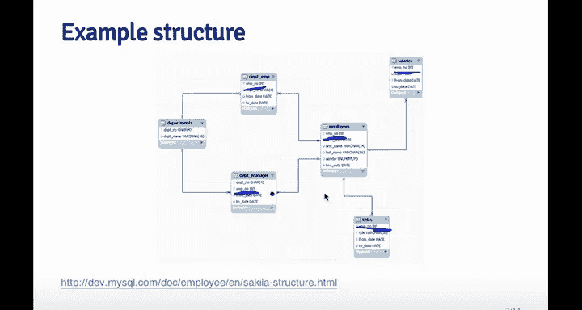

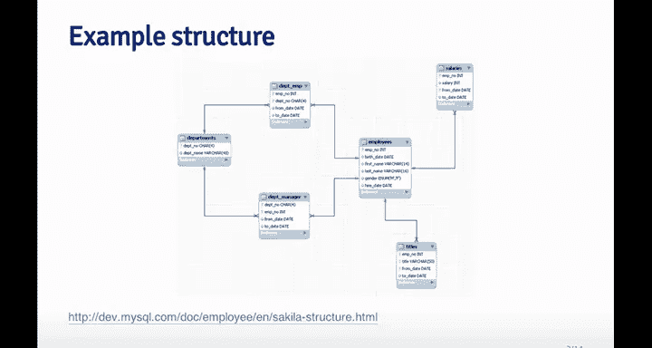

So the first step in using the MySQL package is actually installing MySQL and so this is a little bit complicated because it depends a lot on your operating system and the particular structure that you have。

 so if you go to this website that I've linked to down here at the bottom you'll be able to install MySQL and you can see that there's a version of MySQL for just about every kind of operating system that you might be interested in installing it on and so they're a pretty explicit instructions on've how to install MySQL on all of those websites we're actually going be showing in this lecture and example of a web facing MySQL server that we'll be able to access but as an active good citizenship to the world I would appreciate if you didn't all go and try to access that one server because we'll probably overwhelm them with the large number of people in the class。

So better example is to try to create a MySQL database on your own system and then play around with it。

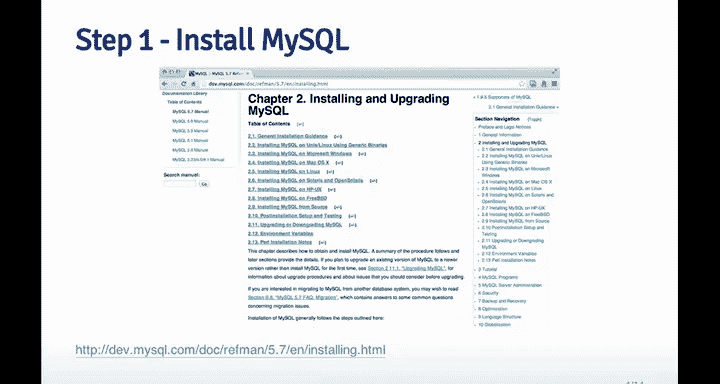

So the first thing that you need to do is install R MySQL within R so on a Mac you can just do install that packages R MySQL for Windows is' actually a little bit more complicated because of the way that the database drivers need to be set up and so forth so you can actually see the official instructions here on this website and then this guide I found to be actually quite a bit more sort of intuitive and useful so if you are having a little bit of trouble getting installed on Windows that might be a good place to go if you have more trouble please go to the forums and ask questions。

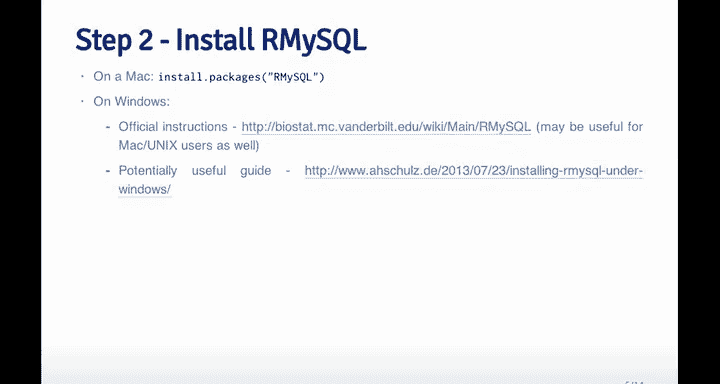

So we're going to be using a web facing version of a MySQL database so that we can just show how the RMISQL package works without having to install MySQL and go through the process of actually building that database。

The important point to keep in mind here is that as a data scientist。

 one role that you will have is likely to collect data from a database and maybe later you're going to put some data back in it。

 but usually the basic data collection is already being performed before you get there so you'll usually be handed a database and have to try to get some data out of it。

So this is information about the human genome that's collected by the University of California。

 Santa Cruz it's one of the most famous databases for genomics。

 and so they have a public facing MySQL page， sort MySQL server and so it gives you information here on how to connect if you have MySQL installed on your computer。

 how to connect their MySQL server and so we're going to use that information and actually just connect with an R and what we're going to try to do is access a database and collect some information about a particular genome that we're interested in。

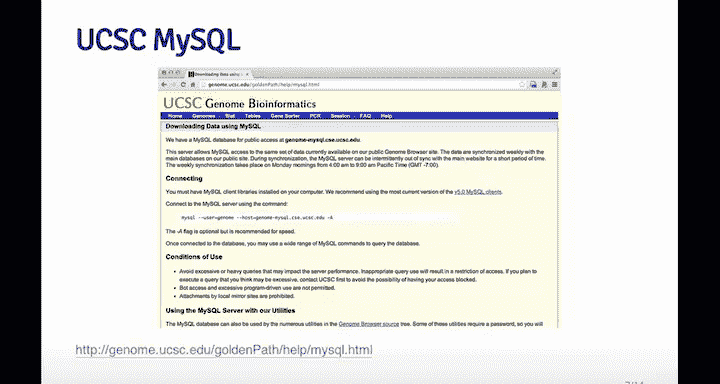

So the first thing that we need to do is once you've loaded the RI SQL。

Package in R you're going use the Db connect command to connect to a database and so in this case it's a MysQL database you can actually use this Db Connect to actually connect to other kinds of databases as well and so you saw from the page on the previous slide that the user that we're going pass it is genome and then you're going to pass it the host which is just where the MySQL server is and in this case it's this web address here So what this does is it opens a connection and that connection is given this handle UCSCDB so you should always assign the handle each connection to handle。

And then what you can do is you can actually apply a query to that database。

 So what you can do is you can use the DB get query command。

 So what that does is it'll go to the connection。 in this case。

 the connection is to this database and it'll run this MysQL command。

 So this actually isn't an R command。 It's actually a MysQL command that we're sending to this database through the DB get query function。

And so then at the end， after I run that command， I'm going to use DV disconnect so I'm going to disconnect from the MySQL server。

 it's very important that whenever you're done analyzing data or collecting data from a MySQL server that you disconnect from that server and you should get a true response that true is coming from the D disconnect because it's saying that we did in fact disconnect from the server。

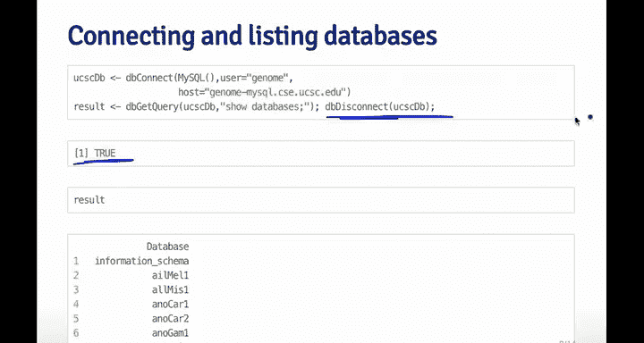

Then if I go and I look at， what result will show is a list of all the databases that are available for that all the databases that are available within the MySQL server that is located at this particular host address right here。

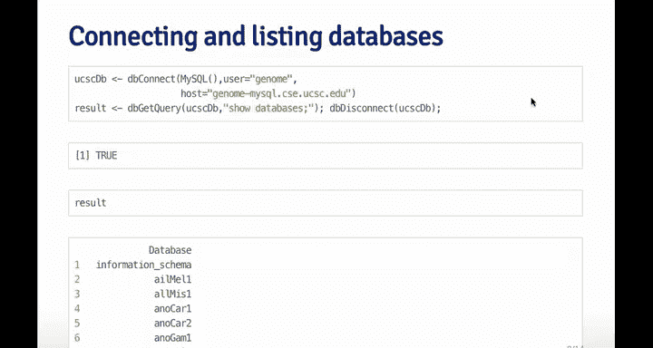

So we're gonna actually focus on one in particular that's HG19 H19 is a particular build of the human genome so it's the 19th build of the human genome and so what we can do now is just run that Db connect command again but instead of just passing at the user will also pass it the database will say we're gonna we want to access this database within this MySQL server and then what we might want to do is see what are the tables within that database so remember on a server there might be multiple databases and within the database there'll be multiple tables each table corresponding to what you might think of as a database frame So what we can do is look at all the tables that exist in the HG19 database and so if you look at the length of that in this case it's very long there are over 10000 tables that are in that single database So this is one nice thing about MySQL can store a large amount of data that we can get easy access to So if you look at the first say five tables you get these tables here these are all different table。

cororresponding to various different elements that describe components of the human genome。

 each table corresponds to a different kind of data。

 so you can kind of think about it in the same way that the ti data principles you thought about each data corresponds to its own file it's the same way here you get each different data type gets its own table。

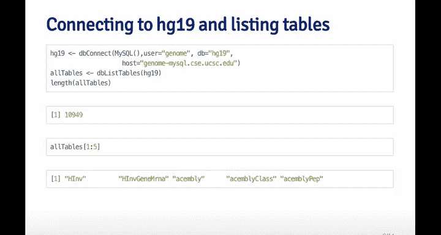

So one thing that we can do is to suppose we know one table that we're interested in so this is for a particular kind of microarray which is a measurement technology used to measure something about the genome so you can actually say。

 okay I want to look in this database， this is a connection that we made to the HG19 database within the MySQL server and I want to know what are all the fields in this particular table So remember a table corresponds to something like a data frame and the fields correspond to something like the column names that data frame and so you can see if we look at the fields here。

 there are things like bin matches， mismatches and so forth。

So what we can do now is suppose we want to find out。

 say how many different rows there are in this dataset。

 So we already know something about the columns right because this Db list fields told us all the column names And so there's something like 22 columns in this dataset or in this table then what we to might want to know is how many rows it has。

 And so what we're gonna do is send another query to the database so it's Db get query again。

 So again we're gonna pass it in quotes a MysQL command。

 This is a very special MySQl command that says select count star from this particular table。

 So what it's doing is it's basically going to count all the records in the table and it's going to return the number of records。

So if you wanted to look at that number of records in a different table。

 you would just send this exact same command with the database you were interested in here and the table you were interested in here。

 and you would get the count of the number of elements in that table。

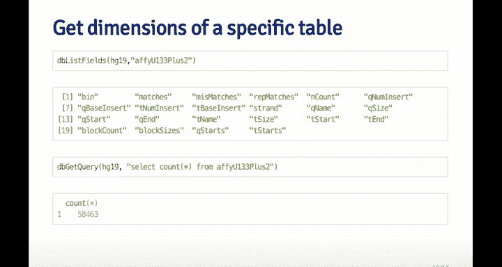

So then the next thing that you can do is suppose you want to get one of the tables out。

 you can basically get the data frame out from the data and so what you do is you're using DBRead table。

 so we pass it the database that we're interested in getting the table from and then the table name that we're interested in getting the data from and so what that'll return is then the data frame itself and so if you look at the top part of that file you can see this is the data that's actually been extracted now from that MySQL server from that particular database and that particular table so you can extract the data one table at a time。

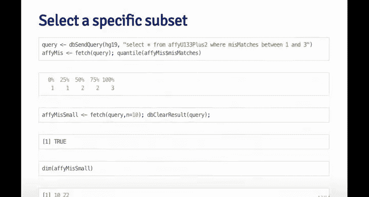

One important thing to keep in mind is that often in these MysQL databases。

 there'll be a huge amount of data stored。 and so any particular table might be gigantic and might be too big to read into R。

 So one thing that you might want to do is select only a subset of the data So you can do that with the DB sendend query command So what you do is you say DB send query and you give it the database again and then we're going to send it a different MysQL command。

 And so the MysQL command here is select star So it's going to select all the different observations from this table。

 the Api U133 plus2 table where the mismatches variable So you remember that's one of the columns in that data is between one and3。

 So what we do is we send this query to the database。

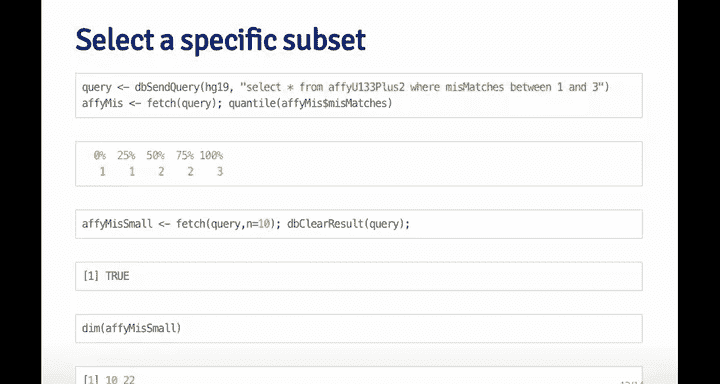

And so now that's stored remotely at the database and then if we want to fetch the result of that we use the fetch command like this and that'll return this AI miss which will give us some information about。

诶。The only the samples that we've selected using this database query。 So if we look。

 say at the quantiles of the mismatches。 So remember we selected the mismatches between one and three and you can see that the quantiles reflect that。

 that we only have data for which the mismatches are between one and three。

So the other thing that you can do is you can actually just fetch so remember when you use the sendend query command。

 it sent it to the database， but it didn't try to suck the data back to your personal computer yet。

 if you only want to suck out a very small amount of data so suppose you just want to see a little bit of the data and make sure that you don't accidentally suck down a gigantic table。

 you can use the fetch command and you can tell it only bring back the top 10 record。

And so what you've got now is just a very small data set that only contains the first 10 rows of that table When you do that。

 you need to clear the query， so you remember you sent a query out to the MySQL server and now it's still sitting out there and you fetch the data back but it didn't stop that query from still being out there at the MySQL server so you need to do Db clear result to clear that query from the remote server and it should return true again because you've cleared that result。

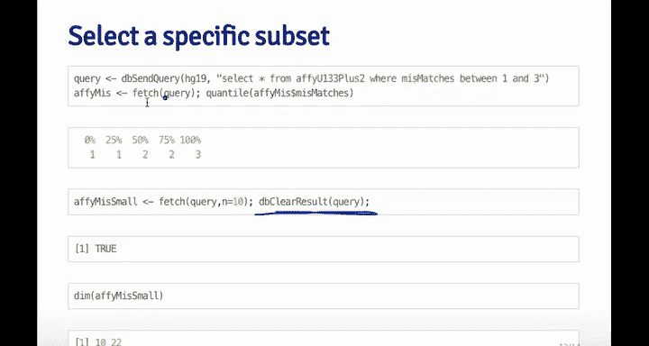

So if you look at this small data set where we fetch only the top 10 rows or observations。

 you can see that that produces a data frame that actually has a dimension of 10 rows as well。

 So what we've done is selecting a very specific subset an important point here is that you can basically send any MysQL query that you would like up here within the quotes So it's a little bit beyond the scope of this class to teach you all of the different queries。

 the most important ones are the queries that I've shown you about selecting the sort of the total count and selecting all of the observations that are subject to some particular conditions but if you go to the MysQL documentation。

 you can actually come up with a query that will allow you to very flexibly select almost any sort of subset of rows or columns from a data that you're actually interested in selecting。

Remember to close the connection so this is one of the most common mistakes when using accessing a database from R is that you open a connection。

 you select some data out and then you go happily on your way。

 you should try to close the connection as soon as you don't need the connection anymore so immediately after extracting out the data that you're interested in。

 you should close the connection and move on with the rest of your script。

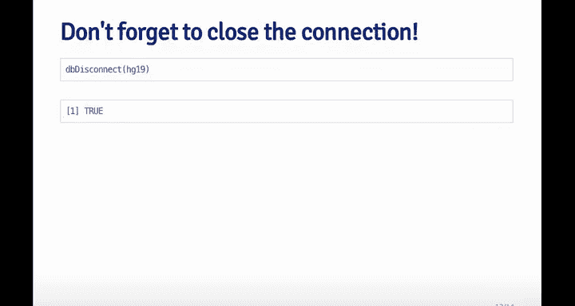

The R MySQL vignette is very good it gives you access to a bunch of other MySQL commands that might be useful for selecting data for your particular examples。

 there's also this very nice collection of MySQL commands here very nicely organized that will give you a lot more information if you want to be able to use them。

One thing to keep in mind is that I have shown an example here about public facing MySQL server。

 and so what I've done primarily for this analysis is select data from that server。 please。

 please do not access that server to delete add or join things。 In other words。

 don't push anything back into the server， only suck things or select things out of the server。

 So you should only be using the select command。 Another important component is that we again are a large class。

 And so if you all hit that server at the same time， it will likely cause problems for them。

 it's much better to practice on your own local version of MysqL and careful in general。

 you need to be a little bit careful with MysQl commands because you can delete data than other people are working on。

 So a nice blog summarizing some other commands that are used with Mysql and R is right here。

 And so if you want to take a look and learn a lot more。

 there's a ton more that can be learn there and R and MysQl play very nicely together if you want to get data out。

😊。

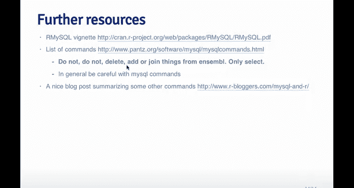

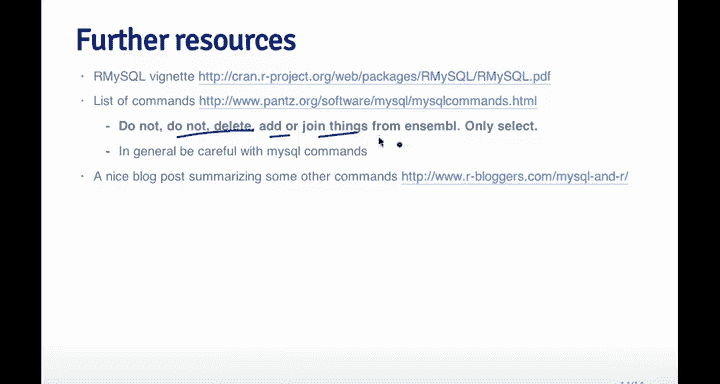

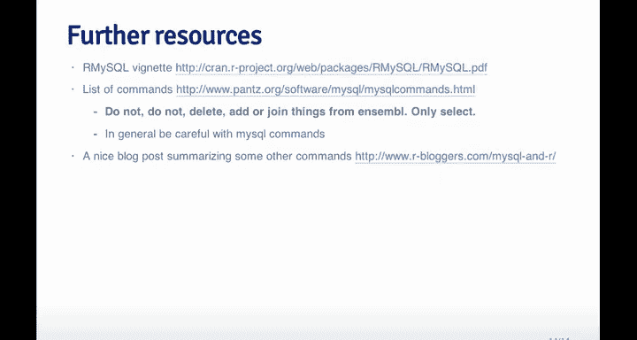