# 约翰霍普金斯大学《数据科学R语言基础｜Data Science： Foundations using R》中英字幕（deepseek - P85：11_从网络读取.zh_en - GPT中英字幕课程资源 - BV1tsFQemEts

This lecture is about reading data from the web there are a large number of ways that you can read data from the web。

 this is primarily going to focus on scraping data out of websites and maybe doing a little bit with working with APIs and a little bit about authentication Later we'll have a lecture that specifically focuses on just the API component of getting data out of web。

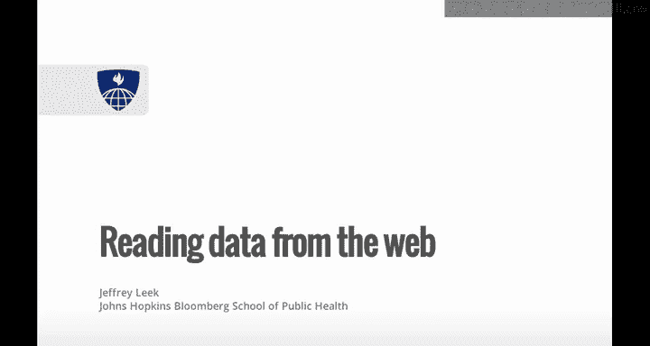

So web scraping is programmatically extracting data from HTML code to websites or from URLs。

 it can be a great way to get data， so for example。

 this link that I have here is an article about how somebody scraped all of the categories that Netflix assigned movies to and then analyzed them in a very interesting way and that ended up being a story that went viral because you collected an interesting set of data just by programmatically extracting data from websites。

Many， I would say almost all websites have information that you might want to programmatically read in some way if you're interested in getting the data off that site in some cases。

 this is against the terms of service for the website so some websites don't specifically say that they do not want to be scraped and so when you do that if you try to scrape the data from them you're at your own risk if you attempt to read too many pages too quickly。

 very common consequences that you can have your I address blocked if you read a lot of proprietary information off the website you can get it that even bigger trouble so you should be a little bit careful when you're deciding to scrape data off of websites but in general it can be a very good way to collect a lot of data very quickly。

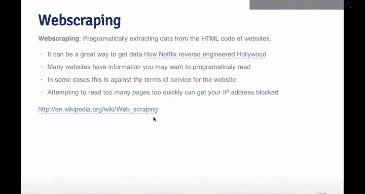

So I'm going to give you one example of how to programmatically extract some data and so that comes from my Google Scholar page。

 so this is that Google Scholar page and there's the link down there at the bottom that's the web link and so this is actually a page that tells you something about the papers that I've published and something about how often they've been cited which is a kind of data that academics care about。

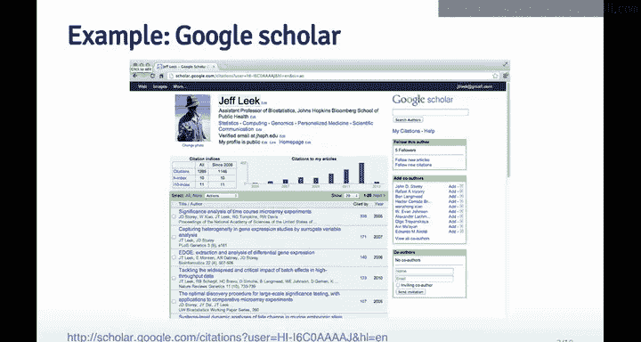

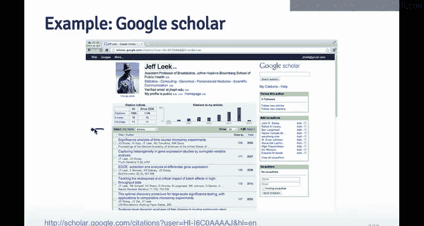

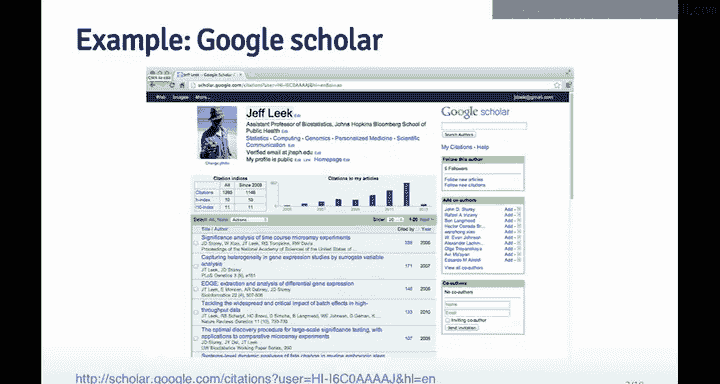

And so what we're going to do is first we're going to use the read liness command to get some data off the internet that's one way。

 so what you can do is you can open a connection to a particular URL and you can do that using this URL function。

 so you just pass it the name of the URL that you would like to open a connection to and then you can use the read liness function to read out some of the data from that connection。

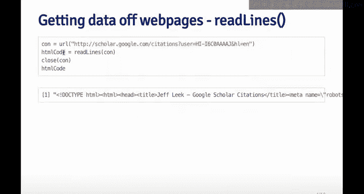

And then just like when you're working with a database。

 you're going to want to be sure to close the connection after you've used it。

 So if you look at the HTML code that we've collected from this， it's going to look like this。

 it's going to look very like one big long string of letters。

 you can send read liness a set number of lines that you'd like it to read。

 but it'll still come out unformatted in this way so it's a little bit hard to read。

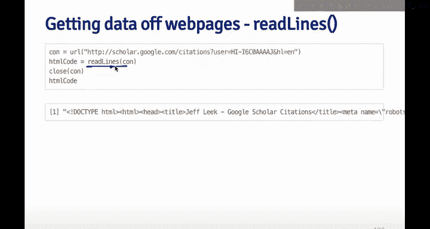

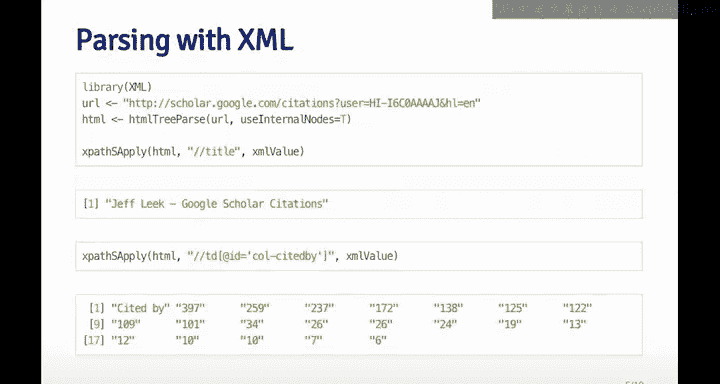

One way to deal with that is to as we've seen before us to use the XM package so again。

 we could say use the same URL， use the XM package and parse the HTML again。

 using the internal nodes to get the complete structure out。

 then if I wanted to get say get the title of the page I could look for the node that's in the title tags and get the title of the page or I could get sort of the number of times my papers are cited by looking at particular table elements of that table。

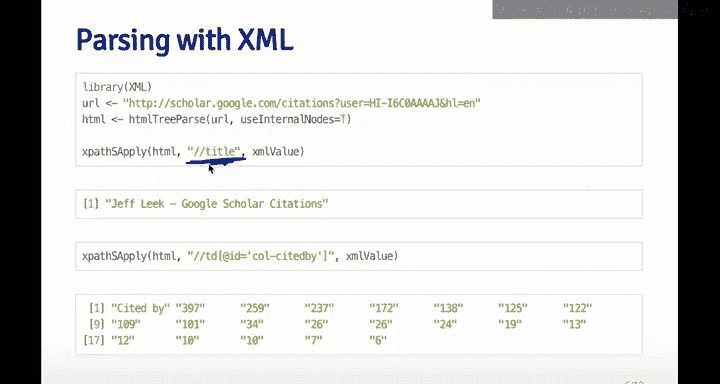

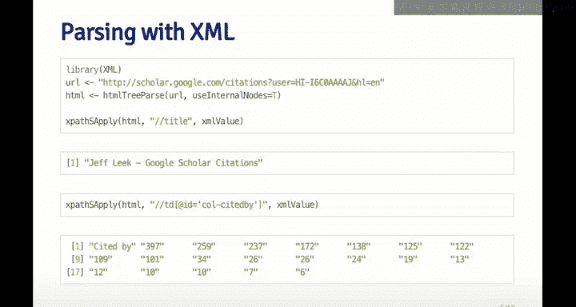

Another approach to getting data is actually with the get command。

 this is in the HTER package for doing things like this where there's an open easily accessible website accessing it with the connections like we've talked about before might be the easiest way but we'll talk in a minute about why the HR package can be very useful in other settings So here I've loaded the HER package and then what I do is I take that same URL I was using before and I just get the URL with HTML to and then what I have to do now is actually you have to extract the content from that HTML page and so I do that and I say I'm gonna to extract the content as a text just one big text string and then I can use the HTML parse command to parse out that text and get the parse H and so this par the H is going look exactly like what I would have got if I use the X package to extract the data directly and so then I can use Sapp to subtract。

Extract out the title， the again of the page like I did before。

So that's how you can use get just to do the exact same sort of exercise that you would have done with the XML package in some other cases you might have to do something a little bit more complicated So if you navigate to this webage with your browser you'll see that it requires a username and password input and so if I just try to get that page using the get command from the HtTR package I get a response that says status 401 and that's because I wasn't able to log in because I haven't been authenticated so what you can do with the HtTR package is you can actually authenticate yourself for websites and so you can do this by assigning to this what we're gonna call the handle we can go and get that website and so we pass the URL again but then we use this authenticate command and we give it the username and the password in this case this is just a test website and so the username is user and the password is password so you can test out things like this to see if you can get access in this case now。

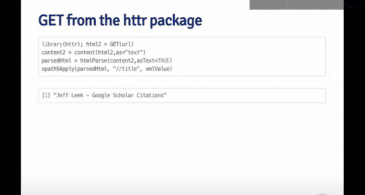

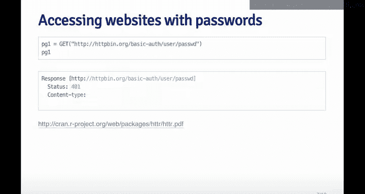

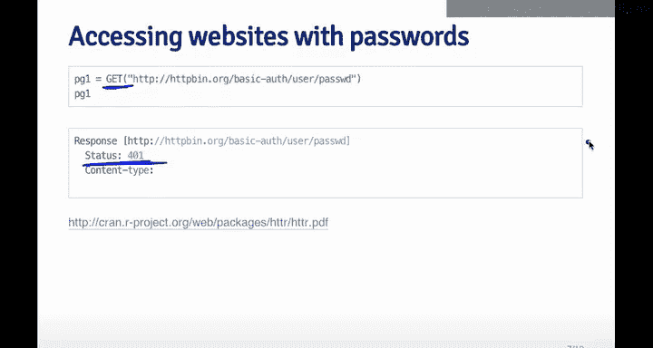

Response is status 200 which means we actually were able to get access to the file and so you've been authenticated and so now we can look at the names of this PG2。

 which gives you all the different components including the sort of the cookies that we have for this file and then the handle that we use to access it and all of that and so we can then use the content function to extract the content from that website after having logged in through R。

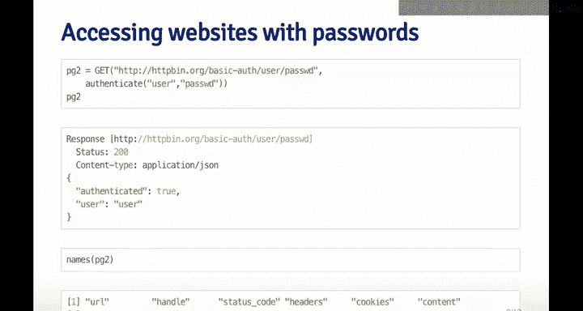

So make sure that you use handles because if you use handles。

 then you can actually access you can sort of save the authentication across multiple accesses to a website so if you set Google to be a handle where that Google is a particular website then what you can do is you can tell get to go and get that handle and you can say go get it for a specific path or you can send it a different path and so for example。

 if you authenticate this handle one time， then the cookies will stay with that handle and you'll be authenticated。

 you won't have to keep authenticating over and over again as you access that website。

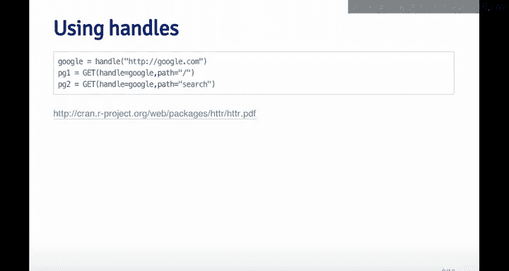

So our bloggers has a lot of good examples of how to scrape data from the web and so if you go and look for search for web scraping on our bloggers。

 you'll be able to get all of those tutorials， the HTR help file also has a bunch of useful examples primarily with sort of toy examples。

 so if you couple that with sort of the more applied examples on our bloggers you can get quite ways and then see later lectures on APIs for how to programmatically interact with APIs of websites。

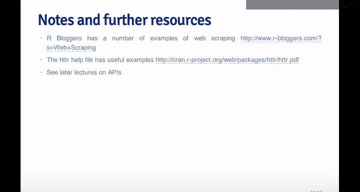