# 约翰霍普金斯大学《数据科学R语言基础｜Data Science： Foundations using R》中英字幕（deepseek - P86：12_从API读取.zh_en - GPT中英字幕课程资源 - BV1tsFQemEts

This lecture covers getting data from APIs APIs are application programming interfaces。

 So for example， most Internet companies like Twitter or Facebook will have an application programming interface or an API where you can download data。

 for example， you can get data about you know which users are tweeting or what they're tweeting about or you can get information about what people are posting on Facebook。

 You can usually get these with get requests with specific URLs as arguments。

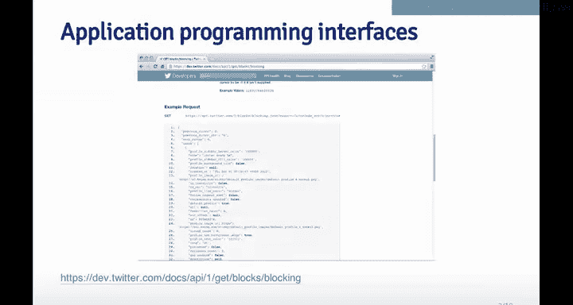

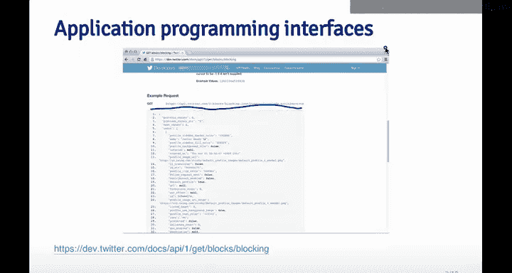

And so what we're going to be able to do is use the HCTR package to be able to get data from these websites。

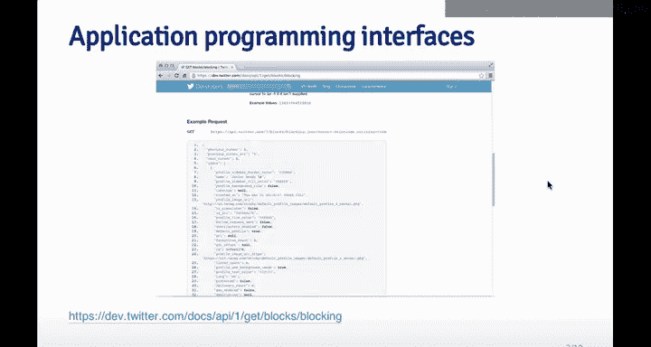

Usually the first thing that you'll need to do is create an account and in this case I don't mean an account like a user account。

 youll actually have to create an account with the API or with the development team out of each particular organization。

 so for example here we're going to go to dev。twitter。com/app。

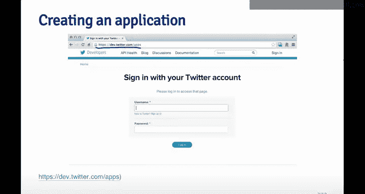

And we're going to create an application， and in this case we're going to make an application using the Twitter handle for my blog。

 simply Stas。

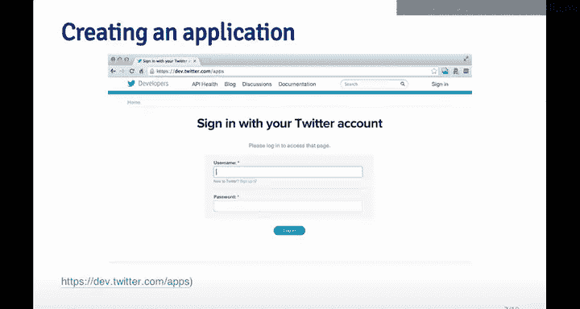

And so what we've done now is we've logged on using our Twitter details and so you can see I'm logged on as simply statistics and what I can do is I can click on this button to create a new application and what that'll do is that'll give me some numbers that I'm going to later use to be able to authenticate the application through R and access data so you can see here I've actually already created an application which I call Simplyimp Sta blog and so if I click on that application then what I'm taken to is a page that looks something like this so you can see this is the application and this is the URL of the application up there and there's some information that I haven't filled in about my organization in my organization's website。

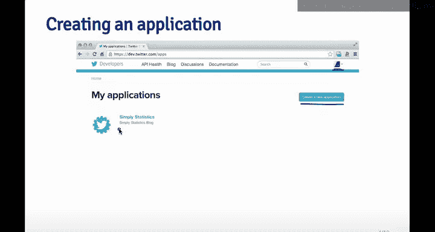

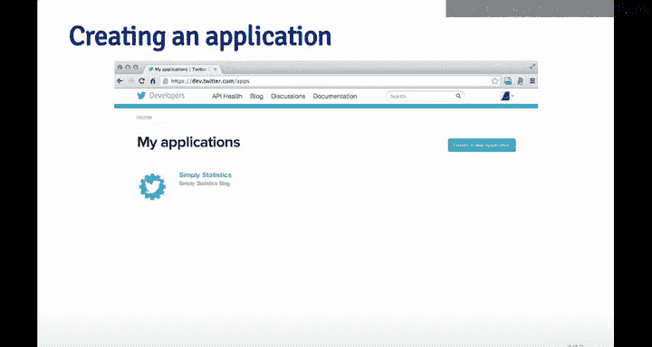

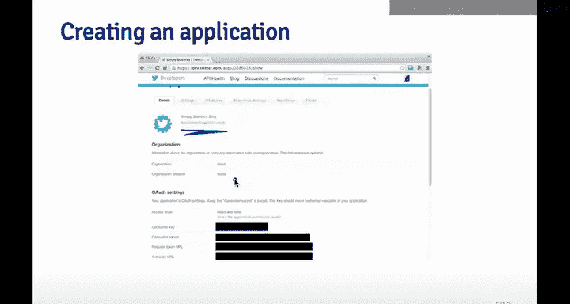

Down here under the OOuth settings， I actually get to see that I have read and write access to the API and then there are a bunch of numbers I black them out here because these numbers are private to you in the application that you built。

 but you'll have a number number for your consumer key， your consumer secret。

 a request token URL and an authorization URL You're going to want to copy down all of those numbers once you've created an application because we're going to use them later in the R code to be able to access the API。

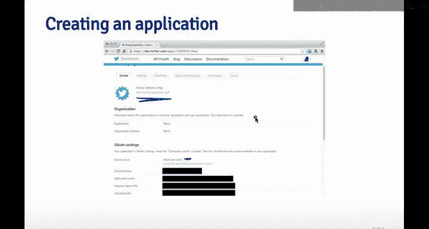

So here's what we're going to do we're going to use the HTR package so we're going to load that package and then we're going to use this command here OO app so what this is going to do is start the authorization process for your application and so what you need to do is you named the application this actually isn't going to get sent to the API this is just for your convenience so I've named it Twitter here because it's going to be the Twitter app。

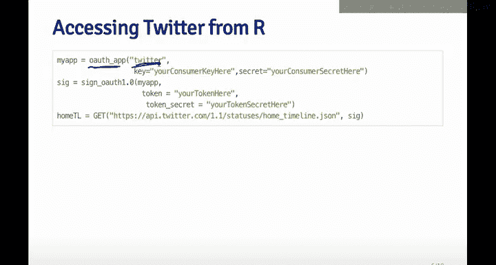

For me， and then I'm going to input here in quotes my consumer key that I got from the application website and I'm going to put my consumer secret here that I got from the application website。

😊。

Then what I'm going to do is take that application and I'm going to sign in and I'm going to sign in using the token here that I collected from the website as well as my token secret that I collected from the website here。

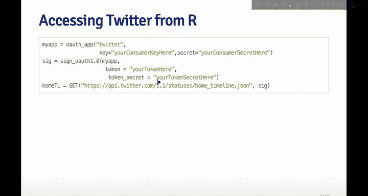

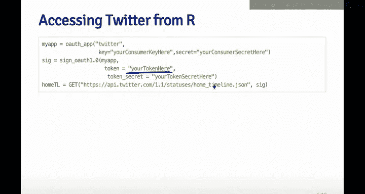

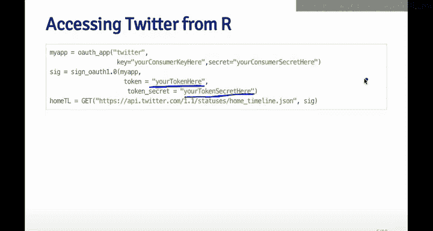

So once I've done this， I've actually sort of created the credentials that will allow me to access data that is privately held by Twitter that's only available to people with an application。

So now what I do is I'm using the get command this is very similar to what I did when I was reading data off the internet and now I'm going to use a very specific URL this is the URL that corresponds to the Twitter API so that's this part of the URL right here This is the version of the API that I'm using 1。

1 which is the current version of the Twitter API I'm going look then I pass it some more components which correspond to which data I'd like to get out so in this case I'd like to get the statuses on my home timeline and I'm going to get it out as a JSON file which is currently the only kind of data supported by Twitter and then I'm going pass it instead of authenticating with a username or a password I'm going pass it the authentication I used with this OOth sign in and so what I'll get back is actually the page that corresponds to this URL which is actually just going to be some JSON data。

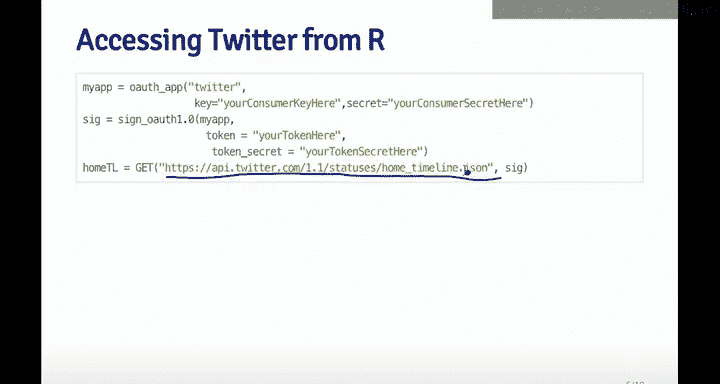

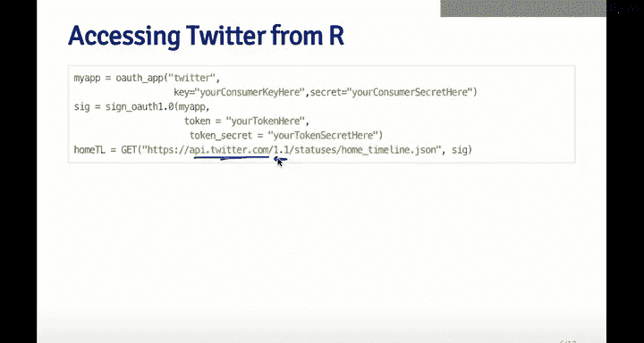

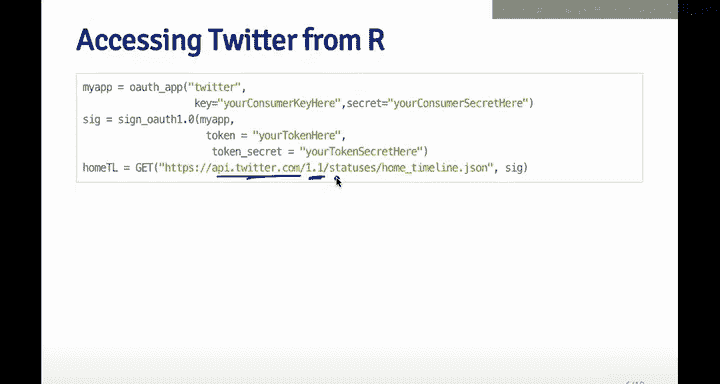

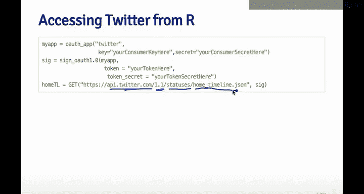

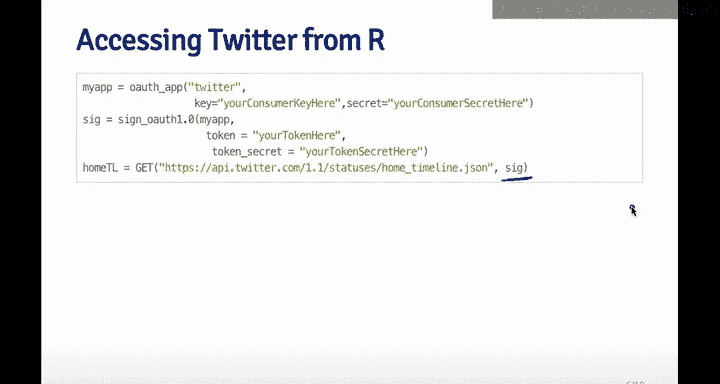

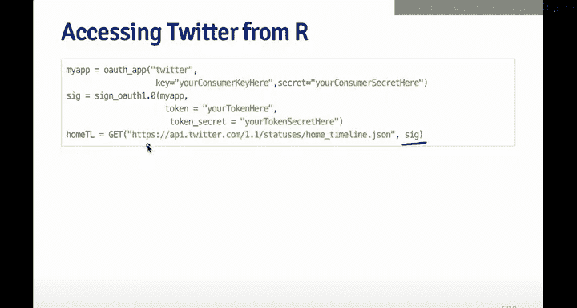

So what I can do is actually use the content function to extract the JSON data so this content function will actually recognize that it's JSON data and create it's going to use the from JSON function from the R JSON IO package so that will return sort of a structured R object which is a little bit hard to read I've found so what I'm going to do is then I'm going to use the JSON Light package to reformat it as a data frame so what I do is I take the JSON structure that I got out from the original command to content and I convert that structure structured R object back into JSON and then I use the JSON Light version of the from JSON argument to create a data frame。

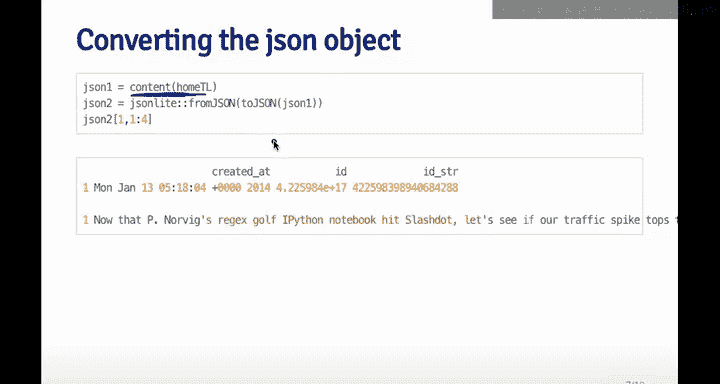

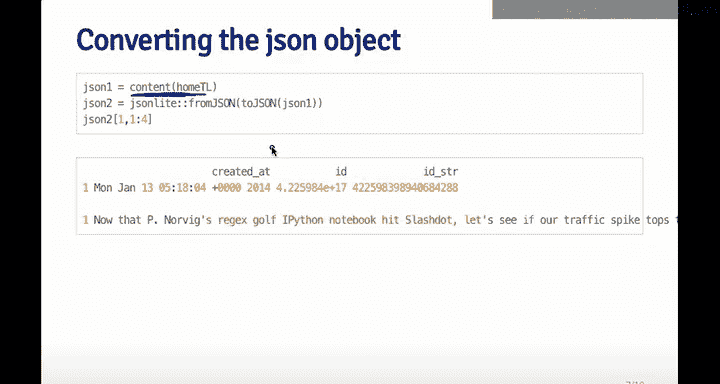

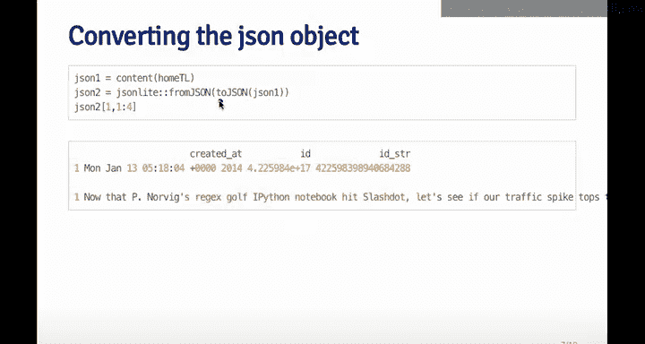

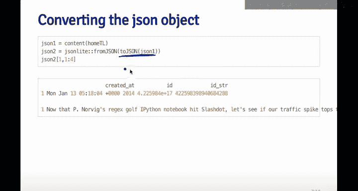

And so what this data frame is now is the data frame where each row corresponds to a tweet in my home timeline and so here you can see I'm going to look at the first row of this data frame。

 which is at the time that I extracted the data the most recent tweet in my home timeline and I'm going to look at the first four columns the first four columns tell me time that the tweet was created the ID number for the tweet。

 the ID string here and then it's actually the text of the tweet so this is the tweet that was the most recent tweet when I collected the data off the internet so you can do this to actually extract information from Twitter this is actually just the request for how do you actually collect information about what's happening on my home timeline but there's a whole bunch of other request that you can do there's a bunch of different data that you can get access to through Twitter and so how did I know what URL to use you actually go into the documentation for the Twitter API so this is the same website as before。

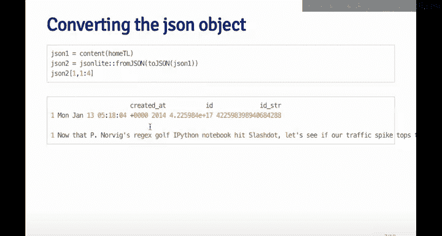

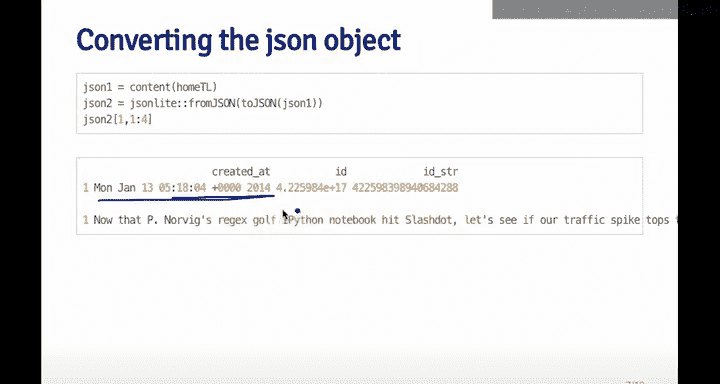

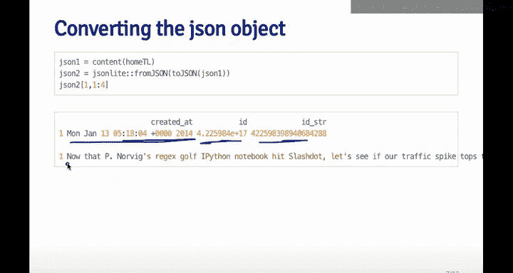

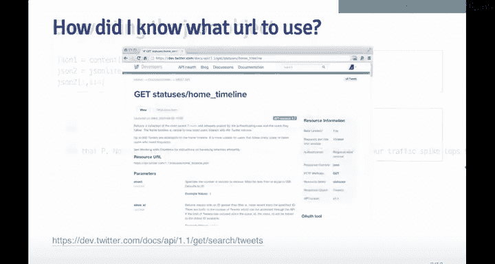

I'm going to look at the Twitter documentation and what I'll get to see is what URL see it says resource URL down here。

 and that's the URL I'm going to be passing to my get command。

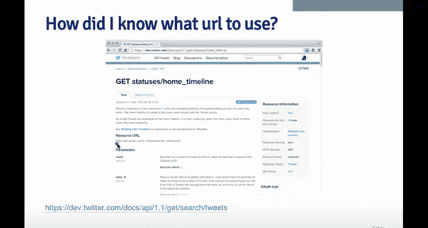

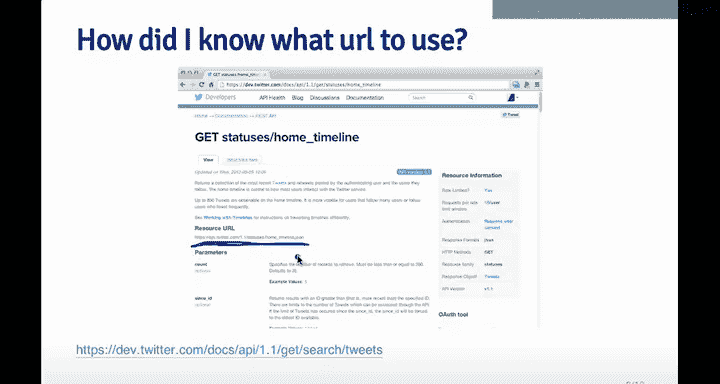

It also has a bunch of parameters down here and so if you look up how to format which parameters to send to an API。

 you can actually send a bunch of different parameters。

 say you can tell it how many tweets to collect and what time to collect it and so forth。

 depending on what URL you're accessing。

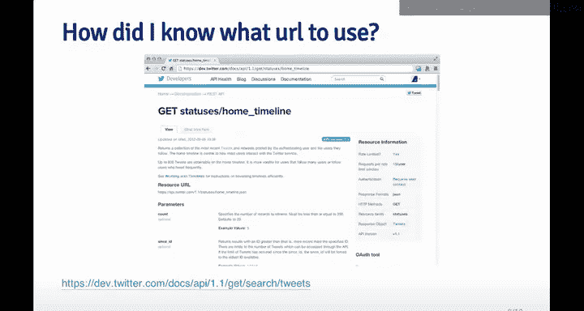

If you want to get other information， not just the information about your home timeline。

 you can actually go to the main Twitter documentation。

 so this is the documentation for the latest version of the API version 1。

1 and it will give you information about getting a bunch of different kinds of information so you can get all sorts of information about just mentions。

 you can get information about the user timeline， you can get information about the home timeline。

 you can get information about retweets， you can download all that information。

 you can also search through the Twitter feeds and get specific tags that you're interested in or hashtags that you might be interested in following。

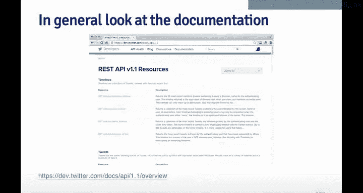

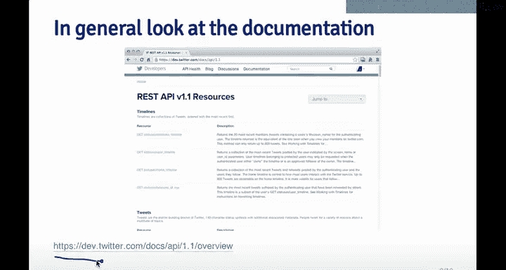

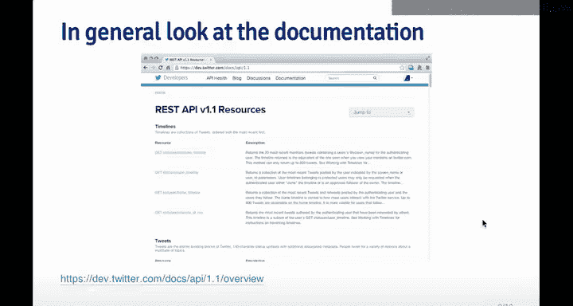

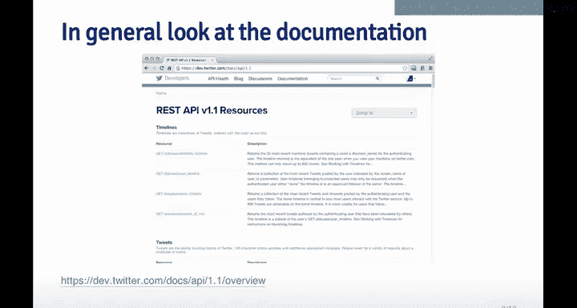

So in general you have to look at the documentation。

 HTR allows get post put delete requests if you are authorized， as you can see。

 I was authorized to read and write particular to the timeline of simply stats because that's who I created the application through。

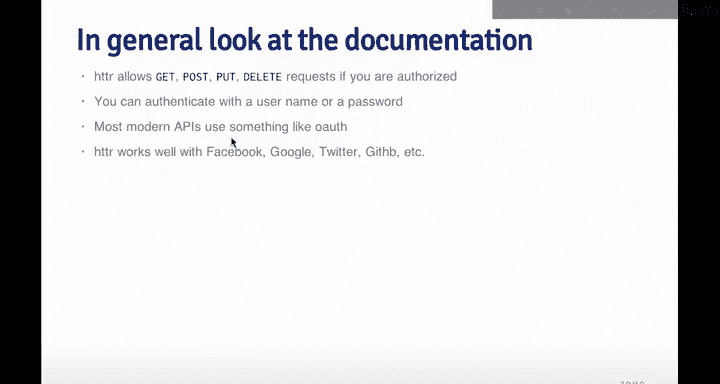

You can also authenticate with a username or a password in some cases， most modern APIs。

 though use something like OOth like we saw just now with Twitter HTTR works well with Facebook。

 Google， Twitter， GiHub and so forth if you go to the HTTR demos component on GiHub you can actually see a bunch of examples of how you access the different APIs for the different websites and that's actually where I modeled this lecture on was the demo for the Twitter API。

